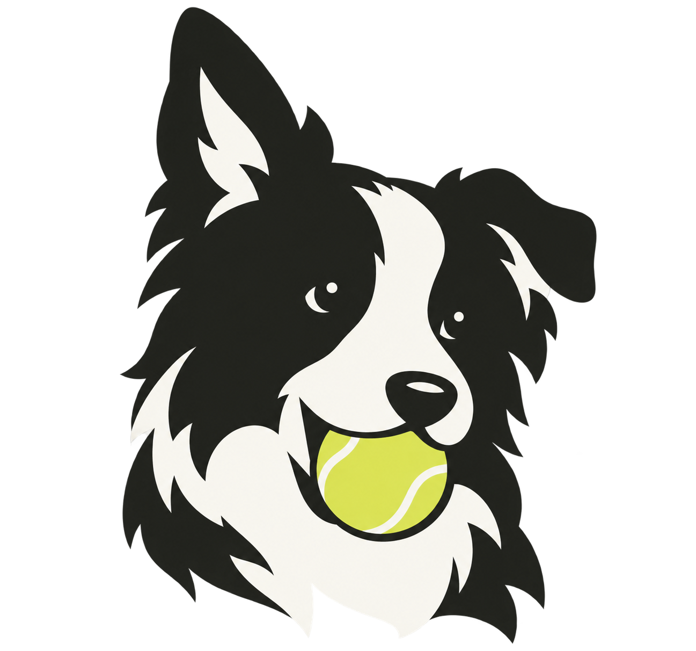

# Collie

[](https://github.com/z-chenhao/collie/actions/workflows/ci.yml)



**Throw me a task. Get a little more life back.**

Collie is your personal agent: a conversation when you need a hand, a capable
worker when you need something done. Give it a question, an idea or a task;
follow the work, approve consequential actions and get a result you can inspect.
Conversation, tools, memory and delegated tasks share one durable execution core.

```sh
make setup
make run
```

The command is `collie`, configuration uses `COLLIE_*`, and the default data
root is `~/.local/share/collie`. [Brand and workspace](docs/features/branding.md).

- [Feature Map: requirements, completion and usage](docs/feature-map.md)
- [Documentation navigation](docs/README.md)
- [Install and start](docs/features/installation.md)
- [Develop and contribute](docs/features/engineering.md)
- [Current architecture and flow](docs/designs/product-overview.md)
- [Product testing](docs/test-plans/product.md)
- [Security and vulnerability reporting](docs/features/operations.md#security-security)

No project-wide license has been selected. Public source availability does not
supply a project-wide open-source license; dependency notices remain with their owners.
