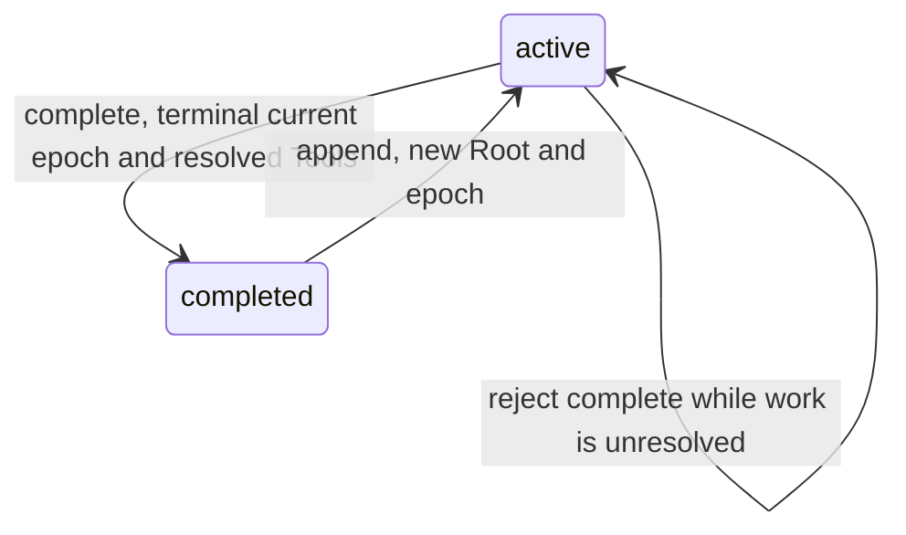

# 006 — Explicit Task completion policy

Status: create policy accepted by the authenticated owner in ERII-225, comment
`01a16954-32dd-7a14-a571-cd8ba4d33ed3`. ERII-226 implements this finite contract.
Explicit completion accepted by the same owner on ERII-226, comment
`01a16b9e-d2ab-7398-b474-cd47164d4022`; it resolves the interface conflict.

## Decision and boundary

Expose optional `completionPolicy: "once" | "ongoing"` only on the existing
Main-only `builtin__task__manage` create arm. Omission keeps `once`. Ordinary
Root success completes a once Task after its final descendant, while ongoing
stays active. Both report the Root result once. Failure and unknown effects
leave either policy active. An ongoing Task without executable work starts no
new Root until append or an existing Automation supplies work.

Persist the choice atomically with Task, immutable anchor, Root, frozen
snapshots, receipt and Outbox. The existing policy trigger prevents later edits.
Append, pause, cancel, owner leases, old-epoch rejection and the single Loop/Tool
pipeline remain the mechanisms. Automation already uses the same ongoing
policy. No new Task state, scheduler, Agent Team or Workflow domain is needed.

The consumer is Main's current Task tool. The schema is a model-visible contract;
storage IDs, policy persistence and Run ownership remain private. No policy
setter or general scheduling configuration is exposed.

## Compatibility

No migration or backfill: schema v9 already added this column, with `once` for
prior Tasks. Empty and historical migrations retain their existing gates.
Explicit once normalizes to omission before request hashing, retaining legacy
invocation/source dedup identity. Ongoing is a different action even when the
brief matches. Invalid, null, duplicate or cross-arm policy fields fail closed.

The registry's v1 Spec format stays v1; the extended schema and description are
frozen into new capability snapshots. Exact Spec selection rejects an older
Main capability as `MODEL_INCOMPATIBLE`; upgrading never replaces a Run's schema.
Drain existing Main Runs with their original binary before upgrading. Stored
results, Task policy, anchors and terminal Runs are not rewritten. New Runs
receive the current schema; existing Worker snapshots have no Task tool.

The approved baseline changes also require an explicit current release-source
binding. Preserve the historical ledger bytes and all 122 review obligations.
The audit/decision entry points bind current source hashes and relocate only
unchanged section/content hashes; changed or ambiguous reviewed text rejects.
New Task clauses remain pending individual review. This inventory maintenance
does not supply release evidence, semantic scores or a release PASS.

## Explicit completion

Extend the same Main-only manage union with `complete` and `taskRef`. Accept
only active Tasks with no nonterminal Root/Child and no queued/running/waiting/
unknown ToolInvocation in the current epoch. This includes unresolved invocations
on already terminal Runs. Reject with non-retryable `INVALID_ARGUMENT`; do not
cancel, drain or wait for work. Paused/completed/cancelled Tasks reject a new
complete action. Paused work must first append and reach an idle active boundary.

Atomically store active → completed, `completed_at`, version +1, the ordinary
source/invocation-deduplicated receipt and control Outbox event. Check Main owner
and Task version/epoch; leave epoch and completion policy unchanged. Late writes
still fail the existing ownership/status/epoch fences. No synthetic Worker
TaskUpdate or Main follow-up is emitted. Once and ongoing use the same operation;
an idle ongoing Task needs it to finish. A later append reactivates completed
work, clears the completion timestamp and creates a new Root/epoch.

`task.ParseManage` owns the strict union. `tools.executeBuiltin` owns validation,
state CAS, receipt and Outbox in one transaction. `fence` rejects stale owners
and Worker writes; append owns reactivation. These are existing mechanisms, with
no new Tool, Task state, scheduler or execution loop.

## Verification

Contract and real SQLite tests cover default/explicit-once dedup, separate ongoing
identity, frozen prior schema rejection, child-tree completion, append, controls,
late writes and immutable policy. `scripts/verify_tasks.py` drives the actual CLI,
reads stored state, kills before/after Task and Root-result commit, restarts and
checks completed-call reuse. Explicit-completion regressions cover both policies,
all rejected state classes, complete/append races, owner fencing, invocation replay
and SIGKILL before/after the completion transaction, without synthetic follow-ups.
Existing five-run control and GC-08 fragment gates remain required. Scripted fixtures prove mechanical behavior, not semantic Golden
Case quality or v1 release acceptance.
