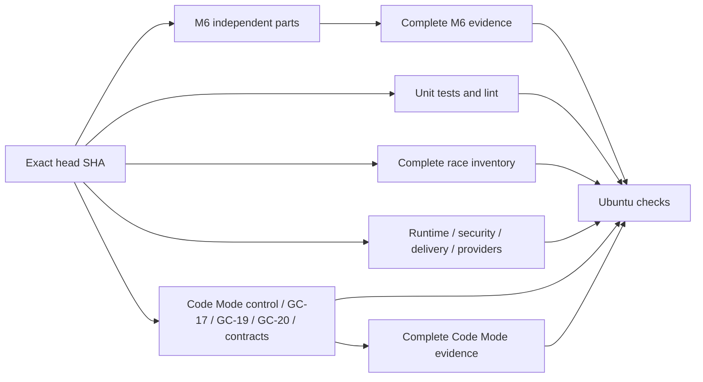

# Offline CI and verification operations

`Ubuntu checks` is the single branch-protection verdict. One workflow runs on
PR heads and main pushes. It always requires unit/lint, race,
every verification matrix cell, every Code Mode/M6 part and both evidence joins.
Missing, skipped, cancelled, failed or unexpected dependencies fail closed.
There is no impact-based omission, early-feedback tier or duplicate shadow
workflow. Every full gate runs for documentation changes too.

The providers shard also requires the native installation/startup gate: source
installation, archive installation, real PTY setup/chat, managed JetStream,
SIGKILL/restart, reinstall and cleanup. It uses the already-populated npm cache
offline and the original Host SDK, preserving the copied public SDK's immutability.
Node is pinned in `.node-version`; frontend dependencies live under `web/`.

The separate `Native packages` workflow runs only on manual invocation or version
tags. It builds Linux/macOS native archives with the same installer, retains
checksums, and creates an unpublished draft for tags. It neither replaces nor
weakens `Ubuntu checks`. No release is published by an ordinary PR.



Each Required job independently installs pinned dependencies, provisions the
public fixture SDK and builds from its exact checked-out source. A small
project-local composite action owns those mechanics. There is no long test or
producer prerequisite. No executable crosses runner boundaries: GitHub image
rollouts can assign different Ubuntu image versions within one workflow.
The retained historical build-bundle utility still rejects image/context drift;
its guards were not relaxed. The new pipeline avoids that reuse entirely.
All actions are pinned. Checkouts use the explicit PR head SHA; the workflow
SHA may identify GitHub's synthetic merge commit.
Strict main ancestry and independent exact-SHA reviewer PASS remain required.
The workflow never changes protection or enables an administrative bypass.
Unit/lint retains its ordinary Python execution and additionally runs all Python
regressions on Python 3.10.22, the minimum supported interpreter series. This
Required step guards portable SDK hashing and the maintained profiling tools.

Providers and the complete race job use private 2 GiB tmpfs mounts for disposable
test directories, through `ci_tmpfs.py setup/cleanup`. The full unit/lint suite,
all five SC race rounds and every verification job except providers keep ordinary
disk storage. Unit/lint also requires five disk-backed receipt recovery race runs.
Every migration, crash/restart and receipt test retains disk coverage. Provider
commands, race flags/counts, SQLite WAL/sync policy and assertions are preserved.
This targets runner disk-wait variance without
claiming a host power-loss test. The mount Doctor proves executable files,
fsync, WAL commit/reopen, capacity, owner and mount identity. Cleanup runs even
after failure, restores TMPDIR, refuses unknown mounts and force/lazy unmount,
and fails on leaked state, a missing verified mount or an unsuccessful unmount.
The exact-SHA `fixture-storage.json` receipt accompanies provider and race evidence.
Other jobs record the ordinary block filesystem from `findmnt`; unknown or RAM
storage rejects their disk-conformance claim before tests start.

## Latency budget

All CI uses a ten-minute baseline from workflow creation through the final
required verdict, with a five-minute target. Queue and dependency waits count
in observed workflow wall time. Every job has an explicit timeout of at most
ten minutes; the topology regression rejects missing or larger timeouts in any
workflow. A job timeout is a stop boundary, not proof of end-to-end latency.
Record actual exact-SHA timings with `ci_profile.py`; treat any workflow over
ten minutes as a regression to diagnose before review. Do not remove coverage,
reduce repetitions, extend fixture deadlines, or retry failures to meet it.

M6 reuses the existing `fixture_pool.py` with capacity four. Travel fixtures
keep capacity two in a separate admission group because each drives Main and a
held Root concurrently; they do not overlap ordinary CLI/browser fixtures. Each variant owns
its database, peer ports, browser, approvals and Artifact export directory.
Process sessions belong to the pool and cancellation joins them. All 66 locked
variants (including six separate red-flag branches) finish before the next of
five consecutive rounds starts. Lightweight progress records avoid rewriting
the growing full state report after every variant; full evidence is written
once on join or failure, using the compact JSON encoder to retain every field
without Python-level indentation overhead. This is private harness scheduling, with no runtime
protocol or production concurrency change. Serial execution remains available
for diagnosis. Increase runner partitioning only when measured contention or
latency justifies it; keep the bounded pool and the same strict aggregate.

Ubuntu evidence on `1eff344` measured about 259 seconds per complete M6 round;
the ten-minute job budget stopped the third round. Local rounds on the macOS
host took about 72 seconds and did not predict this Linux CPU-bound result.
CI therefore uses seven independent M6 parts: context, memory, network, booking,
and three pairs of GC-18 variants. All eighteen primary matrix jobs can start
independently; no binary producer or preceding test gates their admission.
Each pair retains its complete five-run series on one runner. The fixed pair
inventory is private to `m6_report.PARTS`, not a new product protocol.

`ci_personal.py` rejects missing/duplicate/reordered rounds, wrong variant pairs,
failed assertions, invented scores, cleanup failures, dirty or unstable source,
and source/binary/driver/dataset/lock drift. It reconstructs all five canonical
66-variant reports and calls the same `m6_report.aggregate/write` as the local
unpartitioned path. No partial part can satisfy `Ubuntu checks`; both the matrix
and its join are mandatory. Part artifacts retain original state and openable
bytes, while the join retains canonical reports and the aggregate. Browser
installation is needed only by network/booking/desktop parts. M6 prepares the existing Linux sandbox for configured MCP peers, including
read-only context/Memory fixtures. Unit/SC/GC-19 retain the coding workspace
checks. All M6 fixtures remain disk-backed.

## Complete inventory

`scripts/verify_suite.py` is the authoritative logical inventory (105 gate
invocations, including all five Computer lifecycle and Computer Use runs).

| Logical shard | Required evidence |
| --- | --- |
| runtime | Foundation, Main, Tasks; five Child/scheduling/spend/task-control runs; Main/Task fragments; embedded JetStream and real CLI relay |
| codemode | Five Code Mode, Computer lifecycle, Computer Use and fixed-source recovery runs; six variants × five rounds for each GC-17/19/20; five SC conformance and real nested cancellation probes |
| security | Five memory-maintenance, recall, Tool approval/recovery and Artifact runs |
| delivery | Five complete delivery runs, each containing all twenty kill/restart boundaries |
| personal | Eleven exact M6 worlds × six variants × five rounds, plus isolated red-flag routing; all state, openable Artifacts and cleanup |
| providers | Local provider, initial account; five capability/TUI/Pi Bridge/account runs; terminal input; five selected Go model/storage runs |

Each series retains five serial consecutive repetitions on its own worker. Code
Mode now has five independent Required parts: `control` (Code Mode, Computer,
Computer Use and recovery), `GC-17`, `GC-19`, `GC-20` and `contracts` (SC plus real nested CI
cancellation). Each case part runs all six locked variants five times. Contracts
also run five times; splitting cases cannot omit them.

SC conformance partitions its unchanged root-test inventory within each round,
using the existing `ci_race` CPU budget/partition helpers and `fixture_pool`
process ownership. At most four workers each receive one CPU and one Go package
slot; each root runs exactly once with `-race -count=1` and the original
300-second command deadline. The unchanged event judge rejects missing,
duplicate, skipped or failed roots. Every worker joins before the real nested
cancellation probe and the next serial round. All five rounds remain disk-backed.
This addresses the measured M7 Ubuntu run where SC took about 91 seconds per
warm round and the ten-minute job limit cancelled the fifth cancellation probe.
The job limit and the probe's readiness/cleanup deadlines remain unchanged.

`ci_codemode.py` requires every part and round, successful owned-process cleanup,
clean stable source, identical source/build/fixture identities. Every part records its runner image;
independent builds may join across a host image rollout only if binary hashes
and fixtures still match.
It rejects duplicate, reordered, failed or missing rounds and misplaced variants.
It reconstructs the original eighteen-variant Core reports and uses the unchanged
`core_report.aggregate` / `write` verdict. The resulting logical Code Mode report
contains the complete twenty-five gate rows. All ninety case executions and five SC
and cancellation proofs remain inspectable. Unit regressions mutate each of
these acceptance boundaries. No partial job independently proves Code Mode.

Independent fixture capacity is four; GC-17 checkpoint variants retain capacity
two. Local unpartitioned Core runs join case kinds in order. Part jobs use
separate runners. Gate-series concurrency is two, with Go event/model checks
isolated after other work. The complete race runner isolates Bridge first. It discovers SQLite's complete
Go Test/Example/Fuzz inventory. The Child approval contract whose original
five-second context spans three Drain/decision phases runs alone with the full
CPU budget before overlap. All remaining top-level tests run exactly once in up
to three separate processes. Each test retains its own Store/temp root, complete
subtests and internal concurrency; process-local globals and environment remain
isolated. A fourth worker runs the other packages with package concurrency one.
All workers use GOMAXPROCS=1; admission respects the parent/affinity limit and a
four-CPU ceiling. Race instrumentation, count=1 and the 15-minute Go timeout
remain required. Go JSON verdicts reject missing, duplicate, unexpected, failed
or unfinished test roots. All fifty logical packages remain in the same Required
race job; discovery automatically includes new tests. Per-worker commands,
CPU/wall, test outcomes and cleanup remain in `race/inventory.json` and logs.
No assertion, test count, lease, per-case deadline or fault boundary is relaxed.

## Launch, doctor, drive, evidence and cleanup

Install the versions and pinned dependencies from [development.md](development.md).
Linux coding tests need bubblewrap and enabled unprivileged user namespaces;
CI configures these on its disposable runner. The unit/lint job installs the
pinned Chromium binary/system dependencies, then runs the actual Browser fixture
with no external website. The providers shard, unit and race
jobs exercise the real coding sandbox. No live account, network provider,
desktop, installed NATS service or fixed port is needed after dependency setup.

```sh
make test lint
make test-race
make verify
make verify VERIFY_JOBS=1 VERIFY_EVIDENCE=evidence/serial
make verify VERIFY_SHARD=codemode VERIFY_EVIDENCE=evidence/codemode
python3 scripts/verify_suite.py --shard codemode --codemode-part GC-17 --binary bin/erii --evidence evidence/parts/GC-17 --jobs 1
# Run the other four parts into their own folders, then require all five:
python3 scripts/ci_codemode.py --parts evidence/parts --evidence evidence/joined
python3 scripts/verify_suite.py --shard personal --personal-part desktop-1 --binary bin/erii --evidence evidence/m6-parts/desktop-1 --jobs 1
# Run the other six fixed parts in their own folders, then require all seven:
python3 scripts/ci_personal.py --parts evidence/m6-parts --evidence evidence/m6-joined
python3 -m unittest discover -s scripts -p 'test_*.py'
```

`make verify` retains the complete six-shard local path. Partial CLI runs prove
only their selected work. Never share an evidence directory between concurrent
commands. Harnesses launch isolated fixtures, doctor prerequisites, drive the
real CLI/API, read back persisted state and clean owned processes and state.
Computer offline lifecycle evidence does not establish live Lume compatibility.

Each Required job retains SHA/attempt-named artifacts for fourteen days, even
on failure. `suite-*.json` binds source, binary, runner and every invocation;
`timings-*.json` updates after each attempt; `profiles/` records scenario/function
and CPU/wall timings. Individual part artifacts keep the original reports.
The join retains canonical `core-cases-1…5.json` / `core-summary.json` and its
phase log/metrics without uploading the raw part payloads a second time.
Semantic Judge scores remain ungraded; deterministic fragments do not establish
full Golden Case or L2 scores.

Superseded pushes cancel the same PR's old workflow. Shell `exec` gives the
phase owner the Actions entry signal. `ci_step.py` records first receipt;
`fixture_pool.py` stops admission, signals only owned groups, joins children and
removes temporary roots. Escalation leaves time before Actions' hard stop.
The profiler accepts the first termination notification and ignores repeats
while finally blocks unwind; Make and the group owner may both deliver signals.
The controlled repeated-signal regression holds cleanup, signals again, then
requires state removal and the original exit code after release.
Real held Core/PTY/listening-child probes cover cleanup and unrelated-process
preservation. SIGKILL itself cannot unwind Python; disposable VM teardown is
the final boundary. Local cleanup latency is distinct from GitHub push-to-stop.

## Schema and build integrity

Fresh state stores execute the generated version-21 `schema.sql` baseline and any later migrations, removing
repeated historical ALTER parsing. Historical migrations remain authoritative
for existing databases and upgrades. Schema creation, version and later migrations
share one immediate transaction. The generated SQL binds the historical scripts'
digest; drift fails closed. Regenerate after a deliberate snapshot update:

```sh
go test ./internal/agent/sqlite -run '^TestFreshSchemaSnapshotMatchesHistory$' -args -update-state-schema
go test -race ./internal/agent/sqlite -run '^TestFreshSchema' -count=1
```

Equivalence covers every table/index/trigger and empty initial data. Existing
upgrade tests remain. Failure rolls back; real child kills before/after commit
prove restart/version/bootstrap behavior. Fixture tests still enter the public
store boundary and initialize real databases.

Setup-go/npm caches retain their pinned content-addressed input keys. Every job
still installs lockfiles and builds its own CLI. Full Go test counts remain
explicit. Historical `ci_bundle.py` v2 and its corruption/context regressions
remain available for old evidence; the current workflow does not consume build
artifacts or Host cache artifacts from another runner.

`ci_sdk.py` copies the installed SDK without modifying it. Only the fixed public
standard-library closure is precompiled offline into that copy. Its receipt and
Doctor bind original/compiler/tree bytes and frozen source. All jobs check
immutability afterward. The mandatory SDK conformance test proves denied SDK
mutation and sibling reads plus execution of an uncached standard package.
Each product workspace still receives its own private writable cache; the Host
cache is never mounted into the sandbox.

## Measurement and remaining proof

Use `ci_profile.py --limit 30 --output evidence/ci-history.json` for exact-attempt
wall time, runner-minutes and per-job/step evidence. Its raw API snapshots permit
offline reproduction. Job duration is not billed CPU time. Queues, cache state
and heterogeneous runner CPUs add noise; one successful run cannot establish
p95 or a controlled causal speedup. Historical read-only comparison tools retain
their strict five-pair acceptance rules, but no repeated measurement cohort is
part of the delivery path. Supersession records never treat unknown outcomes or
missing timestamps as zero.

For the current topology, `ci_supersede.py collect` requires exactly one
`ci.yml` attempt for the superseded head. It rejects duplicate/unknown workflows,
missing source or completion proof and unknown push outcomes. It no longer
requires the retired shadow workflow. Use an already recorded authorized push;
collection does not trigger or repeat any workflow:

```sh
python3 scripts/ci_supersede.py collect --push-record evidence/push.json --run RUN_ID:ATTEMPT --output evidence/supersession.json
```

The controlled local schema sample (same M4 Max, GOMAXPROCS=4, same eighteen
variants and SC/cancellation probes) reduced one Core round from 142.4293 to
119.7031 seconds and one replay race test from 12.529 to 6.582 seconds. This
single sample preceded the Computer migration merge and is not a whole-CI or
p95 claim. Actual final-head workflow results are recorded in the PR/issue.
The ten-minute objective concerns full `Ubuntu checks`, including setup and
join, rather than an early subset. A miss remains a miss and keeps the PR Draft.

## Failure and rollback

Keep the PR Draft when a part, join or complete gate fails. Inspect its retained
attempt; do not rerun a failed sample to obtain a green measurement. The local
fallback is the unchanged `make verify VERIFY_SHARD=codemode` full path.
If partitioning must be rolled back, restore that complete Code Mode job to the
Required matrix and change the aggregate dependencies in the same reviewed
commit. Never make the join optional before full coverage replaces it.
The schema fast path can be removed without downgrading stored versions:
existing historical migrations still define the same version 21 format.

Artifact recovery's exact-receipt success fixture uses Go's test virtual clock,
retaining the frozen 100ms policy rather than spending it on host scheduling or
filesystem latency. A separate deterministic expiry test consumes that exact
budget, proves unknown/no Artifact/no second effect, then verifies a fresh
authoritative query. The existing real deadline, cancellation, unsafe receipt,
identity and byte/hash assertions remain required. Preserve failed full-suite
evidence; passing focused diagnostics alone do not supersede it.
