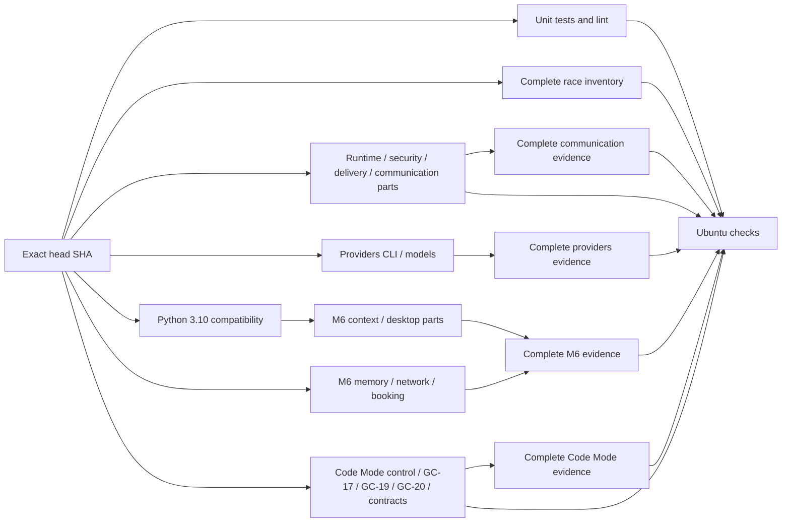

# Offline CI and verification operations

`Ubuntu checks` is the single branch-protection verdict. One workflow runs on
PR heads and main pushes. It always requires unit/lint, race,
every verification matrix cell, every providers/Code Mode/M6 part and all evidence joins.
Missing, skipped, cancelled, failed or unexpected dependencies fail closed.
There is no impact-based omission, early-feedback tier or duplicate shadow
workflow. Every full gate runs for documentation changes too.

The providers shard also requires the native installation/startup gate: source
installation, archive installation, real PTY setup/chat, managed JetStream,
SIGKILL/restart, reinstall and cleanup. It uses the already-populated npm cache
offline and the original Host SDK, preserving the copied public SDK's immutability.
Node is pinned in `.node-version`; frontend dependencies live under `web/`.

The separate `Native packages` workflow runs only on manual invocation or version
tags. It builds Linux/macOS native archives with the same installer, retains
checksums, and creates an unpublished draft for tags. It neither replaces nor
weakens `Ubuntu checks`. No release is published by an ordinary PR.



Each Required job independently installs its pinned runtime dependencies, provisions the
public fixture SDK and builds from its exact checked-out source. A small
project-local composite action owns those mechanics. Its disposable Ubuntu runner
uses the official HTTPS archive mirror for APT downloads. The Azure mirror
repeatedly took 8–9 minutes to install browser prerequisites (one retained run
fetched 25.9 MB in 7m48s), exhausting the ten-minute job limit before checks could
finish. Package selection, browser installation and job limits are unchanged.
Long gates start without a test or build prerequisite. Four shorter M6 cells
wait for Python compatibility to bound initial admission. No executable crosses runner boundaries: GitHub image
rollouts can assign different Ubuntu image versions within one workflow.
The retained historical build-bundle utility still rejects image/context drift;
its guards were not relaxed. The new pipeline avoids that reuse entirely.
Frontend build/TypeScript dependencies install only in unit/lint. Playwright
installs only in unit/lint, delivery and the five Browser-using M6 parts. Pi and
QuickJS still install everywhere, including providers' offline packaging gate.
Across the execution jobs only unit/lint installs frontend dependencies;
seven jobs install Playwright. Lockfile inputs, per-job exact-source builds, every
assertion and repetition count remain unchanged. Clean-runner complete CI is the
dependency-closure proof; install counts alone are not wall-time measurements.
All actions are pinned. Checkouts use the explicit PR head SHA; the workflow
SHA may identify GitHub's synthetic merge commit.
Strict main ancestry and independent exact-SHA reviewer PASS remain required.
The workflow never changes protection or enables an administrative bypass.
Unit/lint retains its ordinary Python execution and additionally runs all Python
regressions on Python 3.10.22, the minimum supported interpreter series. This
Required step guards portable SDK hashing and the maintained profiling tools.

Both providers parts and the complete race job use private 2 GiB tmpfs mounts for disposable
test directories, through `ci_tmpfs.py setup/cleanup`. The full unit/lint suite,
all five SC race rounds and every verification job except providers keep ordinary
disk storage. The packages race runner also requires five disk-backed receipt
recovery race runs after tmpfs cleanup restores TMPDIR. A separate disk Doctor
receipt proves ordinary block storage without overwriting the tmpfs cleanup
receipt. The original command/count reuses that runner's race compiler cache;
test processes, stores and temporary roots remain independent. SDK Doctor runs
after both test phases, including on failure.
Every migration, crash/restart and receipt test retains disk coverage. Provider
commands, race flags/counts, SQLite WAL/sync policy and assertions are preserved.
This targets runner disk-wait variance without
claiming a host power-loss test. The mount Doctor proves executable files,
fsync, WAL commit/reopen, capacity, owner and mount identity. Cleanup runs even
after failure, restores TMPDIR, refuses unknown mounts and force/lazy unmount,
and fails on leaked state, a missing verified mount or an unsuccessful unmount.
The exact-SHA `fixture-storage.json` receipt accompanies provider and race evidence.
Other jobs record the ordinary block filesystem from `findmnt`; unknown or RAM
storage rejects their disk-conformance claim before tests start.

## Latency budget

The complete Python 3.10.22 compatibility suite runs in its own Required job and
isolated exact-head checkout, alongside unit/lint and packages' five disk-backed
receipt race checks. [Run 40055562322](https://github.com/z-chenhao/erii/actions/runs/40055562322)
passed unit/lint, receipt race and SDK isolation, then cancelled Python compatibility
at the ten-minute job boundary. Splitting that existing full suite removes the
serial accumulation; no test, repetition or job deadline is reduced or extended.
The Python job installs only the pinned Browser module used by setup rejection
contracts, not a browser binary or product runtime. Its separate exact-SHA evidence
is retained, and a failed, cancelled, skipped or missing compatibility job rejects
the stable `Ubuntu checks` gate.

All CI uses a ten-minute baseline from workflow creation through the final
required verdict, with a five-minute target. Queue and dependency waits count
in observed workflow wall time. Every job has an explicit timeout. The default ceiling is ten minutes;
Fast, Race and Delivery have explicit fifteen-minute ceilings, including cleanup.
The topology regression rejects missing timeouts and exceptions outside those
three jobs. A job timeout is a stop boundary, not proof of end-to-end latency.
Record actual exact-SHA timings with `ci_profile.py`; treat any workflow over
ten minutes as a regression to diagnose before review. Do not remove coverage,
reduce repetitions, extend fixture deadlines, or retry failures to meet it.

Providers uses two Required parts, `cli` and `models`, with the unchanged
logical inventory in `verify_suite.SHARDS`. The CLI part keeps startup, unscripted,
local provider, initial account, capabilities ×5, TUI ×5, terminal input, Pi Bridge ×5
and account ×5. The models part runs the original `go test -count=5 -json
./internal/llm/... ./internal/agent/sqlite` alone. Both provision their own SDK,
sandbox and private tmpfs; their SDK Doctor and exact fixture cleanup run through
`ci_step.py --phase cleanup`, even after failure. Setup/build/test/cleanup receipts
and native upload/post timestamps account for the whole job, not just verification.

This addresses run `40096934203`, attempt 1, source
`86abfa7efdac7bfee5f873c9a698d7cd25871aa4`, providers job `120881046698`:
verification returned zero after 540.74190803 seconds, but the job was cancelled
for exceeding 10 minutes. Native timestamps show 59 seconds from job start to
test-step start, 541 seconds for that step, then 8 seconds through Doctor,
cleanup, upload/post and job completion (608 seconds total; native timestamps
have one-second precision). A successful test step did not satisfy the job.
Splitting the already-isolated Go series removes it from the CLI critical path;
it adds one independent setup and a small evidence join, without raising timeouts.
This is a budget repair, not a measured p95 or runner-cost improvement.

`ci_providers.py` requires both clean, stable, matching source/binary/workflow
identities, exact gate/attempt inventories in serial order and drained owned
groups. Missing, duplicate, reordered, failed or focused evidence rejects the
join. The Required aggregate also requires both matrix success (including SDK
Doctor/cleanup/upload) and the join. The joined `suite-providers.json` restores
the original logical order and retains both part identities/timings. Individual
artifacts retain raw reports; the join uploads only its canonical suite and phase
receipt. `make verify` keeps its complete unpartitioned providers path.

## Communication budget and evidence

Run [40166371506](https://github.com/z-chenhao/erii/actions/runs/40166371506),
source `7a3c05e13f9e23f1995dca80ff4da1dd47bf1ce2`, completed every required
check but took 665 seconds overall. Communication's three jobs took
432/415/340 seconds including setup and teardown, and its join finished 443
seconds after workflow creation. The remaining critical paths were unit/lint
(654 seconds, including 189 seconds of cold receipt race compilation/execution)
and Code Mode control (262 seconds waiting, then 380 seconds running).
Those observations remain historical evidence, not acceptance for a newer SHA.

The five receipt recovery race checks now follow the existing packages race
job, after verified tmpfs cleanup and a separate disk-conformance receipt.
The M6 matrix is placed in two Required jobs without changing its seven cells:
memory/network/booking start immediately; context and the three desktop parts
wait for the independent Python compatibility job. This admits exactly twenty
execution cells initially, giving all long Code Mode cells an initial slot
under the observed twenty-runner capacity without relying on matrix order or
buying capacity. Each delayed cell still performs its own exact-source build,
setup, original repetitions, Doctor and upload. The M6 join and Ubuntu checks
require both groups; failed compatibility skips dependent cells and fails the
aggregate. Queue/setup/join time still counts toward the unchanged 600-second
whole-workflow objective. Only a new complete exact-SHA attempt proves that bound.

Communication keeps the complete logical inventory in `verify_suite.SHARDS` and
uses three Required matrix cells: `gc01`, `gc02`, and `channels`. The first two
run the original health/goals commands, each retaining six independent variants
and five serial repetitions per variant. `channels` keeps GC-12 ×5 and GC-08,
GC-14 and GC-16 once each, with the original two gate workers. This changes
placement only: fixture inputs, oracles, Host limits, approvals, deadlines,
fault injection, state isolation and cleanup remain unchanged. Every cell keeps
the ten-minute job timeout, its own locked setup/build, disk fixtures, sandbox,
SDK Doctor and exact-head checkout. `make verify VERIFY_SHARD=communication`
retains the complete unpartitioned local path and original bounded queue.

Run [40164000101](https://github.com/z-chenhao/erii/actions/runs/40164000101),
source `2354a4d7a8f82aec844232d600a473feb2cd2d3f`, exhausted the communication
job's ten-minute limit. Native timestamps show 75 seconds before verification;
GC-12's five rounds took 282.90 seconds, GC-01 took 438.50 seconds, and GC-02
then shared the remaining slots with short gates. GC-02 and GC-14 returned 130
when the outer job stopped; GC-16 had no completed evidence. SDK Doctor took
four seconds and evidence upload took ten seconds; job completion followed at
05:12:56Z. These are budget-cancellation observations, not product assertion failures or Case scores.
Splitting the independent long series removes their accumulated queue delay;
complete exact-SHA job results, including setup and teardown, establish the
remaining budget rather than successful test-step times alone.

`ci_communication.py collect` reopens the native reports and invokes their
existing validators before writing a compact `communication-receipts.json`.
It retains exact variant/repetition order, recomputed assertion results, cleanup,
native file size/hash, source/binary/workflow identity and all tracked evaluation
file hashes. Source, fixture and executable bytes must stay fixed throughout
validation. GC-02's existing manifest is resolved and hash-checked locally.
The raw reports stay in the producer's evidence directory; CI uploads the small
manifest, source-bound suite, timings, profiles and phase receipts. Keep native
local bytes in the durable evidence root for independent review; a manifest
without them cannot independently certify a Golden Case or release.

`Complete communication evidence` requires the entire verification matrix to
succeed, including Doctor and upload, then joins exactly the three parts.
It checks the current clean checkout, manifest/suite hashes, matching identities,
frozen evaluation hashes, all original gate attempts and variant repetitions,
true assertions and complete cleanup. Missing, duplicate, reordered, failed,
cancelled, focused or drifted inputs fail closed. Both that join and the matrix
are required by `Ubuntu checks`. Failed collection/join clears any prior success.
The joined `suite-communication.json` restores the original logical order and
retains each part's manifest; no native payload or semantic grade is invented.

```sh
ERII_VERIFY_GATE_JOBS=2 python3 scripts/verify_suite.py --shard communication --communication-part gc01 --binary bin/erii --evidence evidence/communication-parts/gc01 --jobs 1
python3 scripts/ci_communication.py collect --part gc01 --binary bin/erii --evidence evidence/communication-parts/gc01
# Repeat these two commands for gc02 and channels, each with its own directory.
python3 scripts/ci_communication.py join --parts evidence/communication-parts --evidence evidence/communication-joined
```

## M6 scheduling

M6 reuses the existing `fixture_pool.py` with capacity four. Travel fixtures
keep capacity two in a separate admission group because each drives Main and a
held Root concurrently; they do not overlap ordinary CLI/browser fixtures. Each variant owns
its database, peer ports, browser, approvals and Artifact export directory.
Process sessions belong to the pool and cancellation joins them. All 66 locked
variants (including six separate red-flag branches) finish before the next of
five consecutive rounds starts. Lightweight progress records avoid rewriting
the growing full state report after every variant; full evidence is written
once on join or failure, using the compact JSON encoder to retain every field
without Python-level indentation overhead. This is private harness scheduling, with no runtime
protocol or production concurrency change. Serial execution remains available
for diagnosis. Increase runner partitioning only when measured contention or
latency justifies it; keep the bounded pool and the same strict aggregate.

Ubuntu evidence on `1eff344` measured about 259 seconds per complete M6 round;
the ten-minute job budget stopped the third round. Local rounds on the macOS
host took about 72 seconds and did not predict this Linux CPU-bound result.
CI therefore uses seven independent M6 parts: context, memory, network, booking,
and three pairs of GC-18 variants. All twenty-two primary execution jobs can start
independently; no binary producer or preceding test gates their admission.
Each pair retains its complete five-run series on one runner. The fixed pair
inventory is private to `m6_report.PARTS`, not a new product protocol.

`ci_personal.py` rejects missing/duplicate/reordered rounds, wrong variant pairs,
failed assertions, invented scores, cleanup failures, dirty or unstable source,
and source/binary/driver/dataset/lock drift. It reconstructs all five canonical
66-variant reports and calls the same `m6_report.aggregate/write` as the local
unpartitioned path. No partial part can satisfy `Ubuntu checks`; both the matrix
and its join are mandatory. Part artifacts retain original state and openable
bytes, while the join retains canonical reports and the aggregate. Browser
installation is needed only by network/booking/desktop parts. M6 prepares the existing Linux sandbox for configured MCP peers, including
read-only context/Memory fixtures. Unit/SC/GC-19 retain the coding workspace
checks. All M6 fixtures remain disk-backed.

## Complete inventory

Delivery now honors the same `ERII_VERIFY_GATE_JOBS=2` setting as the other
eligible shards. On ERII-30 head `6a837f4`, all ten delivery/channel rounds
passed, but the shard spent 517.6 seconds serially running the two series;
setup and evidence retention took the job past its unchanged ten-minute ceiling.
The old dispatch allowlist silently excluded delivery. The existing bounded
two-worker executor now overlaps these independent series. Each series retains
five consecutive rounds, its original timeouts/assertions and separate report
paths. No production concurrency, fixture storage or job budget changes.
`test_delivery_two_series_overlap_without_splitting_five_rounds` uses two real
owned subprocesses with mutual admission barriers; it fails under the old
serial dispatch and checks all ten canonical rows, per-series order and drained
groups. Actual Web/Feishu/PTY, approval/restart and slow-send lease checks remain
mandatory in every CI round. A successful run demonstrates capacity for that
runner; it is not a controlled long-term performance claim.

Communication also honors that existing two-worker pool. On ERII-247 head
`e413acf`, [run 40156918081](https://github.com/z-chenhao/erii/actions/runs/40156918081)
completed all five GC-12 rounds (about 266 seconds) and GC-08/14/16 (about 144
seconds), then the unchanged ten-minute job boundary cancelled GC-01 after 131
seconds. GC-01 now starts first alongside GC-12; the remaining independent gates
use the same bounded workers. Every gate owns distinct reports and disposable
state, and retains its original assertions, repetitions, fixture deadlines and
cleanup. The real-subprocess admission-barrier regression rejects serial
dispatch, delayed admission of the long pair, missing/reordered rounds and
undrained groups. This fixes scheduling; only successful exact-head CI can prove
that the complete shard fits the existing job budget.

`scripts/verify_suite.py` is the authoritative logical inventory (105 gate
invocations, including all five Computer lifecycle and Computer Use runs).

| Logical shard | Required evidence |
| --- | --- |
| runtime | Foundation, Main, Tasks; five Child/scheduling/spend/task-control runs; Main/Task fragments; embedded JetStream and real CLI relay |
| codemode | Five Code Mode, Computer lifecycle, Computer Use and fixed-source recovery runs; six variants × five rounds for each GC-17/19/20; five SC conformance and real nested cancellation probes |
| security | Five memory-maintenance, recall, Tool approval/recovery and Artifact runs |
| delivery | Five complete delivery runs, each containing all twenty kill/restart boundaries |
| personal | Eleven exact M6 worlds × six variants × five rounds, plus isolated red-flag routing; all state, openable Artifacts and cleanup |
| providers | Local provider, initial account; five capability/TUI/Pi Bridge/account runs; terminal input; five selected Go model/storage runs |

Each series retains five serial consecutive repetitions on its own worker. Code
Mode now has five independent Required parts: `control` (Code Mode, Computer,
Computer Use and recovery), `GC-17`, `GC-19`, `GC-20` and `contracts` (SC plus real nested CI
cancellation). Each case part runs all six locked variants five times. Contracts
also run five times; splitting cases cannot omit them.

SC conformance partitions its unchanged root-test inventory within each round,
using the existing `ci_race` CPU budget/partition helpers and `fixture_pool`
process ownership. At most four workers each receive one CPU and one Go package
slot; each root runs exactly once with `-race -count=1` and the original
300-second command deadline. The unchanged event judge rejects missing,
duplicate, skipped or failed roots. Every worker joins before the real nested
cancellation probe and the next serial round. All five rounds remain disk-backed.
This addresses the measured M7 Ubuntu run where SC took about 91 seconds per
warm round and the ten-minute job limit cancelled the fifth cancellation probe.
The job limit and the probe's readiness/cleanup deadlines remain unchanged.

`ci_codemode.py` requires every part and round, successful owned-process cleanup,
clean stable source, identical source/build/fixture identities. Every part records its runner image;
independent builds may join across a host image rollout only if binary hashes
and fixtures still match.
It rejects duplicate, reordered, failed or missing rounds and misplaced variants.
It reconstructs the original eighteen-variant Core reports and uses the unchanged
`core_report.aggregate` / `write` verdict. The resulting logical Code Mode report
contains the complete twenty-five gate rows. All ninety case executions and five SC
and cancellation proofs remain inspectable. Unit regressions mutate each of
these acceptance boundaries. No partial job independently proves Code Mode.

Independent fixture capacity is four; GC-17 checkpoint variants retain capacity
two. Local unpartitioned Core runs join case kinds in order. Part jobs use
separate runners. Gate-series concurrency is two, with Go event/model checks
isolated after other work. Local `make test-race` keeps its complete serial-Bridge
runner. CI places `--part packages` and `--part sqlite` on two independent
Required runners; both use the approved fifteen-minute outer race limit. The packages part runs
Bridge alone before the other packages (`-p=1`, GOMAXPROCS=1). The SQLite part
discovers SQLite's complete
Go Test/Example/Fuzz inventory. The Child approval contract whose original
five-second context spans three Drain/decision phases runs alone with the full
CPU budget before overlap. All remaining top-level tests run exactly once in up
to three separate processes. Each test retains its own Store/temp root, complete
subtests and internal concurrency; process-local globals and environment remain
isolated. Ordinary SQLite workers use GOMAXPROCS=1; admission respects the parent/affinity limit and a
four-CPU ceiling. Race instrumentation, count=1 and the 15-minute Go timeout
remain required. Go JSON verdicts reject missing, duplicate, unexpected, failed
or unfinished test roots. Every discovered package remains required.
`ci_race_join.py` requires both successful exact-source parts, validates the
package/command inventory, and re-reads the native SQLite discovery and JSON
events to reject missing/duplicate/failed/drifted roots or unjoined processes.
Ubuntu checks requires both the matrix and this join; no part alone proves the
complete race gate. Discovery automatically includes new tests. Per-worker commands,
CPU/wall, test outcomes and cleanup remain in `race/inventory.json` and logs.
No assertion, test count, lease, per-case deadline or fault boundary is relaxed.

SQLite placement uses longest measured tests first, with elapsed-time hints in
`scripts/ci_race_timings.json`. The hints retain their exact-SHA Ubuntu run
provenance and only affect scheduling. Go discovery still owns the complete
inventory; new tests use the mean known cost, and removed tests cannot execute
through a stale hint. The receipt records the hints and unmeasured roots.
SC conformance retains its existing unweighted partitions. The measured ERII-30
timeout had static partition costs of about 330/379/449 seconds; the same
retained costs balance to about 386 seconds each. These are scheduling estimates,
not a latency PASS. Actual required race/cleanup and end-to-end timings must
still pass on the delivered SHA. The ten-minute workflow baseline remains a
separate measured objective; the race teardown allowance does not certify it.

The `f7808415f20968a58a1c8644bc2b3796f7d54034` run
[39894692925](https://github.com/z-chenhao/erii/actions/runs/39894692925)
completed every race test and drained its groups in 509.7 seconds (Bridge 66.3,
remainder 442.8). About 81 seconds of setup left almost no finalization margin.
The native inventory, SDK immutability check, fixture cleanup and artifact upload
all passed; the job itself was cancelled at the ten-minute finalization boundary
(601 seconds overall). Ubuntu checks
correctly failed. Both failed job logs and original manifested artifacts remain
release evidence. Splitting package placement removes Bridge and other-package
work from the SQLite critical path; all checks, cleanup and deadlines remain.
This scheduling change needs successful exact-head CI; an estimate is not PASS.

## Launch, doctor, drive, evidence and cleanup

Install the versions and pinned dependencies from [CONTRIBUTING](../CONTRIBUTING.md).
Linux coding tests need bubblewrap and enabled unprivileged user namespaces;
CI configures these on its disposable runner. The unit/lint job installs the
pinned Chromium binary/system dependencies, then runs the actual Browser fixture
with no external website. The providers shard, unit and race
jobs exercise the real coding sandbox. No live account, network provider,
desktop, installed NATS service or fixed port is needed after dependency setup.

```sh
make test lint
make test-race
make verify
make verify VERIFY_JOBS=1 VERIFY_EVIDENCE=evidence/serial
make verify VERIFY_SHARD=codemode VERIFY_EVIDENCE=evidence/codemode
python3 scripts/verify_suite.py --shard codemode --codemode-part GC-17 --binary bin/erii --evidence evidence/parts/GC-17 --jobs 1
# Run the other four parts into their own folders, then require all five:
python3 scripts/ci_codemode.py --parts evidence/parts --evidence evidence/joined
python3 scripts/verify_suite.py --shard personal --personal-part desktop-1 --binary bin/erii --evidence evidence/m6-parts/desktop-1 --jobs 1
# Run the other six fixed parts in their own folders, then require all seven:
python3 scripts/ci_personal.py --parts evidence/m6-parts --evidence evidence/m6-joined
python3 scripts/verify_suite.py --shard providers --provider-part cli --binary bin/erii --evidence evidence/provider-parts/cli --jobs 1
python3 scripts/verify_suite.py --shard providers --provider-part models --binary bin/erii --evidence evidence/provider-parts/models --jobs 1
python3 scripts/ci_providers.py --parts evidence/provider-parts --evidence evidence/providers-joined
python3 -m unittest discover -s scripts -p 'test_*.py'
```

`make verify` retains the complete six-shard local path. Partial CLI runs prove
only their selected work. Never share an evidence directory between concurrent
commands. Harnesses launch isolated fixtures, doctor prerequisites, drive the
real CLI/API, read back persisted state and clean owned processes and state.
Computer offline lifecycle evidence does not establish live Lume compatibility.

Each Required job retains SHA/attempt-named artifacts for fourteen days, even
on failure. `suite-*.json` binds source, binary, runner and every invocation;
`timings-*.json` updates after each attempt; `profiles/` records scenario/function
and CPU/wall timings. Individual part artifacts keep the original reports.
The join retains canonical `core-cases-1…5.json` / `core-summary.json` and its
phase log/metrics without uploading the raw part payloads a second time.
Semantic Judge scores remain ungraded; deterministic fragments do not establish
full Golden Case or L2 scores.

Superseded pushes cancel the same PR's old workflow. Shell `exec` gives the
phase owner the Actions entry signal. `ci_step.py` records first receipt;
`fixture_pool.py` stops admission, signals only owned groups, joins children and
removes temporary roots. Escalation leaves time before Actions' hard stop.
The profiler accepts the first termination notification and ignores repeats
while finally blocks unwind; Make and the group owner may both deliver signals.
The controlled repeated-signal regression holds cleanup, signals again, then
requires state removal and the original exit code after release.
Real held Core/PTY/listening-child probes cover cleanup and unrelated-process
preservation. SIGKILL itself cannot unwind Python; disposable VM teardown is
the final boundary. Local cleanup latency is distinct from GitHub push-to-stop.

## Schema and build integrity

Fresh state stores execute the generated version-21 `schema.sql` baseline and any later migrations, removing
repeated historical ALTER parsing. Historical migrations remain authoritative
for existing databases and upgrades. Schema creation, version and later migrations
share one immediate transaction. The generated SQL binds the historical scripts'
digest; drift fails closed. Regenerate after a deliberate snapshot update:

```sh
go test ./internal/agent/sqlite -run '^TestFreshSchemaSnapshotMatchesHistory$' -args -update-state-schema
go test -race ./internal/agent/sqlite -run '^TestFreshSchema' -count=1
```

Equivalence covers every table/index/trigger and empty initial data. Existing
upgrade tests remain. Failure rolls back; real child kills before/after commit
prove restart/version/bootstrap behavior. Fixture tests still enter the public
store boundary and initialize real databases.

[Run 39930755535](https://github.com/z-chenhao/erii/actions/runs/39930755535)
hit Azure cache egress limits and setup-node hung until the job deadline,
before tests started. That failed observation is retained.

Setup-go retains its existing SDK/module cache. Hosted npm-cache restoration is
disabled: a clean or cache-disabled runner goes directly through bounded native
installation, without the previously hanging optional cache transport. Local
worktrees reuse npm/Playwright download caches through the same
[setup entry point](../CONTRIBUTING.md#repeated-and-offline-setup). Every job
still installs lockfiles and builds its own CLI. Full Go test counts remain
explicit. Historical `ci_bundle.py` v2 and its corruption/context regressions
remain available for old evidence; the current workflow does not consume build
artifacts or Host cache artifacts from another runner.

`ci_sdk.py` copies the installed SDK without modifying it. Only the fixed public
standard-library closure is precompiled offline into that copy. Its receipt and
Doctor bind original/compiler/tree bytes and frozen source. All jobs check
immutability afterward. The mandatory SDK conformance test proves denied SDK
mutation and sibling reads plus execution of an uncached standard package.
Each product workspace still receives its own private writable cache; the Host
cache is never mounted into the sandbox.

## Measurement and remaining proof

Use `ci_profile.py --limit 30 --output evidence/ci-history.json` for exact-attempt
wall time, runner-minutes and per-job/step evidence. Its raw API snapshots permit
offline reproduction. Job duration is not billed CPU time. Queues, cache state
and heterogeneous runner CPUs add noise; one successful run cannot establish
p95 or a controlled causal speedup. The comparison command below validates the
current complete topology; retained nine-job shadow data requires an explicit historical mode. No repeated
measurement cohort is part of the delivery path. Supersession records never
treat unknown outcomes or missing timestamps as zero.

`ci_compare.py` derives required job names and literal matrices from the maintained
`ci.yml`, cross-checks parts against `verify_suite.py`/`m6_report.py`, and checks
all seven logical suites against that same gate inventory. All three strict join jobs
must succeed. Joined suite receipts must retain every original part, its clean
source/build/image/CPU identity, full ordered repetitions and drained groups.
The canonical joined rows must agree with those parts. Focused/feedback results,
missing parts, duplicated jobs, cancelled/skipped runs and mismatched attempts
cannot become eligible samples. The small Core/M6 summaries remain required;
these checks consume strict-join evidence, not a new case scorer.

The current topology has 30 jobs, including the three communication cells and
their join, both maintained race parts, their
Required join and the independent Python compatibility job. Race matrix values
are checked against `ci_race_join.PARTS`, just as Core/M6 values use their
maintained inventories. The retained 21-job metadata fixture still replays its
original timings, but cannot satisfy the current job inventory. No historical
fixture is rewritten to claim a current successful cohort.

Compare already authorized attempts; this command never launches or reruns CI:

```sh
python3 scripts/ci_compare.py --pair BEFORE_RUN:ATTEMPT,AFTER_RUN:ATTEMPT --artifact-root /absolute/durable/evidence --profile measurement-profile.json --output evidence/comparison.json
python3 scripts/ci_compare.py --offline --output evidence/comparison.json
```

Online artifact retrieval requires ERII-206's `scripts/evidence.py` entry point.
It reads exact run/attempt metadata first and selects only the seven canonical
suite artifacts by SHA/attempt/name/immutable ID. Each join artifact embeds its
parts; individual part archives, fast/race archives and unrelated archives are
not fetched. Hash-verified local archives are reused. The entire invocation has
a 1 MiB archive payload download budget across all attempts. A larger necessary
object requires a separate owner decision; the command does not silently raise
the budget. ZIP member filtering happens after fetching/reusing the whole ZIP;
it is not a member-only network download. Raw JSON retains artifact metadata and
transfer receipts; the output binds the raw file's SHA256. Keep both outside
worktree cleanup for handoff. These private receipts are not a public schema.

When only metadata is available or canonical archives exceed the allowed budget,
retain exact-attempt observations without downloading archives:

```sh
python3 scripts/ci_compare.py --pair BEFORE_RUN:ATTEMPT,AFTER_RUN:ATTEMPT --metadata-only --output evidence/observations.json
python3 scripts/ci_compare.py --offline --output evidence/observations.json
```

This uses ERII-206's metadata inventory, records sizes/IDs and zero archive
transfers, and retains per-job/step timing. No suite success is inferred from
green jobs: missing suites/profile or insufficient independent samples produce
exit 1, `performance_certified=false` and null benefit ratios. This is the
repeatable fallback for the contract's insufficient-evidence outcome, not a
performance certification. See the [delivered setup comparison receipt](reports/2026-10-24-ci-comparison.md).

Current comparisons require at least three independent complete pairs (three
attempts per side), one frozen source/binary/image/CPU capacity, and a matching
non-secret `measurement_profile` on every attempt. `--profile` supplies that
profile for collection. It contains `input_sha256`, `tool_versions`,
`lock_sha256`, `cache_state` and `environment`; values describe the actual
inputs, pinned tools/locks, cache preparation and execution environment. Record
cold, warm and offline cohorts separately. The profile is an explicit experiment
record, not an inferred measurement of network traffic. Preserve commands and
setup receipts alongside it. Do not use this same-source protocol to certify
changed-code cohorts or compare runs with different gate/assertion inventories.

`comparison_complete=false` and `performance_certified=false` mean the cohort
is insufficient or incomparable; the CLI exits 1 while retaining observations
and rejection reasons. Three pairs establish this tool's eligibility threshold,
not release acceptance, p95 confidence or a causal speedup by themselves. Five
safety repetitions inside a gate are never independent workflow samples. The
report separates required-verdict wall time, job lifetime runner-minutes,
per-job queue/dependency waits and name-classified setup/build/test/upload steps.
Jobs API data cannot separate queue from dependency wait or prove the actual
critical path. Missing CPU, cache-hit and outbound payload measurements remain
null. Do not use delayed workflow `updated_at` as the required verdict time.

Historical evidence is read-only and explicitly labelled:

```sh
python3 scripts/ci_compare.py --offline --historical-shadow --output evidence/historical-comparison.json
```

This retains the former nine-job/five-pair interpretation where its original
gate inventory matches, and never sets `performance_certified=true`. It cannot
mix with current topology. `ci_experiment.py`'s command-line entry now rejects
before any GitHub request: its old shadow workflow no longer exists. Historical
orchestration/checkpoint code and feedback tools remain for their retained
consumers and regressions. Do not import the old orchestrator to start new runs,
restore shadow workflows or treat feedback fragments as full verification.

For the current topology, `ci_supersede.py collect` requires exactly one
`ci.yml` attempt for the superseded head. It rejects duplicate/unknown workflows,
missing source or completion proof and unknown push outcomes. It no longer
requires the retired shadow workflow. Use an already recorded authorized push;
collection does not trigger or repeat any workflow:

```sh
python3 scripts/ci_supersede.py collect --push-record evidence/push.json --run RUN_ID:ATTEMPT --output evidence/supersession.json
```

The controlled local schema sample (same M4 Max, GOMAXPROCS=4, same eighteen
variants and SC/cancellation probes) reduced one Core round from 142.4293 to
119.7031 seconds and one replay race test from 12.529 to 6.582 seconds. This
single sample preceded the Computer migration merge and is not a whole-CI or
p95 claim. Actual final-head workflow results are recorded in the PR/issue.
The ten-minute objective concerns full `Ubuntu checks`, including setup and
join, rather than an early subset. A miss remains a miss and keeps the PR Draft.

## Failure and rollback

Keep the PR Draft when a part, join or complete gate fails. Inspect its retained
attempt; do not rerun a failed sample to obtain a green measurement. The local
fallback is the unchanged `make verify VERIFY_SHARD=codemode` full path.
If partitioning must be rolled back, restore that complete Code Mode job to the
Required matrix and change the aggregate dependencies in the same reviewed
commit. Never make the join optional before full coverage replaces it.
The schema fast path can be removed without downgrading stored versions:
existing historical migrations still define the same version 21 format.

Artifact recovery's exact-receipt success fixture uses Go's test virtual clock,
retaining the frozen 100ms policy rather than spending it on host scheduling or
filesystem latency. A separate deterministic expiry test consumes that exact
budget, proves unknown/no Artifact/no second effect, then verifies a fresh
authoritative query. The existing real deadline, cancellation, unsafe receipt,
identity and byte/hash assertions remain required. Preserve failed full-suite
evidence; passing focused diagnostics alone do not supersede it.

## GC-14 exact monitoring gate

The communication shard also runs `verify_gc14.py` once with all six exact
wording/noise/order variants. It reuses the existing MCP sandbox provisioning;
the runtime shard remains independent of that dependency. Receipts retain six
days per variant, Oct18/21-only notifications, two source observations per day,
duplicate scheduling/replay, two SIGKILL boundaries, a profile change at later
admission and cancellation. This adds no timeout changes or reductions to the
existing GC-12 five-round and GC-08 gates. See
[GC-14 verification](gc14-verification.md). All semantic scores remain null.

## Low-bandwidth evidence handoff

Use the [local-first evidence commands](guides/evidence.md) to retain raw results
outside worktree cleanup, share one small receipt and verify same-host files.
Inspect exact run/attempt metadata before downloading an immutable artifact ID;
hash-verified warm retrieval transfers zero archive bytes. Mandatory CI part/join
artifacts and final exports keep their existing completeness and retention rules.
