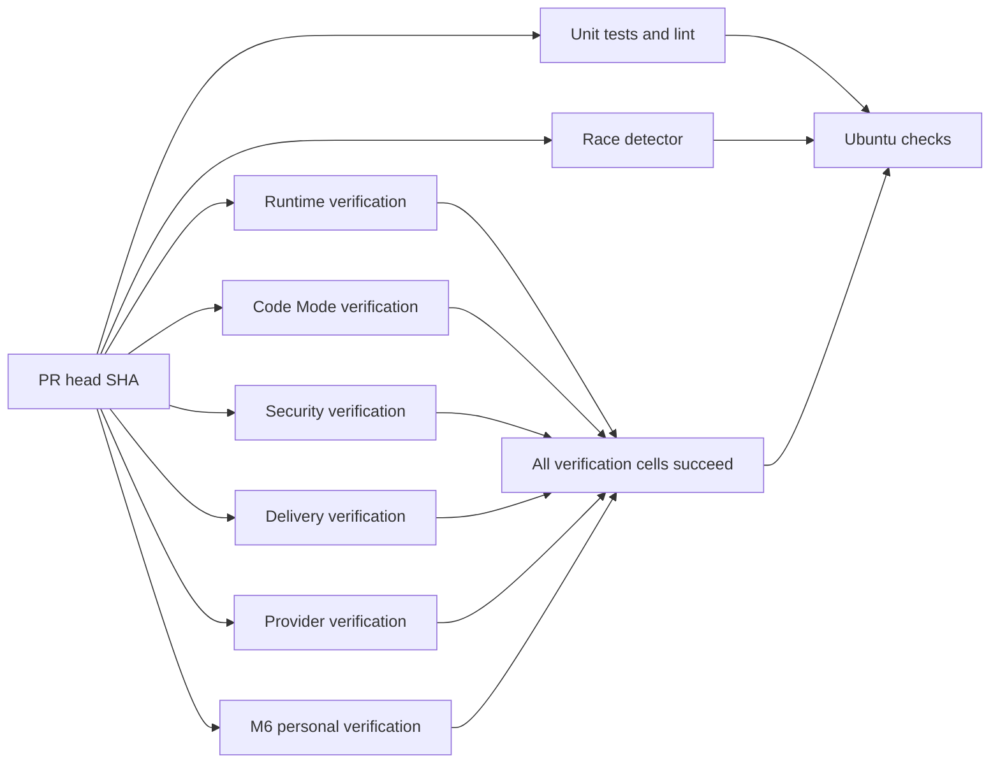

# Offline CI and verification operations

`Ubuntu checks` remains the only branch-protection check name. It runs with
`always()` after unit/lint, race, and the six verification shards. It succeeds
only when all three job results are `success`. A matrix succeeds only when every
cell succeeds; matrix fail-fast is disabled so failures retain independent
evidence. Failure, cancellation, skipped dependencies, missing results and
unexpected dependencies fail the aggregate. `scripts/test_verification.py`
exercises these states, the complete legacy inventory, report ownership and
owned-process cancellation. No heavy gate moves to a schedule or post-merge job.



Each job checks out the explicit PR head SHA (or push SHA). The platform must
still require exact-head reviewer PASS and strict main ancestry before merging.
The workflow does not alter rulesets or merge protection. Superseded commits
cancel the prior workflow for the same PR. Pushes to `main` use a separate group.

The manifest in `scripts/verify_suite.py` owns verification coverage:

| Shard | Required evidence |
| --- | --- |
| runtime | Foundation, Main, Tasks, five consecutive runs each of Child/scheduling/spend/task-control, Main/Task case fragments, embedded JetStream and real CLI relay |
| codemode | Five consecutive Code Mode, fixed-source recovery and Computer lifecycle and Computer Use runs, plus six variants × five runs of each exact GC-17/19/20 Core fixture and SC contracts; see [scope and recovery](core-evals.md) and [Computer lifecycle](computer.md) |
| security | Five consecutive Tool approval/recovery and Artifact runs |
| delivery | Five consecutive delivery runs, including all twenty SIGKILL/restart cases each time |
| providers | Local provider, initial account check, five runs each of capabilities/TUI/Pi Bridge/account, five runs of the selected Go model/storage packages |

Repetitions of a gate always run serially in one shard. Shards use independent
temporary databases, random local ports, owned processes and disjoint report
paths. They share only immutable source and the built executable. No runtime,
fixture, assertion, count, lease or deadline is changed by this optimization.
In particular, the real streaming deadline and recovery lease waits remain.

## Launch, doctor, drive, evidence and cleanup

Install the versions and pinned dependencies from [development.md](development.md).
Linux coding tests need bubblewrap and enabled unprivileged user namespaces;
CI configures these on its disposable runner. The unit/lint job installs the
pinned Chromium binary/system dependencies, then runs the actual Browser fixture
with no external website. The providers shard, unit and race
jobs exercise the real coding sandbox. No live account, network provider,
desktop, installed NATS service or fixed port is needed after dependency setup.

```sh
make verify
make verify VERIFY_JOBS=1 VERIFY_EVIDENCE=evidence/serial
make verify VERIFY_JOBS=4 VERIFY_EVIDENCE=evidence/parallel
make verify VERIFY_SHARD=delivery VERIFY_JOBS=1 VERIFY_EVIDENCE=evidence/delivery-only
python3 -m unittest discover -s scripts -p 'test_verification.py' -v
```

`make verify` builds once, then runs two independent shards at a time by default.
The repeated Go conformance command runs after all local harnesses finish. Its
real 100 ms receipt-recovery fixtures need isolation from unrelated temporary
database I/O; assertions, deadlines and five repetitions remain unchanged.
CI runs one shard per isolated runner and keeps the Go command inside providers.
Use `VERIFY_JOBS=1` for a serial baseline
and the same fixtures/environment for comparisons. Do not run two suite commands
against the same evidence directory at once. A shard-only run proves only that
shard; full success requires every shard plus unit/lint and race.

Each harness owns Launch/Doctor/Drive/Evidence/Cleanup for its product surface.
The runner returns nonzero for a failed repetition and records that attempt.
SIGINT/SIGTERM stop admission and terminate/reap owned groups; Python harnesses
unwind their existing cleanup blocks. SIGKILL cannot run cleanup; disposable CI
VM teardown is the final boundary in that case. Evidence contains temporary
paths for databases already removed, never persistent user data.

Evidence is ignored locally and uploaded even on CI failures, retained for
14 days under a name containing shard, tested head SHA and workflow attempt:

- `suite-*.json`: tested source SHA, workflow SHA, platform, executable SHA-256,
  concurrency, total elapsed time, pass/fail and every executed command.
- `timings-*.json`: per-harness/repetition monotonic durations and exit codes,
  updated after each attempt so earlier measurements survive a later failure.
- `profiles/*/*.json`: Python function cumulative/self durations and named
  scenario/case-variant timings. Timings include child and PTY waits. Function
  totals overlap and must not be summed. Arguments/locals are never recorded.
- `logs/*.log`: individual harness output; `models.jsonl` has per-Go-test events
  and durations; `pi-bridge.tap` retains all five Node runs and case durations.
- All pre-existing feature-map JSON evidence, with unchanged report names.

The source SHA and executable digest identify what ran. Workflow SHA can be
GitHub's synthetic merge SHA while checkout is the explicit head SHA. Download
artifacts using `gh run download RUN_ID --dir DESTINATION`; do not compare old
artifact contents against a new PR head. Record full-suite sample counts and
per-gate median/range; concurrent runners and cold caches add noise.

## Build and cache integrity

Each runner builds from its checked-out source using Go's content-addressed
build cache. `setup-go` keys its caches by platform/toolchain/module inputs.
`setup-node` caches npm download inputs; every job still uses locked `npm ci
--ignore-scripts`. No executable or `node_modules` is accepted from another
workflow artifact. Coding sandboxes retain their own private disposable caches;
CI never mounts a host build cache into the product sandbox. The existing unit,
race and repeated conformance executions are intentionally retained: they prove
different properties even where packages overlap.

## Measurements

The issue's historical Ubuntu runs were 40m11s and 47m26s; CLI verification was
33m35s and 37m42s. Those are context, not a same-fixture performance comparison.
The [ERII-134 report](https://github.com/z-chenhao/erii/pull/19) records the
controlled local serial/parallel measurements, repeated-gate ranges, timing
attachments and exact-head Ubuntu result separately.

The full race command serializes test packages and uses an explicit 15-minute Go
package budget inside its 20-minute job. Two ERII-24 preparation jobs exceeded the
Bridge duplicate-burst RPC's unchanged one-second deadline (1.04s and 1.07s)
while packages shared the two-core runner. Package isolation preserves the event
count, intra-package concurrency, race instrumentation and all assertions.
Real SQLite migrations under race instrumentation exhausted the
implicit 10-minute package budget on Ubuntu; per-test, Tool and lease deadlines
remain unchanged. See [Core gate evidence](core-evals.md).

The Code Mode verification job has a 60-minute budget; other verification shards
retain 30 minutes. Four observed Ubuntu Core runs took 497.06, 508.73, 491.36 and
517.33 seconds each, and the 45-minute job budget interrupted the fifth run.
The 60-minute allocation preserves all 90 case executions, all five serial
repetitions and all per-case/Tool/lease deadlines.
