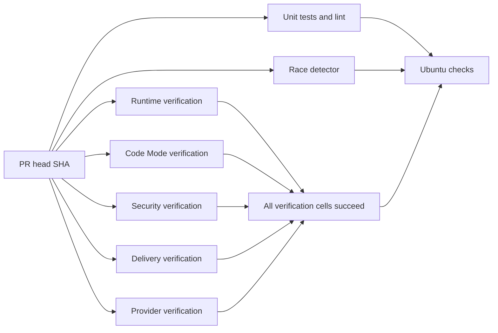
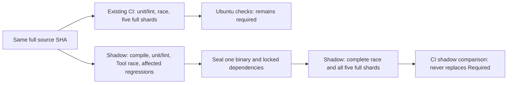

# Offline CI and verification operations

`Ubuntu checks` remains the only branch-protection check name. It runs with
`always()` after unit/lint, race, and the five verification shards. It succeeds
only when all three job results are `success`. A matrix succeeds only when every
cell succeeds; matrix fail-fast is disabled so failures retain independent
evidence. Failure, cancellation, skipped dependencies, missing results and
unexpected dependencies fail the aggregate. `scripts/test_verification.py`
exercises these states, the complete legacy inventory, report ownership and
owned-process cancellation. No heavy gate moves to a schedule or post-merge job.



Each job checks out the explicit PR head SHA (or push SHA). The platform must
still require exact-head reviewer PASS and strict main ancestry before merging.
The workflow does not alter rulesets or merge protection. Superseded commits
cancel the prior workflow for the same PR. Pushes to `main` use a separate group.

The manifest in `scripts/verify_suite.py` owns verification coverage:

| Shard | Required evidence |
| --- | --- |
| runtime | Foundation, Main, Tasks, five consecutive runs each of Child/scheduling/spend/task-control, Main/Task case fragments, embedded JetStream and real CLI relay |
| codemode | Five consecutive Code Mode and fixed-source recovery runs, plus six variants × five runs of each exact GC-17/19/20 Core fixture and SC contracts; see [scope and recovery](core-evals.md) |
| security | Five consecutive recall, Tool approval/recovery and Artifact runs |
| delivery | Five consecutive delivery runs, including all twenty SIGKILL/restart cases each time |
| providers | Local provider, initial account check, five runs each of capabilities/TUI/Pi Bridge/account, five runs of the selected Go model/storage packages |

Repetitions of a gate always run serially in one shard. Shards use independent
temporary databases, random local ports, owned processes and disjoint report
paths. They share only immutable source and the built executable. No runtime,
fixture, assertion, count, lease or deadline is changed by this optimization.
In particular, the real streaming deadline and recovery lease waits remain.

## Launch, doctor, drive, evidence and cleanup

Install the versions and pinned dependencies from [development.md](development.md).
Linux coding tests need bubblewrap and enabled unprivileged user namespaces;
CI configures these on its disposable runner. The providers shard, unit and race
jobs exercise the real coding sandbox. No live account, network provider,
desktop, installed NATS service or fixed port is needed after dependency setup.

```sh
make verify
make verify VERIFY_JOBS=1 VERIFY_EVIDENCE=evidence/serial
make verify VERIFY_JOBS=4 VERIFY_EVIDENCE=evidence/parallel
make verify VERIFY_SHARD=delivery VERIFY_JOBS=1 VERIFY_EVIDENCE=evidence/delivery-only
python3 -m unittest discover -s scripts -p 'test_verification.py' -v
```

`make verify` builds once, then runs two independent shards at a time by default.
The repeated Go conformance command runs after all local harnesses finish. Its
real 100 ms receipt-recovery fixtures need isolation from unrelated temporary
database I/O; assertions, deadlines and five repetitions remain unchanged.
CI runs one shard per isolated runner and keeps the Go command inside providers.
Use `VERIFY_JOBS=1` for a serial baseline
and the same fixtures/environment for comparisons. Do not run two suite commands
against the same evidence directory at once. A shard-only run proves only that
shard; full success requires every shard plus unit/lint and race.

Each harness owns Launch/Doctor/Drive/Evidence/Cleanup for its product surface.
The runner returns nonzero for a failed repetition and records that attempt.
SIGINT/SIGTERM stop admission and terminate/reap owned groups; Python harnesses
unwind their existing cleanup blocks. SIGKILL cannot run cleanup; disposable CI
VM teardown is the final boundary in that case. Evidence contains temporary
paths for databases already removed, never persistent user data.

Evidence is ignored locally and uploaded even on CI failures, retained for
14 days under a name containing shard, tested head SHA and workflow attempt:

- `suite-*.json`: tested source SHA, workflow SHA, platform, executable SHA-256,
  concurrency, total elapsed time, pass/fail and every executed command.
- `timings-*.json`: per-harness/repetition monotonic durations and exit codes,
  updated after each attempt so earlier measurements survive a later failure.
- `profiles/*/*.json`: Python function cumulative/self durations and named
  scenario/case-variant timings. Timings include child and PTY waits. Function
  totals overlap and must not be summed. Arguments/locals are never recorded.
- `logs/*.log`: individual harness output; `models.jsonl` has per-Go-test events
  and durations; `pi-bridge.tap` retains all five Node runs and case durations.
- All pre-existing feature-map JSON evidence, with unchanged report names.

The source SHA and executable digest identify what ran. Workflow SHA can be
GitHub's synthetic merge SHA while checkout is the explicit head SHA. Download
artifacts using `gh run download RUN_ID --dir DESTINATION`; do not compare old
artifact contents against a new PR head. Record full-suite sample counts and
per-gate median/range; concurrent runners and cold caches add noise.

## Build and cache integrity

Each runner builds from its checked-out source using Go's content-addressed
build cache. `setup-go` keys its caches by platform/toolchain/module inputs.
`setup-node` caches npm download inputs; every job still uses locked `npm ci
--ignore-scripts`. No executable or `node_modules` is accepted from another
workflow artifact. Coding sandboxes retain their own private disposable caches;
CI never mounts a host build cache into the product sandbox. The existing unit,
race and repeated conformance executions are intentionally retained: they prove
different properties even where packages overlap.

## Measurements

The issue's historical Ubuntu runs were 40m11s and 47m26s; CLI verification was
33m35s and 37m42s. Those are context, not a same-fixture performance comparison.
The [ERII-134 report](https://github.com/z-chenhao/erii/pull/19) records the
controlled local serial/parallel measurements, repeated-gate ranges, timing
attachments and exact-head Ubuntu result separately.

The full race command uses an explicit 15-minute Go package budget inside its
20-minute job. Real SQLite migrations under race instrumentation exhausted the
implicit 10-minute package budget on Ubuntu; per-test, Tool and lease deadlines
remain unchanged. See [Core gate evidence](core-evals.md).

The Code Mode verification job has a 60-minute budget; other verification shards
retain 30 minutes. Four observed Ubuntu Core runs took 497.06, 508.73, 491.36 and
517.33 seconds each, and the 45-minute job budget interrupted the fifth run.
The 60-minute allocation preserves all 90 case executions, all five serial
repetitions and all per-case/Tool/lease deadlines.

## ERII-141 shadow experiment (not a performance acceptance claim)

The [machine-readable baseline](ci-baseline.json) covers 30 historical source
SHAs, grouped by success, failure and cancellation. Successful runs have an
observed p50 of 2,616 seconds; this mixes coverage versions and is **not** a
controlled comparison. API CPU and cache hits remain null rather than invented
zeroes. The cancellation proxy is successor workflow creation to last old job
completion (p95 431 seconds across nine measurable cancellations). GitHub's job
API does not expose the original push/webhook timestamp, so this is not proof of
the requested push-to-stop p95.

Run 39103736442 (`db121dc96db6b64beace89b60cbfa06c92c96bc5`) records a
2,689-second Code Mode shard: its five new Core runs account for 2,452 seconds.
The first Core run spends 184.69 seconds in engineering fixtures, 135.29 in
coding fixtures and 84.71 in feedback fixtures. The remainder includes repeated
race conformance. This establishes that the new coverage dominates setup cost.
The implementation creates an empty private Go cache for every workspace test;
repeated cold compilation is a suspected contributor, not yet a separately
measured CPU attribution. No product sandbox/cache isolation, fault point,
lease, timeout, assertion or five-run requirement is changed here.

The separate `CI shadow` workflow runs only on ERII-141's draft branch. Existing
`CI` still runs the full gate independently. **Do not promote the shadow workflow
or mark the PR ready until its acceptance evidence is complete.** Its aggregate
is called `CI shadow comparison`, so it cannot supply `Ubuntu checks` to the
active main ruleset. During this experiment runner cost increases: both pipelines
run. This temporary duplication is measurement overhead, not an optimization.



`ci_impact.json` is a conservative early-feedback manifest. `ci_impact.py` loads
it from the event's base SHA and compares it byte-for-byte with the head copy.
Missing history/manifest, manifest drift, unknown or ambiguous paths, and
scripts/workflows/Makefile/protocol/schema/security/replay changes select all
early regressions. Paths come from Git with rename detection disabled, covering
both sides of moves and deletions. Each mapping has a positive fixture and a
negative lookalike test; example-file deletion is a drift failure. The manifest
**never** skips a full merge shard. Unit/lint includes Go schema tests, fixture
locks and both Node contracts. An extra Tool race subset and deterministic
regressions fail closed before heavy candidate jobs are admitted. The early
single attempts are additional evidence; full five-run series remain intact.
The ERII-23 Memory maintenance regression is included in early security feedback;
both workflows provision the sandbox for the full security shard. A topology
contract checks this prerequisite against required CI whenever main advances.

Full-shard selection is deliberately constant during shadow repair:

| Changed paths / trust result | Extra early regressions | Required full shards |
| --- | --- | --- |
| Known documentation mapping | None | runtime, codemode, security, delivery, providers |
| Known implementation mapping | Mapped regressions | All five |
| Unknown/risky path, unavailable base, invalid or drifted manifest | All mapped regressions | All five |

`impact.json.full_shards` records this complete set; the workflow matrix is also
fixed independently of that file. It is not a conditional full-gate selector.
No trusted path can waive a five-run series, Code Mode recovery or a Golden Case.
Conditional full-shard omission is not implemented or claimed as complete.
The measured delivery harness took 128 seconds locally in early feedback,
dominated by its twenty crash/restart cases. Early delivery feedback now uses
the same harness's explicitly marked `--feedback` transport/retry/unknown/approval
fragment. It cannot claim full evidence. The unchanged full-tier invocation
requires all twenty faults in each of five runs; a contract test prevents the
partial flag from entering the full inventory. Compare absolute early feedback
latency separately from the complete, unchanged merge inventory.

The repair candidate permits up to four independent fixtures at a time for delivery,
Tool/Artifact/Child crash boundaries, capability scenarios and Core variants.
Each fixture retains its own configuration, databases, workspace, approvals and
provider ledger. Results retain the original inventory order. Every five-run
series stays serial on one worker; the next Core round starts only after all
eighteen variants and their conformance checks finish. Explicit inventory checks
reject missing or duplicated crash boundaries. The baseline workflow uses the
same source with the default concurrency of one.
Core case kinds join before the next kind starts. GC-17 checkpoint variants use
at most two fixtures so the unchanged fifteen-second fault boundary does not
compete with coding/engineering compilers. A real failed mixed-kind run is
retained; the scheduling regression proves case barriers, all eighteen variants
and the two/four capacity bounds.

`fixture_pool.py` owns process sessions, cancellation admission, joined cleanup
and retirement. Main/Capability/Artifact harnesses and the PTY driver register
their children with this owner. Nested selected capability scenarios reuse the
current owner and stay serial. Cancellation rejects queued launches, stops only
owned groups and joins active fixtures before temporary roots are removed.
Regression tests cover two stubborn listening sessions, unrelated-process
preservation and PTY descriptor closure when launch is cancelled. A command
timeout kills the owned group before draining captured output, so a descendant
cannot hold its parent's pipes open indefinitely; the regression checks the
timeout, listening port and owner retirement together.

Every full Core round also runs `ci_cancel.py`. It holds four real Go/Node Core
fixtures at the checked 37-completed/8-active checkpoint, cancels their enclosing
profiled harness, and checks captured process identities and temporary roots.
Five-round aggregation rejects missing cancellation proof. This is harness
cancellation; GC-20's separate business Task cancellation remains unchanged.
It does not measure GitHub's push-to-cancellation delivery latency.

Runtime and provider shards can overlap two independent gate series. Their Go
event/model checks run after the other series have joined. Code Mode and security
gate series remain serial. Early feedback can overlap two other shards, then
runs security alone so the unexplained recall failure is not confounded by
competing fixtures. Both layers fail closed on any failed or incomplete series.
The shadow workflow sets `ERII_VERIFY_CASE_JOBS=4`, `ERII_VERIFY_GATE_JOBS=2`
and `ERII_FEEDBACK_JOBS=2` only in their applicable steps; required CI keeps the
default serial control. No full shard is omitted.

`ci_bundle.py` v2 seals the binary, both installed dependency trees and a fresh
Host Go build cache after early feedback succeeds. The producer starts that
cache empty. Consumers download only their own workflow attempt's artifact,
require its producer SHA-256, and compare source SHA, tracked input digest,
OS/architecture, runner image, exact Go/Node versions, copied-SDK digest and
workflow Run/attempt before restore. Version-one payloads fail closed.
The source digest includes every tracked file, including lockfiles, go.sum,
workflows and build scripts. Dirty tracked source is rejected. Binary digest,
archive entry types, traversal and escaping symlinks are checked; missing or
corrupt payloads fail closed without rebuilding from an alternate source. This
is intra-run artifact reuse, not cross-SHA executable caching. Host cache links
and special files are rejected; cached executable hard links serialize as regular
bytes. Required full Go tests retain their explicit `-count=1`/`-count=5`, so a
build-cache hit cannot replace a required test execution.
Sandbox commands still receive a new private writable `GOCACHE` each invocation.
Consumer checkout and toolchain
setup remain necessary; no elimination of those costs is claimed.

`ci_sdk.py` creates `.ci-go/sdk` as a disposable copy of the installed Go SDK.
It never modifies the original SDK and refuses occupied or linked destinations.
A fresh offline compiler environment installs only the public dependency closure
of `testing`, `encoding/json`, `testing/internal/testdeps`, `runtime/race` and
`runtime/cgo`. Go's `installgoroot` mode reads these archives from the SDK already
mounted read-only by the process sandbox. No workspace outputs or user caches
enter that SDK. A receipt binds clean source, original SDK bytes, compiler bytes,
fixed roots and the complete copied tree. Doctor rejects any drift. Local cleanup
removes only an unchanged owned SDK and preserves the separate Host cache.

The build step uses the original compiler/`GOROOT` to preserve the control's exact
Erii binary. Fixture processes use the copied SDK through their Host environment.
The mandatory SDK conformance probe checks denied archive mutation, denied sibling
reads, private writable cache identity, and execution of a program importing an
uncached standard package. Missing public archives fall back to compilation in
that private cache. Doctor checks the SDK again after the full job.

Both control and candidate pin `ubuntu-24.04`. GitHub's
[announced `ubuntu-latest` migration](https://github.com/actions/runner-images/issues/14748)
starts on October 19, 2026; the diagnostic job emitted that warning. The fixed
label preserves the measured OS while image-version and CPU checks remain strict.
No required test command, repetition, assertion or timeout changes with this pin.

`ci_step.py` records phase wall time, reaped process-tree CPU, cache-hit outputs,
source SHA, return code and cancellation cleanup latency, including failures.
`profile_harness.py` adds harness/scenario CPU and named Core variant timings;
`verify_suite.py` records harness/repetition CPU. CPU excludes live/unreaped
descendants. Scenario/function times overlap and must not be summed. Setup and
upload timings outside the wrapper come from the GitHub API collector. The
aggregate adds the tested full SHA and every dependency outcome to the workflow
summary. Exact-SHA evidence is retained for failure and graceful cancellation;
hard runner termination can prevent upload.
Source identity is frozen before a phase starts. A changed HEAD, changed tracked
working diff or changed suite executable invalidates the result. Dirty local
trees are marked explicitly and cannot be cited as exact-commit evidence.

The cancellation regression first reproduced a live listening child after its
group leader exited. The runner now kills the remaining owned group after
leader completion, including normal completion, and records cancellation latency.
The durable test checks port closure, removal of fixture state, profile evidence
and a bound below 15 seconds. This is proof for an owned group, not for arbitrary
detached daemons or GitHub's webhook-to-runner cancellation latency. No processes
are terminated by executable name.
Darwin may report `EPERM` for a disappearing process group. Only on Darwin the
inspector then uses `ps` to distinguish a live group from zombies or absence.
Unreadable process state still rejects the result; Linux permission errors remain
failures. The listening-child regression retains its original assertions and
deadlines.

Recall failure artifacts now identify the scenario, stage, grouped Run state,
pending-vector counts and HTTP request count before cleanup. They exclude corpus,
prompts and provider bodies. `TestRecallConcurrentPendingAppendFailsClosed`
deterministically reproduces the documented pending-append boundary, then proves
a later caller recovers both originals. This proves an existing contract, not
the cause of the earlier Ubuntu failure; the harness still rejects every
unexpected `chat work` error without retrying or changing its assertions.

Attempt 2 at `1d177631a95fbc3d6a23d0f35399e74f17df4f97` retained a
failed recovery drain: Main completed, Root remained running, and one authorized
Conversation vector was pending. The repaired harness deterministically exercises
both legal orderings of this documented contract. Success fixtures freeze Root's
first recall before Main publication and defer Worker dispatch until that
publication completes. A new real CLI/HTTP scenario instead holds Root's query
embeddings after catch-up while Main appends. It requires a rejected drain, no
Worker recall/model admission, and recovery by a separate explicit caller.
Every original success, failure, multipart, restart and inert-drain assertion
remains. Both orderings execute in all five stability runs. Unexpected failures
are not retried. The repeatable `-test-main-barrier boundary=release-file` CLI
hook requires an explicit deterministic Bridge; ordinary execution is unchanged.

At `174860b376cc29e71d7b3be0cd554a3b1789d2da`, both recall/security
shards passed. The required race job instead failed while creating the valid
stream for the consumer-rejection fixture immediately after deleting the
incompatible stream. The shadow race job passed. A local 100-run race probe
did not reproduce that failure, so its vendor-level cause remains inconclusive.
The fixture now gives the independent consumer-compatibility assertion a fresh
broker. It retains incompatible-stream rejection, acknowledged deletion and
incompatible-consumer rejection, with no retries or deadline changes.

The profiling callback rejects unrelated function names before constructing
filesystem paths. All six scenario kinds retain their file checks and timing
records. Its contract test exercises those records and proves unrelated calls
do not resolve paths. Same-VM full-Core measurements assess the latency effect
separately; reducing callback work alone does not establish a CI speed target.

Reproduce the measured paths from the repository root:

```sh
# Launch/Doctor: gh authentication must have read access; no product account.
python3 scripts/ci_profile.py --limit 30 --output evidence/ci-history.json
# Drive/Evidence: deterministic offline reclassification from retained raw API data.
python3 scripts/ci_profile.py --offline --output evidence/ci-history.json
make build
python3 scripts/ci_impact.py --base BASE_FULL_SHA --output evidence/impact.json
python3 scripts/ci_step.py --name feedback --phase test -- python3 scripts/ci_feedback.py --plan evidence/impact.json
python3 -m unittest discover -s scripts -p 'test_ci*.py' -v
python3 -m unittest discover -s scripts -p 'test_verification.py' -v
python3 -m unittest discover -s scripts -p 'test_fixture_pool.py' -v
python3 -m unittest discover -s scripts -p 'test_gate_scheduling.py' -v
python3 scripts/ci_cancel.py --binary bin/personal-agent --evidence evidence/ci-cancel.json
python3 scripts/ci_sdk.py prepare --host-cache --evidence evidence/sdk.json
python3 scripts/ci_sdk.py doctor
ERII_CI_PUBLIC_SDK_PROBE=1 python3 scripts/ci_sdk.py run -- go test ./internal/computer/workspace -run '^TestCIInstalledSDKConformance$' -count=1
python3 scripts/ci_sdk.py run -- python3 scripts/verify_suite.py --binary bin/personal-agent --evidence evidence/sdk-full --jobs 1
python3 scripts/ci_sdk.py cleanup
# Full required inventory with the candidate scheduling, using isolated evidence.
ERII_VERIFY_CASE_JOBS=4 python3 scripts/verify_suite.py --binary bin/personal-agent --evidence evidence/candidate --shard delivery --jobs 1 --gate-jobs 2
# Collect explicit full-workflow attempts, never the five repetitions inside one run.
python3 scripts/ci_compare.py --pair BEFORE_RUN:1,SHADOW_RUN:1 --output evidence/controlled.json
python3 scripts/ci_compare.py --offline --output evidence/controlled.json
# Explicitly requested five-round experiment; stays foreground until collected.
python3 scripts/ci_experiment.py --pr 24 --sha FULL_SHA --output evidence/experiment.json
# Separate compiler experiment through the real sandbox, on disposable fixture copies.
ERII_WORKSPACE_PROFILE_DIR="$PWD/evidence/workspace-cache-probe" go test ./internal/computer/workspace -run '^$' -bench BenchmarkWorkspaceStandardSeed -benchtime=5x -count=1
```

Repeat `--pair` for at least five distinct workflow-attempt pairs, collected from
the measured source checkout. The collector requires clean, stable exact-SHA
successes, the current complete gate/repetition inventory, matching binary,
Ubuntu image and CPU-capacity class across every sample, and successful required aggregates. It retains
failed samples and raw API/suite metadata; incomplete proof exits nonzero. It
downloads only structural suite JSON from evidence archives and removes temporary
ZIP files. It neither launches jobs nor retries failures. A complete comparison
does not assert that the performance targets passed. CPU/cache/scenario detail
remains in the original artifacts. Rerun timing uses `run_started_at`, not the
original workflow's creation time; initial rerun queue time remains unmeasured.
Ordinary-change and cancellation cohorts still need separate proof.
`ci_experiment.py` keeps the PR Draft and checks its head before every round.
It watches the initial complete pair, then requests each complete workflow rerun
once after success, waiting for fresh check records rather than old green ones.
An acknowledged queued workflow waits without another request. The check-record
registration window starts only when that workflow becomes active; this does not
change any test or job timeout. Queue latency remains visible in attempt data.
Every round checkpoints its attempts and raw evidence. A failed test, changed
head, ambiguous run or unknown rerun outcome stops the experiment. Existing output
is never overwritten or automatically replayed. It does not mark Ready or assert
performance acceptance. Use it only when CI results/repeated comparisons are
explicitly requested; ordinary delivery does not wait for external CI.
The collector also requires the Core summary's five consecutive nested cleanup
results. Older summaries cannot certify this strengthened verification contract.
Threaded scenario CPU measurements describe overlapping harness intervals;
function profiles cover the main thread. Use whole-harness/step CPU and job
lifetimes for comparisons, rather than summing overlapping case intervals.
Suite/phase records retain logical CPU count, affinity and processor model so
runner variation remains visible. Missing job durations or CPU capacity cannot
be counted as zero measurements or eligible controlled samples.

The compiler benchmark alternates cold and seeded order, preserves a fresh private
writable cache for every invocation, and retains the original coding missing-flag
failure and engineering grandchild failure. Its seed contains only trusted standard-library
outputs for `testing` and `encoding/json`, built inside the same sandbox. It does
not install a product cache policy or count as five whole-CI comparisons.

Harnesses clean up their owned fixtures; collector evidence is retained in the
ignored `evidence/` directory and the collector launches no daemon. Download
workflow artifacts to separate directories; never mix SHAs or attempts. Preserve
raw API responses alongside normalized JSON. Historical failed/cancelled samples
must remain separate from successful performance statistics.

Still required before cutover: five independent before/after samples on the same
Ubuntu image and fixtures, ordinary and Code Mode/Replay cohorts, complete
wall/CPU/setup/build/cache/cancellation evidence, p50/p95/variance and total
runner-minute comparisons, exact push timestamps, real nested cancellation
cleanup, and demonstrated acceptance targets. Neither the 8/12-minute feedback
target nor the 35%/40% improvements nor the 60-second cancellation p95 is proven.
After that evidence passes, switch the stable aggregate's dependencies in one
reviewed workflow change, keep the name and active ruleset unchanged, and require
an exact-SHA reviewer PASS. Rollback is to remove `ci-shadow.yml`; current required
CI never depends on it and needs no protection change. The CI-only approach may
not meet the cost target while repeated sandbox compiler work remains mandatory;
any sandbox-cache proposal needs a separate security design and authorization.

The current requested iteration goal is complete Required CI below ten minutes.
The first controlled pair at `1d17763` measured 3,352 → 2,117 wall seconds and
114.73 → 70.98 runner-minutes. Its second pair failed recall; it cannot certify
a five-pair cohort or that latency goal. Further optimization must preserve the
full inventory, five serial rounds and existing deadlines. Faster early feedback
does not certify a sub-ten-minute complete gate.

`make test-race` and the shadow job use `python3 scripts/ci_race.py`.
Baseline job 117675122720 failed the Bridge duplicate-burst concurrent RPC check
at its one-second deadline while the full SQLite race package was running.
The peer emits 8,192 notifications before it reads that RPC, so the deadline
includes instrumented burst transfer. CPU contention is a hypothesis; a local
full race pass does not prove the cause. An exploratory local `-p 1` trial took
405 seconds versus 308 seconds with normal package scheduling; blanket package
serialization adds overhead. The candidate instead executes Bridge alone first,
then the complete remainder with normal package parallelism. Every package from
`go list ./...` must execute exactly once; unknown new packages enter the remainder,
and missing/duplicate/foreign inventory fails closed. Every stage uses fresh
`-count=1` race tests with the existing 15-minute package budget. Internal test
concurrency, assertions and deadlines are unchanged. `evidence/race/inventory.json`
records the full inventory and both stage outcomes; an early Bridge failure
prevents expensive remainder work and fails the gate.

Required job 117946948256 at `fbb15390ec3a40cba47766037a193275837546e9`
again failed this exact duplicate-burst assertion, at its unchanged one-second
deadline. The NATS fixture passed. This cohort stopped on the evidenced failure
without requesting a rerun. The Makefile now uses the same audited scheduling
path as shadow. All race tests remain in the same Required job and run exactly
once; no test moves to another gate. The test peer, burst bytes, sink barrier,
RPC deadline and production Bridge remain unchanged. Experimental typed/buffered
peer variants gave insufficient local end-to-end improvement and were discarded.
This removes competing package work from the sensitive Bridge phase; its
exact-SHA CI result and the full comparison cohort still require verification.
