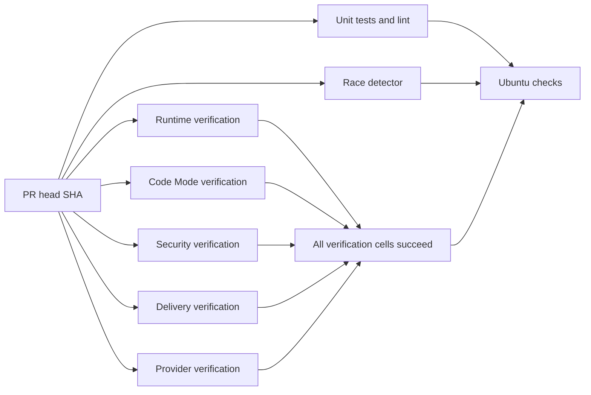
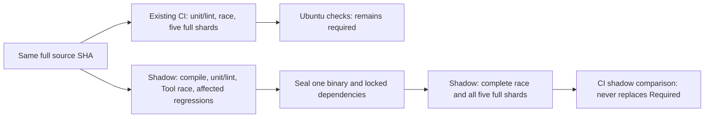

# Offline CI and verification operations

`Ubuntu checks` remains the only branch-protection check name. It runs with
`always()` after unit/lint, race, and the five verification shards. It succeeds
only when all three job results are `success`. A matrix succeeds only when every
cell succeeds; matrix fail-fast is disabled so failures retain independent
evidence. Failure, cancellation, skipped dependencies, missing results and
unexpected dependencies fail the aggregate. `scripts/test_verification.py`
exercises these states, the complete legacy inventory, report ownership and
owned-process cancellation. No heavy gate moves to a schedule or post-merge job.



Each job checks out the explicit PR head SHA (or push SHA). The platform must
still require exact-head reviewer PASS and strict main ancestry before merging.
The workflow does not alter rulesets or merge protection. Superseded commits
cancel the prior workflow for the same PR. Pushes to `main` use a separate group.

The manifest in `scripts/verify_suite.py` owns verification coverage:

| Shard | Required evidence |
| --- | --- |
| runtime | Foundation, Main, Tasks, five consecutive runs each of Child/scheduling/spend/task-control, Main/Task case fragments, embedded JetStream and real CLI relay |
| codemode | Five consecutive Code Mode and fixed-source recovery runs, plus six variants × five runs of each exact GC-17/19/20 Core fixture and SC contracts; see [scope and recovery](core-evals.md) |
| security | Five consecutive Tool approval/recovery and Artifact runs |
| delivery | Five consecutive delivery runs, including all twenty SIGKILL/restart cases each time |
| providers | Local provider, initial account check, five runs each of capabilities/TUI/Pi Bridge/account, five runs of the selected Go model/storage packages |

Repetitions of a gate always run serially in one shard. Shards use independent
temporary databases, random local ports, owned processes and disjoint report
paths. They share only immutable source and the built executable. No runtime,
fixture, assertion, count, lease or deadline is changed by this optimization.
In particular, the real streaming deadline and recovery lease waits remain.

## Launch, doctor, drive, evidence and cleanup

Install the versions and pinned dependencies from [development.md](development.md).
Linux coding tests need bubblewrap and enabled unprivileged user namespaces;
CI configures these on its disposable runner. The providers shard, unit and race
jobs exercise the real coding sandbox. No live account, network provider,
desktop, installed NATS service or fixed port is needed after dependency setup.

```sh
make verify
make verify VERIFY_JOBS=1 VERIFY_EVIDENCE=evidence/serial
make verify VERIFY_JOBS=4 VERIFY_EVIDENCE=evidence/parallel
make verify VERIFY_SHARD=delivery VERIFY_JOBS=1 VERIFY_EVIDENCE=evidence/delivery-only
python3 -m unittest discover -s scripts -p 'test_verification.py' -v
```

`make verify` builds once, then runs two independent shards at a time by default.
The repeated Go conformance command runs after all local harnesses finish. Its
real 100 ms receipt-recovery fixtures need isolation from unrelated temporary
database I/O; assertions, deadlines and five repetitions remain unchanged.
CI runs one shard per isolated runner and keeps the Go command inside providers.
Use `VERIFY_JOBS=1` for a serial baseline
and the same fixtures/environment for comparisons. Do not run two suite commands
against the same evidence directory at once. A shard-only run proves only that
shard; full success requires every shard plus unit/lint and race.

Each harness owns Launch/Doctor/Drive/Evidence/Cleanup for its product surface.
The runner returns nonzero for a failed repetition and records that attempt.
SIGINT/SIGTERM stop admission and terminate/reap owned groups; Python harnesses
unwind their existing cleanup blocks. SIGKILL cannot run cleanup; disposable CI
VM teardown is the final boundary in that case. Evidence contains temporary
paths for databases already removed, never persistent user data.

Evidence is ignored locally and uploaded even on CI failures, retained for
14 days under a name containing shard, tested head SHA and workflow attempt:

- `suite-*.json`: tested source SHA, workflow SHA, platform, executable SHA-256,
  concurrency, total elapsed time, pass/fail and every executed command.
- `timings-*.json`: per-harness/repetition monotonic durations and exit codes,
  updated after each attempt so earlier measurements survive a later failure.
- `profiles/*/*.json`: Python function cumulative/self durations and named
  scenario/case-variant timings. Timings include child and PTY waits. Function
  totals overlap and must not be summed. Arguments/locals are never recorded.
- `logs/*.log`: individual harness output; `models.jsonl` has per-Go-test events
  and durations; `pi-bridge.tap` retains all five Node runs and case durations.
- All pre-existing feature-map JSON evidence, with unchanged report names.

The source SHA and executable digest identify what ran. Workflow SHA can be
GitHub's synthetic merge SHA while checkout is the explicit head SHA. Download
artifacts using `gh run download RUN_ID --dir DESTINATION`; do not compare old
artifact contents against a new PR head. Record full-suite sample counts and
per-gate median/range; concurrent runners and cold caches add noise.

## Build and cache integrity

Each runner builds from its checked-out source using Go's content-addressed
build cache. `setup-go` keys its caches by platform/toolchain/module inputs.
`setup-node` caches npm download inputs; every job still uses locked `npm ci
--ignore-scripts`. No executable or `node_modules` is accepted from another
workflow artifact. Coding sandboxes retain their own private disposable caches;
CI never mounts a host build cache into the product sandbox. The existing unit,
race and repeated conformance executions are intentionally retained: they prove
different properties even where packages overlap.

## Measurements

The issue's historical Ubuntu runs were 40m11s and 47m26s; CLI verification was
33m35s and 37m42s. Those are context, not a same-fixture performance comparison.
The [ERII-134 report](https://github.com/z-chenhao/erii/pull/19) records the
controlled local serial/parallel measurements, repeated-gate ranges, timing
attachments and exact-head Ubuntu result separately.

The full race command uses an explicit 15-minute Go package budget inside its
20-minute job. Real SQLite migrations under race instrumentation exhausted the
implicit 10-minute package budget on Ubuntu; per-test, Tool and lease deadlines
remain unchanged. See [Core gate evidence](core-evals.md).

The Code Mode verification job has a 60-minute budget; other verification shards
retain 30 minutes. Four observed Ubuntu Core runs took 497.06, 508.73, 491.36 and
517.33 seconds each, and the 45-minute job budget interrupted the fifth run.
The 60-minute allocation preserves all 90 case executions, all five serial
repetitions and all per-case/Tool/lease deadlines.

## ERII-141 shadow experiment (not a performance acceptance claim)

The [machine-readable baseline](ci-baseline.json) covers 30 historical source
SHAs, grouped by success, failure and cancellation. Successful runs have an
observed p50 of 2,616 seconds; this mixes coverage versions and is **not** a
controlled comparison. API CPU and cache hits remain null rather than invented
zeroes. The cancellation proxy is successor workflow creation to last old job
completion (p95 431 seconds across nine measurable cancellations). GitHub's job
API does not expose the original push/webhook timestamp, so this is not proof of
the requested push-to-stop p95.

Run 39103736442 (`db121dc96db6b64beace89b60cbfa06c92c96bc5`) records a
2,689-second Code Mode shard: its five new Core runs account for 2,452 seconds.
The first Core run spends 184.69 seconds in engineering fixtures, 135.29 in
coding fixtures and 84.71 in feedback fixtures. The remainder includes repeated
race conformance. This establishes that the new coverage dominates setup cost.
The implementation creates an empty private Go cache for every workspace test;
repeated cold compilation is a suspected contributor, not yet a separately
measured CPU attribution. No product sandbox/cache isolation, fault point,
lease, timeout, assertion or five-run requirement is changed here.

The separate `CI shadow` workflow runs only on ERII-141's draft branch. Existing
`CI` still runs the full gate independently. **Do not promote the shadow workflow
or mark the PR ready until its acceptance evidence is complete.** Its aggregate
is called `CI shadow comparison`, so it cannot supply `Ubuntu checks` to the
active main ruleset. During this experiment runner cost increases: both pipelines
run. This temporary duplication is measurement overhead, not an optimization.



`ci_impact.json` is a conservative early-feedback manifest. `ci_impact.py` loads
it from the event's base SHA and compares it byte-for-byte with the head copy.
Missing history/manifest, manifest drift, unknown or ambiguous paths, and
scripts/workflows/Makefile/protocol/schema/security/replay changes select all
early regressions. Paths come from Git with rename detection disabled, covering
both sides of moves and deletions. Each mapping has a positive fixture and a
negative lookalike test; example-file deletion is a drift failure. The manifest
**never** skips a full merge shard. Unit/lint includes Go schema tests, fixture
locks and both Node contracts. An extra Tool race subset and deterministic
regressions fail closed before heavy candidate jobs are admitted. The early
single attempts are additional evidence; full five-run series remain intact.

`ci_bundle.py` seals the binary and both installed dependency trees once, after
early feedback succeeds. Consumers download only the artifact from their own
workflow attempt, require the producer output SHA-256, and compare source SHA,
tracked input digest, OS/architecture and exact Go/Node versions before restore.
The source digest includes every tracked file, including lockfiles, go.sum,
workflows and build scripts. Dirty tracked source is rejected. Binary digest,
archive entry types, traversal and escaping symlinks are checked; missing or
corrupt payloads fail closed without rebuilding from an alternate source. This
is intra-run artifact reuse, not cross-SHA executable caching. Go's existing
content-addressed compilation cache and locked npm download cache remain.
Sandbox tests keep their own private caches. Consumer checkout and toolchain
setup remain necessary; no elimination of those costs is claimed.

`ci_step.py` records phase wall time, reaped process-tree CPU, cache-hit outputs,
source SHA, return code and cancellation cleanup latency, including failures.
`profile_harness.py` adds harness/scenario CPU and named Core variant timings;
`verify_suite.py` records harness/repetition CPU. CPU excludes live/unreaped
descendants. Scenario/function times overlap and must not be summed. Setup and
upload timings outside the wrapper come from the GitHub API collector. The
aggregate adds the tested full SHA and every dependency outcome to the workflow
summary. Exact-SHA evidence is retained for failure and graceful cancellation;
hard runner termination can prevent upload.
Source identity is frozen before a phase starts. A changed HEAD, changed tracked
working diff or changed suite executable invalidates the result. Dirty local
trees are marked explicitly and cannot be cited as exact-commit evidence.

The cancellation regression first reproduced a live listening child after its
group leader exited. The runner now kills the remaining owned group after
leader completion, including normal completion, and records cancellation latency.
The durable test checks port closure, removal of fixture state, profile evidence
and a bound below 15 seconds. This is proof for an owned group, not for arbitrary
detached daemons or GitHub's webhook-to-runner cancellation latency. No processes
are terminated by executable name.

Reproduce the measured paths from the repository root:

```sh
# Launch/Doctor: gh authentication must have read access; no product account.
python3 scripts/ci_profile.py --limit 30 --output evidence/ci-history.json
# Drive/Evidence: deterministic offline reclassification from retained raw API data.
python3 scripts/ci_profile.py --offline --output evidence/ci-history.json
make build
python3 scripts/ci_impact.py --base BASE_FULL_SHA --output evidence/impact.json
python3 scripts/ci_step.py --name feedback --phase test -- python3 scripts/ci_feedback.py --plan evidence/impact.json
python3 -m unittest discover -s scripts -p 'test_ci*.py' -v
python3 -m unittest discover -s scripts -p 'test_verification.py' -v
```

Harnesses clean up their owned fixtures; collector evidence is retained in the
ignored `evidence/` directory and the collector launches no daemon. Download
workflow artifacts to separate directories; never mix SHAs or attempts. Preserve
raw API responses alongside normalized JSON. Historical failed/cancelled samples
must remain separate from successful performance statistics.

Still required before cutover: five independent before/after samples on the same
Ubuntu image and fixtures, ordinary and Code Mode/Replay cohorts, complete
wall/CPU/setup/build/cache/cancellation evidence, p50/p95/variance and total
runner-minute comparisons, exact push timestamps, real nested cancellation
cleanup, and demonstrated acceptance targets. Neither the 8/12-minute feedback
target nor the 35%/40% improvements nor the 60-second cancellation p95 is proven.
After that evidence passes, switch the stable aggregate's dependencies in one
reviewed workflow change, keep the name and active ruleset unchanged, and require
an exact-SHA reviewer PASS. Rollback is to remove `ci-shadow.yml`; current required
CI never depends on it and needs no protection change. The CI-only approach may
not meet the cost target while repeated sandbox compiler work remains mandatory;
any sandbox-cache proposal needs a separate security design and authorization.
