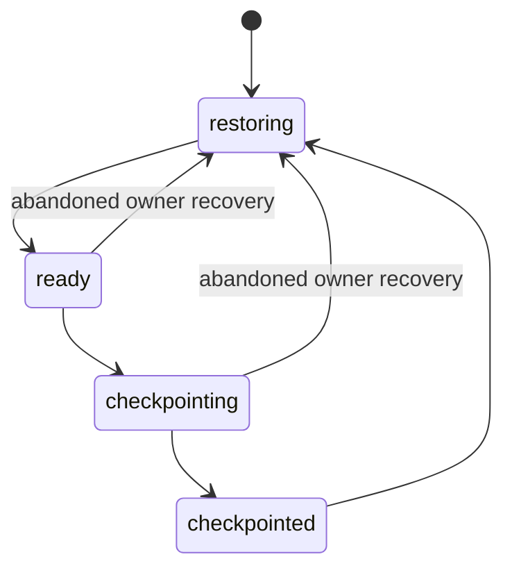

# Durable logical Computer

ERII-24 adds the Lume lifecycle behind the existing Code Mode ToolExecutor and
Security boundary. `cua.getState()` lazily obtains the configured logical
Computer. Its ID persists in `state.db`; replacement instances get increasing
epochs. The accepted Code Mode invocation owns its lifecycle plan and cleanup.
Once its accepted nested calls have drained, the Host requests Guest shutdown,
commits a durable checkpoint, and destroys the disposable instance. Claim recovery
retains the frozen idle request and checkpoint IDs until its final metadata commit.
The provider verifies the published unit before checking the source instance, so
a crash after deletion can reconcile disposal without requiring that instance.
If that invocation is cancelled, a new authorized invocation derives the old
idle request from the retained operation ledger for the exact previous Computer
and instance epoch. It verifies the published unit and reconciles disposal before
restoring the replacement. Reclaiming the new invocation derives the same link
even after supersession. The cancelled Task, Run and Code execution stay terminal;
only Computer lifecycle progress is reconciled. No schema or frozen-request
format changes; unknown effects still fail closed.

ERII-25 adds live inventory, leased App/Window/Tab bindings, AX and screenshot
revisions, input, bounded waits, scoped Artifact transfers and the delayed
Playwright Capability. See [Computer Use](computer-use.md) for the facade,
conservative action approvals, Guest browser provisioning and verification.
Existing explicit Core/Code Mode Computer Fakes remain separate fixtures.
Computer configuration defaults to absent.

## Provisioning

Use Apple Silicon macOS, Lume 0.6.1, a private APFS test store, and a clean,
stopped macOS image with a signed CuaDriver application and pregranted Guest
permissions. The tested combination is documented in [L2 acceptance](computer-l2.md).
The operator supplies a dedicated image without personal accounts, API
credentials or user documents. The compatibility exercise's working VM must
have its synthetic projects and exports removed before serving as this base.

The application does not install or supervise Lume. Run its HTTP API explicitly
in the foreground with a separate `XDG_CONFIG_HOME`. Configure exactly one VM
location, disable telemetry/caching, and keep `vmLocations` last in the pinned
Lume YAML parser:

```yaml
defaultLocationName: "erii"
cacheDirectory: "/ABSOLUTE/OWNED/cache"
cachingEnabled: false
telemetryEnabled: false
vmLocations:
  - name: "erii"
    path: "/ABSOLUTE/OWNED/computer/vms"
```

Use an explicit loopback IP and port. The adapter checks the server's exclusive
storage location, telemetry/caching settings and version before lifecycle work.
HTTP proxies and redirects are disabled. Runtime starts use headless mode with
VNC disabled, no shared Host directories, and Lume's disabled clipboard default.
No default VM store is discovered or adopted.

Initial allocation calls Lume HTTP `clone`, which gives the new logical Computer
its own MAC and machine identifier. A frozen clone marker is durable before
dispatch. The pinned implementation writes the new machine identifier after the
complete directory copy and MAC update; this final postcondition reconciles a
lost HTTP response. A partial clone is never retried or started. Subsequent
checkpoint restores retain this Computer's hardware identity.

Add this advanced configuration to the application's versioned YAML. Keep
`computer.root` separate from application data, coding workspaces, Skills and MCP
working directories. Use a new empty directory with mode `0700`.

```yaml
computer:
  root: /ABSOLUTE/OWNED/computer
  endpoint: http://127.0.0.1:17774
  compatibility:
    provider_version: "0.6.1"
    guest_build: "25F84"
    driver_version: "0.36.0"
    driver_sha256: "54bb23df35ae9a52b6fa7b71e607364d0711bbbf750b9edb006e87b9af586fdd"
    driver_team: "YCK386LBJ7"
    driver_bundle: "com.trycua.driver"
    architecture: arm64
  guest:
    user: lume
    port: 22
    password_ref: env:OWNED_GUEST_PASSWORD
    host_key_sha256: "SHA256:REPLACE_WITH_THE_OWNED_GUEST_ED25519_FINGERPRINT"
  manifest:
    version: 1
    applications: []
    artifact_refs: []
```

JavaScript configuration is also required; see [Code Mode](codemode.md).
Replace the SSH fingerprint with the dedicated Guest's public Ed25519 key
fingerprint. The transport resolves only the explicit SecretStore reference,
uses password authentication in memory, pins Ed25519, and never consults Host
SSH keys or ssh-agent. The existing pinned `x/crypto` module supplies SSH.
Never put the password itself in YAML, SQLite, command arguments or evidence.
The public seed's test login is suitable only for the isolated L2 fixture.

Prepare the base before opening the configured application:

```sh
bin/personal-agent -config /ABSOLUTE/OWNED/erii.yaml computer prepare-base /ABSOLUTE/OWNED/clean-stopped-vm
bin/personal-agent -config /ABSOLUTE/OWNED/erii.yaml computer status
```

`prepare-base` copies only `disk.img`, `nvram.bin` and `config.json`, holds the
native config lock, rejects a session marker, hashes the unit, and publishes its
ownership marker. It refuses a nonempty destination and symlink paths. This is
an offline operator provisioning command; VM lifecycle requests run through the
accepted Tool pipeline. `computer status` is a read-only operator diagnostic.

## State and recovery

Migration 021 adds the logical Computer and frozen operation ledger to the
existing `state.db`. State/version changes and their Outbox events commit with
the Run and Code execution fences. The Computer has one exclusive Code execution
owner. Concurrent users receive a resource refusal; unrelated cells cannot
reclaim that owner's instance. Pending accepted calls retain ownership until
they drain or a later fenced owner recovers them.

The lifecycle uses these states:



An abandoned ready instance is checkpointed before its replacement starts.
Incomplete allocation reattaches to its frozen operation. Epochs and claim
fences reject old owners at effect and completion boundaries. Registry resource
hashes freeze the configuration with the Run's Capability Snapshot; changing
configuration cannot redirect an accepted Run. Guest build, Driver executable
digest, bundle/team signature, console login and an actual Driver capture are
checked before readiness. Incompatible signatures and SSH keys fail closed.

Each checkpoint is one atomically published directory containing the three VM
files and a typed receipt with their full SHA-256 digests, compatibility snapshot
and restoration manifest. Files/directories are fsynced before publication.
Restore verifies the source and publishes a complete new instance directory;
it never installs disk, NVRAM and config one at a time into a live VM.

On APFS, byte-identical atomic COW clones avoid materializing sparse disks.
Within one provider process, a verified immutable unit can reuse its digest
while inode, size and modification time remain unchanged. A new process hashes
the complete source. Keep the private base/checkpoint directories immutable.
Disposal requires the committed checkpoint. Checkpoints and their operation
audit are retained; CPU/RAM and disposable instance directories are released.

The restoration manifest contains bundle IDs, absolute Guest document paths and
stable Artifact references. It applies when restoring a checkpoint; a fresh base
has no user documents to reopen. App/document intent is fixed for this slice.
The ArtifactStore continues to own Artifact bytes and authorization. The
manifest does not serialize JavaScript heaps, Driver sessions or surface handles.
Warm memory snapshots are optional and are not implemented.

### Graceful shutdown and uncertain outcomes

Lume 0.6.1 HTTP `/stop` performs framework power-off. Graceful checkpointing first
requests OS shutdown through the authenticated Guest connection and proves the
native run lock has been released. An abandoned session marker is removed only
while holding that lock on the verified owned instance.

The same-process Lume cache may still report running. Only after native teardown
may the adapter reconcile it with `/stop`, accepting the exact already-not-running
400 response and then requiring `stopped`. The adapter releases its observer lock
before this HTTP request: Lume's fallback can signal a lock holder and replace
the config inode. It reacquires the current file's lock before copying and
checks the inode again before checkpoint publication.

Start/shutdown intent markers are durable before dispatch. If an earlier request
has an unprovable outcome, the adapter returns `UNKNOWN_SIDE_EFFECT` instead of
resending it. It never substitutes power-off for failed graceful shutdown.
Preserve the owned store for diagnosis; use authoritative state to resolve an
uncertain operation. Configuration/signature/integrity refusals expose safe
standard Tool errors, without raw paths, SSH diagnostics or credentials.

## Verification

```sh
go test ./internal/computer/... ./internal/agent/sqlite -run 'TestComputer|TestLifecycle|TestCheckpoint|TestSSH|TestUnknown|TestCorrupt|TestNoCheckpoint|TestStopped|TestUnit'
python3 scripts/verify_computer.py --binary bin/personal-agent --evidence evidence/computer.json
```

The maintained offline harness launches the real CLI and production HTTP/SSH
adapter against explicit protocol Fakes. It drives Code Mode, records nested
ToolInvocations, kills the Agent at readiness and before/after checkpoint
publication and after instance disposal but before the final metadata commit,
then proves a fresh cell succeeds and reads back all three files and Artifact bytes.
It also cancels a Worker Task through Main at readiness and after disposal. Both
cases require a successful fresh cell and unchanged cancelled Task/Run/Code
terminal states. After disposal it verifies the committed file hashes and that
the new ensure uses the original checkpoint. All owned processes are joined.
`make verify` runs it five consecutive times. Contracts cover empty
and populated v20 migration, illegal state changes, CAS/fencing, concurrent
ownership, corrupt NVRAM, blocked shutdown, ambiguous start, symlinks and actual
test-process death at publication boundaries.

For the authorized dedicated L2 root, first seal the clean base and run the
foreground `lume_live.py --profile product serve` with its isolated product
configuration. Then use:

```sh
python3 scripts/verify_computer.py --binary bin/personal-agent --live-root TEST_ROOT --live-config TEST_ROOT/product-live.json --evidence TEST_ROOT/evidence/computer-provider-live.json
```

This mode uses the real Lume/macOS/Driver path and a deterministic model fixture.
It creates only a synthetic Guest text file and TextEdit document intent, proves
cold and SIGKILL recovery (including deletion before the final metadata commit),
proves resumed and fresh cells succeed, independently hashes the full unit, checks the
stable Artifact, and retains the private state/receipts for inspection. The
foreground API is stopped and joined separately after the instance cleanup.
Actual Jianying compatibility remains a separately recorded [L2 matrix](computer-l2-result.json).

The latest [native lifecycle report](computer-provider-l2-result.json) includes
five scenarios. In the post-disposal SIGKILL case, the instance is absent and
the committed checkpoint ID remains unchanged when phase advances from
`checkpointing` to `checkpointed` under the replacement claim. The following
fresh cell restores the same logical Computer at the next instance epoch and
reads the saved Guest document. The reviewed fixture was archived intact; the
repair run used fresh isolated CLI state because its predecessor referenced an
expired worktree's JavaScript installation.
