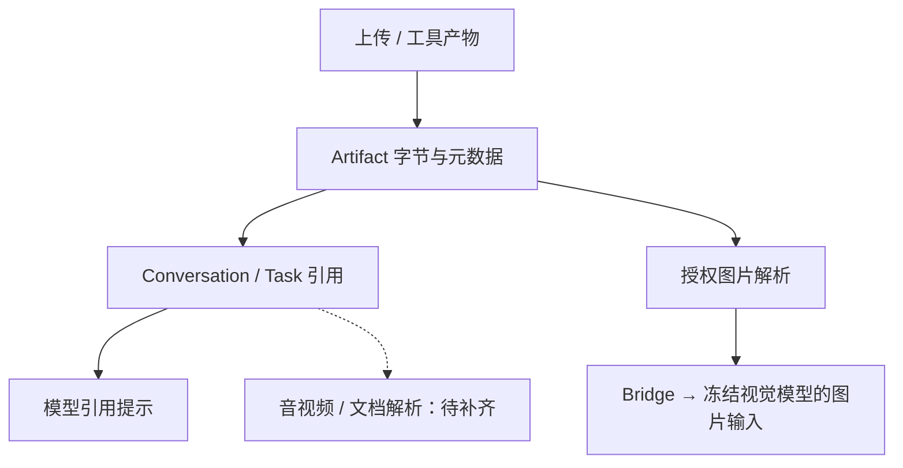
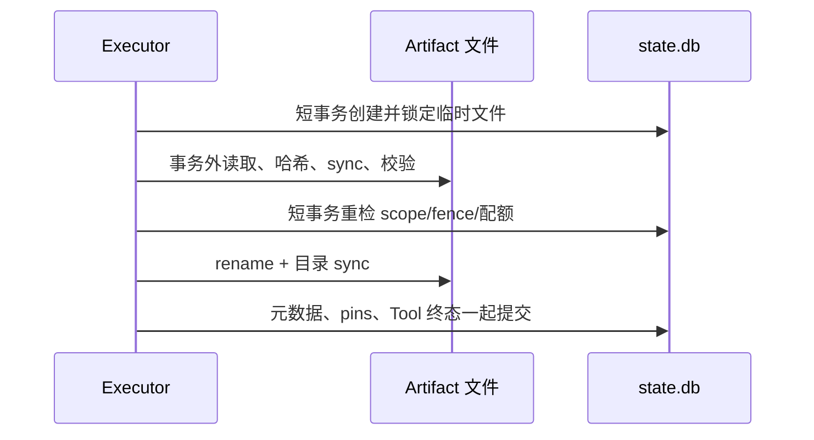

# 文件产物与多模态输入：技术方案

[功能与需求](../features/artifacts-media.md) · [测试方案](../test-plans/artifacts-media.md) · [主索引](../feature-map.md)

最近核对：2026-10-28。本文的架构与流程描述当前有效实现；明确标记的待实现方案不表示已落地。实现级协议仍服从 [跨功能协议与约束](product-overview.md#contract-0-文档效力与实现规则)。

## 当前架构

文件字节位于 Artifact store，引用与权限由 Host 解析。Conversation 保留语义引用；支持的用户图片与显式选择的工具图片在 dispatch 时由 Host 解码，再送入冻结 Provider envelope。

### 用户图片输入与职责边界（F-013）

1. Web 根据附件 MIME 产生 image ContentPart；CLI 通过显式 `type:image` 引用。现有入站接纳验证并 pin 可访问 Artifact，Conversation 与 checkpoint 仅保存语义引用。
2. `agent/messages.go` 统一角色、内容与媒体引用投影。只有真实 user 图片和原有显式 Tool 图片可选择像素；runtime 证据、assistant 附件和 Task 更新不自动变成图片输入。Root/Child 的正文与 Artifact refs 仍保持显式委派边界，不借此复制 Main 图片上下文。
3. 新建 Run 的 `run_context_policy` 冻结 `user_images:true`；Child 复制 Parent 的原始策略。字段缺失表示旧用户引用模式，旧请求和压缩缓存的输入/策略 hash 不重写。该标记属于 Host 的投影版本约定，不是 YAML 配置或新模型能力。schema 29 与 Bridge 格式保持不变，升级时统一停止旧进程，禁止不同投影实现混跑。
4. `agent/sqlite/images.go` 只给未完成、已接纳的视觉 generation 安装临时 resolver。resolver 限定该请求选择的 refs，再通过既有 Artifact 权限、完整性验证及 claim/隐私二次 fence 读取；未选择和未授权引用均拒绝。已完成 generation 直接复用结果，不重新读图；文本模型不安装 resolver。
5. `llm/bridge/images.go` 将请求选择/去重/总量预算与单图解码/预览生成分开。PNG/JPEG 上限为 8 MiB、约 3355 万像素（32 × 1024²），每图最长边 640（极窄图仍至少 1 像素），JPEG 预览最多 48 KiB；工作集最多 8 张，激进重试 4 张，总 base64 预算 512 KiB，复用 1 MiB RPC 上限。输入图片上限由 `llm/images.go` 统一定义。
6. 图片字节仅存在于临时 provider envelope，observer、SQLite generation、Conversation 和摘要档案均不写 base64。格式、大小、损坏与权限失败在供应商调用前拒绝。语义摘要不隐式获得图片；文本模型的 working set 明确说明像素不可用。

Settings 的图片复选框只是候选声明；既有 Host 蓝色方块 Probe 经同一图像 envelope 验证成功后才可选择模型。Saved models 区分未验证请求、已验证图片输入和纯文本。更新模型只影响新 Run，现有模型快照保持冻结。

### 短事务与文件所有权（F-039）

临时对象保持进程所有的文件锁；回收器在元数据事务内以非阻塞 flock 跳过活跃文件。进程死亡自动释放锁，未提交对象由现有回收扫描删除。读取绑定同一 fd，在事务外验证完整性；Run/Computer 使用前再次检查 owner/隐私 fence。显式 publish 的整组内容先在事务外校验，短事务重检每项授权、存活和版本，再一起写最终选择。配额仍由单一即时事务接纳。

## 当前流程与目标差异

上传或保存 → 绑定授权引用 → Agent 读取/处理 → 显式 publish → Main 选择最终附件 → 渠道交付。媒体内容理解需另经支持的解析或视觉路径。

- **F-012**：Artifact 存储、哈希校验、发布选择、Task 引用与渠道文件入口已实现。 保存文件不等于理解内容；发布仅选择当前 Run 最终输出，不授予外部发送权限。
- **F-013**：新 Run 将显式用户图片投影为 ImageRefs。Host 在 dispatch 时以当前 claim/隐私 fence 和 Run grant 读取、验证及缩图，通过既有 Bridge 送给冻结的视觉模型；文本模型保留引用并显式说明无像素。
- **F-014**：附件运输与保存已有；消息投影主要提供引用，未形成统一解析/转写链路。 按实际用户场景明确支持格式，补解析、转写或媒体工具及错误反馈；不以合成文件证明理解质量。

## 代码与依赖

- [internal/artifact/tools/tools.go](../../internal/artifact/tools/tools.go)
- [internal/agent/sqlite/artifacts.go](../../internal/agent/sqlite/artifacts.go)
- [internal/app/artifacts.go](../../internal/app/artifacts.go)
- [internal/agent/messages.go](../../internal/agent/messages.go)
- [internal/agent/sqlite/images.go](../../internal/agent/sqlite/images.go)
- [internal/llm/images.go](../../internal/llm/images.go)
- [internal/llm/bridge/images.go](../../internal/llm/bridge/images.go)
- [internal/agent/sqlite/codemode.go](../../internal/agent/sqlite/codemode.go)

## 验证与交付

验收场景、已有入口和剩余覆盖统一在 [测试方案](../test-plans/artifacts-media.md) 维护。软件证据验证真实入口、最终供应商 HTTP 请求与恢复，不代表真实模型视觉质量或真实账户验收。

## 协议、实现与配置约束

迁入内容按职责归属在此维护。既有编号用于追溯协议，不代表所有设计目标均已实现；完成状态以需求主索引为准。

#### 4.3 Artifact 协议

- 核心协议统一使用 `artifact_ref` 引用文件、图片、视频等产物。
- 模型不得直接输出 `MEDIA:/绝对路径`。
- Artifact 的真实位置、生命周期和访问方式由 Artifact/Computer 层解析。
- Artifact 二进制内容不内联写入可重放的 Conversation 或 Run 历史，避免长会话因 Base64 媒体持续膨胀。
- ERII-192 将模型可见 Artifact 工具收敛为 `builtin__artifact_manage/search`，经过同一个 ToolInvocation/Executor。`manage` 使用严格的 `operation: save | read | describe | publish` 联合 Schema；`search` 无 query 时浏览，有 query 时按名称或 MIME 子串筛选，按可访问结果取最近 1–50 条。`manage` 整体使用 `artifact_write`，只允许本地不可变新产物、读取和显式最终输出选择，不允许外部发送、上传或删除；`search` 使用 `read_only`。单用户安装的 principal 绑定 data root 与 OS 用户，模型不能选择 user/Agent/Task/Run 作用域。详见 [Artifact 实现与运维](../features/artifacts-media.md)。

### Tool contract

The consolidated Artifact builtins use the existing Tool Registry, frozen
Capability Snapshot, ToolInvocation, Executor, claim/epoch fence and error normalization. Replay
policy is `safe`, timeout is 10 seconds, result limit is 64 KiB, risk is low.
Only the Host executes them. No direct Tool bypass or separate invocation
pipeline exists. Main and Worker share these capabilities; Workers still lack
Task controls and user delivery.

| Tool | Arguments | Result | Permission |
| --- | --- | --- | --- |
| `builtin__artifact_manage` (`operation: save`) | `name`, `mediaType`, `text` (8192 characters; 16 KiB total call cap) | opaque ref in `artifact_refs` | `artifact_write` (local immutable write) |
| `builtin__artifact_manage` (`operation: read`) | `artifactRef`, optional byte `offset`, `limit` 1–4096 | bounded text range; binary content returns a ref | `artifact_write` |
| `builtin__artifact_manage` (`operation: describe`) | `artifactRef` | name, MIME, hash, size, dates, version | `artifact_write` |
| `builtin__artifact_manage` (`operation: publish`) | `artifactRefs` (0–127) | selected refs | `artifact_write` |
| `builtin__artifact_search` | optional `query`, `limit` 1–50 (default 50) | accessible descriptors by Unicode-lowercased name/MIME substring, newest first; no query browses | `read_only` |

Unknown fields, ownership/Run IDs, URLs and path inputs are rejected. Inaccessible,
forged, expired, deleted or corrupt references return `NOT_FOUND`; invalid
names/MIME/ranges return `INVALID_ARGUMENT`; quota/size failures return
`RESOURCE_LIMIT`. Storage failures do not become successful results. Byte ranges
must contain valid UTF-8; callers can adjust boundaries when a character is cut.
Binary media remain references. This API does not base64 encode media.

Save and Tool output publication commit metadata with the normalized Tool result.
Runtime idempotency uses the accepted invocation ID, never model-supplied keys.
Large text exceeding the frozen Tool output limit and internal provider binary
streams become Artifacts before any result event, checkpoint or next generation.
Small Tool outputs retain their existing representation. Only an accepted
`publish` invocation can select final outputs; provider result fields cannot
select them. Binary consumption and publication validation keep the same frozen
Tool deadline. The Executor closes returned closable streams, including on
expiry/cancellation, and joins cancellation cleanup before returning. Failed
normalization rolls back metadata, pins and publications before committing the
Tool error. An external-effect stream timeout remains `unknown` and never
retries the effect. Authoritative Query receipts use that same atomic
normalization for reclaimed running calls and terminal `unknown` calls. The
caller, persisted result, reconciliation proof and replay expose the committed
ref. The frozen Query deadline includes receipt consumption and stream closure.
Unusable receipts retain `unknown`; storage errors propagate without settling or
redispatching the effect. Query-only reconciliation never revives the old Run.
A published reference is a resource address; it grants no external upload permission or approval.

`publish` explicitly adds selected final outputs for that Run; it is idempotent
and additive. Intermediate saves are excluded. The union of final selections is bounded to
127 refs, leaving one text part in the 128-part Conversation envelope. A call
exceeding that aggregate limit returns `RESOURCE_LIMIT` without changing the
selection. Root results carry only the
Root's explicit publications in Task updates; Main explicitly selects outputs
for final Conversation parts, preserving image/audio/video semantic types and
using file parts for other MIME types. Direct Child admission and result handoff are covered by [Child operations](delegation.md).
Changing content creates a new ref; no overwrite operation exists.

### Recovery, quota and retention

Defaults: 30 days, 1 GiB per local user, 64 MiB per object, 100 expiry candidates
per cleanup batch. `artifact` configuration sets positive bounds; quota must
cover max object size. Quota counts all live metadata, including expired objects
until deletion. Streaming, syncing and full integrity verification happen outside
state.db transactions. Short immediate transactions serialize quota admission,
metadata publication and recovery scans. Staged files keep an exclusive file
lock until metadata commits or the owner closes; orphan recovery skips locked
files across processes. A crash releases the lock, permitting orphan cleanup.
Rename and directory sync precede atomic metadata/Tool result commit. A committed
Tool result is reused after restart. Existing data needs no schema migration;
stop older binaries before upgrading because their recovery ignores file locks.
Filesystem access uses `os.Root`, generated flat keys, regular-file checks and
no caller-controlled paths. A symlink as the Artifact root fails startup;
symlink objects and path escapes fail closed. The configured data root and OS
account remain trusted deployment boundaries.

Startup always performs orphan recovery first. Cleanup of committed metadata defaults to dry-run. It reports expired, unreferenced candidates and
orphan counts without mutating them. Apply tombstones a bounded batch, commits,
and then removes bytes. Active/paused Task outputs are protected from automatic
cleanup. References to input history, Tool results, Tasks and explicit outputs
pin content. These audit references are durable; retention does not silently
release them. Future history pruning must release its references in the same
transaction before storage can be reclaimed. After Task protection ends, effective expiry rejects content reads.

## Changelog

2026-10-28：测试入口随当前 Makefile/runner 对齐。旧说明中的 make verify、Delivery/security 分片与自动五轮是历史调度；当前默认单次，重复次数通过 runner --repeat 显式指定。保留机制验收要求。

2026-10-28：按统一文档结构迁入本功能的协议与历史决策，更新引用并移除旧文件；此为文档归属调整，不改变运行时协议。

本节追加记录每次架构/流程取舍。旧图不保留在正文；历史正式决定保留在本节。首次记录为现状建档，不推断历史决策日期。

| 日期 | 类型 | 决策与理由 | 取舍及影响 | 关联 |
| --- | --- | --- | --- | --- |
| 2026-10-28 | F-013：用户图片进入视觉输入 | 从 Run 类型/生成存储文件拆出统一消息投影与授权图像 resolver，缩图过程分职责；复用既有 Probe 与 Bridge。 | 采用冻结 context policy 标记保留旧引用表示，不改已有请求或扩大 Child 权限；相比把 base64 放入历史或增加专用看图工具，保持引用持久化和统一执行路径。无需 schema 迁移，升级进程统一版本。 | F-013 |
| 2026-10-28 | F-039：流读取/校验移出 SQLite，保留短事务配额及结果接纳；活跃对象由文件锁保护。 | 避免长流阻塞 lease 和结果接纳；增加文件所有权协议，需停止旧版本后升级，禁止不同回收协议混跑。 |
| 2026-10-28 | 现状建档 | 保留引用式持久化，避免把 Base64 写入对话与恢复记录；用户输入与工具图片分开追踪，不能用运输证据代替模型理解。 | 明确当前边界与待补齐链路；本次仅建立文档，未修改运行时。 | [跨功能契约](product-overview.md#contract-0-文档效力与实现规则) |

后续记录需包含实际比较过的选项、采用理由、兼容/迁移影响和相关需求或 PR；未决建议不能写成已实施决策。
