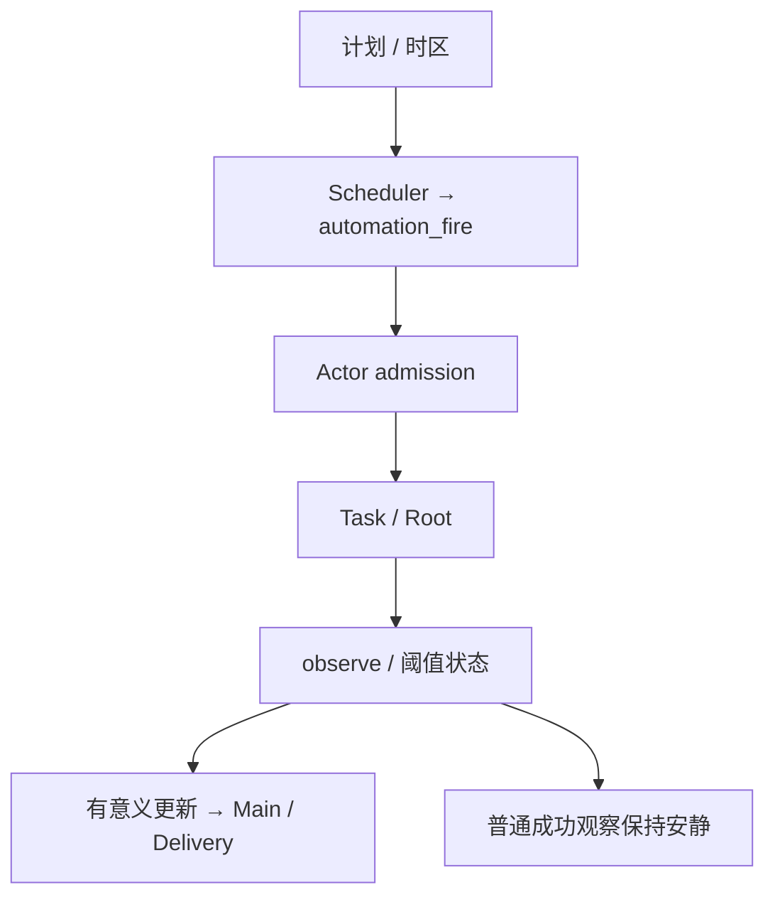

# 自动化与安静监控：技术方案

[功能与需求](../features/automation.md) · [测试方案](../test-plans/automation.md) · [主索引](../feature-map.md)

本文的架构与流程描述当前有效实现；明确标记的待实现方案不表示已落地。实现级协议仍服从 [跨功能协议与约束](product-overview.md#contract-0-文档效力与实现规则)。

## 当前架构

Scheduler 仅产生持久 fire。Actor 通过同一事务关联 ongoing Task 和新 Root；Root 观察后经 Reporter/Main 决定交付。

## 当前流程与目标差异

建立计划 → 到期保存 fire → 校验计划/隐私版本 → 创建或复用 Task 并新建 Root → 执行 → 必要时通知。取消和旧版本触发不能重新激活已停止意图。

- **F-015**：计划、触发记录、Task/Root admission、版本去重和恢复已接通。 执行需要应用或前台 worker 在运行；不自动分离守护进程。
- **F-016**：Root observe 写入每次 fire 的观察值，保存阈值跨越状态并控制 Reporter 通知。 本需求是监控机制，不内置价格或其他在线数据源；真实数据接入由 F-025 跟踪。

## 代码与依赖

- [internal/automation/automation.go](../../internal/automation/automation.go)
- [internal/agent/sqlite/automation.go](../../internal/agent/sqlite/automation.go)
- [internal/agent/sqlite/reporter.go](../../internal/agent/sqlite/reporter.go)
- [internal/app/automation.go](../../internal/app/automation.go)

## 待实现方案

以下方案尚未实现。接口、持久化结构、迁移与精确时序须在实现前确定；当前执行仍遵循已有运行时契约。验收范围见功能说明及并列测试方案。

### F-045 · 主动规则的观察与启用

当前使用者是已经授权 F-042 GitHub PR 监听的本机所有者。他可以先对一项已有 Task 查看规则决策，再决定是否交给现有 Main 和 Task/审批管线。规则范围来自确切 PR 配置和不可变 Task 目标，控制面只扩展已有 `github bind/binding/unbind` 与只读 `github decisions`。这组 CLI 字段处于实验阶段，决策表及状态协议为私有实现。

所有者选择事件类型和模式，宿主负责匹配、身份去重、授权和事务接纳。绑定复用已有 CAS version 和 generation。成功轮询事务在保存新观察时按开始扫描时捕获的代次校验当前绑定、Task 和隐私作用域，同批保存可解释的确定性匹配结果。每个观察版本最多一条决策，保存当时 Task、模式和筛选；代次取自不可变观察。查询只返回当前配置 PR 和隐私作用域内的有界元数据。规则匹配无需模型。

未绑定或撤销后为关闭模式。观察模式可评估并保存决策。显式自动模式只允许当前代的匹配观察进入现有单 Main 接续，随后仍受同 Task、作用域、未知副作用及审批约束。规则修改原子推进代次和序列水位，撤销未接纳的旧因果 Main。已接纳的 Root 归原 Task 管理，旧冻结请求不被改写。迟到的旧代轮询可以保存原始观察，重试同一版本仍无法获新代授权。迁移 038 保留旧绑定的无筛选自动行为，只允许迁移前已落盘且越过旧水位的无代次观察走旧规则；新观察在旧格式绑定下也必须匹配当前代。

有界决策、Task 和授权代次是正确性与审阅所需的状态。规则直接使用已存在的事件种类和绑定，避免额外规则版本、通用语言、批次调度器和独立执行面。暂不开放模型研判、其他来源或跨 Task 自动分配。

## 验证与交付

验收场景、已有入口和剩余覆盖统一在 [测试方案](../test-plans/automation.md) 维护。实际执行结果以对应版本的 PR 或 CI 证据为准；架构说明不证明回归或 Live 验证通过。

## 协议、实现与配置约束

本功能协议在此维护。既有编号用于追溯协议，不代表所有设计目标均已实现；完成状态以需求主索引为准。

#### 3.11 Automation 与 RunScheduler

- 保留独立的 `RunScheduler`，因为定时提醒、周期性简报、持续跟进等能力会较早进入产品。
- 对外能力和领域对象统一命名为 `Automation`；不使用 `ScheduledTask`，避免与 Agent 为并行执行创建的内部 `Task` 混淆。
- `Automation` 表示用户持久化的自动执行意图；一期 `trigger` 支持单次 `at` 与周期 `cron`，并显式保存用户时区。
- `RunScheduler` 只负责持久化触发条件并在到期时产生统一的调度事件，不直接执行 Agent Loop，也不承载业务逻辑。
- 调度事件进入 `AgentActor`，由正常路由规则创建或唤醒 Main Run/Worker Run；定时触发与用户消息复用同一套 Run、权限、工具和交付链路。
- 实际执行仍由 `RunExecutor` 消费 `run_ready`、调用 `RunStore.Claim` 后完成，Scheduler 不绕过 RunClaim。
- 一期不在 Scheduler 内实现资源编排或复杂工作流；未来云端可将触发器实现替换为分布式调度服务，而保持内部事件协议不变。
- 本地 CLI 的 `automation work` 在前台以同一个 Actor/RunClaim 路径消费触发；`automation tick` 只生成事件。运行命令、Tool Schema、升级和证据见 [Automation operations](../features/automation.md)。
- cron 使用五个数字字段，支持列表、范围、步长；weekday `0L`～`6L` 表示当月最后一个对应星期。不存在的 DST 分钟跳过，回拨的两个 UTC 分钟分别触发。错过多次时合并为持久化的原到期触发，下一次 cron 严格晚于扫描时间。
- 持久化 fire 身份、独立 schedule version 和 Inbox 收据。修改使旧排队触发/结果失效；取消复用 Task epoch 停止树，不创建新 Run。每个 Automation 绑定 ongoing Task，每次触发按序新建 Root；Model/Capability 在 admission 时冻结。
- Automation 接受时冻结隐私 epoch；admission 在创建首个 Task 前校验该意图与当前 Forget 屏障，撤销的 fire 持久化 skipped 与 Inbox。收据重放、调度更新或新 Task 时间戳不能恢复旧意图；升级时缺少 provenance 的旧意图在已有 Forget 后保守跳过（ADR 003）。list 对撤销意图仅返回 Host 生成的引用、当前版本和 enabled 控制状态，清空指令/调度/时区并省略 nextFire/below；本地审计保留，新的意图仍完整可见。
- 可选整数 `below` 阈值由绑定 Root 的普通 ToolInvocation 记录观测；同一 fire 的多来源同值幂等，异值拒绝。仅从阈值外进入阈值内允许完成通知；无有效观测报告 needs_input，不伪造数据。

统一链路为：

`Automation → trigger → RunScheduler → AgentActor → Run → AgentLoop → Delivery`

### Tool contract and compatibility

| Tool | Exposure | Permission | Replay | Errors |
| --- | --- | --- | --- | --- |
| `builtin__automation_manage` | Main | `task_control` | safe; frozen invocation and source/action receipt | invalid request/CAS: `INVALID_ARGUMENT`; missing ref: `NOT_FOUND`; Worker: hidden/denied |
| `builtin__automation_observe` | Only monitoring Automation Root; Main/ordinary Roots/Children hidden | `automation_observe` | safe; immutable per-fire observation | invalid value: `INVALID_ARGUMENT`; wrong role/fire: `PERMISSION_DENIED`; value drift: `NON_DETERMINISTIC_REPLAY` |

The shared ToolExecutor enforces frozen schemas and exact action approval for
any downstream external effect. Automation grants no credentials or effect
approval. Existing frozen capability snapshots gain no Tools. New Root trees
freeze the active profile at admission, not when the schedule or fire was created.

Migration 023 adds Automation, fire identities, source/action receipts, due and
pending indexes, version/transition/audit constraints. Empty and all prior schemas
upgrade forward. Populated v22 migration and partial-DDL rollback have dedicated
tests. Back up the whole data root with the process stopped before upgrading.
Migration 024 adds the immutable intent privacy epoch. Legacy Automation rows
retain their audit and default to epoch zero: they remain eligible without a
Forget barrier; with a barrier they are conservatively skipped, even if their
calendar timestamps appear newer. Create a new Automation from fresh independent
input to establish intent after Forget. Existing fire/request receipts are not
rewritten. Partial-DDL rollback and populated v23 preservation are tested. Older
binaries reject schema 24. No credentials enter these records.

## Web 所有者直接编辑

具体需求是让所有者在 Task 页面看见待执行安排并手工修改配置，参考成熟自动化表单的指令／频率／时间层级。CLI 与 Main 工具已共用 Runs 的事务、automation_request 收据、schedule_version fencing；它们的 cancel 同时取消关联 Task，无法充当可恢复的安排停用开关。

新增内部 OwnerConfiguration/OwnerReceipt 与 ConfigureAutomation，使用同一 Runs.write 和不可变收据机制。此为私有所有者配置契约，不扩展模型 Tool schema，不把 TaskReader 改成写入接口，也不新增数据库表。版本、当前所有者和原意图 privacy epoch 在事务内校验；仅更新安排及触发版本，不修改已接单 fire、Task 指令或 Run 快照。停用不取消 Task；已过时的未接单 fire 由既有版本检查拒绝，旧版本阈值观察不再具备通知资格。

Web 使用独立的 ScheduleSettings 读写适配。source_id 保留跨未知响应的重试身份；匹配收据在当前版本检查前返回，改变同 key 的请求被拒绝。未修改的单次时刻通过原始精确 Spec/时区证明保留秒、小数和既定偏移；新写入须在事务内匹配原配置与提交版本，避免隐藏字段成为任意回写入口。新输入的本地日期时间须唯一对应一个真实时刻；拒绝夏令时空缺／重复而不静默归一化。

保留了原始任务和完成规则不可变的边界；没有引入可编辑 Task anchor、通用工作流、结束日期或单项模型选择。安排读失败仅降级安排区域，普通任务仍可读。此实现不承诺执行恰好发生在触发时间，也不新增后台守护进程。
