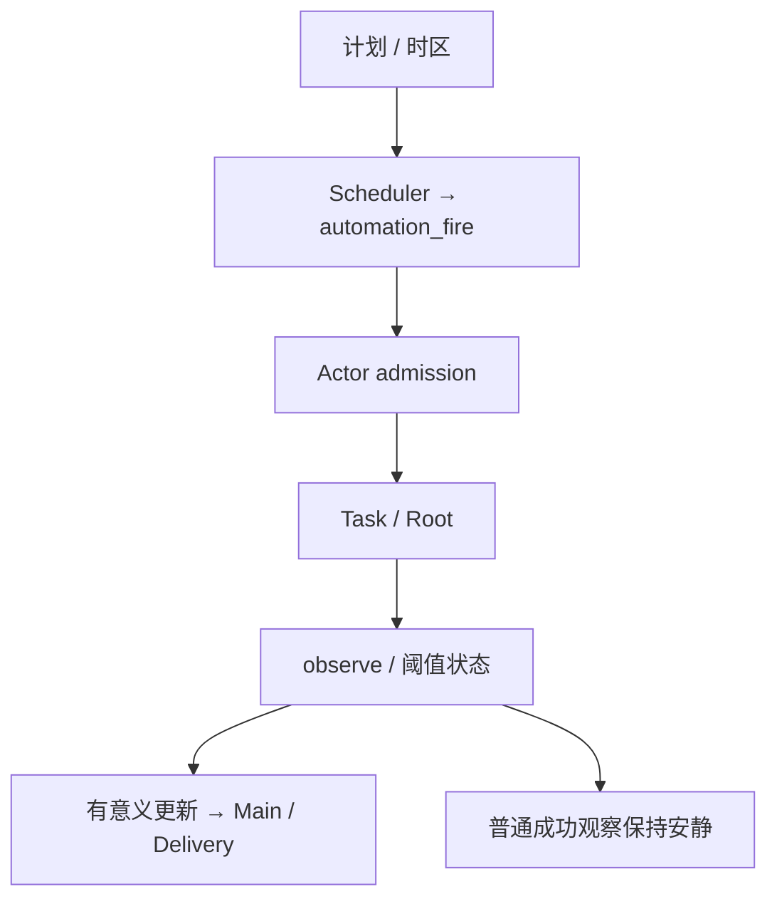

# 自动化与安静监控：技术方案

[功能与需求](../features/automation.md) · [测试方案](../test-plans/automation.md) · [主索引](../feature-map.md)

最近核对：2026-10-28。本文的架构与流程描述当前有效实现；明确标记的待实现方案不表示已落地。实现级协议仍服从 [跨功能协议与约束](product-overview.md#contract-0-文档效力与实现规则)。

## 当前架构

Scheduler 仅产生持久 fire。Actor 通过同一事务关联 ongoing Task 和新 Root；Root 观察后经 Reporter/Main 决定交付。

## 当前流程与目标差异

建立计划 → 到期保存 fire → 校验计划/隐私版本 → 创建或复用 Task 并新建 Root → 执行 → 必要时通知。取消和旧版本触发不能重新激活已停止意图。

- **F-015**：计划、触发记录、Task/Root admission、版本去重和恢复已接通。 执行需要应用或前台 worker 在运行；不自动分离守护进程。
- **F-016**：Root observe 写入每次 fire 的观察值，保存阈值跨越状态并控制 Reporter 通知。 本需求是监控机制，不内置价格或其他在线数据源；真实数据接入由 F-025 跟踪。

## 代码与依赖

- [internal/automation/automation.go](../../internal/automation/automation.go)
- [internal/agent/sqlite/automation.go](../../internal/agent/sqlite/automation.go)
- [internal/agent/sqlite/reporter.go](../../internal/agent/sqlite/reporter.go)
- [internal/app/automation.go](../../internal/app/automation.go)

## 验证与交付

验收场景、已有入口和剩余覆盖统一在 [测试方案](../test-plans/automation.md) 维护。本次建档未执行本功能的回归或 Live 验证，不以架构图替代运行证据。

## 协议、实现与配置约束

迁入内容按职责归属在此维护。既有编号用于追溯协议，不代表所有设计目标均已实现；完成状态以需求主索引为准。

#### 3.11 Automation 与 RunScheduler

- 保留独立的 `RunScheduler`，因为定时提醒、周期性简报、持续跟进等能力会较早进入产品。
- 对外能力和领域对象统一命名为 `Automation`；不使用 `ScheduledTask`，避免与 Agent 为并行执行创建的内部 `Task` 混淆。
- `Automation` 表示用户持久化的自动执行意图；一期 `trigger` 支持单次 `at` 与周期 `cron`，并显式保存用户时区。
- `RunScheduler` 只负责持久化触发条件并在到期时产生统一的调度事件，不直接执行 Agent Loop，也不承载业务逻辑。
- 调度事件进入 `AgentActor`，由正常路由规则创建或唤醒 Main Run/Worker Run；定时触发与用户消息复用同一套 Run、权限、工具和交付链路。
- 实际执行仍由 `RunExecutor` 消费 `run_ready`、调用 `RunStore.Claim` 后完成，Scheduler 不绕过 RunClaim。
- 一期不在 Scheduler 内实现资源编排或复杂工作流；未来云端可将触发器实现替换为分布式调度服务，而保持内部事件协议不变。
- 本地 CLI 的 `automation work` 在前台以同一个 Actor/RunClaim 路径消费触发；`automation tick` 只生成事件。运行命令、Tool Schema、升级和证据见 [Automation operations](../features/automation.md)。
- cron 使用五个数字字段，支持列表、范围、步长；weekday `0L`～`6L` 表示当月最后一个对应星期。不存在的 DST 分钟跳过，回拨的两个 UTC 分钟分别触发。错过多次时合并为持久化的原到期触发，下一次 cron 严格晚于扫描时间。
- 持久化 fire 身份、独立 schedule version 和 Inbox 收据。修改使旧排队触发/结果失效；取消复用 Task epoch 停止树，不创建新 Run。每个 Automation 绑定 ongoing Task，每次触发按序新建 Root；Model/Capability 在 admission 时冻结。
- Automation 接受时冻结隐私 epoch；admission 在创建首个 Task 前校验该意图与当前 Forget 屏障，撤销的 fire 持久化 skipped 与 Inbox。收据重放、调度更新或新 Task 时间戳不能恢复旧意图；升级时缺少 provenance 的旧意图在已有 Forget 后保守跳过（ADR 003）。list 对撤销意图仅返回 Host 生成的引用、当前版本和 enabled 控制状态，清空指令/调度/时区并省略 nextFire/below；本地审计保留，新的意图仍完整可见。
- 可选整数 `below` 阈值由绑定 Root 的普通 ToolInvocation 记录观测；同一 fire 的多来源同值幂等，异值拒绝。仅从阈值外进入阈值内允许完成通知；无有效观测报告 needs_input，不伪造数据。

统一链路为：

`Automation → trigger → RunScheduler → AgentActor → Run → AgentLoop → Delivery`

### Tool contract and compatibility

| Tool | Exposure | Permission | Replay | Errors |
| --- | --- | --- | --- | --- |
| `builtin__automation_manage` | Main | `task_control` | safe; frozen invocation and source/action receipt | invalid request/CAS: `INVALID_ARGUMENT`; missing ref: `NOT_FOUND`; Worker: hidden/denied |
| `builtin__automation_observe` | Only monitoring Automation Root; Main/ordinary Roots/Children hidden | `automation_observe` | safe; immutable per-fire observation | invalid value: `INVALID_ARGUMENT`; wrong role/fire: `PERMISSION_DENIED`; value drift: `NON_DETERMINISTIC_REPLAY` |

The shared ToolExecutor enforces frozen schemas and exact action approval for
any downstream external effect. Automation grants no credentials or effect
approval. Existing frozen capability snapshots gain no Tools. New Root trees
freeze the active profile at admission, not when the schedule or fire was created.

Migration 023 adds Automation, fire identities, source/action receipts, due and
pending indexes, version/transition/audit constraints. Empty and all prior schemas
upgrade forward. Populated v22 migration and partial-DDL rollback have dedicated
tests. Back up the whole data root with the process stopped before upgrading.
Migration 024 adds the immutable intent privacy epoch. Legacy Automation rows
retain their audit and default to epoch zero: they remain eligible without a
Forget barrier; with a barrier they are conservatively skipped, even if their
calendar timestamps appear newer. Create a new Automation from fresh independent
input to establish intent after Forget. Existing fire/request receipts are not
rewritten. Partial-DDL rollback and populated v23 preservation are tested. Older
binaries reject schema 24. No credentials enter these records.

## Changelog

2026-10-28：测试入口随当前 Makefile/runner 对齐。旧说明中的 make verify、Delivery/security 分片与自动五轮是历史调度；当前默认单次，重复次数通过 runner --repeat 显式指定。保留机制验收要求。

2026-10-28：按统一文档结构迁入本功能的协议与历史决策，更新引用并移除旧文件；此为文档归属调整，不改变运行时协议。

本节追加记录每次架构/流程取舍。旧图不保留在正文；历史正式决定保留在本节。首次记录为现状建档，不推断历史决策日期。

| 日期 | 类型 | 决策与理由 | 取舍及影响 | 关联 |
| --- | --- | --- | --- | --- |
| 2026-10-28 | 现状建档 | 调度器不执行模型；自动化复用现有执行、审批和交付路径，保留安静通知与版本 fencing。 | 明确当前边界与待补齐链路；本次仅建立文档，未修改运行时。 | [跨功能契约](product-overview.md#contract-0-文档效力与实现规则) |

后续记录需包含实际比较过的选项、采用理由、兼容/迁移影响和相关需求或 PR；未决建议不能写成已实施决策。
