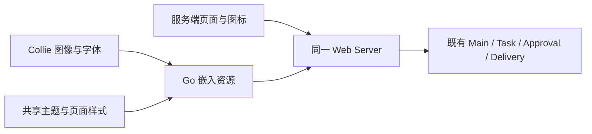
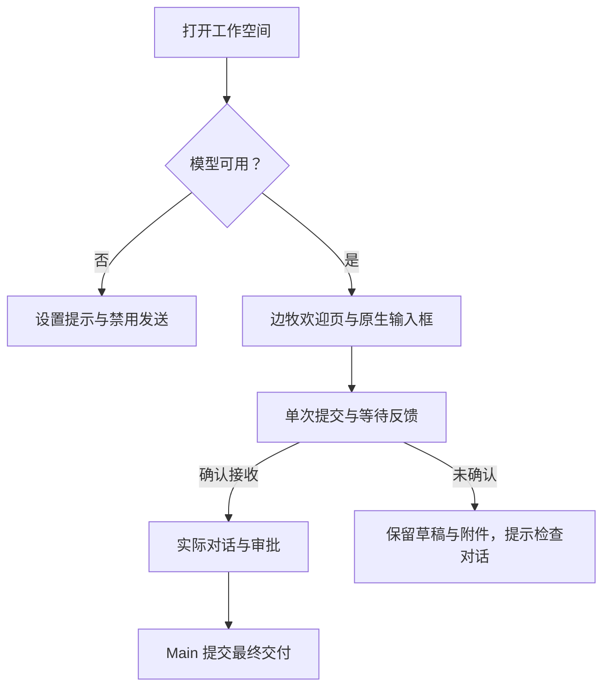

# Collie 品牌：技术方案

[功能说明](../features/branding.md) · [测试方案](../test-plans/branding.md) · [主索引](../feature-map.md)

核对日期：2026-10-29。以下为当前实现。

## 当前架构

`web/src/style.css` 只编排入口：Tailwind → `foundation.css` → shell / workspace / conversation / observability。主题、字体与共享原生控件默认值归 `foundation.css`，页面规则在共享默认值之后加载，防止同优先级 `.panel` 覆盖 `.current-model` 等页面表面和密度。布局、对话、工作页面和执行检查仍各有 CSS 模块。不建立第二套组件库、运行服务或主题覆盖层。服务端模板负责原生表单和可信固定 SVG；React 继续只增强既有固定 UISpec 组件。字体与图片以同源静态路由提供，CSP 仅开放同源字体，不开放 CDN。

原图保持原始字节，使用 CSS 的 object-fit 在各尺寸展示；未采用后续简化草稿。字体以原始文件与 OFL 文本分发。许可与来源见 `web/licenses/`，产品可访问 `/licenses.txt`。

## 视觉参考的落点

- [Coolors](https://coolors.co/)：围绕原图网球选定 `#D8EC63`，配 `#292B27`、`#F8F7F4`、`#6E7068`、`#DFDFD7`，分别承担行动、正文、画布、次要说明和分隔线。重点用色，不把每个面板染成强调色。
- [Fontshare](https://www.fontshare.com/)：参考有个性的展示字体与克制的正文组合。所检查的 Cabinet Grotesk、General Sans 和 Chubbo 下载包当前使用 FFL 2.0，限制公开再分发；本仓库采用可公开分发的 Lora + DM Sans 原始 OFL 字体。
- [Noun Project](https://thenounproject.com/)：参考一致的轮廓图标语言，实际使用项目自绘固定 SVG，不搬运需单独许可的图标。图标不代替操作名称和无障碍标签。
- [React Bits](https://reactbits.dev/) 与 [CTA Gallery](https://www.cta.gallery/)：采用轻微的边牧指针倾斜与网球绿 CTA。发送按钮保持固定位置和单一清晰箭头，等待确认期间用加载指示与文字反馈表达状态。实际代码在 `web/src/brand.ts` 与现有对话 CSS，不引入动画依赖；只有提交等待态循环，未确认不会播放完成动画，减少动态效果时关闭。
- [Frontify](https://www.frontify.com/en)：品牌图像、字标、配色和操作语言共同贯穿每一页，内容页维持明确的阅读与操作层级。
- [Shape of AI](https://www.shapeof.ai/)：沿用明确的模型就绪状态、可恢复的提交反馈、人工审批和执行检查入口，让品牌隐喻与实际系统状态分开。
- [Blush](https://blush.design/)、[Spline](https://spline.design/)、[Unsplash](https://unsplash.com/) 作为插画、3D 和照片的参考。本轮主视觉使用所有者选定的边牧原图，工作页面没有额外外部素材或 3D 运行服务。

### Claude 参考与排版平衡

参考 [Claude 公开产品展示](https://claude.com/product/overview) 的衬线展示字与无衬线操作文字的分工、暖中性色和克制边界。登录后的工作台当前无法直接观察，不将公开营销页等同于其真实会话工作台。未复制专有字体、品牌符号或素材。

欢迎区采用 OFL Lora 400，桌面 42px / 移动 32px，正常字距与单一墨色；操作与阅读统一 DM Sans，正文/输入 16px、导航与按钮 14px，并明确 PingFang SC、Microsoft YaHei、Noto Sans CJK SC 的中文回退。边牧原图保持原字节。欢迎标题、说明与 720px 输入框组成紧凑的一组；欢迎页隐藏重复面包屑，保留模型就绪反馈。

侧栏选中态采用浅底深字，发送按钮保留唯一醒目的网球绿与 44px 点击区域，去掉球纹叠加、重复提示和按钮磁吸。图标统一为圆角 2px 轮廓；模型来源入口也使用固定 SVG。Tasks 空态取消外层卡片，模型当前配置用分隔线组织；审批和错误仍保留语义强调。Developer 技术信息保留紧凑密度，同时提高表格、树和 Context 的文字尺寸。

## 当前流程

欢迎页使用 CSS 根据已有 live 区域是否包含 welcome 切换布局，不重建 composer。输入节点、source_id、焦点、选择、附件和原生 picker 均保留。Reduced motion 关闭入场、悬停与提交动画。执行成功由现有服务端状态判定。

## 身份重置与兼容

项目所有者明确授权在无人使用阶段抹除旧身份，选择一次性重置而非兼容迁移。Go module、命令、环境变量、默认目录、Keychain service、NATS stream、CloudEvents 类型、Guest 工作目录、Runtime ABI 与备份 magic 同步切换为 Collie。旧数据库、历史 Run、凭据服务和备份不作为兼容输入，安装器不主动删除其文件。新身份内部的 fencing、冻结快照、unknown 不重发和审批机制仍由原实现承担；没有新增运行时适配层。

## 验证与交付

沿用既有 Go、前端构建检查、浏览器驱动、九项核心系统门禁与安装/恢复回归；证据范围见并列测试方案。不新增 CI、评测或验证脚本。

## Changelog

| 日期 | 关联需求 | 决策状态 | 比较的选项与采用方案 | 理由及取舍 | 兼容、迁移和影响 |
| --- | --- | --- | --- | --- | --- |
| 2026-10-29 | F-041；替代 channels 的旧中性视觉与角色资产决定 | 已采用 | 使用所有者选定的原始边牧图；不采用简化重绘；统一现有主题与页面 | 保留可识别的表情与私人助手气质，避免另建前端运行服务 | 现有页面与原生交互同源增强 |
| 2026-10-29 | F-041；所有者明确授权 | 已采用 | 完整 Collie 身份重置，删除曾准备的旧名兼容层 | 当前无用户，无须维护双命名与迁移分支 | 新目录、凭据与协议命名；不兼容旧身份持久数据，不主动清除外部文件 |
| 2026-10-29 | F-041；替代初版视觉排版与按钮磁吸决定 | 已采用 | 采用 Claude 公开展示的排版分工，选择 Lora + DM Sans、低对比导航、清晰固定发送按钮及分隔线式配置；基础样式先于页面样式加载 | 缓解紧字距、小字号、导航抢焦点和重复卡片；修复共享规则覆盖页面规则的问题 | 仅调整表现层及字体资源，无数据、协议、工具或执行流程变化；保留原生表单节点和边牧原图 |
| 2026-10-29 | F-041；320px 实际浏览器检查 | 已采用 | 360px 以下减少导航横向 padding、图标与间距，保持文字字号与标签 | 解决三项导航的最小内容宽度导致的 16px 页面横向溢出 | 仅窄屏布局调整；既有 channels 浏览器入口增加实际可见范围与页面宽度回归 |
