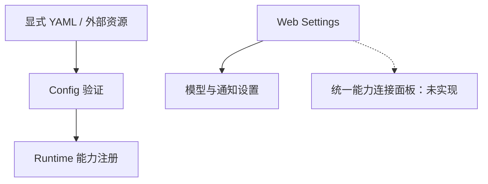

# 能力连接与就绪引导：技术方案

[功能与需求](../features/capability-setup.md) · [测试方案](../test-plans/capability-setup.md) · [主索引](../feature-map.md)

最近核对：2026-10-28。本文的架构与流程描述当前有效实现；明确标记的待实现方案不表示已落地。实现级协议仍服从 [跨功能协议与约束](product-overview.md#contract-0-文档效力与实现规则)。

## 当前架构

当前 Config 在应用装配时决定注册能力，Web Settings 主要控制模型与通知。尚无统一能力连接与健康投影。

## 当前流程与目标差异

当前：操作员配置 → 重启/新 Run 使用相应快照。目标：用户查看能力状态 → 按能力完成配置 → 探测验证 → 对新执行生效；具体变更生命周期需设计确认。

- **F-030**：模型设置已有界面；其他能力主要通过 YAML 与外部准备启用，尚无统一工作台。 定义能力配置/就绪投影及设置页面；不增加模型可见的第二套能力发现 API。

## 代码与依赖

- [internal/app/runtime.go](../../internal/app/runtime.go)
- [internal/config/config.go](../../internal/config/config.go)
- [internal/interaction/web/server.go](../../internal/interaction/web/server.go)
- [internal/interaction/web/page.go](../../internal/interaction/web/page.go)

## 验证与交付

验收场景、已有入口和剩余覆盖统一在 [测试方案](../test-plans/capability-setup.md) 维护。本次建档未执行本功能的回归或 Live 验证，不以架构图替代运行证据。

## Changelog

2026-10-28：按统一文档结构迁入本功能的协议与历史决策，更新引用并移除旧文件；此为文档归属调整，不改变运行时协议。

本节追加记录每次架构/流程取舍。旧图不保留在正文；历史正式决定保留在本节。首次记录为现状建档，不推断历史决策日期。

| 日期 | 类型 | 决策与理由 | 取舍及影响 | 关联 |
| --- | --- | --- | --- | --- |
| 2026-10-28 | 现状建档 / 未来方向 | 保留现有配置与冻结快照作为权威；新增设置是用户控制面，不向模型开放凭据或任意注册能力的权限。 | 明确当前边界与待补齐链路；本次仅建立文档，未修改运行时。 | [跨功能契约](product-overview.md#contract-0-文档效力与实现规则) |

后续记录需包含实际比较过的选项、采用理由、兼容/迁移影响和相关需求或 PR；未决建议不能写成已实施决策。
