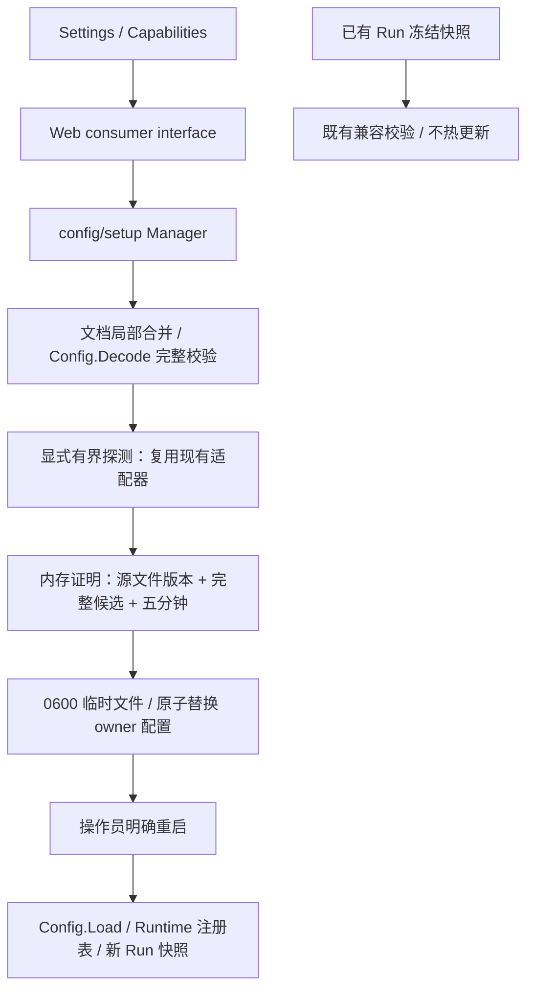

# 能力连接与就绪引导：技术方案

[功能与需求](../features/capability-setup.md) · [测试方案](../test-plans/capability-setup.md) · [主索引](../feature-map.md)

最近核对：2026-10-29。实现级协议服从 [跨功能协议与约束](product-overview.md#contract-0-文档效力与实现规则)。

## 当前架构

`config/setup` 持有 owner 配置文档、候选验证、诊断证明和原子保存。Web 在消费侧定义 CapabilitySettings 接口，只负责认证后的页面与原生表单。App 只注入服务，不参与配置业务规则。运行时仍从启动 Config 创建现有能力注册表，不引用设置服务。

## 编辑与保存流程

- `GET /settings/capabilities` 只投影已保存配置；详情路径限定为六个已知 ID。普通读取不发起探测。`POST /capability/configure` 使用现有 owner 认证、Host/Origin 检查，测试后 303 回规范详情 URL；页面不轮询重建编辑器。
- 每次编辑最多 64 KiB，源文件最多 256 KiB。YAML AST 仅替换当前 section，随后调用共享严格 Decode 校验全部字段、单文档、版本、引用和路径隔离。启动与设置共享 ValidateSourcePath，拒绝把 owner 配置暴露于执行、toolchain、Skills 或 provider 目录（包括符号链接别名）。Computer 编辑包含 computer/javascript；不隐式删除有冲突的 execution 覆盖。
- 测试使用现有 Memory Vault、embedding HTTP adapter、Skill catalog、MCP 沙箱发现、Local execution 和 Computer provider。单次总时限 30 秒，同进程仅一项探测，探测期间不持有配置互斥锁。错误只返回固定诊断文案，不回显底层错误或凭据。
- 内存保存最多六项有界草稿，详情刷新保留当前源版本下的未保存候选。成功证明绑定源文件 SHA、规范能力值、完整候选文档 SHA 和时间；测试结束再次读取源版本，外部变更使结果作废。五分钟过期可保留草稿，但失去保存资格。证明不跨重启，不视为持续健康承诺。
- 保存串行化并持有配置父目录 advisory flock，拒绝同版本并发 Collie 写入；通过 os.Root 固定目录，拒绝符号链接/非普通源文件，0600 临时文件 fsync 后再次校验版本，再 rename 并同步目录。保留未改 section/注释。外部编辑器不参与 advisory lock，不能承诺任意第三方在最后 rename 瞬间的写入都受 CAS 保护；应避免同时手改。
- 默认 owner 文件不存在时，从启动配置生成必要资源 section；不持久化托管 broker 临时端口或安装时推导的模型 Bridge 路径。Load 自动发现 data_root/config.yaml，显式 -config 始终优先；读取和 doctor 不创建文件。已存在源文件被删除后，当前服务拒绝默默重建覆盖。

## 生命周期与数据边界

Manager 持有不可修改的 startup Config 副本，与已保存配置比较生成 PendingRestart。保存不调用 Registry、Run、ModelProfile 或数据库迁移；明确重启后新 Run 冻结新能力。旧快照继续现有兼容/重放协议，发生身份冲突时拒绝恢复。

Memory 密钥引用变更必须解析到同一密钥，不能把连接设置当作加密数据迁移。已保存或启动时的 embedding identity（provider/endpoint/model/dimensions）不能通过 Save 直接更换，须先离线重建索引。停用并不删除旧数据，跨进程再次启用仍须操作员保留原身份；既有存储绑定继续拒绝向量空间混用。

Computer `Provider.Probe` 与实际执行的 lock 路径共用 checkHost，校验独立存储、禁用遥测/缓存与精确版本，诊断额外校验 sealed base 和凭据可用性；不分配 Guest。平台真实兼容性仍由 Computer 功能自己的 native/live 证据界定。

## 代码与依赖

- [config/setup](../../internal/config/setup/manager.go)：状态/证明/保存编排；[document.go](../../internal/config/setup/document.go)：文档编辑与原子写入；[resources.go](../../internal/config/setup/resources.go)：六类资源投影；[probe.go](../../internal/config/setup/probe.go)：适配器诊断。
- [Config.Load/Decode](../../internal/config/config.go)：默认发现、严格共享校验。
- [Web control plane](../../internal/interaction/web/capabilities.go) 与 [模板](../../internal/interaction/web/templates/capabilities.html)。
- [Computer shared probe](../../internal/computer/macosvm/probe.go)。

无新依赖、模型工具、DB schema、后台服务、CI gate 或评测体系。设置层前端复用现有样式、原生输入与按钮；共用提交增强保留 clicked action，避免禁用按钮丢失表单字段，并保留初始 disabled 状态供 bfcache 返回恢复。

## 验证与交付

验收场景和证明范围见 [测试方案](../test-plans/capability-setup.md)。系统测试复用现有 channels gate 和 owned peers，不将界面截图或受控模型回复当作真实模型质量分数。

## Changelog

| 日期 | 类型 | 决策与理由 | 取舍及影响 | 关联 |
| --- | --- | --- | --- | --- |
| 2026-10-28 | 现状建档 / 未来方向 | 保留配置和冻结快照为权威；新增设置属于 owner 控制面。 | 当时尚无统一能力页；未更改运行时。 | F-030 |
| 2026-10-29 | F-030 实现 / 模块拆分 | 选择 config/setup 集中配置生命周期，复用领域适配器；未把诊断塞入 App 或建第二套工具注册。 | Web 仅消费接口，Computer 共用 Host 检查；无新依赖或 schema。 | F-030 |
| 2026-10-29 | 候选证明 / 明确重启 | 选择先测试再保存、短期内存证明和文件版本检查，避免保存即热改 Registry。 | 用户需重启；新 Run 使用新快照，旧 Run 不自动升级；测试不是迁移。 | F-030 |
