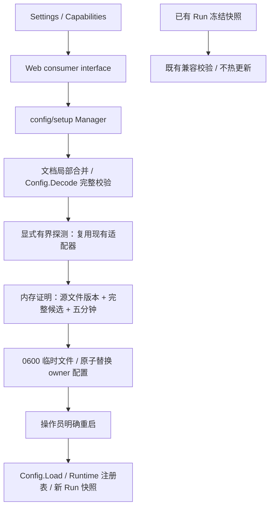

# 能力连接与就绪引导：技术方案

[功能与需求](../features/capability-setup.md) · [测试方案](../test-plans/capability-setup.md) · [主索引](../feature-map.md)

实现级协议服从 [跨功能协议与约束](product-overview.md#contract-0-文档效力与实现规则)。

## 自动默认资源

正常安装启动推导 `defaults: {memory: true, search: true, skills: true, computer: true}`；显式 `-config` 不自动加入该段。具体资源配置优先，带自定义路径、toolchain 或 repository source 的本地执行覆盖默认 Computer。Manager 在启动时准备有效资源，owner 文档保留自动模式，读取 Settings 和 doctor 不下载、不引导 Guest。

Memory 使用跨进程锁分配随机 SecretStore 引用，确认 32 字节密钥可读后原子保存 `default-memory.json`。已有引用丢失或锁定时不重新生成；已有加密数据但无默认引用时要求恢复原密钥。原生凭据不可用时 Settings 显示需要处理，本地 Conversation 搜索仍可用。备份包含引用元数据，不包含系统凭据。

本地搜索直接查询已有 SQLite 文本索引，支持中文子串；不调用 embedding 服务、不制造向量、不绑定向量空间。加密 Memory 的明文索引仍只在内存中。可在设置中接入自定义 embedding，既有向量身份变更仍要求离线迁移。Conversation-only 与包含 Memory 的默认搜索具有不同冻结资源身份。

普通表单通过 `mode: automatic` 表达自动候选，Manager 将其转换为 `defaults` 对应开关并删除自定义 section；自动 Computer 同时移除本地执行覆盖。关闭同时清除自动开关，重启不会重新开启。Memory 关闭还原子清除 embedding section 并关闭 defaults.search；重新开启 Memory 默认恢复本地检索。自定义密钥仍必须与既有默认密钥一致。

Computer 的详细下载、Guest 准备与等待协议见 [Computer 方案](computer-use.md#自动桌面准备)。自动资源的连接测试只确认选择默认模式，实际进度独立显示；不把配置选择当作桌面已启动。

## 当前架构

`config/setup` 持有 owner 配置文档、候选验证、诊断证明和原子保存。Web 在消费侧定义 CapabilitySettings 接口，只负责认证后的页面与原生表单。App 只注入服务，不参与配置业务规则。运行时仍从启动 Config 创建现有能力注册表，不引用设置服务。

## 编辑与保存流程

- `GET /settings/capabilities` 只投影已保存配置；底层详情路径限定为六个已知 ID，主列表仅展示五个入口；embedding 通过 Memory → 高级设置进入。普通读取不发起探测。`POST /capability/configure` 使用现有 owner 认证、Host/Origin 检查，普通 Save 在同一请求中先 Test 再 Save，成功后 303 回详情；失败保留草稿，不写配置。高级编辑仍支持单独测试与精确证明保存。页面不轮询重建编辑器。
- 每次编辑最多 64 KiB，源文件最多 256 KiB。YAML AST 仅替换当前 section，随后调用共享严格 Decode 校验全部字段、单文档、版本、引用和路径隔离。启动与设置共享 ValidateSourcePath，拒绝把 owner 配置暴露于执行、toolchain、Skills 或 provider 目录（包括符号链接别名）。自定义 Computer 编辑包含 computer/javascript，保留冲突检查；选择自动 Computer 则切回默认桌面并移除 execution 覆盖。
- 测试使用现有 Memory Vault、embedding HTTP adapter、Skill catalog、MCP 沙箱发现、Local execution 和 Computer provider。单次总时限 30 秒，同进程仅一项探测，探测期间不持有配置互斥锁。错误只返回固定诊断文案，不回显底层错误或凭据。
- 内存保存最多六项有界草稿，详情刷新保留当前源版本下的未保存候选。成功证明绑定源文件 SHA、规范能力值、完整候选文档 SHA 和时间；测试结束再次读取源版本，外部变更使结果作废。五分钟过期可保留草稿，但失去保存资格。证明不跨重启，不视为持续健康承诺。
- 保存串行化并持有配置父目录 advisory flock，拒绝同版本并发 Steward 写入；通过 os.Root 固定目录，拒绝符号链接/非普通源文件，0600 临时文件 fsync 后再次校验版本，再 rename 并同步目录。保留未改 section/注释。外部编辑器不参与 advisory lock，不能承诺任意第三方在最后 rename 瞬间的写入都受 CAS 保护；应避免同时手改。
- 默认 owner 文件不存在时，从启动配置生成必要资源 section；不持久化托管 broker 临时端口或安装时推导的模型 Bridge 路径。Load 自动发现 data_root/config.yaml，显式 -config 始终优先；读取和 doctor 不创建文件。已存在源文件被删除后，当前服务拒绝默默重建覆盖。

## 生命周期与数据边界

Manager 持有不可修改的 startup Config 副本，与已保存配置比较生成 PendingRestart。保存不调用 Registry、Run、ModelProfile 或数据库迁移；明确重启后新 Run 冻结新能力。旧快照继续现有兼容/重放协议，发生身份冲突时拒绝恢复。

Memory 密钥引用变更必须解析到同一密钥，不能把连接设置当作加密数据迁移。已保存或启动时的 embedding identity（provider/endpoint/model/dimensions）不能通过 Save 直接更换，须先离线重建索引。停用并不删除旧数据，跨进程再次启用仍须操作员保留原身份；既有存储绑定继续拒绝向量空间混用。

Computer `Provider.Probe` 与实际执行的 lock 路径共用 checkHost，校验独立存储、禁用遥测/缓存与精确版本，诊断额外校验 sealed base 和凭据可用性；不分配 Guest。平台真实兼容性仍由 Computer 功能自己的 native/live 证据界定。

## 代码与依赖

- [config/setup](../../internal/config/setup/manager.go)：状态/证明/保存编排；[document.go](../../internal/config/setup/document.go)：文档编辑与原子写入；[resources.go](../../internal/config/setup/resources.go)：六类资源投影；[probe.go](../../internal/config/setup/probe.go)：适配器诊断。
- [Config.Load/Decode](../../internal/config/config.go)：默认发现、严格共享校验。
- [Web control plane](../../internal/interaction/web/capabilities.go) 与 [模板](../../internal/interaction/web/templates/capabilities.html)。
- [Computer shared probe](../../internal/computer/macosvm/probe.go)。

无新依赖、模型工具、DB schema、CI gate 或评测体系。自动 Computer 使用由宿主进程管理的私有 Lume 服务。设置层前端复用现有样式、原生输入与按钮；共用提交增强保留 clicked action，避免禁用按钮丢失表单字段，并保留初始 disabled 状态供 bfcache 返回恢复。

## 验证与交付

验收场景和证明范围见 [测试方案](../test-plans/capability-setup.md)。系统测试复用现有 channels gate 和 owned peers，不将界面截图或受控模型回复当作真实模型质量分数。

## 表单优先的能力配置

界面与 Preferences 共用左侧设置导航、居中窄列与紧凑分组行（见 [设置页交互](channels.md#设置页布局与交互)）。Memory 和检索共用一个主入口，Semantic search 是其高级子设置；默认状态为 Enabled (default)，启用与连接检查证明分开。普通界面保留设置项与 Save，自定义连接提供 Check connection；详细说明、YAML、来源路径、检查时间收进 Advanced。Web 私有表单类型只覆盖实际领域字段，YAML AST 对这些字段定点修改，保留未展示的高级配置；别名或无法无损映射的结构回退到 Advanced YAML，不能静默重解释。Computer 的兼容／Driver 和运行时字段分组折叠，首次配置时展开。

原 Manager 仍拥有完整校验、探测、候选证明、源文件版本、密钥／索引迁移边界与保存。普通 `apply` 动作将最终字段交给既有 Test/Save 链路，后台验证精确候选后才写入；失败与版本冲突保留草稿。高级 `save` 动作继续要求已有证明，编辑字段仍会使其失效。MCP 增删行是有界的本地候选重绘，不调用 provider 或保存配置；保留提交版本，避免并发文件变更时默默重基。没有新增通用表单引擎、公共字段 schema 或依赖。
