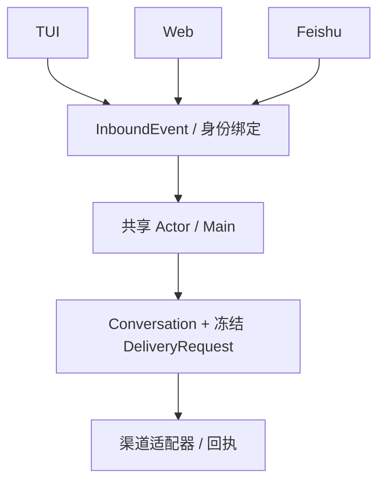
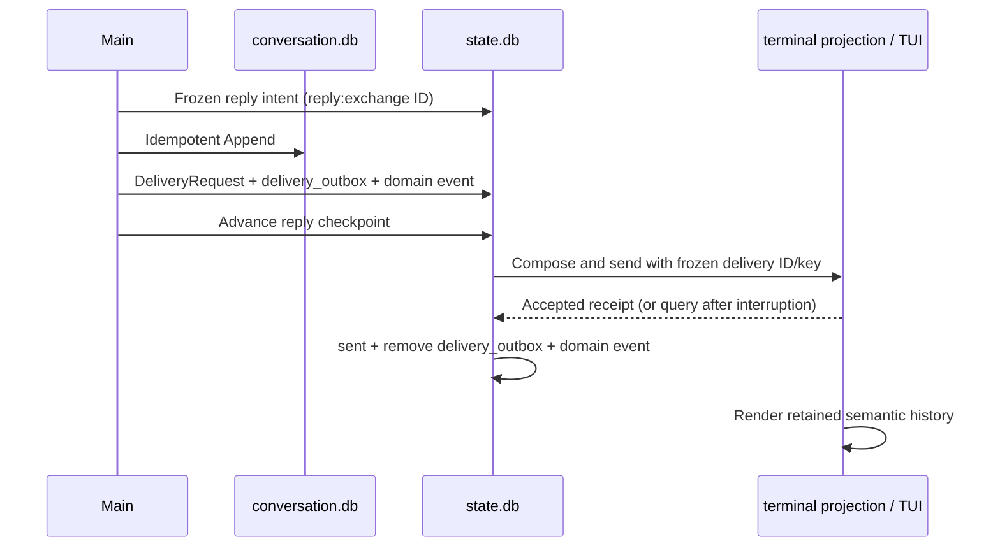

# 终端、Web 与飞书：技术方案

[功能与需求](../features/channels.md) · [测试方案](../test-plans/channels.md) · [主索引](../feature-map.md)

本文的架构与流程描述当前有效实现；明确标记的待实现方案不表示已落地。实现级协议仍服从 [跨功能协议与约束](product-overview.md#contract-0-文档效力与实现规则)。

通知与能力设置的自动选项统一显示 Auto／自动，当前值由原生 select 与共享增强组件的选中态表达；标签简化不改变渠道优先级、保存版本或无脚本回退。

## 当前架构

渠道将输入归一化为 InboundEvent，经身份、来源去重进入同一 Actor。Main 的语义消息与冻结路由产生 DeliveryRequest，各适配器记录投递回执。

### 控制面与查询边界（F-039）

Web 在依赖准备期间开放，ingress 保持关闭；缺失能力修复后后台重试准备，成功后恢复接纳。TUI 在依赖恢复后刷新就绪提示并重新调度已接收工作；恢复提示与已有历史展示可独立到达。已持久化终态的 Main 模型失败由 Run 记录承载，不关闭 HTTP listener；未能确立权威状态的基础设施错误仍使执行循环明确失败。

页面查询按用途分开：Models 读取模型与必要账户信息，Notifications 只读渠道设置，Tasks 通过独立只读池读取分页摘要/详情，Conversation 读取最近 100 条和审批。`before` 是排他的 sequence 游标；返回升序消息，页面提供 Earlier messages，API 通过 `X-Steward-Before` 返回下一页 cursor。GET 不 Flush intent、不写 projection；交付循环独立 Flush 并冻结投影。已有投影只读复用，无投影时内存合成。交付直接按 conversation/message ID 取一条，Main 初始化按冻结 ID 集合分批读取，不扫描不相关记录，也不改变已有上下文边界。

### Web 时间呈现边界

`web/time.go` 为每个请求绑定经校验的 `steward-timezone` IANA 时区；未执行的模板源用于克隆，避免语言或时区函数在并发请求间互相覆盖。聊天投影只增加已有 CreatedAt 的呈现，不改写消息、冻结投影、API 时间字段或排序。`web/src/local-time.ts` 统一转换宿主标记的时间、当地日历日、人性化日期与图表提示，覆盖首屏、实时片段及详情预览；不遍历或改写用户正文和原始 JSON。展示只到秒，时区仅用于内部转换，不写入可见时间标签。完整时间浮层归共享 `components/ui/time-detail.ts`。

浏览器提交日期筛选时携带明确的绝对时刻；原生回退按浏览器已保存的时区解析无偏移输入，拒绝夏令时跳时中不存在的时刻。明确带偏移的 URL 时间保留原时刻；API 的旧无偏移时间参数继续按原 UTC 契约解析。计划规则的时区属于执行语义，时间展示偏好只转换其下一次发生的绝对时刻，不修改规则。

### Go 实现职责（F-040）

Web POST 分发只选择有名动作处理函数；消息/附件、模型、账户、通知各自维护请求步骤，认证、CSRF 和 Server 生命周期仍为统一入口。

### Web 信息架构与呈现职责（F-018）

共享外壳预加载 Inter 和 Michroma 字体，CSS 与 preload 使用相同的内容 SHA-256 版本 URL。只有版本与内嵌字节匹配的字体允许私有长期缓存；页面、脚本、样式、未版本化字体和错误响应仍为 no-store。切换 Settings 子页保留原生导航，不再逐页重新下载字体并闪回系统字体。

一级侧栏上方为 Chat、Tasks、Developer，Settings 固定左下；模块内部分类使用相邻二级侧栏，不替换一级入口；没有重复头像入口、静态绿色状态灯或未实现功能的空 Tab。共同的导航、面包屑、状态、按钮、面板和反馈使用一套中性样式。视觉主操作分别是发送、处理当前任务、配置下一步和选择观测节点。

`routes.go` 维护认证后的路由分发，`navigation.go` 维护规范路径、旧地址跳转和本地返回地址校验；`page.go` 只组装共享框架与分派加载。`settings.go`、`tasks.go`、`conversation.go` 与 `approval_view.go` 拥有各自的查询/呈现。前端样式按 shell、workspace、conversation、observability 分开，共享设计变量；没有引入新框架或第二套状态管理。

消息输入框的键盘增强保留原生节点：Enter 阻止默认换行并通过 `requestSubmit` 复用按钮的表单校验与提交流程；Shift + Enter 保留原生换行。输入法组合事件（含兼容性键码 229）不触发发送，按键自动重复、正在提交和按钮禁用时也不提交。发送按钮在 conversation 样式中使用固定 `#B84F2F` 背景与白色图标，不修改其他主操作的主题变量。输入框聚焦使用既有边框与内侧 1px 描边，避免外环重复包裹输入容器；键盘焦点仍可见。

Models 概览 → 来源选择 → 新模型表单 → 模型详情验证/选择；Notifications 单独子页。候选模型的 probe 成功不等于 profile 已激活：呈现检查已存 Probe 的 profile/auth version、BridgeIdentity 和能力，真正选择仍由原 Control.Select 校验权限、实时凭据和版本。表单失败留在对应流程，凭据和底层错误不反射到页面。选中模型只影响新 Run，已有冻结执行树保持原配置。通知选项绑定实际持久化值，不可用的旧绑定明确提示。

Tasks 的分页、详情、历史与 Main 交付由 `task/sqlite.Reader` 提供；共享同一进度定义的 TUI/旧 API 保持原摘要契约，见 [任务设计](tasks.md)。详情中的继续沟通先校验所有权，再作为带可见任务说明的普通用户消息进入现有 Main ingress；不增加 Task 控制 API。

Web 审批查询使用只读 `Runs.ApprovalView`，已过期授权按当前时间投影状态，不执行恢复、落库或唤醒；CLI/运行时仍调用原 `Runs.Approvals` 恢复。卡片只识别 security 来源且身份匹配的 Host 通知，不按正则删改用户文本，也不改写持久化 Conversation/投递投影；精确参数、完整 Raw action 和冻结哈希保留。

旧 `/settings` → Models、`/progress` → Tasks；旧 Trace query/冻结上下文链接保留全部选择参数并跳转到规范详情路径。已知子页未登录返回 401 登录表单，成功后仅返回校验过的本地页面；API 认证响应不变。共享认证、CSRF、binding、CSP 继续先于业务处理；业务页面/API 保持 no-store。账户激活的 schema 44 兼容变化见模型连接方案。

### Web 待办投影与反馈来源（F-018/F-004）

启动配置和运行时就绪状态由 Chat 的设置提示及 Settings 的 Models 标签展示。模型列表、连接与详情都属于 Models，旧模型列表地址重定向到该标签。工作待办只投影问题、成果审阅、审批与任务执行事实，模型设置状态不参与待办计数。任务标题使用原始内容，系统生成的描述和操作按界面语言呈现。

`attention.go` 为现有 SSR 与条件更新提供私有只读投影。具名问题/审阅读取 F-004 当前记录，不依赖 Task 是否 active；审批读取有界 `PendingApprovals`，保留既有历史 `ApprovalView`；Task 失败、unknown 和无结构化问题时的需要信息状态来自当前执行事实。同 Task 的结构化 input question 抑制 generic input 兜底，失败与 unknown 保持独立事实。模型不可用提供现有 Settings 修复入口，不猜测模型进度文本或建立新状态机。

每个来源最多读取一页当前项，页面计数直接取已呈现记录，后续项使用 `+`/更多链接：问题继续原反馈游标，审批定位 Chat 中第一个未呈现的当前审批（包括没有 Task 的 Main 审批），任务继续其已有列表游标。不可用来源明确提示，不把未知当零；没有为总数扫描全部历史。问题引用、可访问成果名与真实源消息 sequence 来自原 Store，SQL、Run ID 和底层错误不进入用户流程。统一导航、品牌、i18n 与原生控件样式保持。

`POST /task/feedback` 在既有 loopback/token、同源与启用绑定校验后，调用同一反馈事务。问题是稳定 logical source，不同页面提交是 callback aliases；Web 的 channel_source 使用与 CLI 相同的 feedback request key。绑定/来源校验先于重复回执返回；首次 Web 接纳保存 `source:web` 与 message_route，首次 CLI 接纳仍保持原渠道。后到重试不改写已冻结路由。没有新 migration、工具 schema 或 Worker 控制入口。

原生表单与异步增强都只提交用户动作一次。400 无效输入、409 陈旧/冲突、权限变化与未知确认分别呈现；UTF-8 字节限制在浏览器先检查，服务端仍为权威。失去当前性的表单移出操作区和计数前保留其本地非空草稿为只读参考，不将其转移到新问题或自动提交。同一问题普通更新保留 native textarea、选区与焦点。Chat 的泛待办以明确标注的新标签页打开，保留不能序列化的原 native 附件状态；仅审批仍使用原定位。

### Web 实时投影与界面生命周期（F-019）

`GET /api/updates?view=/|/tasks|/tasks/{taskRef}|/settings/...&before=...` 返回当前视图的具名 HTML 区域与 `latest` sequence；`before` 仅用于 Conversation 的排他历史游标。状态与内容由现有 Core 查询取得，复用 SSR 的 UISpec 验证、转义、语义 fallback 和审批投影。完整页面与后台读取共用 `loadConversation` 和具名模板；没有新 Agent Loop、模型请求、领域写入口、事件表或迁移。

每次条件读取先执行已有认证与渠道绑定检查，再判断 `If-None-Match`；未变化返回 304。响应不含 composer、原始 Run/Tool trace 或模型凭据。历史页保留原游标，并用最新 sequence 提示新消息。各区域读取各自已提交投影，下次读取收敛；审批提交始终重新校验冻结哈希与权限。

**流式文本**：Provider Bridge 逐片校验并发出 `text_delta`，同时累积完整结果。共享 Loop 按 generation 发出开始和增量；`message_end` 仅表示模型交换已保存。Web 前景 Actor 只将 Main 正常生成的文本送到本机 Web 的临时缓冲。执行上下文取消时立即撤下草稿，供应商连接随后完成清理。调用工具、失败、转入等待、被新输入取代或离开当前执行时也撤下草稿。`DeliverReply` 成功后才通知正式提交。上下文压缩无预览；Worker、无关工具参数、推理正文和原始供应商事件不转发。Intelligent UI 通过同一连接的私有 `ui-preview` 事件发送受控快照，来源、禁用交互与正式交付衔接见 [Intelligent UI 方案](intelligent-ui.md#流式预览与正式交付)。文本与草稿撤下/提交信号均不写入 RunTrace、Outbox 或 Conversation。

**传输与恢复**：最新 Conversation 通过同源 `GET /api/conversation/stream` 接收 SSE。连接复用已有会话与绑定校验，并每秒续查；丢失权限即结束流。当前预览最多 64 KiB，合并短时间内的增量；慢连接独立取后缀，写入超时结束连接。重连取得当前预览的前缀并继续接收增量，不重放已结束草稿。Web 以纯文本呈现预览，在可能的富结果标记前停止，最终沿既有 UISpec 入口验证和呈现。正式提交信号给仍在读取该草稿的连接补齐尚未发送的文本，并立即触发权威读取。浏览器用同一轮的匿名关联键在正式消息出现时移除草稿。

已提交投影保留条件读取：周期性读回外部状态，也在掉线或进程重启后重新取得正式消息。单一调度链取消过时读取；单次 10 秒 deadline，网络失败最多退避到 30 秒。隐藏或离开页面时关闭流并取消读取，返回时恢复。401/403 保留用户输入，另页登录和显式重试不重建输入节点。

前端职责拆分为：`main.tsx` 仅启动；`composer.ts` 增强原生表单、附件状态和单次发送，不替换 DOM，点击发送时冻结本次内容与请求身份、显示待发送气泡并清空输入区，新草稿使用新的请求身份；`projections.tsx` 负责受控 UISpec 和 React root 生命周期；`live-updates.ts` 负责读取、区域协调、阅读位置与连接状态。按稳定消息 sequence/TaskRef/审批 ID 复用不变的组件节点，只释放被移除的 React root。文件选择器不序列化到网络或本地存储，也不随刷新重挂载。读者锚点移出最新 100 条窗口时保留当前内容，用户点击新消息提示后才切换。

审批仍使用 `POST /approval`；渐进增强请求通过 `Accept: application/json` 获取接受回执，原 HTML 表单继续使用 303。前端只提交用户所点表单的 ID、原冻结哈希和决定，每次交互发送一次。确认丢失或旧审批失效时读取当前投影，不自动重发决定、不把旧同意转给新审批，也不把回执当成外部动作完成。

选择本机内存预览与原有条件读取：前者需要及时、有限且可丢弃；后者必须能从数据库恢复。直接转发 NATS 或 Run trace 会把内部事件和私有内容暴露成浏览器接口，也需要额外重放语义。SSE 形状是 Web 私有协议，不承诺跨渠道订阅或断点重放。终端和外部渠道仍投递正式消息；既有审批、冻结快照和持久化格式保持原样。

## 当前流程与目标差异

验证身份 → 规范输入与附件 → 接受并去重 → Actor 执行 → 冻结回复目标 → 适配呈现并发送。Web 流式呈现 Main 文本，并通过带 ETag 的条件读取更新已提交区域；输入状态保留在原节点。

- **F-017**：标准启动/TUI/CLI、输入与已交付回复投影已接通。 终端输出没有远端确认协议，不宣称屏幕显示 exactly-once。
- **F-018**：分层 Models/Notifications、Tasks 列表/详情、优先待办/信息回答/成果审阅和独立 Trace 详情已接通，保留认证路由、前端嵌入与语义 fallback。 实时更新与开发区分别由 F-019、F-031 跟踪。
- **F-019**：Main 临时文本经 SSE 到最新对话；已提交会话、审批、全局状态、任务摘要和登录过程通过条件读取刷新。阶段摘要由 F-005 负责。
- **F-020**：签名回调、p2p 身份绑定、收发、本地回执、自建应用 token 自动维护与 CLI 诊断已实现；新消息来源随路由冻结，同步与 Task 结果引用原消息，IM 可提供预览和可信工作台成果链接；未知远端结果保持 query-only，不靠刷新或重发推定成功。

### 飞书原消息与成果投影（F-020）

`channel_source` 已保存受验证的来源消息、绑定及 Main request key。新迁移为不可变 `message_route` 增加 `reply_source_id`，由插入触发器要求该来源已经属于同一飞书绑定；旧路由保持空值，不将已接受动作从 send API 改成 reply API。入站接受与来源路由同事务，Main 最终交付只从已消费的 `input_sequence` 复制，迟到但未消费的输入不能重定向交付。

Task 原来源复用 `task_request` 的 create 接纳记录及原消息路由，不另建 Task 关联或生命周期。不同原来源的 `main_inbox` 更新分别交给同一个 Main；未选组仍留在原持久 inbox，由既有调度/恢复扫描接续。只有 unambiguous 原来源可参与 Automatic 路由选择；显式通知偏好优先，目标为原绑定时才附原消息引用。单活动 Main、Task epoch、Forget、绑定撤权和 Delivery claim 仍沿用原权威检查；来源上下文不授予新动作权限。

Feishu Adapter 对非空冻结来源调用官方 [回复消息 API](https://open.feishu.cn/document/server-docs/im-v1/message/reply)，路径转义后只到既有固定 Host；不带可由 callback 自选的接收者，`reply_in_thread=false` 保留个人消息的引用形式，不推广成群话题。其余路由继续使用原 send API。原消息目标加入回执 payload hash，失败不回退到新消息或别的受众。`uuid` 仅辅助平台短窗口去重，远端 ack 不确定依然 query-only；[官方 Channel SDK 的回复约定](https://github.com/larksuite/channel-sdk-python/blob/main/docs/reference.md) 同样区分原消息回复与显式新消息。

可选 owner 配置 `feishu.workspace_url` 提供实际完整结果入口。这是已存在工作台的 origin，不是公开部署授权；严格拒绝 userinfo、路径、query、fragment 和非 loopback 明文 HTTP。普通 IM 结果采用 1200 字符的确定性预览，链接复用 `/?before=<sequence+1>#message-<sequence>`，保留分页后可定位的完整语义/附件。配置此入口时不将相同文件再上传到 IM；没有可信地址则保留全文和附件，不悄悄丢弃细节。审批继续完整显示动作。loopback 仅同机可达，远端可达性与身份验证由现有部署负责。

共享 UISpec 仍保留完整内容；Feishu 的私有投影扩展另存精确卡片、原消息来源和附件政策，并随首次准备原子冻结。重启、修改 workspace 地址或调整摘要政策均复用同一保存投影。旧投影没有扩展字段时按原完整卡片呈现。投递仍只有原 DeliveryRequest 与分片回执，不新增一条 Web/IM 通知意图或第二投递管线。

持久原消息、来源分组、投影冻结、权限和幂等属于领域必要机制；1200 字符、是否配置成果链接与现有通知偏好是可替换政策。实现和扩展字段保持内部实验性，不稳定通用跨渠道编排接口，不暴露 Worker 结果或内部 Run ID，不归并未知 PR 事件。GitHub 反馈接续仍由 F-042/F-004 完成；真实平台展示、权限与链接可达性需独立 Live 验证。

### 飞书任务反馈卡（F-004/F-020）

迁移 039 在 `state.db` 增加私有 `feishu_task_question`，记录问题、不可变通知路由与绑定版本。Main 保存 `request_input` 时，只有确切的原用户 Main 输入具有已认证 Feishu 路由、当前绑定可用，且通知偏好为 Automatic 或指定该绑定，才同时提交一条 `needs_input` 通知。迁移 040 为同一关联增加可选 `review_url`。Main 保存 `request_review` 时还需要已配置的可信工作台 origin，使用其生成并冻结 `/tasks/<taskRef>#<feedbackRef>`。没有地址时审阅保留在 CLI/Web。039 已有的问题、投影和回执继续沿用。

Feishu adapter 复用 DeliveryRequest、原消息 reply API、冻结 projection 和分片 0 的远端消息回执。问题是纯文本。审阅使用固定说明、可信工作台入口和单字段反馈表单，页面锚点定位确切审阅，文件由认证 Web Artifact 路由读取。准备网络发送时检查当前请求，在可能阻塞的凭据获取完成后再次检查绑定版本、Task/隐私 epoch、到期和人工结束。审阅还需当前配置与冻结链接的 origin 一致，并通过 ArtifactStore 对每个确切引用重新检查访问、保留和文件可打开性。接纳及重放也做相同的文件检查。卡片只验证元数据与文件可打开性，认证 Web 下载时校验内容哈希。已经发出的请求可能晚于撤销返回，随后对该卡的回应由存储拒绝。缺少已保存的权威回执时，未知发送维持 query-only。

新版签名卡片回调以应用、租户、操作人、会话及实际卡片消息 ID 确立身份。Main 提交事务将其与已冻结的原投递、回执及当前绑定版本比较，通过后才接纳 callback/source 或复用旧回执。撤销后重绑增加版本，旧卡失效。Feishu 保留真实卡片 ID 给同步回复，平台 source ledger 与 CLI/Web/Feishu 共享的 TaskFeedback 幂等键分开。首次回答、Main input、原路由和已回答状态同事务提交，后续 Task 异步结果仍走原 Task 话题。 [飞书签名校验](https://open.feishu.cn/document/event-subscription-guide/callback-subscription/receive-and-handle-callbacks) · [飞书新版卡片表单与回调](https://open.feishu.cn/document/uAjLw4CM/ukzMukzMukzM/feishu-cards/card-json-v2-components/interactive-components/image-picker)

确切通知关联、权限复检和单一接纳事务是领域必需。纯文本问题、通过可信工作台查看的成果、个人渠道及单字段表单是当前产品范围。实现保持在私有 Feishu adapter 和既有 TaskFeedback 写入口，复用已有投递 outbox。问题和审阅沿用同一回调提交名称，由持久记录决定类别。真实飞书客户端的行为留待 Live 验证。

## 代码与依赖

- [internal/tui/session.go](../../internal/tui/session.go)
- [internal/interaction/web/server.go](../../internal/interaction/web/server.go)
- [internal/interaction/web/lifecycle.go](../../internal/interaction/web/lifecycle.go)
- [web/src/main.tsx](../../web/src/main.tsx)
- [internal/interaction/feishu/handler.go](../../internal/interaction/feishu/handler.go)
- [internal/interaction/feishu/delivery.go](../../internal/interaction/feishu/delivery.go)
- [internal/app/channels.go](../../internal/app/channels.go)

## 待实现方案

以下方案尚未实现。接口、持久化结构、迁移与精确时序须在实现前确定；当前执行仍遵循已有运行时契约。验收范围见功能说明及并列测试方案。

### F-018 · 优先呈现待用户处理事项

读取 F-004、既有 Approval、Task 和诊断的具名事实，组成当前工作台的只读优先视图；处理动作回到各自所属入口。来源与事项身份、权限及陈旧检查是机制，排序/折叠规则是展示政策。详细布局与聚合查询待真实事项接通后设计，暂不新增面板框架、内部流水线标签页或第二套事实源。

### F-020 · 跨平台事件与成果组织

原消息交付已接通的范围见上文。GitHub 评审/CI 经 F-042/F-004 显式关联后，因果 Main 复用原 Task 的原消息来源，继续遵守已冻结路由、显式通知偏好与撤权；不据个人 p2p 回复推定群话题、PR 结果组织或通用多渠道事件归并已经完成。继续保留 unknown，不承诺远端 exactly-once 或隐式目的地回退。

## 验证与交付

验收场景、已有入口和剩余覆盖统一在 [测试方案](../test-plans/channels.md) 维护。实际执行结果以对应版本的 PR 或 CI 证据为准；架构说明不证明回归或 Live 验证通过。

## 协议、实现与配置约束

本功能协议在此维护。既有编号用于追溯协议，不代表所有设计目标均已实现；完成状态以需求主索引为准。

### Deduplication, restart and uncertainty

Schema 025 adds bindings, event/source aliases, frozen message routes, preferences,
UI projections, imported-resource mappings and per-part channel receipts.
Migration is forward-only, transactional, preserves existing TUI receipts and
runs from empty or every prior supported schema.

The input transaction checks the enabled binding, canonical semantic hash and
both callback and source identities, then commits the existing `main_input`,
Conversation intent, route and Outbox event together. A new callback ID carrying
an already accepted source ID reuses its receipt. Identity or parameter drift
fails closed. Web/TUI/Feishu inputs preserve the authoritative Conversation order.

The Composer persists UISpec v1 in Delivery, never semantic Conversation or model
context. Fixed templates support escaped semantic Markdown text, tables, Artifact
cards, progress, frozen confirmation cards and field summaries. They do not execute
HTML/JS/React. Unknown versions, unknown components and invalid/render-failed
components degrade to semantic text. TUI remains semantic text/media fallback;
Feishu uses a controlled plain-text card and uploaded file attachments. Each
outbound file retains its name and exact bytes. Missing/oversized resources fail
closed rather than exposing a host path or silently sending the wrong attachment.

The Web shell uses the Steward personal-agent layout, locally bundled
ad-agent Button/Card components and shared native-control styles, OpenIntelligentUI's native DataTable,
and the owner-selected Steward wordmark and Ghost agent avatar. The React layer only
enhances fixed UISpec v1 components; it does not add a second
Agent or model connection. Server rendering remains the semantic fallback.
The composer keeps its server-rendered form and input nodes throughout enhancement.
Shared control styles apply without replacing text, focus, source identity, selected
files or an open native picker. Delayed-bundle browser regressions cover both a
selected attachment and a picker whose selection finishes after the bundle loads.
No frontend asset requires an external request. Source revisions, local changes,
MIT/Apache-2.0 notices, build and verification commands are recorded in
`web/README.md`; bundled notices are at `/licenses.txt`.
Generated HTML/CSS/JavaScript answers use the Main UI tool and an opaque-origin Web iframe described in [Intelligent UI](intelligent-ui.md); Host execution and external actions remain outside this rendering path.

### Feishu application credential lifecycle

`feishu.NewClient` 在应用组合根创建一个共享客户端。`auth.go` 只负责 token 获取、进程内缓存、有效期、安全失效与关闭；`status.go` 负责安全诊断与只读连接检查。回调、下载、上传和发送复用同一凭据源；客户端的值拷贝共享缓存，不把 mutex 复制给各调用方。

配置必须显式二选一：`app_secret_ref` 由 SecretStore 读取自建应用凭据，POST 官方 `/open-apis/auth/v3/tenant_access_token/internal`；`access_token_ref` 沿用外部维护模式。无默认账户、服务切换或持久 token 表。端点只能是官方 HTTPS 或显式 loopback 测试 peer；即使注入 HTTP client 也禁止跟随重定向，并限制15秒超时。原始响应、密钥与 Authorization 不进入诊断或领域记录。

进程内并发刷新只有一个 owner；等待者可独立取消。有效期从请求开始保守计算，提前 `min(60s, TTL/10)` 刷新；拒绝缺失、无效或越界 TTL，不回退使用失效 token。短暂失败在内存中退避1秒，避免失败风暴；新进程重新获取，关闭后清除缓存且迟到响应不能复活凭据。旧请求的鉴权失败只失效自己使用的 token，不能清掉已更新的 token。

只有 HTTP 401 或明确 token 错误码构成已拒绝动作。发送/上传客户端不在内部重发。取凭据失败或明确鉴权拒绝返回 Delivery 的 `retry`，由既有持久队列、回执与有限退避决定后续尝试；应用凭据明确拒绝返回 `failed/credentials_rejected`。`credentials_unavailable` 与 `credentials_rejected` 为安全的投递错误码，沿用原状态/schema。超时、断连、无有效回执或其他不确定响应仍为 `unknown`；恢复的非幂等投递不增加发送权限。

CLI `channel status` 无网络；`channel check` 获取凭据并 GET `/open-apis/bot/v3/info/`，只有这个只读查询可在显式 token 拒绝后刷新一次重查。输出模式、状态、可用的到期时间与恢复建议，不进行通知、绑定或投递核实。真实平台与业务权限需独立验证；不扩大为多租户应用授权或永久 exactly-once。

Local Web receipt acceptance is durable and idempotent. Feishu UUID deduplication
has a bounded provider window, so the adapter does **not** promise indefinite
idempotence. Successful parts retain authoritative response IDs before Outbox
acknowledgement. Restart reuses those receipts. A disconnected send without an
authoritative receipt becomes `unknown` and is query-only; it is never blindly
resent. Interrupted uploads can leave an unreferenced provider file, but cannot
justify repeating a user notification. The user can see the semantic message in
Web history while a remote transport remains unconfirmed.

The shared Delivery service renews its fenced claim through composition, receipt
queries, every upload/message part and settlement. A slow successful request or
cumulative multipart operation may exceed the configured lease without becoming
a second attempt. Renewal checks the current token, version and live expiry;
an expired or replaced owner cannot renew. Lost ownership cancels that transport
and joins its heartbeat without stopping Web ingress. The current owner recovers
from authoritative receipts; an uncertain Feishu send stays query-only.
The service revalidates the live fence before starting transport, so a scheduling
pause that consumes the original lease cannot authorize even a fast send.

## Recoverable semantic delivery

Main replies reach the local terminal through a durable Delivery Outbox. The
Conversation stores semantic content; `state.db` stores delivery intent,
transport state, and the terminal's immutable accepted-message projection.
No online accounts, broker, or model inference are needed to drain accepted
deliveries. [Web/Feishu adapters and UISpec composition](../features/channels.md) extend
this delivery path and have separate transport/UI verification.

There is no distributed transaction. A restart reuses the accepted generation,
reply intent and IDs, appends missing semantic messages, enqueues missing delivery
requests, then advances the checkpoint. Sending never rewrites Conversation.
Duplicate ingress callbacks keep the original Main receipt. Repeated Reporter
events keep the original Main follow-up. Repeated enqueue checks all frozen
identity fields and fails closed on drift.

The producer owns the private enqueue boundary (`delivery/sqlite.Enqueue` inside
its transaction); `delivery.Service` owns transport and reconciliation; adapters
own presentation and delivery receipts. Tools and Workers do not select a
channel or send completion messages. The composer accepts assistant semantic
parts, including opaque Artifact references, and rejects Tool traces. UI tool artifacts bind to a Main reply and become opaque Widget references in the projection; their code executes only in the Web sandbox.

| State | Meaning | Next state |
| --- | --- | --- |
| pending | Durable intent, no dispatch claim | sending |
| sending | Leased attempt; a crashed sender may have sent | sent, retry, failed, unknown; expired lease may be reclaimed |
| retry | Known transient failure with no effect; persisted wake time | sending |
| sent | Authoritative accepted receipt | Terminal |
| failed | Definitive rejection or exhausted known-safe retries | Terminal |
| unknown | Outcome cannot be established | Query only; sent/failed on authoritative evidence |

Each claim has a fresh Host token and expiry, plus a version checked by CAS.
A late acknowledgement cannot
change a newer owner's row or a terminal receipt. Delivery state and its internal
CloudEvent commit together. `delivery_outbox` owns transport work and is distinct
from `event_outbox`, which propagates internal domain events.

An adapter declares whether the provider guarantees idempotency for the frozen
action/key. Recovery queries a prior sending attempt first. An authoritative
absence permits another send only through an idempotent adapter: the expired
sender may still be alive. A provider without idempotency or a reliable query
remains unknown. An unknown row is never automatically resent, even when a later
query reports absence. Raw provider errors are replaced with bounded codes.

The local terminal adapter implements acceptance as an immutable unique-key
insert into `terminal_message` in `state.db`, with an internal acceptance event.
Acceptance and acknowledgement use separate transactions. The TUI reads that
retained projection rather than displaying pending assistant intents. Physical stdout has no acknowledgement
protocol: reconnect and `/history` can show accepted history again. This is one
stored semantic message, not generic exactly-once rendering or external delivery.

Only completion, failure, needs-input and approval intents can enqueue. Progress
updates remain read-only activity and create no notification or Main inference.
Root completion/failure goes through Reporter and Main. Security originates
approval notices in the invocation transaction, then the normal Conversation-first
recovery path delivers them. `/approve ID HASH` and `/deny ID HASH` submit the
displayed frozen hash to Security and wake the original Run. Duplicate matching
decisions remain idempotent. Approval expiry/invalidation still fails closed.

## Steward Web components

This is a locally bundled presentation layer for the existing Go Web server.
The conversation layout uses soft monochrome surfaces, restrained selected navigation,
a graphite submit action, centered thread and rounded composer. React enhances the escaped server HTML;
the existing forms and semantic fallback remain usable without JavaScript.

### Pinned source and changes

| Source | Revision | Reused code or asset | Local changes |
| --- | --- | --- | --- |
| [ad-agent](https://github.com/z-chenhao/ad-agent) | `e43216ffa7bd686b496a15f1d8a99ac180857caa` | `web/src/components/ui/{button,card}.tsx`, `web/src/components/ui/styles.ts`, `web/src/lib/utils.ts`, neutral style tokens | Retain used card components, button variants/sizes and style tokens; Steward supplies layout, routes and content |
| [OpenIntelligentUI](https://github.com/CopilotKit/OpenIntelligentUI) | `8391a94c1c3939c679e40ddd7bfc08a9ef690e70` | Native Table, BarChart, PieChart, PlanCard, MeetingTimePicker, ExportOverlay; shared theme/SVG/form styles | Preserve upstream names and props; adapt imports, reduced motion, safe exports and durable time selection; generateSandboxedUi uses the same upstream fields/activity/bridge with Steward delivery |
| [shadcn/ui](https://github.com/shadcn-ui/ui) | `8a3536678a528cc012b9e62484290e79d0be410f` | Field/Input/Card 与 ChartContainer/Tooltip 的使用子集 | 保留原生表单语义，以 Steward 字体/主题和组件内布局适配；MIT 文本打包，无新增页面介绍文案 |
| [Base UI](https://base-ui.com/react/overview/about) | `@base-ui/react@1.9.0` | Button、Select、Combobox、Menu | 全局选择器和菜单共用无样式交互基础；保留原生值、无脚本路径及业务保存边界 |
| Steward / Ghost | Owner-selected 2026-11-02 assets | Michroma wordmark and charcoal/ivory ghost PNGs and lossless WebP atlases | Self-hosted; complete-frame animation, static fallback and reduced-motion support; provenance in `web/licenses/steward-artwork.md` |
| Open font projects | Included OFL notices | Inter, Source Serif 4, Source Han Sans SC, JetBrains Mono and Michroma | Self-hosted; Chinese unicode-range subsets; original sources and hashes in `web/licenses/` |

Upstream licenses and artwork provenance are in `licenses/`. The binary embeds
the required MIT/Apache-2.0 license texts and serves them at `/licenses.txt`.
There are no paid frontend services. Pinned runtime dependencies include React,
React DOM, Base UI, Recharts, Zod and the component helpers. Tailwind and esbuild compile
checked-in local assets; they do not run as product services.

OpenIntelligentUI's native component is integrated here. Its isolated-answer and validated bridge patterns inform Steward's own durable Widget renderer. The upstream Python agent, CopilotKit/AG-UI transport, model routing and browser-key flow are not integrated. Steward's frozen ModelSnapshot,
SecretStore, Actor, approval and controlled UISpec v1 contracts remain the owners
of those responsibilities. Generated Widget code is confined to the dedicated Web sandbox and receives no Host execution authority.

The client accepts only supported UISpec v1 components. Invalid/unknown versions,
components and unsupported table dimensions retain the server-rendered result.
Empty or failed renders use authoritative semantic text from the Host, never a
replacement fallback supplied inside a projection. Custom Widget HTML is served through its dedicated sandbox route; no dynamic component import, remote asset or browser credential input is added.

## 当前 Web 交互取舍

页面按用户任务使用稳定子路由与共享 SSR；完整 Context 归入 Generation 并保留深链接。Task 查询与审批投影只读，保持渠道共用对话、审批、执行和已提交结果，不引入渠道专属 Agent Loop。

输入区保留原生表单及文件选择器 DOM，避免脚本加载替换节点丢失附件。独立区域条件读取复用现有查询与 SSR，让输入、渲染、更新各自管理生命周期；updates 只读接口与可选 JSON 审批回执保持原接口默认行为及冻结执行语义。

## F-020 飞书凭据自动维护

选择在既有飞书模块集中 token 生命周期与CLI诊断，应用层只注入一个共享客户端；未采用逐请求换 token、凭据落入领域数据库或鉴权失败即在发送客户端内部重发。新增可选 `app_secret_ref`、`channel status/check` 与两个安全投递错误码；外部 token 配置继续可用，不需数据迁移。不改变审批、通知目的地、冻结动作、回执或未知副作用规则；没有修改Web页面。

## Steward Web 表现层

共享样式和导航以已确认 Demo 为准；模型/账户、通知、能力配置及执行检查保留原生路线。Chat 的 Computer/Worker 详情复用认证与既有只读数据，无新增写入协议。侧栏、主题与头像偏好仅存在浏览器。具体令牌与组件见 `web/src/foundation.css` 和 `web/README.md`，兼容取舍见[品牌设计](branding.md)。

## 四入口与只读 Computer 工作区

具体用户是所有者的持续对话和委派任务工作流。沿用认证路由、source ID、冻结审批、任务/执行只读查询与 live 区域。新增私有表现片段呈现真实待审批数量；Chat 的 Worker 查询展示有界的所有执行记录（包括旧 epoch），按实际执行时间倒排并保留后端状态；Task 列表不查询 Conversation，Inspector 故障只降低执行详情可用性。

Computer 查看独立于 Agent 执行机制：只读 HTTP 端点复用现有 Browser 会话与绑定校验，状态/操作记录不返回凭据、原生 VM 名、句柄或参数；桌面画面不持久化并使用 private/no-store。面板显示控制轮询，完成一帧后再等待约两秒；截帧有五秒取消期限及大小限制。实例读取与截帧后复核之间不持有数据库事务。

比较了复用 Agent capture 会话、暴露远程控制/VNC 与单独只读截帧，选择独立 Driver session，避免污染 Agent 的观察凭据，也不增加新的执行或审批管线。此处协议保持私有，不泛化多用户屏幕广播、远程接管或通用视频平台。

Chat 顶部居中两行显示名称与动态头像。Computer 与 Worker 为互斥详情面板，保留持续对话、草稿、附件和阅读锚点；Tasks 保留独立列表和详情。Worker 的当前运行查询独立于历史上限，避免长期运行记录被较新的终态记录挤掉；历史最多 50 条，更多记录回 Developer，不泛化查询协议。

## 本机 Web 直接访问

当前用户需求是本机访问省去 workspace token 输入。`web.listen` 仍必须是明确的 `127.0.0.1` 或 `::1`；省略 `token_ref` 时直接信任 loopback TCP peer，不读取 SecretStore、不建立登录会话。配置 `token_ref` 则继续使用原有 Bearer/session 机制，保持已有安装和自动化客户端兼容，不增加新的 auth 枚举或用户系统。

免 token 模式同时校验实际监听地址、直连 peer、字面 Host、Origin 与 Fetch Metadata，拒绝跨站及不同本地 origin；不信任转发头。渠道绑定、冻结动作审批、只读 Computer 边界与 CSP 不变。此模式信任可连接本机端口的本地进程，不提供 OS 用户间隔离；不开放公网访问。未选择隐藏页面表单但继续强制 SecretStore 口令，避免把登录复杂度留在配置里。

## 工作区布局与键盘定位

当前所有者在桌面、平板和窄屏上阅读持续对话、任务及执行证据。Task 和 Developer 的双列布局使用各自内容容器的 760px 断点，避免仅按视口判断而忽略固定导航的占宽。Chat 在 1280px 以下复用已有 modal 面板，宽屏继续并列显示；选择保守的单一阈值，暂不引入依据侧栏状态切换的额外面板模式。

这些都是私有表现策略，不改变 HTTP 路由、任务状态、source ID、审批表单或冻结数据。标签露出只调整所在横向条的滚动；导航先解除目标的 inert 再移动焦点；执行片段替换以替换前最新的焦点、原区域和控制类型定位对应链接，避免同 URL 的 Refresh 抢走树节点焦点。同一观察刷新保留详情滚动，切换到不同观察从新详情顶部阅读。

能力示例前置并仅在空白未配置时展开，例子区最多 240px 高度，完整字段仍可滚动查看。没有增加 schema 编辑器、配置向导、通用导航框架或新公共接口。

### 设置页布局与交互

Settings 保留一级导航，在旁边展开二级侧栏，直接呈现 Preferences、Notifications、Models、Apps、Capabilities 五个分类，不设置分类搜索。正文居中，单列窄宽度；移动端在同一抽屉中并排保留两级导航，可关闭、可键盘退出并还原焦点。

| 参考组件 | 当前设置页的映射 |
|---|---|
| ChatGPT 的分类导航、搜索、选中态 | 左侧分类筛选、空结果、Escape 清空、Enter 进入首项 |
| ChatGPT 常规、数据管理、云电脑中的设置行 | 圆角分组、细分隔线、左侧名称／必要说明、右侧值或操作；详细诊断收进 Advanced |
| 紧凑语言下拉与选中标记 | 两项语言使用 Base UI Select，无搜索；原生方向键／Enter、Escape／点击外部关闭，保留无脚本表单；达到[全局规范](../../design.md#全局组件契约)中的长列表阈值才用 Combobox 搜索 |
| Multica 偏好、通知、个人／工作区表单 | 同一设置行对齐输入、多行文本、开关和按钮；账户选择、模型声明及能力字段仍取实际配置 |
| Multica 危险操作与两套参考的按钮层级 | 账户退出使用危险色和确认对话框，默认聚焦取消；取消与 Escape 不发送请求，确认仅提交一次 |

参考录屏还展示了存储管理、使用额度、快捷键及工作区资料等页面的布局；当前产品没有对应设置，不增加空分类或没有后端的开关。录屏没有展开所有导航项或破坏性确认弹窗，未据此推断未展示的交互。

界面语言使用浏览器 Cookie，确认不同值后自动保存；无脚本或初始化失败时保留原生表单与保存按钮。外观在当前浏览器立即应用，可选择浅色、深色、跟随系统并持久化；不改变模型配置。模型切换继续要求显式授权，通知继续携带版本，能力 Save 继续由服务端测试最终候选后原子保存。前端不持久化凭据，不引入第二条配置管线。所有控件由本地资源构建，继续遵守现有 CSP。

### 两级导航实现

公共规则维护在根目录 [design.md](../../design.md#两级导航)。共享 shell 使用 `workspace-navigation` 容纳一级栏与可选的 `section-sidebar`，`has-section-navigation` 负责内容占宽。Settings、Developer 与 Tasks 的分类共用这一结构；Tasks 提供执行记录和任务配置两个入口。导航使用原生链接，焦点约束与 inert 以整个容器为边界，没有新增运行时路由或数据查询。

一级栏底部仅保留 Settings，外观和头像动效集中在 Preferences；不再渲染宣传语或重复的主题按钮。头像动效开关调用已有 `StewardGhost.pause`，继续使用原浏览器存储键；系统 reduced-motion 优先时禁用开关并显示原因，不改变既有动画帧与状态呈现。

### Web 消息与配置增强

消费方为当前会话 Web UI。Markdown 由固定版本 Marked 解析，原始 HTML 转义，再由 DOMPurify 白名单清理；链接仅接受 HTTP(S) 和明确的 artifact 引用，后者仍经过认证 ArtifactStore 下载。流式草稿复用同一清理器。Mermaid 代码块按需下载独立本地包，以 strict 模式生成 SVG 并通过 Blob 图像呈现；失败保留源码，不嵌入模型 HTML，也不开放脚本 CSP。输入上限、图边数及图片隔离是安全边界；气泡、处理点和字体是呈现政策。

能力表单使用逐表单单飞自动提交和字段去抖；服务端 apply 对确切候选执行 Test + Save、版本 CAS 与密钥／索引身份保护。成功刷新各表单配置版本，失败保留草稿；不热更新冻结执行能力。YAML 文件限制 64 KiB，原生 multipart 与增强读取走相同验证。许可证保留在构建产物，设置页不展示页脚入口。

桌面折叠保留可访问的图标模块入口；移动导航仍是抽屉。Computer/Worker 使用固定定位且聊天页禁止滚动链回弹。favicon 不继承 CSS，因此首屏脚本与主题 class 同步切换现有图集导出的黑／白 PNG。所有增强保持私有呈现实现，不新增公开 UI 执行协议或持久已读状态。

### Web 待发送气泡与 UI 分组

需求来自点击发送后的长时间输入滞留，以及原生 UI 和最终文字倒序合并。当前消费者是 Web composer/live updates 与已有 Main UI 投影。客户端提交前冻结 FormData、来源键和文件，随后腾出原生输入节点；独立 outgoing 区不被权威区域 patch 删除。仅为合法客户端来源键提供对账属性，不暴露内部消息 ID；权威消息抵达即去掉对应本地气泡，保持一个消息实例。网络不确定时仅允许原快照重试；明确校验拒绝可恢复草稿，较新的草稿受到保护。

入口保留绑定、运行时与已配置状态检查，不在 HTTP 接纳前触发凭据刷新；原模型执行解析器仍负责实际认证、刷新和撤销 fencing。原子接纳与确切重试是领域机制，立即呈现和状态文案是 Web 政策。没有新增持久队列、模型发送工具或未经确认的“已读”状态。

Web 读取绑定 UI artifact 的原调用顺序，并与冻结投影的组件逐项核对；只在精确匹配时生成私有 bubbles 视图。展示组件保留原 form IDs 和提交状态，UI 气泡在前，最终回复气泡在后。原 Conversation、跨渠道语义 fallback、交付投影和版本均不改写；未知投影继续原呈现，不猜测 Markdown 的来源。

### 全局组件一致性

当前消费者是服务端设置/任务/开发者表单和 React 会话富组件。全局组件皮肤保持 Steward 的字体、字号、导航、内容布局和品牌语义，统一按钮、输入框、选择器、菜单、卡片、复选框及开关。选择器与菜单的键盘、定位、取消和焦点交由 Base UI；原生值适配器仅连接表单值与业务事件，不再自建筛选/导航状态机。选择器在弹窗中把浮层放进相同 dialog，避免进入不可交互的背景；定位器消除根 CSS zoom 的坐标倍率、浮层恢复该倍率，保留放大后的文字与触控尺寸。原生必填校验把焦点交给可见控件，不尝试聚焦隐藏值。

机制是原生表单值、服务端校验、版本和请求身份；当前控件结构与外观是可替换策略。适配器、皮肤和裁剪的上游组件保持仓库私有，不新增通用跨产品组件 SDK。采用组件源码与小型运行时依赖，拒绝整体搬入 Multica 页面、业务层或第二套主题；没有引入 ReUI 商业页面块。无脚本仍使用相同皮肤的原生表单。

### Settings 行布局与对话模型选择

Settings 的单值配置与右侧命令遵守根目录 design.md。纯标签不继承含控件标签的网格规则；组合输入使用共享 embedded 变体消除双层焦点边界。Apps 目录和详情布局保持原契约。

私有 Web 选择投影位于 composer_models.go；GET /api/models 只读账户目录与本地配置，正常页面与轮询不读取账户凭据。用户通过 POST /model/choose 按配置版本选择，复用 Control 的账户目录激活与直连验证路径；未保存账户模型仅在选择时创建配置，冻结执行不受影响。首次 Web 登录仅在尚无当前模型时选用首个账户目录模型。目录与激活机制属于现有模型控制契约；首项默认、紧凑触发器和 12 项搜索阈值是 Web 策略，不建立公开通用模型选择 API、批量同步器或新持久层。拒绝读取目录时批量创建配置，以避免 GET 写入与过期目录残留。

App 连接配置发现区分「已读取但未配置」与「当前密钥不能读取配置」；只有确认未配置且提供方明确没有托管授权时，才显示自有 OAuth 配置提示。读取权限不足仍由既有授权链接端点决定可用性，不将未知状态误报为缺少配置，也不暴露提供方响应中的客户端密钥。该元数据仅在仓库内部适配器与连接服务之间使用。

Tasks 复用 has-section-navigation、section-sidebar 和 section-navigation，与 Settings、Developer 共用桌面布局、折叠和手机抽屉。分类选中由私有 taskConfigurationPage 根据规范路由判断；页面内不再重复分类 Tab，不新增导航状态机或持久化状态。

通知目的地选择后自动保存，携带版本并更新确认版本；冲突／写入结果未知不自动重发，刷新读取实际状态。无脚本保留原生提交。Preferences 同组短值选择器等宽，Models 按 Models 归组两类模型连接，App service 使用键值行和右对齐同宽操作；Apps 目录布局不变。相关回归由 settings_test、channels_preferences 和 page-transitions 覆盖。

Models 为 Settings 的独立分类，包含「Sign in with an account」和「Connect with an API key」。账户目录自动进入聊天模型选择器；API 连接使用现有私有文件 SecretStore，凭据与首个模型元数据一次事务保存，失败清理新文件。连接后自动验证；首次无当前模型自动选用，后续连接不覆盖选择。连接操作复用共享菜单和原生表单，断开采用模型及凭据双版本确认并撤销后续使用，保留历史冻结配置。Apps 工具栏 App settings 进入服务配置；原 Models/Resources 服务入口移除，旧 setup 与 services/apps 深链接保留重定向。浏览器回归覆盖实际 HTTP provider 的 API key、聊天模型切换、断开及明暗／窄屏布局。

Models 将账户与 API 连接分组；账户入口先呈现实际支持的 ChatGPT 提供方，明确确认后才发起授权，重连绑定已有连接 ID，添加其他账户是独立操作。等待状态与取消保持配置行，完成后刷新账户投影。不能仅凭相似名称合并不同注册身份，现有账户记录不自动删除。协议、凭据生命周期、当前模型和冻结快照不改变。浏览器回归断言进入提供方页不发送 auth/login，并保留 API 连接、原生路径、明暗和窄屏验证。Apps 服务高级授权配置使用应用标识／配置 ID 行，删除 JSON 编辑框；显式验证保存和版本检查保留，目录布局不变。
