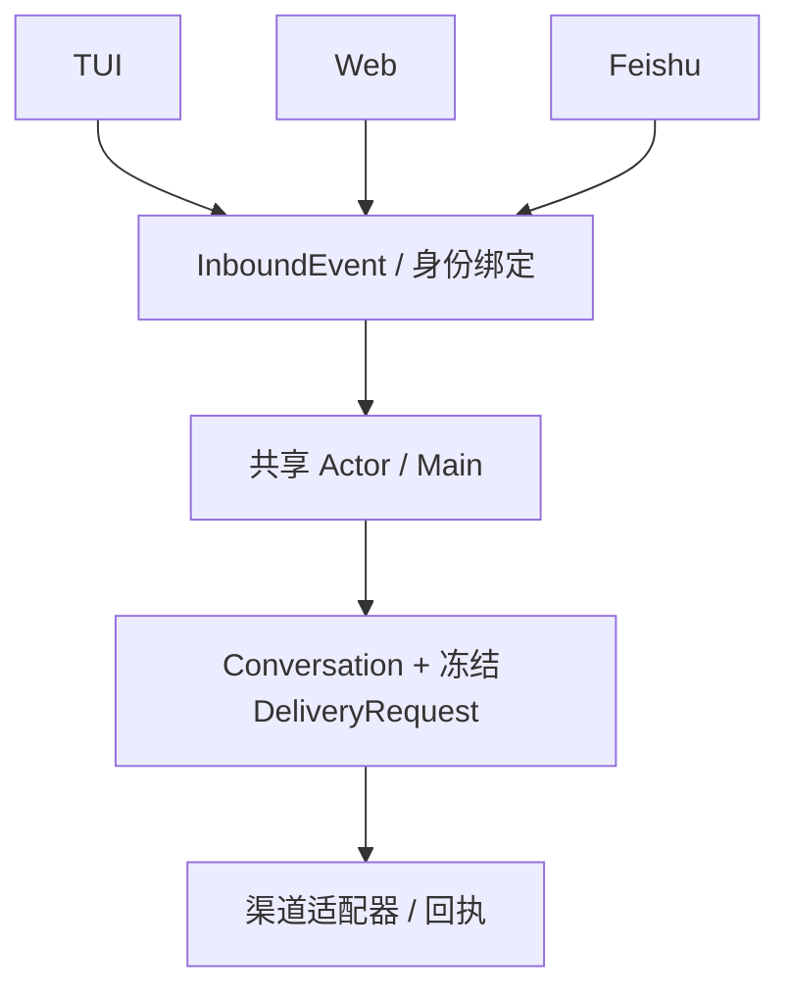
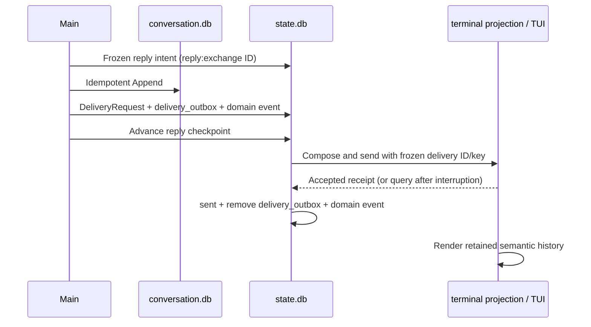

# 终端、Web 与飞书：技术方案

[功能与需求](../features/channels.md) · [测试方案](../test-plans/channels.md) · [主索引](../feature-map.md)

最近核对：2026-10-28。本文的架构与流程描述当前有效实现；明确标记的待实现方案不表示已落地。实现级协议仍服从 [跨功能协议与约束](product-overview.md#contract-0-文档效力与实现规则)。

## 当前架构

渠道将输入归一化为 InboundEvent，经身份、来源去重进入同一 Actor。Main 的语义消息与冻结路由产生 DeliveryRequest，各适配器记录投递回执。

### 控制面与查询边界（F-039）

Web 在依赖准备期间开放，ingress 保持关闭；缺失能力修复后后台重试准备，成功后恢复接纳。TUI 在依赖恢复后刷新就绪提示并重新调度已接收工作；恢复提示与已有历史展示可独立到达。已持久化终态的 Main 模型失败由 Run 记录承载，不关闭 HTTP listener；未能确立权威状态的基础设施错误仍使执行循环明确失败。

页面查询按用途分开：Settings 读取模型/账户/渠道设置，Progress 读取任务摘要，Conversation 读取最近 100 条和审批。`before` 是排他的 sequence 游标；返回升序消息，页面提供 Earlier messages，API 通过 `X-Erii-Before` 返回下一页 cursor。GET 不 Flush intent、不写 projection；交付循环独立 Flush 并冻结投影。已有投影只读复用，无投影时内存合成。交付直接按 conversation/message ID 取一条，Main 初始化按冻结 ID 集合分批读取，不扫描不相关记录，也不改变已有上下文边界。

### Go 实现职责（F-040）

Web POST 分发只选择有名动作处理函数；消息/附件、模型、账户、通知各自维护请求步骤，认证、CSRF 和 Server 生命周期仍为统一入口。

## 当前流程与目标差异

验证身份 → 规范输入与附件 → 接受并去重 → Actor 执行 → 冻结回复目标 → 适配呈现并发送。Web 现状通过整页刷新看到新记录。

- **F-017**：标准启动/TUI/CLI、输入与已交付回复投影已接通。 终端输出没有远端确认协议，不宣称屏幕显示 exactly-once。
- **F-018**：认证路由、服务生命周期、前端嵌入与语义 fallback 已实现。 实时更新与开发区分别由 F-019、F-031 跟踪。
- **F-019**：当前客户端通过有条件的五秒整页刷新取新内容，尚无推送式消息更新。 接通增量状态/消息读取与前端更新；具体传输方式在实施时确定，保留权威提交边界。
- **F-020**：签名回调、p2p 身份绑定、收发和本地回执已实现；access token 由外部维护。 补凭据刷新/失效诊断体验；不确定远端投递目前只能依赖已保存本地回执，可信远端核实能力仍待定义。

## 代码与依赖

- [internal/tui/session.go](../../internal/tui/session.go)
- [internal/interaction/web/server.go](../../internal/interaction/web/server.go)
- [internal/interaction/web/lifecycle.go](../../internal/interaction/web/lifecycle.go)
- [web/src/main.tsx](../../web/src/main.tsx)
- [internal/interaction/feishu/handler.go](../../internal/interaction/feishu/handler.go)
- [internal/interaction/feishu/delivery.go](../../internal/interaction/feishu/delivery.go)
- [internal/app/channels.go](../../internal/app/channels.go)

## 验证与交付

验收场景、已有入口和剩余覆盖统一在 [测试方案](../test-plans/channels.md) 维护。本次建档未执行本功能的回归或 Live 验证，不以架构图替代运行证据。

## 协议、实现与配置约束

迁入内容按职责归属在此维护。既有编号用于追溯协议，不代表所有设计目标均已实现；完成状态以需求主索引为准。

### Deduplication, restart and uncertainty

Schema 025 adds bindings, event/source aliases, frozen message routes, preferences,
UI projections, imported-resource mappings and per-part channel receipts.
Migration is forward-only, transactional, preserves existing TUI receipts and
runs from empty or every prior supported schema.

The input transaction checks the enabled binding, canonical semantic hash and
both callback and source identities, then commits the existing `main_input`,
Conversation intent, route and Outbox event together. A new callback ID carrying
an already accepted source ID reuses its receipt. Identity or parameter drift
fails closed. Web/TUI/Feishu inputs preserve the authoritative Conversation order.

The Composer persists UISpec v1 in Delivery, never semantic Conversation or model
context. Fixed templates support escaped semantic Markdown text, tables, Artifact
cards, progress, frozen confirmation cards and field summaries. They do not execute
HTML/JS/React. Unknown versions, unknown components and invalid/render-failed
components degrade to semantic text. TUI remains semantic text/media fallback;
Feishu uses a controlled plain-text card and uploaded file attachments. Each
outbound file retains its name and exact bytes. Missing/oversized resources fail
closed rather than exposing a host path or silently sending the wrong attachment.

The Web shell uses the requested ChatGPT-style neutral layout, locally bundled
ad-agent Button/Card/Textarea components, OpenIntelligentUI's native DataTable,
and the original Eri character logo/default agent avatar. The React layer only
enhances fixed UISpec v1 components and existing forms; it does not add a second
Agent or model connection. Server rendering remains the semantic fallback.
The composer preserves text, selected files, focus/selection and the source ID
when the local bundle takes over an already usable server form. A delayed-bundle
browser regression enters real input before that handoff and then submits once.
No frontend asset requires an external request. Source revisions, local changes,
MIT/Apache-2.0 notices, build and verification commands are recorded in
`web/README.md`; bundled notices are at `/licenses.txt`.
OpenIntelligentUI's arbitrary generated HTML/JS path is outside this integration
and requires an explicit architecture/security decision under the baseline.

Local Web receipt acceptance is durable and idempotent. Feishu UUID deduplication
has a bounded provider window, so the adapter does **not** promise indefinite
idempotence. Successful parts retain authoritative response IDs before Outbox
acknowledgement. Restart reuses those receipts. A disconnected send without an
authoritative receipt becomes `unknown` and is query-only; it is never blindly
resent. Interrupted uploads can leave an unreferenced provider file, but cannot
justify repeating a user notification. The user can see the semantic message in
Web history while a remote transport remains unconfirmed.

The shared Delivery service renews its fenced claim through composition, receipt
queries, every upload/message part and settlement. A slow successful request or
cumulative multipart operation may exceed the configured lease without becoming
a second attempt. Renewal checks the current token, version and live expiry;
an expired or replaced owner cannot renew. Lost ownership cancels that transport
and joins its heartbeat without stopping Web ingress. The current owner recovers
from authoritative receipts; an uncertain Feishu send stays query-only.
The service revalidates the live fence before starting transport, so a scheduling
pause that consumes the original lease cannot authorize even a fast send.

## Recoverable semantic delivery (ERII-15)

Main replies reach the local terminal through a durable Delivery Outbox. The
Conversation stores semantic content; `state.db` stores delivery intent,
transport state, and the terminal's immutable accepted-message projection.
No online accounts, broker, or model inference are needed to drain accepted
deliveries. [Web/Feishu adapters and UISpec composition](../features/channels.md) extend
this delivery path and have separate transport/UI verification.

There is no distributed transaction. A restart reuses the accepted generation,
reply intent and IDs, appends missing semantic messages, enqueues missing delivery
requests, then advances the checkpoint. Sending never rewrites Conversation.
Duplicate ingress callbacks keep the original Main receipt. Repeated Reporter
events keep the original Main follow-up. Repeated enqueue checks all frozen
identity fields and fails closed on drift.

The producer owns the private enqueue boundary (`delivery/sqlite.Enqueue` inside
its transaction); `delivery.Service` owns transport and reconciliation; adapters
own presentation and delivery receipts. Tools and Workers do not select a
channel or send completion messages. The composer accepts assistant semantic
parts, including opaque Artifact references, and rejects Tool traces. No arbitrary
HTML or executable UI enters the protocol.

| State | Meaning | Next state |
| --- | --- | --- |
| pending | Durable intent, no dispatch claim | sending |
| sending | Leased attempt; a crashed sender may have sent | sent, retry, failed, unknown; expired lease may be reclaimed |
| retry | Known transient failure with no effect; persisted wake time | sending |
| sent | Authoritative accepted receipt | Terminal |
| failed | Definitive rejection or exhausted known-safe retries | Terminal |
| unknown | Outcome cannot be established | Query only; sent/failed on authoritative evidence |

Each claim has a fresh Host token and expiry, plus a version checked by CAS.
A late acknowledgement cannot
change a newer owner's row or a terminal receipt. Delivery state and its internal
CloudEvent commit together. `delivery_outbox` owns transport work and is distinct
from `event_outbox`, which propagates internal domain events.

An adapter declares whether the provider guarantees idempotency for the frozen
action/key. Recovery queries a prior sending attempt first. An authoritative
absence permits another send only through an idempotent adapter: the expired
sender may still be alive. A provider without idempotency or a reliable query
remains unknown. An unknown row is never automatically resent, even when a later
query reports absence. Raw provider errors are replaced with bounded codes.

The local terminal adapter implements acceptance as an immutable unique-key
insert into `terminal_message` in `state.db`, with an internal acceptance event.
Acceptance and acknowledgement use separate transactions. The TUI reads that
retained projection rather than displaying pending assistant intents. Physical stdout has no acknowledgement
protocol: reconnect and `/history` can show accepted history again. This is one
stored semantic message, not generic exactly-once rendering or external delivery.

Only completion, failure, needs-input and approval intents can enqueue. Progress
updates remain read-only activity and create no notification or Main inference.
Root completion/failure goes through Reporter and Main. Security originates
approval notices in the invocation transaction, then the normal Conversation-first
recovery path delivers them. `/approve ID HASH` and `/deny ID HASH` submit the
displayed frozen hash to Security and wake the original Run. Duplicate matching
decisions remain idempotent. Approval expiry/invalidation still fails closed.

## Erii Web components

This is a locally bundled presentation layer for the existing Go Web server.
The conversation layout follows the requested ChatGPT-style neutral sidebar,
centered thread and rounded composer. React enhances the escaped server HTML;
the existing forms and semantic fallback remain usable without JavaScript.

### Pinned source and changes

| Source | Revision | Reused code or asset | Local changes |
| --- | --- | --- | --- |
| [ad-agent](https://github.com/z-chenhao/ad-agent) | `e43216ffa7bd686b496a15f1d8a99ac180857caa` | `web/src/components/ui/{button,card,textarea}.tsx`, `web/src/lib/utils.ts`, neutral style tokens | Retain used card components, button variants/sizes and style tokens; Erii supplies layout, routes and content |
| [OpenIntelligentUI](https://github.com/CopilotKit/OpenIntelligentUI) | `8391a94c1c3939c679e40ddd7bfc08a9ef690e70` | `apps/app/src/components/generative-ui/table-catalog.tsx` native `DataTable` and Zod props | Remove the CopilotKit catalog registration/import; retain validation and accessible table; map the existing UISpec table through a private adapter |
| [eri](https://github.com/z-chenhao/eri) | `f4dcf11f29d17a2be517acb2a50dad08318edc40` | `assets/brand/eri-icon-192.png`, `eri-favicon-32.png` | Original bytes; the same character is the logo and default agent avatar |

Upstream licenses and artwork provenance are in `licenses/`. The binary embeds
the required MIT/Apache-2.0 license texts and serves them at `/licenses.txt`.
There are no paid frontend services. Pinned runtime dependencies are React,
React DOM, Zod and the ad-agent component helpers. Tailwind and esbuild compile
checked-in local assets; they do not run as product services.

OpenIntelligentUI's native component is integrated here. Its Python agent,
CopilotKit/AG-UI transport, model routing, browser-key flow and generated
HTML/JavaScript sandbox are not integrated. Erii's frozen ModelSnapshot,
SecretStore, Actor, approval and controlled UISpec v1 contracts remain the owners
of those responsibilities. Enabling arbitrary generated code requires a separate
architecture/security decision.

The client accepts only supported UISpec v1 components. Invalid/unknown versions,
components and unsupported table dimensions retain the server-rendered result.
Empty or failed renders use authoritative semantic text from the Host, never a
replacement fallback supplied inside a projection. There is no HTML evaluator,
dynamic component import, remote asset or browser credential input.

## Changelog

2026-10-28：测试入口随当前 Makefile/runner 对齐。旧说明中的 make verify、Delivery/security 分片与自动五轮是历史调度；当前默认单次，重复次数通过 runner --repeat 显式指定。保留机制验收要求。

2026-10-28：按统一文档结构迁入本功能的协议与历史决策，更新引用并移除旧文件；此为文档归属调整，不改变运行时协议。

本节追加记录每次架构/流程取舍。旧图不保留在正文；历史正式决定保留在本节。首次记录为现状建档，不推断历史决策日期。

| 日期 | 类型 | 决策与理由 | 取舍及影响 | 关联 |
| --- | --- | --- | --- | --- |
| 2026-10-28 | F-040：按职责拆分 Go 实现。 | 保持原协议、路由、schema 与原子事务边界；详见工程方案。 |
| 2026-10-28 | F-039：Web 故障隔离与分页纯查询；交付按 ID 定位。 | 控制面可用于修复运行依赖，避免读请求产生运行副作用或随历史无限增长；API 数组形状保留，超过 100 条需跟随游标。 |
| 2026-10-28 | 现状建档 | 渠道共享对话、审批与执行，不引入渠道专属 Agent Loop。Web 实时化需保留提交后的权威结果；飞书 unknown 不通过重复发送消除。 | 明确当前边界与待补齐链路；本次仅建立文档，未修改运行时。 | [跨功能契约](product-overview.md#contract-0-文档效力与实现规则) |

后续记录需包含实际比较过的选项、采用理由、兼容/迁移影响和相关需求或 PR；未决建议不能写成已实施决策。
