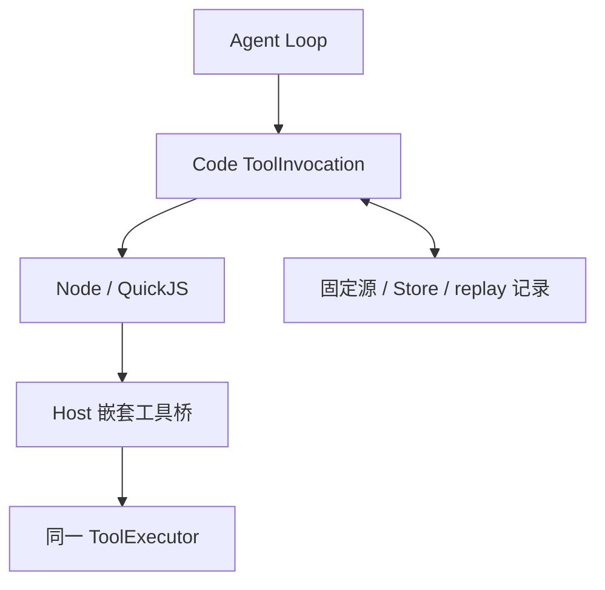

# JavaScript Code Mode 与持久恢复：技术方案

[功能与需求](../features/codemode.md) · [测试方案](../test-plans/codemode.md) · [主索引](../feature-map.md)

最近核对：2026-10-28。本文的架构与流程描述当前有效实现；明确标记的待实现方案不表示已落地。实现级协议仍服从 [跨功能协议与约束](product-overview.md#contract-0-文档效力与实现规则)。

## 当前架构

Go Host 冻结源及 runtime/prelude 指纹；Node 托管 QuickJS；嵌套调用重新进入统一执行器，数据库保存调用与 Store 观察。



### 执行协调边界（F-039）

`internal/tool/codemode/execution.go` 拥有 VM 尝试、最多三次 transport 重建、已存 outcome 复用、嵌套调用 drain 与挂起协调。消费方定义 `ExecutionHost`，SQLite 的 `codeBridge` 提供 claim/fence、读取/记录 outcome、原子事件接纳、release 和 Computer idle。所有工具仍进入原 Tool Executor；VM 不接触数据库或模型凭据。shutdown watcher 在返回前 join。指纹、source、call key、既存 schema 与重放结果保持不变。

## 当前流程与目标差异

接受固定 source → 启动隔离 VM → 嵌套调用和 Store 观察持久化 → 等待可释放 VM → 重启按同一源重放并复用结果 → 显式输出。

- **F-008**：Node/QuickJS Sidecar、嵌套调用、Store、固定源重放和等待释放已实现。 运行时不提供任意网络、文件、凭据或不可重放时间随机源；不是通用 shell。

## 代码与依赖

- [internal/tool/codemode/sidecar.go](../../internal/tool/codemode/sidecar.go)
- [internal/agent/sqlite/codemode.go](../../internal/agent/sqlite/codemode.go)
- [internal/agent/sqlite/code_recovery.go](../../internal/agent/sqlite/code_recovery.go)
- [runtime/javascript/src/sidecar.mjs](../../runtime/javascript/src/sidecar.mjs)
- [runtime/javascript/src/prelude.mjs](../../runtime/javascript/src/prelude.mjs)

## 验证与交付

验收场景、已有入口和剩余覆盖统一在 [测试方案](../test-plans/codemode.md) 维护。本次建档未执行本功能的回归或 Live 验证，不以架构图替代运行证据。

## 协议、实现与配置约束

迁入内容按职责归属在此维护。既有编号用于追溯协议，不代表所有设计目标均已实现；完成状态以需求主索引为准。

<a id="contract-62-code-mode"></a>

#### 6.2 Code Mode

- 采用类似 Pi 1.2.0 / CUA REPL 的 JavaScript Code Mode。
- 模型侧只暴露一个**代码执行入口** `builtin__codemode__execute`；这不排斥经过 Tool Exposure Policy 选出的普通 Direct Tool。输入直接使用 JavaScript 源码，不再另设 `builtin__computer__run`、Agent 专用 Code Cell 或第二个 CUA JavaScript 工具。
- Agent 可以在 Code Mode 中搜索、组合和调用工具。
- Code Mode 在同一个 JavaScript Code Cell 中按 Capability Policy 注入 `tools.*`、`cua.*` 与可选的 `agent.*`：三者只是同一 Tool Registry 和 ToolInvocation 管线的不同 Facade，不创建第二种 Code Cell 或 Agent 专用执行协议。Main 默认不注入 `agent.*`，Worker 在允许委派时注入。
- 简单工具调用仍允许直接执行；复杂工作可在一次 JavaScript 执行中组织多个工具调用。
- 核心后端使用 Go；模型生成的 JavaScript 运行在独立的 QuickJS 隔离环境中，不直接拥有 Node.js、文件系统、网络或定时器能力，只能通过宿主注入的受控能力访问外部世界。MVP 固定采用独立 Node.js Sidecar 承载 Pi Code Mode 的 QuickJS Worker；Node.js 只是宿主，不是脚本的安全边界。
- 每次 `builtin__codemode__execute` 都创建一次性 QuickJS 执行环境，调用完成、失败或取消后销毁；不提供跨调用持久 JavaScript REPL。长期状态保存在 Task/Run、ToolInvocation、Code Mode Store、Computer Checkpoint 和 ArtifactStore 中，而不是 JS Heap 中。
- Code Mode 不获得绕过 Tooling、Security、权限和审计的能力。
- 单次脚本内可以持有 CUA Surface 句柄；跨脚本只保存稳定的逻辑引用并重新获取对象，不依赖 JavaScript 内存延续。

<a id="contract-621-融合后的发现与调用协议"></a>

##### 6.2.1 融合后的发现与调用协议

Pi Code Mode、Codex CUA REPL 与 Child Agent 共享执行入口、渐进式文档、输出语义和 ToolInvocation 管线；Tool Executor 可以不同，但调用抽象必须一致：

- `tools.*` 表示注册在 Tool Registry 中的无状态或显式状态工具函数。
- `cua.*` 表示当前 Computer 中动态存在的 App、Window、Browser、Tab 及其 Surface 句柄。
- `agent.*` 是仅向有权委派的 Worker 暴露的 Agent Tool JavaScript Facade；`agent.run()` 与普通 Tool 一样创建 ToolInvocation，只是由 `AgentToolExecutor` 唤起 Child Run。
- App、Window 和 Tab 不注册为 `ALL_TOOLS` 中的伪工具；它们由当前 Computer 的实时 Inventory 发现，否则工具目录会随界面状态频繁变化，并破坏 Prompt Cache 与句柄正确性。

Code Mode 提供与 Pi 1.2.0 对齐的工具发现能力：

```typescript
declare const ALL_TOOLS: Array<{ name: string; description: string }>;

declare function searchTools(
  query: string,
  options?: { limit?: number; namespace?: string },
): Promise<Array<{ name: string; description: string }>>;

declare function describeTool(name: string): Promise<ToolDescription | undefined>;
declare function describeNamespace(name: string): Promise<NamespaceDescription | undefined>;
```

- `ALL_TOOLS` 只包含可调用工具的轻量元数据，不内联完整 Schema。
- `searchTools()` 对当前 Run 实际可访问的工具进行相关性检索。
- `describeTool()` 按需返回描述、输入/输出 TypeScript 声明和模型必须遵守的使用说明。
- `describeNamespace()` 返回 MCP Server、Builtin Domain 或虚拟命名空间的说明与工具列表；`describeNamespace("cua")` 返回稳定的 CUA 根协议，`describeNamespace("agent")` 只返回 `agent.run()` 的参数、结果、错误和生命周期语义，不返回 Capability Snapshot、并发槽位或预算余额。
- 工具的 Canonical Name 始终可以通过 `tools[name](../test-plans/product.md)` 调用；只有不存在命名冲突时才同时提供经过转义的 `tools.<js_name>(args)` 便利别名，避免名称规范化产生碰撞。
- `tools.*`、`cua.*` 和 `agent.*` 的每次执行调用都进入统一 `ToolExecutor` 并创建 ToolInvocation；脚本只接收规范化后的结构化结果，失败、审批拒绝或参数错误以可捕获的 JavaScript `Error` 表示。

CUA 使用“静态能力文档 + 动态资源清单 + 绑定后的对象能力”三级发现：

```typescript
declare const cua: {
  getState(options?: ObservationOptions): Promise<ComputerState>;
  listApps(options?: ObservationOptions): Promise<AppInfo[]>;
  listWindows(options?: ObservationOptions): Promise<WindowInfo[]>;
  listBrowsers(options?: ObservationOptions): Promise<BrowserInfo[]>;
  listTabs(options?: BrowserOptions & ObservationOptions): Promise<TabInfo[]>;
  getApp(target: string | { windowId: string }): Promise<App>;
  getBrowser(options?: GetBrowserOptions): Promise<Browser>;
  getTab(reference: string | StableTabReference, options?: BrowserOptions): Promise<Tab>;
  createBrowserTab(browserId: string, url?: string, options?: CreateTabOptions): Promise<Tab>;
};
```

- `describeNamespace("cua")` 负责回答“CUA 能做什么”；`cua.getState()` 与 `list*()` 负责回答“当前有哪些对象”；`getApp/getBrowser/getTab` 负责把稳定引用绑定为当前脚本可用的 Surface 句柄。
- 绑定 App、Browser 或 Tab 只返回脚本内句柄；脚本随后显式调用观察或文档方法。与独立 CUA REPL 不同，融合后的 Code Mode 不自动把绑定结果、文档或界面状态写入顶层输出，只有 `text()`、`image()` 和顶层 `return` 能进入模型上下文。
- Surface 暴露稳定的通用观察与操作方法；Provider 或 Browser 特有能力通过 `documentation()` 与 `capabilities.list/get/documentation` 延迟披露，不把 Playwright、WebMCP、GPU、剪贴板等全部塞进顶层工具描述。
- 所有句柄都携带当前 Computer、Instance、Surface 与 Lease 身份；恢复或迁移后旧 Lease 失效，调用方必须通过稳定逻辑引用重新绑定。
- 每次界面操作后必须重新观察，再使用新的元素引用；一次脚本可以批量执行确定性动作，但结束前必须获取并输出可验证的最新状态。

<a id="contract-622-builtin__codemode__execute-描述策略"></a>

##### 6.2.2 `builtin__codemode__execute` 描述策略

顶层工具描述保持短小、稳定，只包含：

1. 输入是原始 JavaScript，支持顶层 `await` 与 `return`。
2. `tools.*`、`cua.*`、`agent.*`、发现函数、`text()`、`image()`、`store()/load()` 和 `exit()` 的最小声明。
3. 优先结构化工具、必要时使用 CUA；所有实际调用仍受 Security 与 Approval 管控。
4. 已被 Go Host 接受的 `agent.run()` 不会因为 JavaScript 未 `await` 或脚本先结束而取消；它继续执行，但结果不会进入已结束脚本的输出。脚本失败也不会回滚已经发生的外部副作用。
5. 结果只通过 `text()`、`image()` 或顶层 `return` 进入模型上下文，嵌套调用的完整结果保留在 RunTrace 中。

高频、稳定的 Direct Tool 可以在描述中内联 TypeScript 声明，并设置可配置的 Token Budget；MCP、大型工具集、Provider 特有 CUA 能力和实时 Computer Inventory 一律按需发现，避免动态内容破坏 Prompt Cache。

`store(key, value)` / `load(key)` 是当前 Code Mode ToolInvocation 作用域内的持久化 JSON KV，不是通用文件系统：

- `key` 是由脚本选择的普通字符串，Host 以 `execution_id + key` 隔离；`value` 必须可 JSON 序列化，超出大小上限时改用 Artifact。
- `store()` 在返回前持久化；固定源码重放时 `load()` 可读取相同值。重复写同一键采用 last-write-wins，并写入 CodeCall/RunTrace 便于审计。
- Store 不跨 Code Mode ToolInvocation、Run 或 Task 自动共享，也不向 Child 注入；跨边界传递使用 ArtifactRef。
- Store 的读取和写入也受执行 epoch、取消和输出大小限制，不能用于保存凭据、绕过 Artifact Policy 或制造外部副作用。

<a id="contract-623-runtime-放置与-host-bridge"></a>

##### 6.2.3 Runtime 放置与 Host Bridge

MVP 不在 Go 中重新实现 Pi Code Mode，也不把业务执行权交给 Node.js：

```text
Agent Loop
  → builtin__codemode__execute
  → Node Sidecar / QuickJS Worker
  → Host Bridge
  → Go ToolExecutor / ToolInvocation
      ├─ tools.* → Provider Tool Executor
      ├─ cua.*   → Computer Tool Executor
      └─ agent.* → AgentToolExecutor → Child Run
```

- Node Sidecar 复用 Pi Code Mode 的 QuickJS 生命周期、资源限制、Host Namespace、发现函数、输出裁剪、取消和 Promise 语义。
- Go 负责 Agent Loop、Tool Registry、ToolExecutor、Security、Approval、ToolInvocation、RunTrace 和所有 Provider 调用；Node Sidecar 不直接持有业务凭据或访问 Provider。
- Go 与 Node Sidecar 使用带 `execution_id/call_id` 的本地双向 RPC；本地可采用长生命周期子进程与 Stdio/Unix Socket，云端可部署在同一 Pod，协议不依赖具体传输。
- `tools.*` 使用 Pi Code Mode 原生 Tool Host Callback；`cua.*` 由可信 JavaScript Prelude 构建对象 Facade，底层只依赖三个内部 Host Call：

```text
__cuaDiscover(input)
__cuaBind(input)
__cuaInvoke(handle_token, method, args)
```

- App、Tab、Browser 等对象只是 QuickJS 内持有 `handle_token` 的轻量 Proxy。`__cuaInvoke` 回到 Go 后必须创建嵌套 `ToolInvocation` 并进入统一 `ToolExecutor`，不能直接调用 Driver。
- `agent.run()` 以 Canonical Tool `builtin__agent__run` 进入同一个 `host.invoke`、Tool Registry 和 ToolExecutor；Sidecar 不识别“Agent 调用”这种特殊协议，只等待普通 Tool Promise。
- Sidecar 或 Go 进程故障时不恢复正在运行的 JavaScript 栈；依赖已持久化的 CodeExecutionState、CodeCall、ToolInvocation 和 Child Run 判断外部效果，再由父 Code Mode ToolInvocation 重放或 Agent Loop 重新规划。

<a id="contract-624-go--node-sidecar-内部协议"></a>

##### 6.2.4 Go ↔ Node Sidecar 内部协议

参考 Codex app-server 对“命令、异步事件、审批和可恢复运行状态”的分离方式，但不依赖其私有实现细节。MVP 使用版本化的双向 JSON-RPC 2.0 协议，传输优先采用 Stdio；需要多进程复用或独立部署时切换为 Unix Socket，消息语义保持不变。

Go 是所有领域状态和执行结果的权威来源；Node Sidecar 只保存当前活跃的 QuickJS 执行上下文，不保存业务凭据，不直接连接 Tool Provider、Computer Driver 或数据库。

Go 向 Sidecar 发起的核心方法：

```text
runtime.initialize
execution.start
execution.cancel
execution.dispose
runtime.shutdown
```

Sidecar 向 Go 发起的核心 Host Call：

```text
host.discover
host.invoke
host.store_get
host.store_put
```

Sidecar 通过 `execution.event` 通知 Go：

```text
execution_started
output_appended
call_started
call_finished
execution_suspended
execution_completed
execution_failed
execution_cancelled
heartbeat
```

统一信封至少包含：

```typescript
interface RuntimeEnvelope {
  protocolVersion: string;
  runtimeId: string;
  executionId: string;
  sequence: number;
  occurredAt: string;
  traceId?: string;
}

interface HostInvokeRequest extends RuntimeEnvelope {
  callId: string;
  parentInvocationId: string;
  toolName: string;
  arguments: unknown;
  deadlineAt?: string;
}
```

- `execution_id` 只标识 Code Mode ToolInvocation 的一次内部执行状态；`call_id` 标识脚本内一次 Host Call；领域执行身份仍是 Go 创建的 `ToolInvocation.invocation_id` 或 Child Run ID。
- `sequence` 在单个 `execution_id` 内严格递增。Go 按序消费事件并以 `(execution_id, sequence)` 去重；JSON-RPC 响应只能解决请求，不能代替权威状态事件。
- `execution.start` 必须声明执行类型、源码哈希、资源限制、可访问能力集合和父 Run 身份。Sidecar 不能仅凭脚本中的工具名扩大权限。
- 所有 `host.invoke` 都按 `toolName` 进入 Tool Registry 和 ToolExecutor。`builtin__agent__run` 的 Executor 在 ToolInvocation 内部创建 Child Run；CUA Tool 的 Executor 绑定 ComputerUseRuntime。Facade 不构成不同执行协议。
- 审批在 Go 内暂停对应 Host Call；Sidecar 只看到 Promise 仍未完成。批准、拒绝和超时由 Go 以正常结果或结构化错误解决该调用，不把审批逻辑复制到 JavaScript Runtime。
- 取消由 Go 传播到 Sidecar、QuickJS 和尚可取消的下游调用；Parent Run 或 ToolInvocation 的取消意图沿 Run 树递归传播。已经形成外部副作用的调用仍按 `ToolInvocation` 恢复策略处理，不能把“脚本已取消”等同于“副作用未发生”。
- Sidecar 断线后，Go 将活跃 JavaScript 标记为 `interrupted` 并回收 Runtime；不恢复 JS 栈。可恢复的 Code Mode ToolInvocation 从 CodeCall Ledger 重放，不能安全恢复的短时执行交给 Agent Loop 重新规划。
- `execution_suspended` 是 Code Mode Tool Executor 的内部能力：当脚本只剩等待中的 Host Promise、没有可继续执行的 JavaScript 时，Sidecar 返回 `pending_call_ids` 并销毁 QuickJS；CodeCall 状态变化后由 Go 重新唤醒父 ToolInvocation 并重放脚本。暂停期间不占用 JS Heap、Goroutine 或 Pod。
- RPC 层实施消息大小、输出大小、并发数、CPU 时间、内存和未决 Host Call 数量限制；大对象只传 `artifact_ref` 或 Store 引用。
- `output_appended` 只接收由 `text()`、`image()` 或最终 `return` 显式选择的内容；完整嵌套结果在 Go 的 RunTrace/CodeCall Ledger 中保存，避免 RPC 输出反向污染模型上下文。

<a id="contract-625-可替换的-javascript-runtime-边界"></a>

##### 6.2.5 可替换的 JavaScript Runtime 边界

业务层不直接依赖 QuickJS 或某个 Node 库。Sidecar 适配层实现一个版本化 Runtime 协议，使 MVP 可以复用 Pi/QuickJS，将来若需要更强的静态限制，也能替换为 OpenCode 风格的 JavaScript 子集解释器：

```go
type JavaScriptRuntime interface {
    Start(ctx context.Context, req ExecutionRequest, events ExecutionEventSink) (ExecutionOutcome, error)
    Cancel(ctx context.Context, executionID ExecutionID, reason string) error
    Dispose(ctx context.Context, executionID ExecutionID) error
}

type ExecutionOutcome struct {
    Kind        OutcomeKind // completed | suspended | failed | cancelled
    Result      *ArtifactRef
    PendingCall []HostCallID
    Error       *ExecutionError
}
```

- `ExecutionRequest` 必须携带 `runtime_version`、`prelude_version`、`source_hash`、执行类型、能力清单和资源上限；Runtime 不从全局环境隐式继承能力。
- Code Mode Runtime 接受 `completed/suspended/failed/cancelled`，并将 `PendingCall` 映射到持久化 CodeCall。
- `ExecutionEventSink` 必须先将重要事件写入 RunTrace/CodeCall Ledger，再确认 Sidecar 事件；日志或 Token 流等非权威信息可以降级丢弃。
- Runtime 替换不得改变 Host Call、错误码、输出裁剪、取消和重放语义；语言实现是基础设施细节，不进入 Agent、Task 或 Run 的领域 API。

<a id="codemode-javascript-code-mode-runtime-erii-19--erii-20"></a>

## JavaScript Code Mode runtime (ERII-19 / ERII-20)

The configured `builtin__codemode__execute` Tool runs one fresh QuickJS VM per
invocation through the normal Agent Loop and ToolExecutor. Its `source` argument
contains the raw async JavaScript body: top-level `await` and `return` work.
There is no second Agent Loop or JavaScript interpreter. Every nested Tool,
Agent, and Computer operation creates an ordinary fenced ToolInvocation.

<a id="codemode-isolation-and-transport"></a>

### Isolation and transport

Go starts a Node Sidecar with an explicit environment containing only PATH,
TZ, and LANG. It passes source, frozen accessible Tools, identities and limits;
it passes no credentials, model Provider or database handles. One execution
gets one Worker thread and one QuickJS-WASI VM. Worker termination is awaited;
the Go adapter closes pipes and reaps its exact child process before returning.
The process is currently scoped to `Start`; it is not a resident shared pool.

The Pi 1.3.0 VM/Prelude is vendored with its MIT notice and exact npm integrity.
Erii retains Pi's Promise scheduling, JSON boundary, output controls and
intrinsic lockdown. Its checked Prelude adaptations prohibit time/random and
provide synchronous Host-backed Store plus the CUA/Agent facades. Node is the
host; QuickJS is the script boundary. Scripts have no Node objects, filesystem,
network, timers, module loader, credentials, or real-time/random APIs.

The versioned JSON-RPC 2.0 stdio protocol implements initialize, start, cancel,
dispose and shutdown plus host discovery/invoke/store requests. Envelopes carry
execution, parent and Run identity, monotonic sequence and UTC time. The Go
adapter rejects forged identities, unknown methods, sequence drift and a final
RPC result without a matching authoritative terminal event. Exact duplicate
events can be acknowledged again. The sink durably records events before ack.
Nested admission atomically inserts CodeCall, ToolInvocation, Child admission
when applicable, counters and Outbox using the existing transaction.

Fixed production limits are: 30s cell deadline, 32 MiB QuickJS heap, 100,000
interrupt polls, 64 KiB source/output, 256 output items, 128 pending Host calls,
and 1 MiB RPC messages. Go ToolExecutor retains its actual concurrency,
approval, conflict, timeout and retry policies. Limits from untrusted sources
cannot expand them. Parameter drift for an admitted nested identity fails
closed. External effects retain `safe/query_before_retry/never` semantics.

The Code Mode wrapper coordinates nested calls without owning an actual Tool
execution slot. Nested Tools acquire the same global, Agent, Run, Provider and
per-Tool capacity as direct calls, including conflict exclusion. A configured
`tools.run_concurrency: 1` therefore completes an awaited nested call; parallel
calls still share that one slot. The Loop/Executor and the fixed JavaScript
limits continue to bound wrapper execution.

<a id="codemode-fixed-source-recovery"></a>

### Fixed-source recovery

Schema 17 adds an immutable manifest and versioned execution state behind the
ordinary Code Mode ToolInvocation. The manifest saves source and explicit
empty input JSON, hashes both, and binds the model/capability snapshots,
complete frozen Tools, limits, Runtime/Prelude versions and installed bytes.
Runtime fingerprints cover Sidecar/Worker/VM sources, package lock and WASM;
Prelude fingerprints cover both Erii adaptations and the pinned upstream file.
The registry includes installed Runtime/Prelude hashes in its ResourceHash, so
Run creation freezes them before any cell starts. Recovery rejects drift.
No heap or stack is serialized.

The trusted Prelude captures the caller's source position. Node derives each
nested key from the parent Provider call, source hash, position and dynamic
ordinal at that position. Scripts never see or supply keys. Atomic admission
binds the key to canonical name/arguments/schema/resolved Tool capabilities,
and commits CodeCall, ToolInvocation, Child/counters and Outbox together.
Completed calls reuse durable results; active Children retain their identities.
Nested effects retain ordinary `safe/query_before_retry/never` recovery;
`unknown` never becomes permission to retry. Drift fails the whole cell with
`NON_DETERMINISTIC_REPLAY`, including when script catches ordinary Tool errors.

Host invoke first accepts the call without dispatching it. If work is pending,
Node destroys the Worker/QuickJS VM. Go then drains accepted work through the
same ToolExecutor. Long approval/Child waits release both execution and Run
leases. Further progress rebuilds a fresh VM from the immutable manifest.
Persisted delivery sequence numbers restore Promise continuation order even
when transport replies arrive out of order. Store retains versioned JSON with
a value hash and update time; it is isolated to one invocation. Each Store operation has a trusted source key and an immutable receipt. Replay
reuses its original read or write, so an earlier load cannot observe a later
write and repeated replay cannot increment a saved counter. Aggregate quota
rejections retain their normalized error under the same operation key and request
hash, even if a later write shrinks the Store before suspension and replay. Distinct writes
to one key still use last-write-wins semantics. Events retain their audit.

Each execution claim increments an epoch and issues a new token subordinate
to the Run lease. Every Sidecar event, Store access and Host admission checks
both identities. Run renewal extends the active execution lease. The terminal
receipt is persisted with its authoritative terminal event before acknowledgement;
the ordinary ToolExecutor commits the final wrapper result under that owner.
Old callbacks cannot admit work or commit output.

Authoritative Tool, Child, approval, input, spend and stop transitions increment
`wake_seq` in their transactions. Release compares its observed sequence with
the current sequence before entering idle; a change forces another drain.
The existing Run scheduler scans expired execution claims and unprocessed
wakes and emits Outbox hints. It remains the sole scheduler.

Normal shutdown interrupts a current VM replay and preserves accepted work.
User cancellation fences the entire Run tree and settles nested effects through
the existing cancellation path. Accepted unawaited calls continue after script
completion. The chosen output is frozen while these calls drain internally;
their later results do not enter the finished output.

`code_execution_state` records replay starts/hits, epochs, wakes and leases.
Suspension events record active VM count, Node RSS and elapsed milliseconds.
`verify_code_recovery.py` kills actual Sidecar and Go processes at exactly 37
completed and 8 active Children out of 100. It checks independent Fake-provider
dispatch audits, reattached identities, quotas, final aggregation, memory
metrics and cleanup. The normal CLI harness covers unawaited work, Store
isolation, approval rejection and crashes before/after effects. Both harnesses are available through the system runner; repetition is explicit. Fake-clock tests advance approval by six hours
and prove the disposed VM is not retained.

## Changelog

2026-10-28：测试入口随当前 Makefile/runner 对齐。旧说明中的 make verify、Delivery/security 分片与自动五轮是历史调度；当前默认单次，重复次数通过 runner --repeat 显式指定。保留机制验收要求。

2026-10-28：按统一文档结构迁入本功能的协议与历史决策，更新引用并移除旧文件；此为文档归属调整，不改变运行时协议。

本节追加记录每次架构/流程取舍。旧图不保留在正文；历史正式决定保留在本节。首次记录为现状建档，不推断历史决策日期。

| 日期 | 类型 | 决策与理由 | 取舍及影响 | 关联 |
| --- | --- | --- | --- | --- |
| 2026-10-28 | F-039：VM 重建/挂起协调移入 CodeMode，SQLite 继续负责权威事实与事务。 | 替代把所有编排放进数据库适配器；不引入第二 scheduler、执行管线或运行时 wire 版本。 |
| 2026-10-28 | 现状建档 | 使用标准 JavaScript 表达顺序与并发；固定源与冻结能力恢复，不增加 Workflow DSL 或第二套执行引擎。 | 明确当前边界与待补齐链路；本次仅建立文档，未修改运行时。 | [跨功能契约](product-overview.md#contract-0-文档效力与实现规则) |

后续记录需包含实际比较过的选项、采用理由、兼容/迁移影响和相关需求或 PR；未决建议不能写成已实施决策。

### 历史实现进度快照

以下是早期阶段记录，保留当时边界，不描述当前完成状态；当前需求状态以 Feature Map 为准。

ERII-19 实现进度：真实 Node/Pi QuickJS 执行、统一嵌套 ToolInvocation、同步持久 Store、发现/角色隔离和 Fake Computer Facade 的运行与证据入口见 `docs/designs/codemode.md`。当前每次 Start 独占 Sidecar/Worker；固定源码全量 Durable Replay、专用 Claim/Wake 与 37+8 kill/restart 验收仍由 ERII-20/21 完成，不据此宣称 M5 完成。
