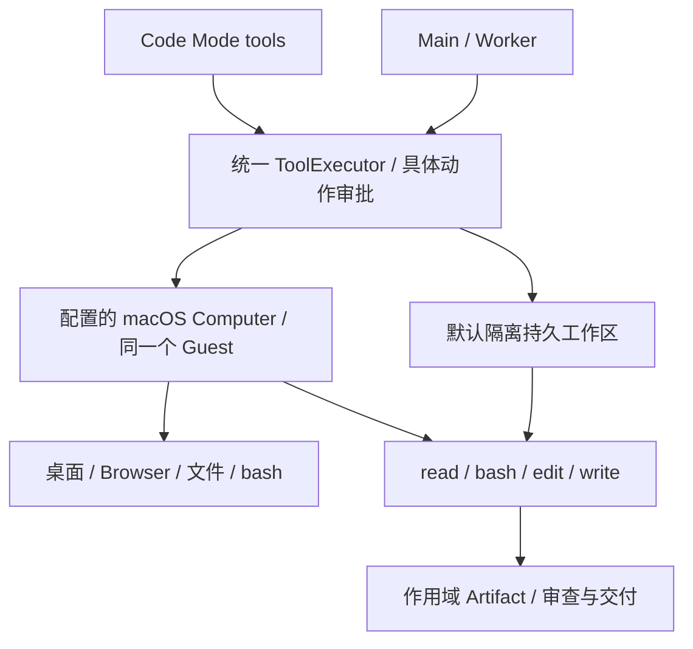

# 文件、命令与代码工作：技术方案

[功能与需求](../features/coding.md) · [测试方案](../test-plans/coding.md) · [主索引](../feature-map.md)

## 当前架构

Main、Root 和 Child 默认都有 `builtin__read`、`builtin__bash`、`builtin__edit`、`builtin__write`。这是文件/执行层的最小工具集；Task、Memory、Artifact、Automation、Skills、MCP 和 Code Mode 保留自己的结构化职责。

四个工具默认注册，配置只选择执行后端、工作目录和只读工具链。未配置 Computer 时，默认工作目录为 `<app.data_root>.computer`，首次调用创建私有目录。Linux 使用 bubblewrap namespace，macOS 使用 Seatbelt；系统 Python 3 运行嵌入程序，缺少沙箱或解释器时明确失败，没有宿主执行 fallback。本地沙箱不开放网络。独立编译器需要 `execution.toolchain_roots` 指定只读安装根；不会继承用户 PATH、shell profile、凭据或包管理器网络配置。

配置 Computer 后，四个工具使用现有 Lume/SSH Guest，在 `/Users/<guest-user>/StewardWorkspace` 工作；浏览器和桌面应用能访问同一文件系统。文件工具使用工作区相对路径；bash 是该隔离 Computer 用户的通用命令入口，可以访问 Guest 里的其他文件，不是 Host shell。`execution` 和 `computer` 不能同时选择；不暗中启动第二份工作区。

## 工具与流程

| 工具 | 行为 | 权限 / 重放 |
| --- | --- | --- |
| `builtin__read` | 按行读取，返回完整文件 SHA-256；`as_artifact:true` 保存完整文件，二进制自动返回 Artifact | read_only / safe |
| `builtin__bash` | 搜索、Git、测试及通用命令；默认 60 秒，可指定 1–120 秒；每次从工作区开始，cd/export 不跨调用保留 | external_effect / high / never |
| `builtin__edit` | 当前 SHA-256 + 唯一 old_text 精确替换；保留其他内容，允许连续编辑和脏文件 | external_effect / high / never |
| `builtin__write` | 创建文件和目录；覆盖已有文件必须匹配当前 SHA-256 | external_effect / high / never |

先读项目适用的 AGENTS.md 和目标文件，精确修改，再运行项目自己的测试，检查退出码和输出，读取 diff/交付文件为 Artifact，最后由 Main 交付。AGENTS 从实际执行环境按需读取，是项目证据；不会把宿主 cwd 的文件偷偷拼进 system prompt，也不能授予权限或审批。

原有 `workspace_search/git/test` 由常规 bash 命令承担；不提供固定 Go 测试专用工具。工具调用成功不代表命令成功，必须检查 `exit_code`、`timed_out`、`truncated`。命令输出上限 48,000 字节；读取默认 200 行、最多 2,000 行和 48,000 字节。超长单行可用 bash 按字节读取。文件/Artifact 读取上限 8 MiB；单次写入与编辑参数各限 64 KiB。

## 隔离、审批与恢复

所有直接调用和 Code Mode 调用都使用同一 ToolInvocation、审批、输出归一化与重放路径。read 自动允许；bash/edit/write 需要批准冻结的具体动作。bash 即使只运行 grep/git/test，也不以字符串猜测降低风险。父级批准不授予 Child。Shell 不能替代 Task/Memory/Artifact 的内部控制面，Host 域数据库与 SecretStore 不进入工作区。

同一环境操作串行化：统一冲突键覆盖文件/命令和 Computer 桌面动作，辅助程序还对工作区目录持有跨进程锁。目录组件使用 O_NOFOLLOW；读取拒绝链接、特殊文件，写入通过同目录临时文件与原子替换完成。工作区是专属执行环境，不支持外部写者在 hash 校验与替换之间并发写入。使用已有用户文件时精确修改并保留其他内容；bash 的具体修改能力由该次命令审批约束。

macOS 原生工具在 Host 侧以固定 `/usr/bin/xcrun --no-cache --find python3` 和净化环境发现系统解释器，限定发现期限与输出大小。仅接受已有 Developer 只读范围内规范化的普通可执行文件，随后在原 Seatbelt 边界中运行嵌入的 Python helper。Linux 仍解析系统 `/usr/bin/python3`。

本地进程清理有超时和进程组控制；Linux PID namespace 回收后代。macOS 仅原生 Python helper 允许向同一 Seatbelt 沙箱的进程发信号，使其能终止自有 Bash 子进程组。沙箱外进程及另一次调用的独立沙箱仍拒绝信号。macOS Seatbelt 是受控命令的内核文件/网络边界，不替代 VM 的强进程隔离；对不可信工作负载使用配置的 macOS Guest。Guest 传输或调用超时后可能已有动作，结果保持 unknown，不能自动重发；受控 bash 自身的 deadline 仍限制执行时长。

原生环境工具与图片 OCR 共用 `computer/sandbox` 的进程生命周期和有界输出捕获。`Run` 返回是否成功启动，环境工具据此区分启动失败与可能已发生的副作用；原生工具取消仍先发 SIGTERM 让 Python 清理其命令子进程，OCR 立即 SIGKILL，收尾统一等待并回收进程组。`Output` 不嵌入 bytes.Buffer，避免 io.Copy 通过 ReaderFrom 绕过字节上限。此层不负责审批、业务错误或重试，环境协议与 OCR 解析仍由各自模块维护。

原生 Guest 调用复用持久 execution claim 和 Computer operation ledger，不生成 JavaScript、不追加隐藏 ToolInvocation。直接调用结束前 checkpoint/dispose；嵌套调用复用所属 Code cell 的 Computer，等全部调用排空后统一回收。Run/Code claim 丢失会中断传输，旧 epoch 不能提交结果。迁移 029 让原生调用终态同步关闭 execution claim。

## 默认设置与迁移

旧 `workspace:` 配置和五个 `builtin__workspace_*` 工具已移除；没有别名，也不会改写历史 Capability Snapshot、模型请求、审批或 receipt。升级前用旧版本排空涉及旧 Workspace 的 Run 和待决副作用；升级后改用 `execution.root`（私有、独占工作目录）或现有 Computer。旧 Workspace snapshot 不能在新版本恢复，返回 MODEL_INCOMPATIBLE；Worker Task 可由新 Main append 创建新 Root。共享数据目录的进程一起升级；schema 29 不能交给旧二进制打开。

`audit/edit/protected` 不迁移成假限制：四工具始终存在，写入和命令逐次审批，读取内容哈希约束精确文件修改。只读工作请拒绝相应动作的审批。需保留的原始用户 checkout 放在执行目录之外，仅把明确选定的副本放进环境。

Skills list/view 也默认提供，未配置内容时返回空目录；服务 MCP 仍需明确连接和认证。正常安装启动已带 Code Mode，无须为核心方法手写启用 YAML；独立执行命令/恢复不猜测原先未冻结的运行时。

## 当前 Task 代码环境

### F-026 · 任务独立代码环境与交付证据

当前消费者是配置本地仓库的安装所有者、运行其 Task 的 Root/Child、审阅工作副本和验证回执的 CLI。普通 Main 仍使用 `execution.root`。配置启用完整工作目录导入，暂不让模型选择仓库、分支、主机路径或网络。目录隔离由已有内核沙箱落实，审批、冻结 ToolSpec 和不可重试的 unknown 仍由既有 ToolExecutor 裁决。

Task Root admission 同事务保存 `task_code_environment`（schema 37）的源路径、冻结资源 hash、派生位置和 pending 状态。工作副本、基线及 receipt 存在 canonical data-root 的私有兄弟目录 `<data-root>.task-code`。该兄弟目录是 Host 保留的受保护位置。配置拒绝它与通用执行、只读工具链、Skills/MCP、Computer 或源目录相交，取消源配置后仍保留此边界。只向 Root/Child 沙箱挂载同 Task 的 `work`。Task 目录、基线和 scope hash 由 Host 校验，源路径与本机内部行不作为外部协议。

准备在事务外完成。文件遍历逐层用目录句柄和 `O_NOFOLLOW`，跳过 `.git`，拒绝链接、特殊文件、无效 UTF-8 文件名和超出数量/大小上限的树。初次导入复制完整普通文件，包括所有者的脏文件和未跟踪文件。源二次扫描检出导入中的变化，安全副本同时生成基线与工作目录。Task 私有锁串行准备，原子 rename 发布后由 receipt 恢复同一快照。rename 前中断可从未发布的 staging 恢复，rename 后保留已发布副本。关停或失去 claim 保持 pending 或保留 receipt，真正的准备失败只终止当前 Root。续跑复用同 Task，变更冻结资源时拒绝重绑。

审阅在工作目录锁下构造有界、安全的 `a`/`b` 快照，运行固定沙箱 diff。文件清单按内容摘要和执行位比较，独立记录新增、删除和修改，包括空文件及二进制文件。文本补丁保留原文件内容和相对路径。diff 输出若含无效 UTF-8，报告以 `patch_unavailable: non_utf8` 标明省略补丁，文件清单和原字节摘要仍完整保留。每个报告最多读取 256 条历史 bash 调用及 4 MiB 的参数和回执，超限标明截断。保留接受时间、尝试次数、状态、错误和原结果。`report` 写入 Task 作用域 Artifact，提交时重检所有者与 Forget 屏障，报告 JSON 至多 16 MiB。目录扫描每树最多 4096 项、单文件 8 MiB、总内容 64 MiB。

机制是冻结边界、隔离挂载、发布恢复与可信证据。当前政策是一个显式源、完整文件导入、有界本地审阅及所有者主动生成 Artifact。选择文件快照以保留脏文件，同时跳过 `.git` 内的配置、凭据数据、对象与 hooks。导入普通文件时不筛查其中误存的密钥，所有者须检查授权的源目录。代价是导入复制成本，且基线相对于工作副本而非某个 Git commit。内部数据结构为私有，当前 CLI 与配置为实验性入口。通用 Git 连接器、自动远端分支/PR、依赖下载、跨主机副本同步和自动工作目录清理仍待各自范围。

## 当前缺口与验证

默认本地环境是离线文件/命令环境，不自动下载 VM、浏览器、项目依赖或第三方服务。macOS Guest 的平台和凭据准备仍见 [Computer](computer-use.md)。本地显式源导入已接通，真实模型开发质量与远端 PR/服务授权仍待验证，F-026 保持部分完成。测试层级、真实入口和本轮证据边界见 [测试方案](../test-plans/coding.md)。

## 当前设计取舍与兼容约束

执行环境提供 read/bash/edit/write 四个原生工具，保留精确文件修改与稳定输出，搜索、Git 和测试通过通用命令完成。工具复用统一执行管线和配置的 Guest；默认本地内核沙箱离线，不自动提供云电脑。项目指令按执行环境需要读取，Skills 目录可发现。

原生工具与 OCR 共用 sandbox 的进程组取消、等待和有界输出。原生工具仍保留 SIGTERM 清理、用户变更保护、审批及未知效果判定；schema 29 只扩展原生 execution 终态清理，不改写历史协议。旧 Workspace Run 升级前须排空。
