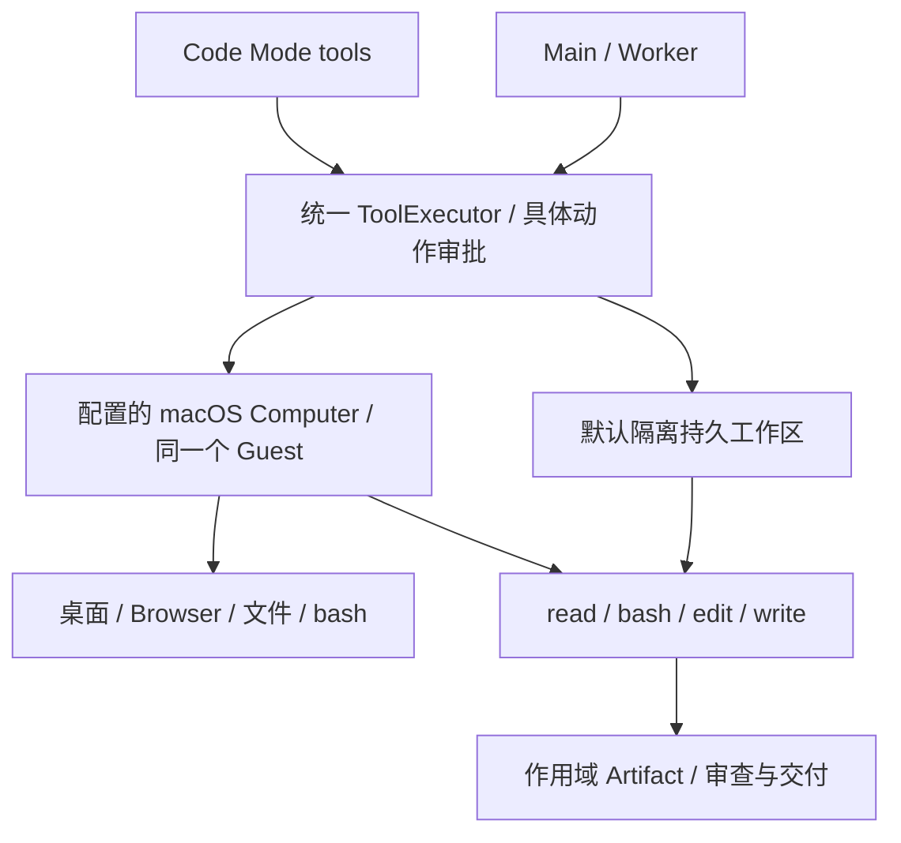

# 文件、命令与代码工作：技术方案

[功能与需求](../features/coding.md) · [测试方案](../test-plans/coding.md) · [主索引](../feature-map.md)

## 当前架构

Main、Root 和 Child 默认都有 `builtin__read`、`builtin__bash`、`builtin__edit`、`builtin__write`。这是文件/执行层的最小工具集；Task、Memory、Artifact、Automation、Skills、MCP 和 Code Mode 保留自己的结构化职责。

四个工具默认注册，配置只选择执行后端、工作目录和只读工具链。未配置 Computer 时，默认工作目录为 `<app.data_root>.computer`，首次调用创建私有目录。Linux 使用 bubblewrap namespace，macOS 使用 Seatbelt；系统 Python 3 运行嵌入程序，缺少沙箱或解释器时明确失败，没有宿主执行 fallback。本地沙箱不开放网络。独立编译器需要 `execution.toolchain_roots` 指定只读安装根；不会继承用户 PATH、shell profile、凭据或包管理器网络配置。

配置 Computer 后，四个工具使用现有 Lume/SSH Guest，在 `/Users/<guest-user>/EriiWorkspace` 工作；浏览器和桌面应用能访问同一文件系统。文件工具使用工作区相对路径；bash 是该隔离 Computer 用户的通用命令入口，可以访问 Guest 里的其他文件，不是 Host shell。`execution` 和 `computer` 不能同时选择；不暗中启动第二份工作区。

## 工具与流程

| 工具 | 行为 | 权限 / 重放 |
| --- | --- | --- |
| `builtin__read` | 按行读取，返回完整文件 SHA-256；`as_artifact:true` 保存完整文件，二进制自动返回 Artifact | read_only / safe |
| `builtin__bash` | 搜索、Git、测试及通用命令；默认 60 秒，可指定 1–120 秒；每次从工作区开始，cd/export 不跨调用保留 | external_effect / high / never |
| `builtin__edit` | 当前 SHA-256 + 唯一 old_text 精确替换；保留其他内容，允许连续编辑和脏文件 | external_effect / high / never |
| `builtin__write` | 创建文件和目录；覆盖已有文件必须匹配当前 SHA-256 | external_effect / high / never |

先读项目适用的 AGENTS.md 和目标文件，精确修改，再运行项目自己的测试，检查退出码和输出，读取 diff/交付文件为 Artifact，最后由 Main 交付。AGENTS 从实际执行环境按需读取，是项目证据；不会把宿主 cwd 的文件偷偷拼进 system prompt，也不能授予权限或审批。

原有 `workspace_search/git/test` 由常规 bash 命令承担；不提供固定 Go 测试专用工具。工具调用成功不代表命令成功，必须检查 `exit_code`、`timed_out`、`truncated`。命令输出上限 48,000 字节；读取默认 200 行、最多 2,000 行和 48,000 字节。超长单行可用 bash 按字节读取。文件/Artifact 读取上限 8 MiB；单次写入与编辑参数各限 64 KiB。

## 隔离、审批与恢复

所有直接调用和 Code Mode 调用都使用同一 ToolInvocation、审批、输出归一化与重放路径。read 自动允许；bash/edit/write 需要批准冻结的具体动作。bash 即使只运行 grep/git/test，也不以字符串猜测降低风险。父级批准不授予 Child。Shell 不能替代 Task/Memory/Artifact 的内部控制面，Host 域数据库与 SecretStore 不进入工作区。

同一环境操作串行化：统一冲突键覆盖文件/命令和 Computer 桌面动作，辅助程序还对工作区目录持有跨进程锁。目录组件使用 O_NOFOLLOW；读取拒绝链接、特殊文件，写入通过同目录临时文件与原子替换完成。工作区是专属执行环境，不支持外部写者在 hash 校验与替换之间并发写入。使用已有用户文件时精确修改并保留其他内容；bash 的具体修改能力由该次命令审批约束。

本地进程清理有超时和进程组控制；Linux PID namespace 回收后代。macOS Seatbelt 是受控命令的内核文件/网络边界，不替代 VM 的强进程隔离；对不可信工作负载使用配置的 macOS Guest。Guest 传输或调用超时后可能已有动作，结果保持 unknown，不能自动重发；受控 bash 自身的 deadline 仍限制执行时长。

原生 Guest 调用复用持久 execution claim 和 Computer operation ledger，不生成 JavaScript、不追加隐藏 ToolInvocation。直接调用结束前 checkpoint/dispose；嵌套调用复用所属 Code cell 的 Computer，等全部调用排空后统一回收。Run/Code claim 丢失会中断传输，旧 epoch 不能提交结果。迁移 029 让原生调用终态同步关闭 execution claim。

## 默认设置与迁移

旧 `workspace:` 配置和五个 `builtin__workspace_*` 工具已移除；没有别名，也不会改写历史 Capability Snapshot、模型请求、审批或 receipt。升级前用旧版本排空涉及旧 Workspace 的 Run 和待决副作用；升级后改用 `execution.root`（私有、独占工作目录）或现有 Computer。旧 Workspace snapshot 不能在新版本恢复，返回 MODEL_INCOMPATIBLE；Worker Task 可由新 Main append 创建新 Root。共享数据目录的进程一起升级；schema 29 不能交给旧二进制打开。

`audit/edit/protected` 不迁移成假限制：四工具始终存在，写入和命令逐次审批，读取内容哈希约束精确文件修改。只读工作请拒绝相应动作的审批。需保留的原始用户 checkout 放在执行目录之外，仅把明确选定的副本放进环境。

Skills list/view 也默认提供，未配置内容时返回空目录；服务 MCP 仍需明确连接和认证。正常安装启动已带 Code Mode，无须为核心方法手写启用 YAML；独立执行命令/恢复不猜测原先未冻结的运行时。

## 当前缺口与验证

默认本地环境是离线文件/命令环境，不自动下载 VM、浏览器、项目依赖或第三方服务。macOS Guest 的平台和凭据准备仍见 [Computer](computer-use.md)。仓库导入、真实模型开发质量及远端 PR/服务授权没有因新增四工具而自动完成，F-026 保持部分完成。测试层级、真实入口和本轮证据边界见 [测试方案](../test-plans/coding.md)。

## Changelog

2026-10-28：按统一文档结构迁入本功能的协议与历史决策，更新引用并移除旧文件；此为文档归属调整，不改变运行时协议。

本节追加记录每次架构/流程取舍。旧图不保留在正文；历史正式决定保留在本节。首次记录为现状建档，不推断历史决策日期。

| 日期 | 类型 | 决策与理由 | 取舍及影响 | 关联 |
| --- | --- | --- | --- | --- |
| 2026-10-28 | 现状建档 | 现有窄工具面是隔离与审查取舍；扩展开发能力时保留用户变更、审批和未知效果处理，不能直接把当前限制描述成完整工程能力。 | 明确当前边界与待补齐链路；本次仅建立文档，未修改运行时。 | [跨功能契约](product-overview.md#contract-0-文档效力与实现规则) |

后续记录需包含实际比较过的选项、采用理由、兼容/迁移影响和相关需求或 PR；未决建议不能写成已实施决策。

2026-10-28：F-026 替换临时 Workspace 适配器为默认 read/bash/edit/write。比较 bash-only、四原生工具和保留五个专用 Workspace 工具；选择四工具以保留精确文件修改与稳定输出，通用命令承担搜索/Git/测试。复用统一执行和配置的 Guest；默认本地内核沙箱离线，不伪称自动提供云电脑。项目指令改为执行环境按需读取，Skills 目录默认可发现。schema 29 只扩展原生 execution 终态清理，不重写历史协议；旧 Workspace Run 升级前排空。
