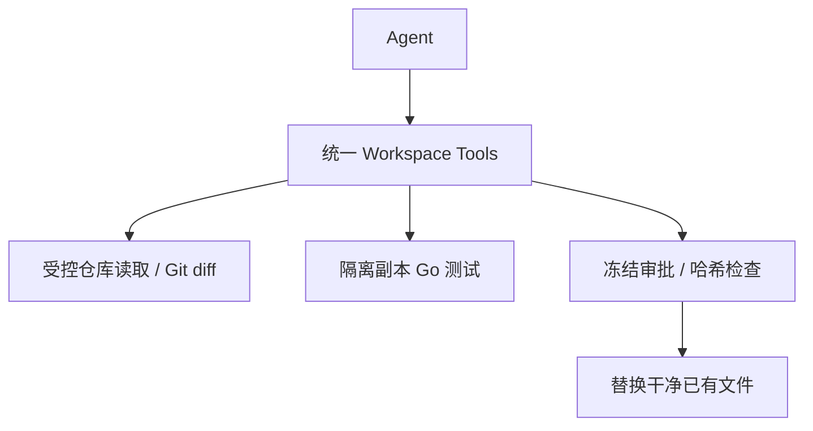

# 受控代码工作与开发交付：技术方案

[功能与需求](../features/coding.md) · [测试方案](../test-plans/coding.md) · [主索引](../feature-map.md)

最近核对：2026-10-28。本文的架构与流程描述当前有效实现；明确标记的待实现方案不表示已落地。实现级协议仍服从 [跨功能协议与约束](product-overview.md#contract-0-文档效力与实现规则)。

## 当前架构

Workspace 工具按受控根目录提供文件和 Git 读取；测试使用隔离副本；编辑通过批准动作和 preimage/rules 哈希检查，不暴露任意 shell。

## 当前流程与目标差异

读 AGENTS 与文件 → 搜索/理解 → 准备精确修改 → 审批与 CAS → 修改 → 测试 → 返回结果；多文件持续修改与最终交付尚待扩展。

- **F-026**：有 read/search/status/diff、隔离固定 Go 测试及单个干净受跟踪文件的批准替换。 缺少通用新建/删除、连续修改脏文件和提交交付链路；是否开放任意命令需单独决策。

## 代码与依赖

- [internal/computer/workspace/workspace.go](../../internal/computer/workspace/workspace.go)
- [internal/computer/workspace/test.go](../../internal/computer/workspace/test.go)
- [internal/computer/workspace/sandbox.go](../../internal/computer/workspace/sandbox.go)

## 验证与交付

验收场景、已有入口和剩余覆盖统一在 [测试方案](../test-plans/coding.md) 维护。本次建档未执行本功能的回归或 Live 验证，不以架构图替代运行证据。

## 协议、实现与配置约束

迁入内容按职责归属在此维护。既有编号用于追溯协议，不代表所有设计目标均已实现；完成状态以需求主索引为准。

### Coding fixture boundary

Provision an exclusive disposable Git checkout, with AGENTS.md and no shared
writers. Preserve the user's original checkout separately. This interim adapter
is for bounded controlled repositories, not execution of hostile workloads or a
replacement for the M6 Lume VM/Guest ComputerProvider. The current maximum is
4,096 walked entries, 64 KiB per exposed file, 8 MiB per test/metadata copy.
Shared worktrees, alternates, symlinks and hard-linked exposed files are denied.
Do not configure a checkout containing credentials. Configuration rejects scope
overlap with Erii data, Skills and provider directories.

| Tool | Behavior | Permission / replay |
| --- | --- | --- |
| `builtin__workspace_read` | Relative regular file, text and SHA-256 | read_only / safe |
| `builtin__workspace_search` | Bounded literal search or file listing | read_only / safe |
| `builtin__workspace_git` | Fixed status/diff commands only | read_only / safe |
| `builtin__workspace_test` | Fixed `go test -race ./...` in an isolated disposable copy | read_only / safe |
| `builtin__workspace_edit` | One existing clean tracked file; matching `before_hash` and AGENTS.md `rules_hash` | external_effect / high / never |

`audit` mode omits edit entirely, including from Worker discovery. `edit` mode
requires an exact approval and rejects protected paths, AGENTS.md, dirty/staged
files, assume-unchanged/skip-worktree index entries, invalid links and stale
hashes. Index flags are inspected in the private metadata copy and never cleared
on the original index. A temporary sibling is synced and renamed
atomically. This first adapter conservatively rejects a second edit to an already
dirty file, including its own earlier edit. There are no create/delete/commit,
reset/checkout, arbitrary shell, environment, mount or command parameters. Human
integration of the reviewed diff remains outside this tool surface. A crash after
rename but before result commit stays `unknown`; the file is not edited again.
An exclusive checkout is required because filesystem CAS cannot fence an
uncooperative external writer between the final preimage check and rename.

Git runs against a disposable metadata copy without repository config, hooks,
external diff/textconv, filters, fsmonitor, replacement objects or submodule
recursion. The original index, dirty files and hooks remain byte-identical.
Transient metadata locks are excluded. Automatic maintenance is disabled for
read commands and fixture bootstrap so no detached Git writer owns test state.
Tests copy regular source files without `.git`, then run under macOS Seatbelt
(`sandbox-exec`) or Linux bubblewrap namespaces with host user files, network,
keychain/Mach services and inherited secrets unavailable. Writable cache/temp
files and test mutations stay in that copy. The source checkout is not mounted
into the test sandbox. Output is bounded and temporary paths are normalized.
Tests returning nonzero report `passed:false`; they do not imply success just
because the Tool completed. A missing sandbox fails closed; there is no host
execution fallback. Process groups are collected and disposable files removed.

Linux requires bubblewrap and permission for unprivileged user namespaces. CI
installs the distribution package and enables namespaces only on its disposable
runner. macOS requires the system sandbox and Xcode/Command Line Tools. No new Go
or Node production dependency is added. Kernel sandboxing is an interim isolation
boundary. [Computer operations](computer-use.md) and [Computer Use](../features/computer-use.md)
own VM lifecycle/resource isolation and the separately recorded live compatibility
evidence; this coding fixture does not establish those results.

## Changelog

2026-10-28：按统一文档结构迁入本功能的协议与历史决策，更新引用并移除旧文件；此为文档归属调整，不改变运行时协议。

本节追加记录每次架构/流程取舍。旧图不保留在正文；历史正式决定保留在本节。首次记录为现状建档，不推断历史决策日期。

| 日期 | 类型 | 决策与理由 | 取舍及影响 | 关联 |
| --- | --- | --- | --- | --- |
| 2026-10-28 | 现状建档 | 现有窄工具面是隔离与审查取舍；扩展开发能力时保留用户变更、审批和未知效果处理，不能直接把当前限制描述成完整工程能力。 | 明确当前边界与待补齐链路；本次仅建立文档，未修改运行时。 | [跨功能契约](product-overview.md#contract-0-文档效力与实现规则) |

后续记录需包含实际比较过的选项、采用理由、兼容/迁移影响和相关需求或 PR；未决建议不能写成已实施决策。
