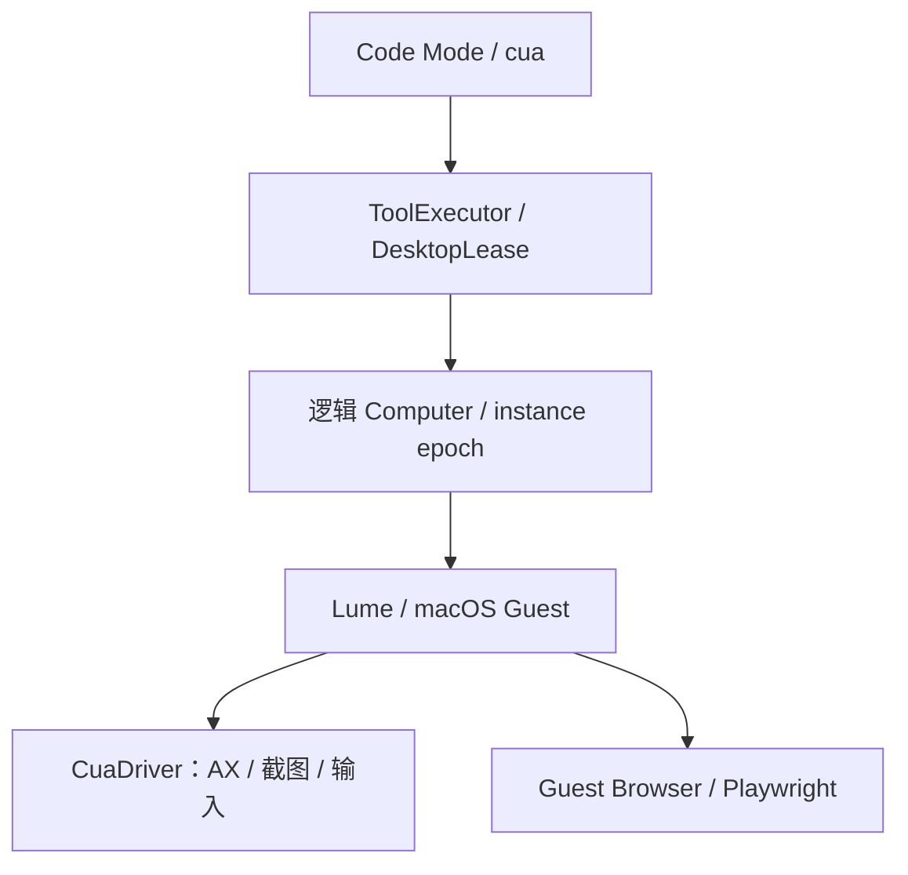
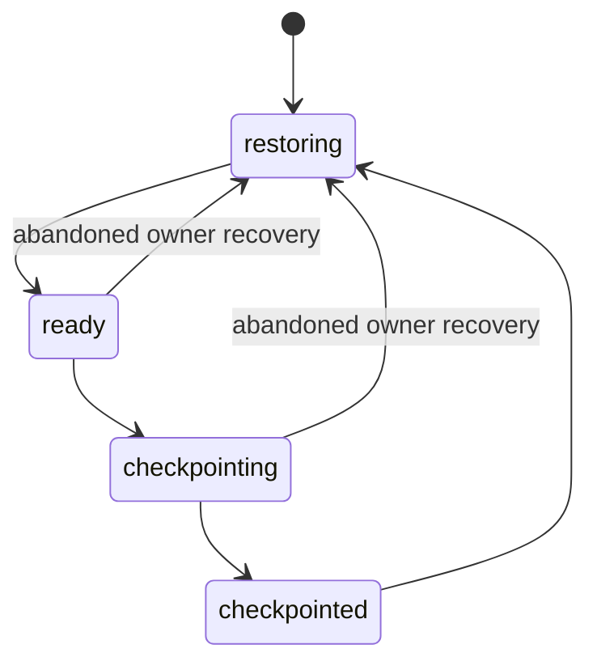

# 隔离 Computer 与桌面浏览器操作：技术方案

[功能与需求](../features/computer-use.md) · [测试方案](../test-plans/computer-use.md) · [主索引](../feature-map.md)

最近核对：2026-10-28。本文的架构与流程描述当前有效实现；明确标记的待实现方案不表示已落地。实现级协议仍服从 [跨功能协议与约束](product-overview.md#contract-0-文档效力与实现规则)。

## 当前架构

逻辑 Computer 身份持久化，实例 epoch 随恢复变化；DesktopLease 约束冲突。Code Mode 的私有桥经统一工具执行器访问 Lume/SSH Guest。



## 当前流程与目标差异

配置并验证基础环境 → 获取逻辑 Computer → 恢复实例 → 发现和观察 → 审批后动作 → 再观察 → 排空调用并 checkpoint/dispose。

- **F-027**：Lume 生命周期、SSH Guest、CuaDriver、AX/截图、受限 Playwright、文件传输与 epoch 已实现。 范围是 Apple Silicon macOS + 指定 Guest 环境，不包含 Linux 桌面或安装后自动提供 VM；兼容性需在真实平台复验。

## 代码与依赖

- [internal/computer/macosvm/provider.go](../../internal/computer/macosvm/provider.go)
- [internal/computer/macosvm/use.go](../../internal/computer/macosvm/use.go)
- [internal/computer/use.go](../../internal/computer/use.go)
- [internal/agent/sqlite/computer_use.go](../../internal/agent/sqlite/computer_use.go)
- [internal/agent/sqlite/computer.go](../../internal/agent/sqlite/computer.go)

## 验证与交付

验收场景、已有入口和剩余覆盖统一在 [测试方案](../test-plans/computer-use.md) 维护。本次建档未执行本功能的回归或 Live 验证，不以架构图替代运行证据。

## 协议、实现与配置约束

迁入内容按职责归属在此维护。既有编号用于追溯协议，不代表所有设计目标均已实现；完成状态以需求主索引为准。

<a id="contract-9-computerinstance-与恢复"></a>

### 9. Computer、Instance 与恢复

<a id="contract-91-概念分离"></a>

#### 9.1 概念分离

- `Computer` 是逻辑上持续存在的工作环境，包含应用、文件、状态和 Artifact。
- `Instance` 是承载 Computer 的一次性运行实例，可以启动、暂停、销毁和替换。
- Computer 与 VM Instance 不是同一概念；Computer 的身份和状态应跨 Instance 存续。

<a id="contract-92-computerprovider"></a>

#### 9.2 ComputerProvider

- 使用统一的 `ComputerProvider` 接口屏蔽底层实现。
- 一期本地 macOS VM 运行时采用 `Lume`，桌面与应用控制采用运行在 Guest 内的 `Cua Driver`。
- 只复用 Lume 的虚拟机生命周期、镜像和 Guest 访问能力，以及 Cua Driver 的桌面控制能力；不采用 Cua 自带的 Agent Runtime，也不让模型直接访问其原始接口。
- Go 服务在 `computer/macosvm` 中实现适配器，通过 Lume 本地 HTTP API 管理 VM；Cua Driver 通过 Guest 登录会话提供截图、Accessibility、窗口、鼠标和键盘操作。
- Lume 与 Cua Driver 的所有操作仍统一经过 `ToolExecutor → Security → ComputerProvider`。
- 云端可替换为虚拟机、容器/Pod、远程桌面运行时或其他隔离执行环境。
- Provider 负责实例分配、启动、暂停、销毁、检查点、恢复、并发仲裁和资源回收。

<a id="contract-93-生命周期"></a>

#### 9.3 生命周期

- Agent 空闲后，Instance 可以暂停或销毁，以节省资源。
- Computer Checkpoint 分为两级：
  - `Durable Checkpoint`：保存磁盘、NVRAM、VM 配置、已安装应用、用户文件、Artifact 与恢复清单；允许停止 VM 进程、重启宿主机，未来也可以在兼容宿主机上重建 Instance。
  - `Warm Checkpoint`：额外保存内存和打开中的应用状态，只是同一宿主机上的快速唤醒优化，不属于跨 Provider、跨宿主机的可移植语义。
- 一期必须实现 Durable Checkpoint；空闲回收采用“优雅停止 VM → 持久化 Durable Checkpoint → 释放 CPU/RAM”。
- 下次使用时从 Durable Checkpoint 启动 Instance、恢复登录会话并重新连接 Cua Driver；必要时由恢复清单重新打开应用和工作文档。
- Warm Checkpoint 作为 `ComputerProvider` 的可选能力，不作为一期正确性依赖，也不承诺跨宿主机迁移。
- 生命周期策略由系统自行决定；即使允许配置，也只放在高级设置中。
- 用户不感知 Instance 的启动、暂停、迁移或恢复状态。
- 用户只看到 Agent 空闲/忙碌和持续进行中的工作。

ERII-24 的本地切片在同一已接受 Code Mode ToolInvocation 内执行生命周期策略：
首次 `cua.getState()` 获取逻辑 Computer，已接受嵌套调用全部结束后优雅关机、
提交 Durable Checkpoint、销毁 Instance。Computer 元数据、冻结操作和 Outbox
同处 `state.db`，使用 Run/Code claim 与 instance epoch fencing。Guest 的签名、
权限、登录及 Driver 连接和三文件原子恢复由 `computer/macosvm` 负责。
ERII-25 在相同嵌套 ToolInvocation 中提供 Surface Inventory、Handle、Action、
DesktopLease、Observation 和受控文件传输；来源局部失败进入 Inventory errors。
受控审批/资源暂停保留物理 Lease，活动 claim 崩溃仍重建 Instance 并拒绝旧 Handle。
配置、恢复和故障处理见 [Computer 运维](#) 与 [Computer Use](../features/computer-use.md)。

生产 CUA bridge 的 `ToolSpec.internal` 随 Capability Snapshot 冻结，仅供 Code
Mode 的宿主绑定使用，不投影到模型 Tool 列表；直接模型调用仍被 Code claim
校验拒绝。该可选元数据缺省为 false 且省略编码，保留既有非 Computer Run
及显式旧 Fake 的冻结 Tool 表示；已接受快照不自动改写或扩权。

<a id="contract-94-镜像与兼容性"></a>

#### 9.4 镜像与兼容性

- 使用不包含用户凭据和个人文件的基础 macOS 镜像，通过 Lume 克隆形成具体 Computer。
- VM 磁盘、NVRAM 与配置必须作为一个一致性单元管理，不能只复制磁盘文件。
- Cua Driver 使用固定签名的应用构建并预置必要权限，避免克隆或升级后因权限身份变化导致 Computer Use 失效。
- 正式实现前必须通过剪映兼容性验收：安装与启动、素材导入、时间线编辑、字幕与转场、音视频导出、Computer Use 稳定性、停止后恢复以及异常恢复全部通过。
- 若剪映在 Lume 上存在无法接受的兼容性或性能问题，Parallels 作为备选 Provider；切换不改变上层 Computer 协议。

<a id="contract-95-computer-use-分层"></a>

#### 9.5 Computer Use 分层

参考 Codex Computer Use 的设计，将 Computer 能力拆成三层：

1. `ComputerProvider`：只管理 Instance 分配、启动、停止、Checkpoint、恢复、销毁、状态和 Provider 能力，不暴露 `click`、`type` 等界面操作。
2. `ComputerUseRuntime`：作为 Code Mode 中 `cua.*` 的宿主侧桥接层，与当前 Run、Computer 自动绑定，不再建立第二套 JavaScript 解释器；模型不处理 `instance_id`、`session_id` 或底层连接信息。
3. `ComputerSurface`：统一 App、Window、Browser 和 Tab 的发现、绑定、观察与操作协议；Lume 负责生命周期，Guest 内 Cua Driver 实现 macOS App Surface，浏览器可由 CDP/Playwright Surface 实现。

执行原则：

- `cua.*` 是与 Provider 无关的稳定协议；Code Mode 和 Agent 不感知本地或云端、Pod、宿主机、VM 地址及连接方式，底层可按任务替换 macOS VM、Linux Desktop 或 Browser Computer。
- 本地使用 Lume 与 macOS Cua Driver；未来云端由对应的 `ComputerProvider` 和 Guest/Browser Driver 实现相同协议，上层代码无需改变。
- Computer Instance 被暂停、销毁或迁移后，Provider 从 Durable Checkpoint 恢复环境，`ComputerUseRuntime` 重新连接当前 Instance，并通过稳定逻辑引用重新发现 Surface。
- 不尝试迁移正在执行的 JavaScript 调用栈；运行中故障由持久化的 Run、ToolInvocation 和 Computer Checkpoint 恢复。
- Conversation 状态、Code Mode 状态和 Computer 状态彼此分离。
- JavaScript 变量和 Surface 句柄只在当前 Code Mode 调用内有效，不写入 Durable Checkpoint；Computer 恢复后通过稳定逻辑引用重新发现并绑定 Surface。
- Surface 同时支持 Accessibility State 与 Screenshot；优先使用稳定的元素引用或语义动作，无法操作时再降级到截图坐标。
- Accessibility State 默认允许增量 Diff，但每次操作后必须重新观察，不复用已经失效的元素引用。
- 一次 JavaScript 执行可以批量组织确定性操作，并在同一调用结尾获取最新状态验证结果。
- 如果目标应用存在 API、MCP 或其他结构化能力，优先使用结构化工具；Computer Use 用于必须依赖视觉判断或 GUI 操作的部分。
- JavaScript 内部的每个实际操作仍形成独立的嵌套 `ToolInvocation`，逐项经过 ToolExecutor、Security、权限、审计和资源冲突检查，不能因外层是一次代码执行而绕过管控。
- 操作系统 Screen Recording/Accessibility 权限、应用访问授权和具体高风险操作审批分别管理。

<a id="contract-96-codex-风格的-cua-最小协议"></a>

#### 9.6 Codex 风格的 CUA 最小协议

<a id="contract-961-computer-inventory-与显式绑定"></a>

##### 9.6.1 Computer Inventory 与显式绑定

CUA 根对象只负责发现当前 Computer 的运行资源和创建脚本内句柄：

```typescript
type Platform = "macos" | "linux" | "windows";

interface ComputerState {
  computerId: string;
  instanceEpoch: string;
  platform: Platform;
  apps: AppInfo[];
  windows: WindowInfo[];
  browsers: BrowserInfo[];
  errors?: InventoryError[];
}

interface Cua {
  readonly computer: {
    readonly platform: Platform;
    launchApp(input: { app: string }): Promise<void>;
  };
  readonly files: ComputerFileAPI;

  getState(): Promise<ComputerState>;
  listApps(): Promise<AppInfo[]>;
  listWindows(): Promise<WindowInfo[]>;
  listBrowsers(): Promise<BrowserInfo[]>;
  listTabs(options?: { browser?: string }): Promise<TabInfo[]>;

  getApp(selector: string | AppSelector): Promise<App>;
  getBrowser(selector?: BrowserSelector): Promise<Browser>;
  getTab(reference: string | StableTabReference, options?: { browser?: string }): Promise<Tab>;
  createBrowserTab(browserId: string, url?: string, options?: CreateTabOptions): Promise<Tab>;
}
```

- `getState()` 采用 Codex 的容错 Inventory 思路：某个 Browser 或 Driver 枚举失败时写入 `errors`，不使其他 Inventory 一并失败。
- `getApp/getBrowser/getTab` 只绑定已经存在的资源，不隐式启动应用或创建 Tab；启动与创建是显式副作用，分别使用 `launchApp()` 和 `createBrowserTab()`。
- 字符串 Selector 只是便捷写法；权威引用使用稳定的逻辑 `app_id/window_id/browser_id/tab_id`，不把 Provider 原始连接信息暴露给模型。
- `instanceEpoch` 在 Instance 重建、恢复或迁移后变化。Surface Handle 同时绑定 `computer_id + instance_epoch + surface_id + lease_id`；旧 Handle 调用返回 `STALE_SURFACE_HANDLE`，由脚本使用稳定引用重新绑定。
- JavaScript Handle 不允许通过 `store()` 持久化；只能持久化稳定 ID、URL、Bundle ID、窗口标题等可重绑定信息。

<a id="contract-962-surfaceobservation-与元素版本"></a>

##### 9.6.2 Surface、Observation 与元素版本

参考 Codex 的 `Target → App/Tab` 结构，所有可观察界面实现统一 `Surface`：

```typescript
type Vec2 = [x: number, y: number];
type Direction = "up" | "down" | "left" | "right";

interface ElementRef {
  observationRevision: string;
  index: number;
}

type ElementTarget = number | ElementRef;
type PointerTarget = ElementTarget | Vec2;

interface AXObservation {
  surfaceId: string;
  revision: string;
  baseRevision?: string;
  kind: "full" | "diff";
  state: string;
}

interface ScreenshotObservation {
  surfaceId: string;
  revision: string;
  width: number;
  height: number;
  image: ImageBlock;
}

interface CombinedObservation {
  ax: AXObservation;
  screenshot: ScreenshotObservation;
}

interface Surface {
  readonly ref: StableSurfaceReference;
  readonly capabilities: CapabilityCollection;

  documentation(): Promise<string>;
  getAXState(options?: { full?: boolean }): Promise<AXObservation>;
  getScreenshot(): Promise<ScreenshotObservation>;
  getAXStateAndScreenshot(options?: { full?: boolean }): Promise<CombinedObservation>;

  click(target: PointerTarget, options?: ClickOptions): Promise<void>;
  drag(from: Vec2, to: Vec2, options?: PointerOptions): Promise<void>;
  scroll(target: PointerTarget, direction: Direction, amount?: ScrollAmount): Promise<void>;
  setValue(target: ElementTarget, value: string): Promise<void>;
  selectText(target: ElementTarget, text: string, options?: SelectTextOptions): Promise<void>;
  performSecondaryAction(target: ElementTarget, action: string): Promise<void>;
  waitForChange(options?: { sinceRevision?: string; timeoutMs?: number; full?: boolean }): Promise<AXObservation>;
}
```

- AX State 默认返回相对上一观察的 Diff；首次观察、`full: true`、Handle 重绑定或 Diff 基线丢失时返回完整状态。
- `number` 元素索引沿用 Codex 的简洁写法，隐式绑定该 Handle 最近一次 AX Observation；`ElementRef` 是可显式传递的安全写法。Observation 更新后，旧索引和旧 `ElementRef` 必须 fail-closed，返回 `STALE_ELEMENT_REFERENCE`。
- 坐标始终相对于最近 Screenshot 的 Surface 视口；没有有效 Screenshot Revision 时拒绝坐标操作，避免恢复、缩放或窗口移动后误点。
- AX Revision 与 Screenshot Revision 分开维护；仅获取截图不会让 AX 元素引用静默指向另一棵树。
- `performSecondaryAction()` 沿用 Codex 命名，只能调用最新 AX State 明确暴露的非默认语义动作，不允许猜测任意 Action Name。
- 观察是 Read Barrier：必须排在当前 DesktopLease 已提交动作之后返回。一期所有原生桌面 Surface 共享 `conflict_key=computer:<id>:desktop`，不允许不同窗口或 App 并行操作；未来 Browser Provider 可以对经过隔离验证的 Tab 使用独立冲突键。

<a id="contract-963-appbrowser-与-tab"></a>

##### 9.6.3 App、Browser 与 Tab

```typescript
interface App extends Surface {
  paste(text: string, options?: { format?: "text" | "md" | "html" }): Promise<void>;
  pressKey(key: string, options?: { durationMs?: number }): Promise<void>;
  typeText(text: string): Promise<void>;
}

interface Browser {
  readonly browserId: string;
  readonly capabilities: CapabilityCollection;
  documentation(): Promise<string>;
}

interface Tab extends Surface {
  readonly tabId: string;
  paste(target: ElementTarget | null, text: string, options?: PasteOptions): Promise<void>;
  pressKey(target: ElementTarget | null, key: string, options?: KeyOptions): Promise<void>;
  typeText(target: ElementTarget | null, text: string): Promise<void>;
  goto?(url: string): Promise<void>;
  back?(): Promise<void>;
  forward?(): Promise<void>;
  reload?(): Promise<void>;
  close?(): Promise<void>;
}
```

- App 与 Tab 复用相同观察和指针操作协议；输入方法单独定义，因为 Browser 可能需要先聚焦具体元素，而原生 App 通常对当前焦点输入。
- 导航、关闭等方法为可选能力；Provider 不支持时不伪造实现，而是在 `documentation()` 与 Capability Inventory 中明确缺失。
- 不复制 Codex 的 `markDeliverable/markHandoff` 到 CUA 核心协议。Erii 的长期 Tab 生命周期属于 Run/Computer 的资源保留策略，而不是 UI Driver 方法。
- Agent 创建的临时 Tab 默认属于当前 Run Lease；需要跨 Run 保留时，由上层 Resource Policy 持久化稳定 Tab Reference，不能依赖 JavaScript Handle。

<a id="contract-964-等待模型"></a>

##### 9.6.4 等待模型

Code Mode 没有 `setTimeout()` 或任意网络轮询能力。一期不建立通用条件 DSL，只提供 `waitForChange()`：

```typescript
waitForChange(options?: {
  sinceRevision?: string;
  timeoutMs?: number;
  full?: boolean;
}): Promise<AXObservation>;
```

- Runtime 负责等待 Driver 事件或执行有界轮询，模型不指定 `poll_interval`，也不能用 Sleep 制造大量空转。
- 成功时返回变化后的最新 AX Observation；超时返回结构化 `WAIT_TIMEOUT`，并携带最后一次 Observation 摘要。
  ERII-25 以受 Host 限制的 1–10,000 ms deadline 执行有界轮询；详情只保留安全摘要。
- 模型在拿到新 Observation 后自行判断文本、元素或窗口条件；Browser 的 DOM Locator、URL 和导航同步由 `playwright` Capability 提供。
- 只有实际场景证明 `waitForChange()` 往返成本不可接受时，才增加声明式语义条件，避免一期维护复杂且 Provider 难以一致实现的等待 DSL。

<a id="contract-965-按需-capability"></a>

##### 9.6.5 按需 Capability

沿用 Codex 的 Capability Collection，稳定核心协议之外的能力全部延迟披露：

```typescript
interface CapabilityInfo {
  id: string;
  description: string;
}

interface CapabilityCollection {
  list(): Promise<CapabilityInfo[]>;
  get<T = unknown>(id: string): Promise<T>;
}

interface DocumentedCapability {
  documentation(): Promise<string>;
}
```

一期只实现一个标准 Capability：

| Scope | Capability | 用途 |
|---|---|---|
| Tab | `playwright` | DOM Locator、导航等待和下载/文件选择器 |

`visibility`、`viewport`、`history`、`webmcp`、`page_assets`、`clipboard`、`content` 和 `dev_logs` 保留为未来候选，不进入一期验收范围；只有出现明确产品场景时才加入。

- 模型必须先 `capabilities.list()`，再 `get(id)`；Capability Handle 可过期，导航、恢复或 Provider 变更后重新获取。
- `documentation()` 返回精确 TypeScript 声明、使用指导和安全说明；未请求的 Capability 不占用 `builtin__codemode__execute` 描述预算。
- Capability 方法仍逐次形成嵌套 `ToolInvocation`，不能把 Playwright 或 WebMCP 当成绕过 ToolExecutor 的本地对象。

<a id="contract-966-文件传输与-artifact-边界"></a>

##### 9.6.6 文件传输与 Artifact 边界

文件传输属于 ComputerUseRuntime 的稳定桥接能力，不作为 App/Tab 的通用方法，也不允许模型直接访问宿主机任意路径：

```typescript
interface ComputerFileRef {
  computerId: string;
  path: string;
  size?: number;
  mediaType?: string;
}

interface ArtifactDescriptor {
  artifactId: string;
  name: string;
  size?: number;
  mediaType?: string;
}

interface ComputerFileAPI {
  importArtifact(input: {
    artifactRef: string;
    destination?: string;
    overwrite?: boolean;
  }): Promise<ComputerFileRef>;

  exportArtifact(input: {
    path: string;
    name?: string;
    mediaType?: string;
  }): Promise<ArtifactDescriptor>;
}
```

`ArtifactRef` 在所有模型可见与跨模块协议中始终是不可解析的字符串；`ArtifactDescriptor` 只是在需要展示或审计时返回的内部元数据视图。模型不得自行拼接 `artifactId`、路径或下载 URL。

- `importArtifact()` 将 ArtifactStore 中的对象物化到当前 Computer 的受控 Transfer Root；`exportArtifact()` 将 Guest 文件校验并写回 ArtifactStore。
- 不接受宿主机绝对路径、任意 URL 或未经登记的 Guest 外部路径；底层可以通过 Lume、SSH、共享目录或云 Provider 传输，但模型侧协议不变。
- `overwrite: true`、敏感文件导入、文件上传到第三方页面和导出隐私数据分别经过 Security Policy；文件传输本身不能暗含上传授权。
- Browser 下载先落入 Computer 的受控下载目录，再由 `exportArtifact()` 生成可持久化 Artifact；Browser 上传通过 `playwright` 的 File Chooser 使用 `ComputerFileRef`，不直接暴露宿主路径。
- 大文件只在 JS 中传递引用和元数据，不把二进制或 Base64 放入 QuickJS 内存、RunTrace 或模型上下文。

<a id="contract-967-融合后的输出语义"></a>

##### 9.6.7 融合后的输出语义

- Codex 的独立 `cua_repl` 可以自动展示 `getState/getApp/getAXState` 的结果；在本方案中所有 CUA 调用只是 Code Mode 内部值，不自动进入顶层 ToolResult。
- 脚本必须显式使用 `text(observation.state)`、`image(screenshot.image)` 或 `return` 选择模型下一轮真正需要的内容。
- RunTrace 保存完整结构化 Observation、Action、Capability Call、文件引用和错误；模型上下文只接收脚本筛选后的结果。
- 这种差异保留了 Pi Code Mode“内部执行丰富、模型输入受控”的核心价值，同时复用 Codex 的 Computer Surface 交互模式。

<a id="computer-use-leases-and-observations"></a>

### Leases and observations

Bindings retain Computer ID, Instance epoch, Surface identity and the accepted
Code invocation's DesktopLease. They are not checkpoint state. `store()` rejects
Surface and Capability objects; store Bundle IDs, URLs and other semantic refs.
Instance reconstruction invalidates old bindings. A controlled approval/resource
suspension records a resume receipt and retains the physical DesktopLease.
Expired or abandoned active claims still follow the durable rebuild path. Old
Run/Code owners cannot write state, accept results or keep their transports live.

All Computer calls, including observations, acquire the same desktop conflict
key through ordinary ToolExecutor admission. They also retain the logical
`computer:<id>:desktop` key after allocation. Different Apps do not bypass the
read barrier. A mutation invalidates cached AX/pointer references before dispatch.
A lost result is `unknown`; the Host does not repeat it.

The first AX read and `full:true` return a full state. Later reads have
`kind:diff` and `baseRevision`; `state` is empty for no change and otherwise is a bounded contiguous line
patch: `@@ zeroBasedLine,removedLines,addedLines @@`, then `- ` removed lines and
`+ ` added lines. New AX observations invalidate old explicit ElementRefs.
Numeric indices always refer to the handle's latest AX state. Screenshots have
separate revisions and Artifact references. A screenshot-only read disables the AX walk and preserves native tokens; it
cannot retarget an old index to a changed tree. Browser element tokens also bind
CDP backend node identity, so replacing a node with identical text does not
reuse the old reference. Core operations retain a fixed ElementHandle while
waiting for actionability and reject a detached node instead of querying a
replacement. Explicit Playwright CSS locators remain dynamic. Coordinates require a valid screenshot and unchanged geometry.
Every action must be followed by observation before using element/pointer refs.
Observation references become actionable in the same SQLite transaction as the
Tool result and screenshot Artifact metadata. Failed output normalization leaves
the pending observation inert.

`performSecondaryAction` accepts only an advertised non-default action. The
native adapter uses Cua Driver's AX `click.action` path, not arbitrary command
execution. Native `selectText` uses bounded, exact-element keyboard selection for
one unique ASCII substring within the first 256 characters of an AX text field;
unsupported or ambiguous ranges fail closed. Browser text selection uses the
bound DOM element. Input acknowledgements preserve `verified`/`effect` facts;
`unverifiable` is not a claim of application success. Observe and read back the
application state after input, including Return/commit where the app requires it.

`waitForChange({sinceRevision,timeoutMs,full})` polls inside the Runtime, never
inside QuickJS. The deadline is 1–10,000 ms. `WAIT_TIMEOUT.details.observation`
contains the last bounded AX summary. Observe again after a timeout before
using element refs. Unchanged internal polls do not advance the delivered diff
base. It does not poll forever or retry input.

<a id="computer-use-security-and-file-transfer"></a>

### Security and file transfer

This first adapter uses a conservative policy: every input, navigation,
launch/create and file transfer requires approval for that exact frozen nested
ToolInvocation. Reads and discovery are automatic. Consent for a Code cell,
import or Parent never grants upload, overwrite, private export or Child consent.
All mutations use `never` replay; reads use `safe`. A transport failure after
possible input becomes `UNKNOWN_SIDE_EFFECT` and is never retried automatically.

```js
const file = await cua.files.importArtifact({artifactRef: inputRef});
// file is {computerId, path}; path is relative to the controlled Guest root.
const artifact = await cua.files.exportArtifact({path: file.path});
// artifact.artifactId is the opaque ArtifactRef; pass it directly to Artifact tools.
return artifact;
```

The fixed Guest Transfer Root is `/Users/<configured-guest-user>/EriiTransfer`.
Only registered `imports/<name>` and `downloads/<name>` refs are accepted. No
Host path, arbitrary URL, external Guest path or script-provided ID authorizes
access. ArtifactStore enforces the current Agent/Task/Run scope. Imports,
overwrites, exports and page uploads are separate calls and approvals.

The Guest helper opens every path component with directory-relative descriptors
and `O_NOFOLLOW`. It refuses traversal, symlinks, hard links, directories and
special files before truncation. Binary bytes remain outside QuickJS and traces.
Transfers are bounded to 8 MiB. Downloads use generated names under `downloads/`;
page-chosen filenames cannot select a destination. FileChooser uploads receive
bytes from registered ComputerFileRefs, not Host or Guest filesystem paths.
File registration is retained for the owning Run or Task across cells and
Instance replacement. Another scope cannot turn a known path into authority.
New imports are limited to 256 visible files; overwrites require an existing
scoped registration.

<a id="computer-durable-logical-computer"></a>

## Durable logical Computer

ERII-24 adds the Lume lifecycle behind the existing Code Mode ToolExecutor and
Security boundary. `cua.getState()` lazily obtains the configured logical
Computer. Its ID persists in `state.db`; replacement instances get increasing
epochs. The accepted Code Mode invocation owns its lifecycle plan and cleanup.
Once its accepted nested calls have drained, the Host requests Guest shutdown,
commits a durable checkpoint, and destroys the disposable instance. Claim recovery
retains the frozen idle request and checkpoint IDs until its final metadata commit.
The provider verifies the published unit before checking the source instance, so
a crash after deletion can reconcile disposal without requiring that instance.
If that invocation is cancelled, a new authorized invocation derives the old
idle request from the retained operation ledger for the exact previous Computer
and instance epoch. It verifies the published unit and reconciles disposal before
restoring the replacement. Reclaiming the new invocation derives the same link
even after supersession. The cancelled Task, Run and Code execution stay terminal;
only Computer lifecycle progress is reconciled. No schema or frozen-request
format changes; unknown effects still fail closed.

ERII-25 adds live inventory, leased App/Window/Tab bindings, AX and screenshot
revisions, input, bounded waits, scoped Artifact transfers and the delayed
Playwright Capability. See [Computer Use](../features/computer-use.md) for the facade,
conservative action approvals, Guest browser provisioning and verification.
Existing explicit Core/Code Mode Computer Fakes remain separate fixtures.
Computer configuration defaults to absent.

<a id="computer-state-and-recovery"></a>

### State and recovery

Migration 021 adds the logical Computer and frozen operation ledger to the
existing `state.db`. State/version changes and their Outbox events commit with
the Run and Code execution fences. The Computer has one exclusive Code execution
owner. Concurrent users receive a resource refusal; unrelated cells cannot
reclaim that owner's instance. Pending accepted calls retain ownership until
they drain or a later fenced owner recovers them.

The lifecycle uses these states:



An abandoned ready instance is checkpointed before its replacement starts.
Incomplete allocation reattaches to its frozen operation. Epochs and claim
fences reject old owners at effect and completion boundaries. Registry resource
hashes freeze the configuration with the Run's Capability Snapshot; changing
configuration cannot redirect an accepted Run. Guest build, Driver executable
digest, bundle/team signature, console login and an actual Driver capture are
checked before readiness. Incompatible signatures and SSH keys fail closed.

Each checkpoint is one atomically published directory containing the three VM
files and a typed receipt with their full SHA-256 digests, compatibility snapshot
and restoration manifest. Files/directories are fsynced before publication.
Restore verifies the source and publishes a complete new instance directory;
it never installs disk, NVRAM and config one at a time into a live VM.

On APFS, byte-identical atomic COW clones avoid materializing sparse disks.
Within one provider process, a verified immutable unit can reuse its digest
while inode, size and modification time remain unchanged. A new process hashes
the complete source. Keep the private base/checkpoint directories immutable.
Disposal requires the committed checkpoint. Checkpoints and their operation
audit are retained; CPU/RAM and disposable instance directories are released.

The restoration manifest contains bundle IDs, absolute Guest document paths and
stable Artifact references. It applies when restoring a checkpoint; a fresh base
has no user documents to reopen. App/document intent is fixed for this slice.
The ArtifactStore continues to own Artifact bytes and authorization. The
manifest does not serialize JavaScript heaps, Driver sessions or surface handles.
Warm memory snapshots are optional and are not implemented.

<a id="computer-graceful-shutdown-and-uncertain-outcomes"></a>

#### Graceful shutdown and uncertain outcomes

Lume 0.6.1 HTTP `/stop` performs framework power-off. Graceful checkpointing first
requests OS shutdown through the authenticated Guest connection and proves the
native run lock has been released. An abandoned session marker is removed only
while holding that lock on the verified owned instance.

The same-process Lume cache may still report running. Only after native teardown
may the adapter reconcile it with `/stop`, accepting the exact already-not-running
400 response and then requiring `stopped`. The adapter releases its observer lock
before this HTTP request: Lume's fallback can signal a lock holder and replace
the config inode. It reacquires the current file's lock before copying and
checks the inode again before checkpoint publication.

Start/shutdown intent markers are durable before dispatch. If an earlier request
has an unprovable outcome, the adapter returns `UNKNOWN_SIDE_EFFECT` instead of
resending it. It never substitutes power-off for failed graceful shutdown.
Preserve the owned store for diagnosis; use authoritative state to resolve an
uncertain operation. Configuration/signature/integrity refusals expose safe
standard Tool errors, without raw paths, SSH diagnostics or credentials.

## Changelog

2026-10-28：测试入口随当前 Makefile/runner 对齐。旧说明中的 make verify、Delivery/security 分片与自动五轮是历史调度；当前默认单次，重复次数通过 runner --repeat 显式指定。保留机制验收要求。

2026-10-28：按统一文档结构迁入本功能的协议与历史决策，更新引用并移除旧文件；此为文档归属调整，不改变运行时协议。

本节追加记录每次架构/流程取舍。旧图不保留在正文；历史正式决定保留在本节。首次记录为现状建档，不推断历史决策日期。

| 日期 | 类型 | 决策与理由 | 取舍及影响 | 关联 |
| --- | --- | --- | --- | --- |
| 2026-10-28 | 现状建档 | 保持宿主与 Guest 隔离、观察引用随状态失效、桌面互斥与统一副作用恢复；Fake 测试不能代替真实 macOS 兼容性证据。 | 明确当前边界与待补齐链路；本次仅建立文档，未修改运行时。 | [跨功能契约](product-overview.md#contract-0-文档效力与实现规则) |

后续记录需包含实际比较过的选项、采用理由、兼容/迁移影响和相关需求或 PR；未决建议不能写成已实施决策。
