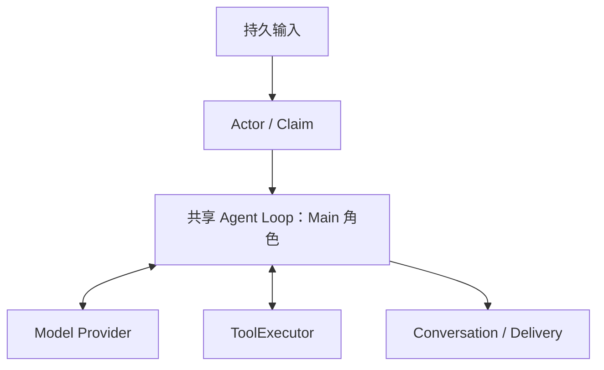

# 自然语言对话与共享循环：技术方案

[功能与需求](../features/conversation.md) · [测试方案](../test-plans/conversation.md) · [主索引](../feature-map.md)

最近核对：2026-10-28。本文的架构与流程描述当前有效实现；明确标记的待实现方案不表示已落地。实现级协议仍服从 [跨功能协议与约束](product-overview.md#contract-0-文档效力与实现规则)。

## 当前架构

Actor 协调领取与租约，唯一 Agent Loop 内核处理推理和工具交换。Conversation 保存用户可见历史，Run checkpoint 与 model_generation 保存执行边界。



## 当前流程与目标差异

接受输入并去重 → 调度 Main → 组装冻结请求 → 调用模型 → 有工具则执行并续轮 → 保存最终回复 → 交付。

- **F-003**：Actor 管理输入与执行权；共享 Loop 在 model/tools/reply/settle 阶段推进，保存模型交换和回复。 本需求不包含实时 Web 推送或高质量语义压缩，分别由 F-019、F-011 跟踪。

## 代码与依赖

- [internal/agent/actor.go](../../internal/agent/actor.go)
- [internal/agent/loop.go](../../internal/agent/loop.go)
- [internal/agent/run.go](../../internal/agent/run.go)
- [internal/agent/sqlite/generation.go](../../internal/agent/sqlite/generation.go)

## 验证与交付

验收场景、已有入口和剩余覆盖统一在 [测试方案](../test-plans/conversation.md) 维护。本次建档未执行本功能的回归或 Live 验证，不以架构图替代运行证据。

## 协议、实现与配置约束

迁入内容按职责归属在此维护。既有编号用于追溯协议，不代表所有设计目标均已实现；完成状态以需求主索引为准。

<a id="contract-4-conversation-与消息协议"></a>

### 4. Conversation 与消息协议

<a id="contract-41-conversationmessage"></a>

#### 4.1 ConversationMessage

以 Pi 1.2.0 的消息模型为基线，只保留必要类型：

- `UserMessage`：用户输入。
- `AssistantMessage`：Agent 面向用户的语义回复。
- `ToolMessage`：模型上下文中使用的工具结果消息。

Conversation 支持最小必要的多模态语义内容；核心 `ContentPart` 一期包含：

- `text`。
- `image`。
- `audio`。
- `video`。
- `file`。
- `tool_call`。

图片、音频、视频和文件 Part 内部统一使用 `artifact_ref` 寻址；`artifact_ref` 是资源引用机制，不替代资源的语义类型。Intelligent UI 不进入核心 Conversation/AgentMessage 内容协议，而由 Delivery 层生成和持久化渠道投影。

工具执行的完整轨迹不混入用户可见 Conversation，而是进入独立的 RunTrace/Observability 存储。

<a id="contract-64-agent-loop-协议"></a>

#### 6.4 Agent Loop 协议

- `internal/agent/loop.go` 承载可复用的无状态 Agent Loop 内核，并由 `loop_test.go` 验证。
- 一期不为了抽象提前建立独立子包，也不定义只有一个实现的 `AgentLoop` 接口。
- Main Agent Loop 与 Worker Agent Loop 复用同一内核，仅在上下文来源、工具集合、事件接收器和结束策略上不同。
- `AgentMessage` 与 `ConversationMessage` 分离：前者是 Loop 运行时协议，后者是产品持久化模型，由 Context Builder 转换。
- `AgentMessage` 使用最小运行时联合类型：

```text
SystemMessage
UserMessage
AssistantMessage
ToolResultMessage
CustomMessage
```

- Root Worker 仅在 `completed`、`failed`、`needs_input` 或 `unknown` 时，以 `CustomMessage{custom_type: "task_update", ...}` 返回 Main Agent Loop；普通运行进度、取消和等待审批不唤醒 Main Loop。Child Worker 只向直接 Parent 返回结果，不直接生成 Main Follow-up。
- `CustomMessage` 只存在于 Agent Loop 上下文和 RunTrace；Task/Run 模块保存权威状态，不将它作为普通消息写入用户 Conversation。
- `CustomMessage` 的最小字段为 `message_id`、`custom_type`、`content`、`details`、`origin` 和 `created_at`，不引入 Pi 面向 TUI 的 `display` 字段。
- `task_update.content` 保存供 Main Loop 理解的自然语言业务摘要；其 `details` 使用具名的 `TaskUpdateDetails`，模型可见字段只包含 `task_ref`、`kind: completed | failed | needs_input | unknown` 和可选 `artifact_refs`。
- `event_id`、`root_run_id`、`agent_id`、`task_id`、`task_epoch`、`sequence`、`occurred_at` 和投递次数属于持久化事件信封，不进入模型可见 `details`。Reporter 使用稳定 `event_id` 派生幂等 Request ID，重复队列投递只进入 Main Inbox 一次。
- `needs_input` 表示缺失信息会实质阻塞执行；Main 先尝试用已有上下文回答，仍无法处理时再集中询问用户。`unknown` 表示外部副作用是否发生无法确认，必须由 Main、Reconciler 或用户进一步处理。
- `cancelled` 由 Main 的 `task_manage(cancel)` 已知，不产生重复 Follow-up；审批由 Security/Approval 直接生成确定性审批请求，审批结果唤醒原 Root Run，不先触发 Main 模型推理。
- 每种 `custom_type` 在 Go 内对应具体的 `details` 结构体，只在存储和传输边界序列化为 JSON；业务代码不直接操作 `map[string]any`。
- `CustomMessage` 是内部一等消息类型，只有在 LLM Provider 边界才由按 `type` 注册的转换器映射为模型兼容消息。
- 转换后的消息必须保留可持久化的 `origin: runtime` 来源，并带明确的运行时内容边界；不得被 Conversation、Compaction、Memory 或任务锚点识别为用户原话或用户意图。
- 不将 Worker 结果提升为高权限 System Message；未知 `type` 或缺失转换器时 fail-closed，不注入模型上下文。
- 所有 `AgentMessage.content` 进入 Agent Loop 前统一规范化为 `[]ContentPart`；对外提供纯文本便捷构造函数，但 Loop 内不保留 `string` 特例。
- Worker 不直接生成面向用户的最终回复；Main Agent Loop结合人格、当前语境和投递场景决定是否以及如何通知用户。
- Root 产生关键更新时，Host 先原子持久化 Run/Task 状态、`TaskUpdate` 与 Outbox，再由 durable Reporter 以 Pi 风格的 Follow-up 提交 Main Inbox；Main 忙碌时排队，空闲时启动新的 Main Run。Root 的自然语言、图片和文件结果由 Host 包装为运行时消息，不要求模型通过 JSON Schema 或 constrained decoding 生成 `TaskUpdateMessage`。
- Agent Loop 对外事件与 Pi 保持一致：

```text
agent_start
agent_end
turn_start
turn_end
message_start
message_update
message_end
tool_execution_start
tool_execution_update
tool_execution_end
```

- 外层事件信封补充 `agent_id`、`run_id`、`task_id`、`sequence` 和 `occurred_at`，不修改 Loop 核心事件语义。
- 为支持可恢复审批，仅对 Pi 风格的 `BeforeToolCallResult` 增加最小 `suspend` 能力。

<a id="main-loop-ownership-and-persistence"></a>

### Ownership and persistence

Run creation freezes the ModelSnapshot, capability/tool schemas, and role prompt
fragments with the Run and Outbox event in one state transaction. An immutable
history boundary selects earlier semantic history from `conversation.db` on
first execution. The resulting context and each provider request are persisted
before dispatch. Steering remains separate ordered messages, injected after a
tool batch or before publishing a final answer. Steering arriving during a
final generation causes another model step before that answer is published.
A recovered accepted exchange keeps its frozen context until its result is checkpointed, before newer steering is injected. Once a reply intent is committed, later input follows that reply and continues
the same active Run until it reaches its terminal boundary.

State migration v7 adds Runs, claims, capability snapshots, input and semantic
write intents, model generations, ToolInvocations, reply/delivery records, and
RunTrace. It preserves prior v1–v6 metadata and events. `conversation.db` has an
independent v1 forward migration, WAL, foreign keys, busy timeout, monotonic
per-Conversation sequences and immutable idempotent message IDs. An incompatible
future version fails startup. [Memory maintenance](../features/memory-context.md) owns the
separate Memory database and its current migrations.

| Run state | Legal next states in this slice |
| --- | --- |
| `queued` | `running` on Claim |
| `running` | `running` on Checkpoint/controlled release, `waiting`, `completed`, `failed` |
| `waiting` | `running` on an eligible wake/Claim |
| `completed`, `failed` | Terminal; another request creates another Run |

The Main foundation reserves the baseline's cancelled state.
[The Task slice](../features/tasks.md) now supplies create/search/append; controlled user
pause/cancel uses the controlled [Task stop path](../features/tasks.md). Waiting reasons use the baseline enum. Resource waits
are recoverable; user-input waits become eligible when new steering arrives.
Approval wakes and resource waits use the durable Tool path in `docs/features/tools-approvals.md`; other external-event integrations arrive with their respective slices.

Claims use an opaque token, monotonic epoch and five-second lease, renewed once
per second. All Run, generation-acceptance and Tool mutations verify ownership;
Checkpoints and terminal transitions additionally use Run version CAS. Takeover
rejects old claims even when a slow response arrives afterward. SQLite busy/locked
transactions receive at most three attempts with bounded exponential backoff;
other write failures stop at a recoverable boundary. SQLite's configured busy
timeout also applies. Model errors and Tool business errors are not retried.

The Bridge's Host observer commits generation results, usage and the completion
Outbox event together under the existing auth/cancellation acceptance gate,
before publishing completion. Recovery reuses completed generations. An
incomplete model call may run again with the frozen request; no partial response
becomes a semantic message. Profile switches affect only new Runs, including
after restart. Credentials remain outside snapshots/context/results.

Main replies commit in this order:

1. Save an immutable reply intent with stable message/delivery IDs in `state.db`.
2. Idempotently append the ordered intents to `conversation.db`.
3. Enqueue DeliveryRequest and its Delivery Outbox in state.db.
4. Advance the reply Checkpoint after both durable writes.
5. Complete the Run, or process newly accepted steering.

There is no cross-database transaction. Restart fills missing writes using the
saved IDs. The `settle` Checkpoint prevents another generation if the process
dies between reply commit and Run completion. Any executor may flush immutable
semantic intents, but only the current claim may create them or advance a Run.
The M3 [Delivery Outbox](channels.md) drains requests into the durable terminal
inbox, independently of model readiness. Reading semantic history alone does not
imply a message was accepted by the channel.

SIGINT/SIGTERM stops admission to the current executor and waits for its current
model/Tool step to reach a durable boundary. Model calls have a 45-second Host
deadline; the Node Bridge also owns its existing stream deadline. The executor
releases the claim while retaining the nonterminal Run state, without cancelling business work. Run `chat work` again to
continue. SIGKILL leaves the lease to expire; a newly started `chat work` waits
and reclaims automatically. No broker is needed for this bounded CLI drain:
state is authoritative, and Outbox notifications remain available to the relay.

## Changelog

2026-10-28：测试入口随当前 Makefile/runner 对齐。旧说明中的 make verify、Delivery/security 分片与自动五轮是历史调度；当前默认单次，重复次数通过 runner --repeat 显式指定。保留机制验收要求。

2026-10-28：按统一文档结构迁入本功能的协议与历史决策，更新引用并移除旧文件；此为文档归属调整，不改变运行时协议。

本节追加记录每次架构/流程取舍。旧图不保留在正文；历史正式决定保留在本节。首次记录为现状建档，不推断历史决策日期。

| 日期 | 类型 | 决策与理由 | 取舍及影响 | 关联 |
| --- | --- | --- | --- | --- |
| 2026-10-28 | 现状建档 | 保留 Actor 与智能循环的职责分离；Main、Root、Child 复用同一内核。诊断或评测不得引入另一套执行循环。 | 明确当前边界与待补齐链路；本次仅建立文档，未修改运行时。 | [跨功能契约](product-overview.md#contract-0-文档效力与实现规则) |

后续记录需包含实际比较过的选项、采用理由、兼容/迁移影响和相关需求或 PR；未决建议不能写成已实施决策。
