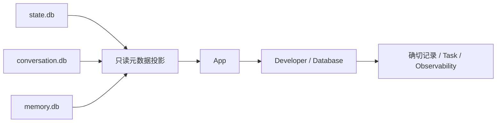

# Developer Database 数据检查：技术方案

[功能与需求](../features/database.md) · [测试方案](../test-plans/database.md) · [主索引](../feature-map.md)

## 当前架构

`internal/database` 定义固定的 Query、Page、Record、Field 和 Link 投影。`internal/database/sqlite` 持有三个独立只读连接池，从领域数据库读取允许的列；App 仅组装生命周期和 Web 接口。

连接由 Host 提供的数据根构造，使用 SQLite `mode=ro` 和 `query_only=1`，每库最多两个连接、500 ms busy timeout。连接池惰性打开；缺失数据库不会被创建。每次浏览总期限最多三秒，使用独立池避免占用运行时写连接。App 关闭时回收这些池，没有后台扫描或模型调用。

## F-033 的查询与作用域

查询只有 collection、确切 ref、cursor 和 limit。表名、列名、排序和 JOIN 均由静态投影选择，输入只作为绑定参数。最多返回 limit+1 行以判断继续位置，默认 20、上限 50；不读取全库生成页面总数。

当前 Agent 从 state.db 的安装身份读取。执行按 Agent 过滤，消息按 Conversation 的本机 user/Agent 归属过滤；Memory 允许该本机用户的 user 作用域和当前 Agent 作用域；Artifact 同时匹配本机用户和 Agent。HTTP 无权选择用户或 Agent。

Messages 使用顺序号与 ID，其他类型使用创建时间与 ID 做排他 keyset 分页。游标记录位置及 collection/Agent 的哈希绑定，限制长度并严格解析。游标不改变行权限；类型切换或 Agent 变化后旧游标失效。确切查询对不存在和不可见引用给出同一错误。

每个列表查询使用 SQLite 的单语句快照。跨库关联读取可能观察到稍后的提交，因此不宣称全局原子快照；返回前复核当前 Agent。已删除、被替代或过期记录可显示审计元数据，内容读取和语义召回仍遵守原有边界。

## 允许字段与关系

SQL 明确选择功能文档列出的元数据，不选择消息 content_json、Memory content、密文、credentials、storage_key、request_key 或 checkpoint payload。消息只在 SQLite 内提取内容部分数及至多 16 个附件引用；Memory 只提取存储形式、计数和至多 16 个已知来源；文件只提取至多 16 个持有者引用。

链接来自持久关系：消息的 main_input/main_reply、执行的 Task/父级/根级、Memory 的替代字段和来源，以及 Artifact 的生成者和 artifact_reference。Memory feedback 来源只映射到实际 `builtin__memory_manage` 调用所属的可见 Run，不推断第三方文字或时间上的关联。

所有候选引用先校验形状，再按目标类型批量核对真实归属；缺失和越权对象被移除。关系去重并按关系/引用稳定排序。页面链接由 Host 生成到固定路由，字段继续由 HTML 模板转义。API 无文件路径、原始 JSON 展开或 SQL 执行入口。

## 隐私与生命周期

这是本机所有者的显式元数据审计入口，不是 Main/Worker 工具，不发放 Artifact grant，也不接入 Memory 解密、embedding 或自动召回。Forget 后历史元数据仍可审计，原记忆值不进入查询结果、ToolInvocation、Run checkpoint 或模型请求。没有写入、恢复 Task、修复数据库或重新执行的控制动作。

Web 使用现有 loopback、Host/Origin、token/session 和启用绑定检查。页面和 API 均拒绝未知、重复或越界参数，底层故障只映射为固定 400/404/503。页面没有 Live 更新循环，浏览不产生 Main 输入或模型消费。

## 兼容与取舍

没有数据库迁移、新索引、依赖或冻结请求变化。只读投影集中维护允许列，避免暴露通用数据库接口；代价是随领域 schema 变化同步维护明确查询。单元测试验证作用域、相同时间的分页、只读强制和敏感字段；真实 CLI/Web 回归用领域入口生成记录来检测 schema 漂移。

大库中未按创建时间索引的投影仍受请求期限约束，查询超时返回不可用。跨库全局快照、完整持有者图、任意 SQL、内容解密和写入修复均不属于此入口。

## 代码与验证

- [投影协议](../../internal/database/database.go)
- [只读查询](../../internal/database/sqlite/reader.go)与[允许列](../../internal/database/sqlite/projections.go)
- [关联校验](../../internal/database/sqlite/links.go)
- [App 组装](../../internal/app/database.go)
- [Web 入口](../../internal/interaction/web/database.go)

验证方法和边界见[测试方案](../test-plans/database.md)，运行结果保留在 PR 和忽略的 evidence/ 中。
