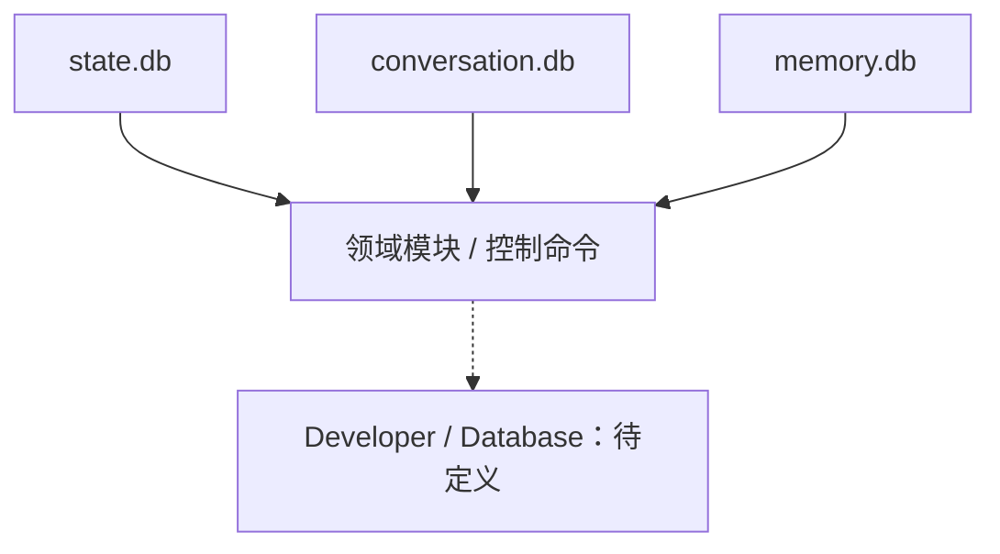

# Developer Database 数据检查：技术方案

[功能与需求](../features/database.md) · [测试方案](../test-plans/database.md) · [主索引](../feature-map.md)

本文的架构与流程描述当前有效实现；明确标记的待实现方案不表示已落地。实现级协议仍服从 [跨功能协议与约束](product-overview.md#contract-0-文档效力与实现规则)。

## 当前架构

state、conversation、memory 数据分别由领域模块管理；Web 目前只提供有界的领域投影，没有通用数据库页面。

## 当前流程与目标差异

当前通过领域命令检查数据。未来经有权限、分页、有界的只读接口查看记录，并跳转相关执行；具体投影待确认。

- **F-033**：当前存在各领域 SQLite 与控制命令；Web 没有通用数据库检查页。 先确定允许的数据、脱敏/解密权限、分页与只读查询范围；该方案不包含读写修复。

## 代码与依赖

- [internal/agent/sqlite/schema.sql](../../internal/agent/sqlite/schema.sql)
- [internal/conversation/sqlite/store.go](../../internal/conversation/sqlite/store.go)
- [internal/memory/sqlite/store.go](../../internal/memory/sqlite/store.go)
- [internal/interaction/web/server.go](../../internal/interaction/web/server.go)

## 验证与交付

验收场景、已有入口和剩余覆盖统一在 [测试方案](../test-plans/database.md) 维护。实际执行结果以对应版本的 PR 或 CI 证据为准；架构说明不证明回归或 Live 验证通过。
