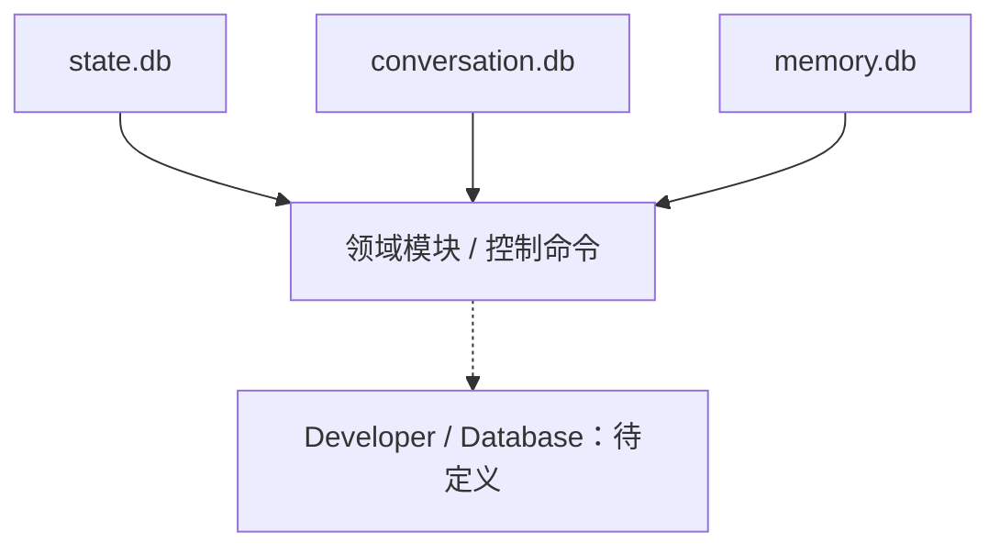

# Developer Database 数据检查：技术方案

[功能与需求](../features/database.md) · [测试方案](../test-plans/database.md) · [主索引](../feature-map.md)

最近核对：2026-10-28。本文的架构与流程描述当前有效实现；明确标记的待实现方案不表示已落地。实现级协议仍服从 [跨功能协议与约束](product-overview.md#contract-0-文档效力与实现规则)。

## 当前架构

state、conversation、memory 数据分别由领域模块管理；Web 目前只提供有界的领域投影，没有通用数据库页面。

## 当前流程与目标差异

当前通过领域命令检查数据。未来经有权限、分页、有界的只读接口查看记录，并跳转相关执行；具体投影待确认。

- **F-033**：当前存在各领域 SQLite 与控制命令；Web 没有通用数据库检查页。 先确定允许的数据、脱敏/解密权限、分页与只读查询范围；读写修复不属于本次方向。

## 代码与依赖

- [internal/agent/sqlite/schema.sql](../../internal/agent/sqlite/schema.sql)
- [internal/conversation/sqlite/store.go](../../internal/conversation/sqlite/store.go)
- [internal/memory/sqlite/store.go](../../internal/memory/sqlite/store.go)
- [internal/interaction/web/server.go](../../internal/interaction/web/server.go)

## 验证与交付

验收场景、已有入口和剩余覆盖统一在 [测试方案](../test-plans/database.md) 维护。本次建档未执行本功能的回归或 Live 验证，不以架构图替代运行证据。

## Changelog

2026-10-28：按统一文档结构迁入本功能的协议与历史决策，更新引用并移除旧文件；此为文档归属调整，不改变运行时协议。

本节追加记录每次架构/流程取舍。旧图不保留在正文；历史正式决定保留在本节。首次记录为现状建档，不推断历史决策日期。

| 日期 | 类型 | 决策与理由 | 取舍及影响 | 关联 |
| --- | --- | --- | --- | --- |
| 2026-10-28 | 现状建档 / 未来方向 | 登记未来页面，保持领域数据库写入归各自模块所有。只读浏览为首版建议，不能把数据库页面作为修改审批、Run 或隐私状态的后门。 | 明确当前边界与待补齐链路；本次仅建立文档，未修改运行时。 | [跨功能契约](product-overview.md#contract-0-文档效力与实现规则) |

后续记录需包含实际比较过的选项、采用理由、兼容/迁移影响和相关需求或 PR；未决建议不能写成已实施决策。
