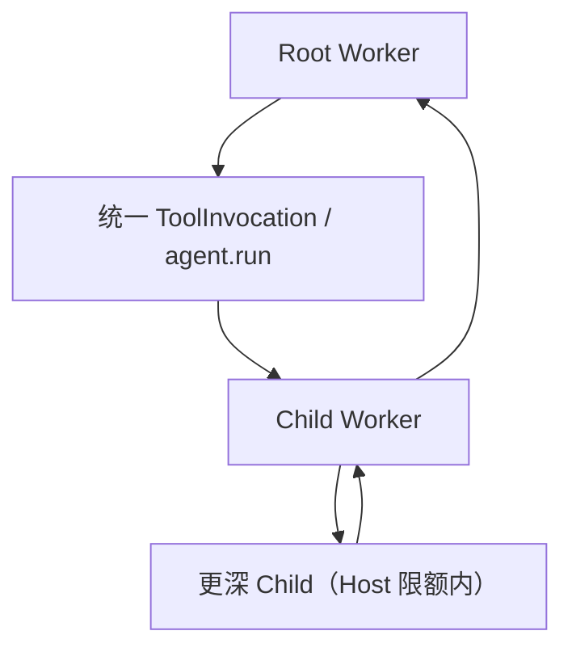

# Worker 子任务委派：技术方案

[功能与需求](../features/delegation.md) · [测试方案](../test-plans/delegation.md) · [主索引](../feature-map.md)

最近核对：2026-10-28。本文的架构与流程描述当前有效实现；明确标记的待实现方案不表示已落地。实现级协议仍服从 [跨功能协议与约束](product-overview.md#contract-0-文档效力与实现规则)。

## 当前架构

Child admission 位于统一 ToolInvocation 事务，父子关系持久化。等待子结果的 Parent 释放执行租约；子结果仅唤醒直接父级。



## 当前流程与目标差异

父 Worker 提交显式 task/refs → Host 验证能力与限额 → 原子创建 Child → Child 执行 → 保存最终结果 → Parent 采用结果并继续。

- **F-006**：agent.run 创建一个 Child；继承冻结模型及削减后的能力，结果只返回直接 Parent。 Main 不直接创建 Child；Child 不获得任务控制、凭据或记忆写入权限。

## 代码与依赖

- [internal/agent/child.go](../../internal/agent/child.go)
- [internal/agent/sqlite/children.go](../../internal/agent/sqlite/children.go)
- [internal/agent/sqlite/scheduler.go](../../internal/agent/sqlite/scheduler.go)

## 验证与交付

验收场景、已有入口和剩余覆盖统一在 [测试方案](../test-plans/delegation.md) 维护。本次建档未执行本功能的回归或 Live 验证，不以架构图替代运行证据。

## 协议、实现与配置约束

迁入内容按职责归属在此维护。既有编号用于追溯协议，不代表所有设计目标均已实现；完成状态以需求主索引为准。

<a id="contract-38-mainroot-worker-与-child-的-prompt-组装"></a>

#### 3.8 Main、Root Worker 与 Child 的 Prompt 组装

Prompt 使用可组合片段，不为三种 Run 维护三份彼此分叉的完整 System Prompt：

| Prompt 片段 | Main Run | Root Worker Run | Child Worker Run |
|---|---:|---:|---:|
| Core Safety / Tool Policy | 有 | 有 | 有 |
| 完整 Agent 人格与用户交互风格 | 有 | 无 | 无 |
| 精简 Agent Identity / 稳定行为原则 | 已包含在完整人格中 | 有 | 无 |
| Conversation 与当前交互上下文 | 有 | 无 | 无 |
| Task Context 与持续状态 | 按需读取摘要 | 完整 | 仅 Parent 显式传入部分 |
| 通用 Worker 执行规则 | 无 | 有 | 有 |
| `agent.run()` 能力说明 | 无 | 有 | 按 Capability Policy 提供 |

- Main 面向用户，对用户关系、意图协调和最终表达负责。
- Root Worker 面向 Task，保持该 Erii 的稳定身份与行为原则，但不承担聊天语气和渠道表达。
- Child 面向直接 Parent，是无独立人格的通用执行单元；它不得凭空假设未显式提供的用户背景。
- Prompt 片段统一由 `internal/agent/context.go` 按 Run 位置和冻结能力组装；是否暴露 `agent.run()` 由 Tool Exposure/Capability Policy 决定，而不是通过复制或分叉 Agent Loop 实现。
- Main 与 Root 共享同一份 Agent 基础能力配置，包括普通 Tool、CUA、Skill、数据作用域和 Security Policy；Host 再按 Run Role 自动派生能力表面。Main 额外拥有 Task 控制和用户交付能力且默认没有 `agent.run()`；Root 不拥有 Task 控制或用户交付能力，但拥有 `agent.run()`。
- Root 能力不在 `task_manage(create)` 中指定。Host 创建 Run 时根据当前 Agent 配置与 Run Role 生成带版本的 Capability Snapshot；Run 期间配置变化不影响该 Run，新 Run 使用新版本。
- Child 默认完整继承直接 Parent Worker 的 Capability Snapshot，并应用 Child 固定禁用项；调用方不在 `agent.run()` 中指定 Tool、Skill 或权限。Child 只能缩小能力，不能扩大能力、提升权限或加载 Parent 不具备的 Skill。
- Root 与 Child 都可以调用只读 `memory_search` 和 Task Artifact 检索；`memory_search` 统一召回长期 Memory 与 Conversation 历史。检索结果只进入发起查询的 Run，不自动注入或同步给 Parent、Sibling。共享持久化用户信息不等于共享 Parent 的运行上下文。
- Loop 函数命名为 `RunAgentLoop` 和 `ContinueAgentLoop`；领域层使用 `CreateRun`、`ClaimRun` 与 `CheckpointRun`。产品层不存在复活旧 Run 的 `ResumeRun`：用户继续 Task 时创建新 Root Run，基础设施故障恢复则重新 Claim 同一个未终结 Run。

<a id="contract-66-agentcode-mode-的一等-host-能力"></a>

#### 6.6 `agent.*`：Code Mode 的一等 Host 能力

对于“对 100 条数据逐条分析”“分阶段调查”“多 Agent 生成后交叉验证”等工作，不引入独立的 Workflow 产品与领域模型。系统只扩展统一 Code Mode：`agent.*` 与 `tools.*`、`cua.*` 平级，JavaScript 自身表达循环、分支、并发和结果汇总。

所谓 Dynamic Workflow 只是“一段调用了 Agent Tool 的代码”的使用模式，不是新的运行对象。Durable 是 Run、ToolInvocation 及其内部恢复状态的基础设施属性，不是 Workflow 的专属属性。

<a id="contract-661-统一能力表面"></a>

##### 6.6.1 统一能力表面

Worker Run 的 Code Mode Runtime 注入同一组稳定命名空间：

```text
tools.*      结构化工具与 MCP
cua.*        Computer、App、Browser、Tab
agent.*      Child Agent Run
```

- Canonical Tool 名称是 `builtin__agent__run`；拥有 `can_spawn_agents` 的 Worker 模型执行单次委派时可以直接调用它，进入 Code Mode 后则通过更自然的 `agent.run()` Facade 调用。两者引用同一个 ToolSpec、ToolInvocation 状态机和 `AgentToolExecutor`，不是两套实现。
- Root/Child Worker 在 Capability Policy 允许时看到 `agent.*`，不需要先选择 `builtin__workflow__start`，也不存在另一套 Workflow DSL。Main 默认不暴露 `builtin__agent__run` 或 `agent.*`，它通过创建 Task 启动 Root Worker。
- “可见”不等于“有权执行”。Host Bridge 根据当前 Run 的 `can_spawn_agents`、最大深度、高安全配额、工具范围和数据作用域进行强制校验；不能依赖 Prompt 约束。
- Root Worker 与具备委派能力的 Child Worker 使用相同 JavaScript API。Child Run 可以继续调用 `agent.run()` 形成 Run 树；宿主统一限制最大深度、后代总数、调用次数和并发。是否向某类 Run 暴露该命名空间由 Tool Exposure/Capability Policy 决定。
- Worker 的普通能力来源于统一 Agent 配置，而不是 Task 或 `agent.run()` 参数。Root 使用 Agent 配置的 Worker Role View；Child 继承 Parent Worker 的带版本 Capability Snapshot，并再次经过深度、高安全配额、Computer 资源锁和固定禁用项校验。
- 不提供 `workflow.*`、`WorkflowDefinition`、`WorkflowRun`、`WorkflowStep` 或单独的 Workflow Scheduler。
- 顶层入口保持一个：`builtin__codemode__execute`。暂停、取消、恢复和后台执行沿用 Run/Continuation 的通用协议。

<a id="contract-662-javascript-api"></a>

##### 6.6.2 JavaScript API

真正的 Host 能力保持最小：

```typescript
interface AgentRunRequest {
  task: string;
  artifactRefs?: readonly ArtifactRef[];
}

interface AgentResult {
  readonly text: string;
  readonly artifactRefs: readonly ArtifactRef[];
}

declare const agent: {
  run(request: AgentRunRequest): Promise<AgentResult>;
};
```

MVP 对有权委派的 Worker 只保留 `agent.run()`；Canonical Direct Tool 是 `builtin__agent__run`。不提供 `capabilities/spawn/get/cancel/send/broadcast` 等第二套能力发现、资源监控、生命周期或通信 API。

模型不查询预算余额、当前并发槽位或剩余后代数量。调用是否可接受由 Host 在 `agent.run()` admission 时原子判断：并发不足时透明排队，达到极高的深度、后代数或调用次数安全上限时以统一 `RESOURCE_LIMIT` Host Tool Error reject。带版本的 Capability Snapshot 仍作为宿主内部数据，用于 Child 权限继承、Tool/Skill 集合冻结、Durable Replay 一致性校验和防止扩权，但不暴露给模型或 JavaScript。

`agent.run()` 永远启动通用 Worker，不接受 Agent/Profile、Skill、Tool、权限、输出 Schema、超时、标签或重放 Key 参数。Child 继承 Parent 的工作面 Capability Snapshot，包括 Skill 发现、执行类 Tool、Code Mode、只读 Memory/Conversation 检索、Task Artifact 检索、数据作用域和 Security Policy；它不获得直接用户通信、Task/Conversation/Session 管理、Agent 配置、凭证/授权管理或长期 Memory 写入等控制面权力。具体副作用的 Approval 不从 Parent 继承，仍逐 ToolInvocation 裁决；Child 是否继续获得 `agent.run()` 由同一 Capability Policy 和宿主深度、安全配额限制决定。

不额外提供 `parallel.*`。顺序、并发、分支和错误收集直接使用标准 JavaScript：`Promise.all()` 表达 fail-fast，`Promise.allSettled()` 收集逐项结果；无论脚本创建多少 Promise，AgentService/RunScheduler 的宿主配额始终是实际并发上限。

顺序处理：

```javascript
const results = [];

for (const row of input.rows) {
  results.push(await agent.run({
    task: `分析下面这条数据，把完整结论作为内容或产物返回：\n${JSON.stringify(row)}`
  }));
}

return results;
```

100 条数据的并发处理：

```javascript
const results = await Promise.allSettled(
  input.rows.map((row) => agent.run({
    task: `分析记录 ${row.id}，把结论和必要证据作为内容或产物返回：\n${JSON.stringify(row)}`
  }))
);

const resultSet = await tools.builtin__artifact__manage({
  operation: "save",
  text: JSON.stringify(results),
  mediaType: "application/json",
  name: "item-analysis.json"
});

return agent.run({
  task: "汇总逐条分析结果，指出共性、异常和需要人工复核的项目。",
  artifactRefs: resultSet.artifactRefs
});
```

- 模型直接发出的 Tool Call 复用模型/API 协议提供的 `provider_call_id`；模型只看到顶层 Code Mode Tool Call，看不到其中的 Host Call。受信 Runtime 因此为 `tools.*`、`cua.*` 和 `agent.run()` 嵌套调用根据父 `provider_call_id`、固定源码位置与动态出现序号生成稳定 `nested_call_key`。模型和 JavaScript 都不生成或传入这些 Key；ToolExecutor 另根据稳定 `invocation_id` 生成外部 Provider 使用的 `idempotency_key`。
- Child Agent 正常完成完整 Agent Loop，不对其最终模型生成施加 JSON Schema 或 constrained decoding。Harness 在生成完成后用代码把最终自然语言和明确发布的 Artifact 封装为 `{ text, artifactRefs }`；这是 Host 传输包装，不会干预模型的推理轨迹。
- 大型输入、中间结果、JSON/CSV、图片和文件使用 Run-scoped `ArtifactRef`，不能把数十万 Token、二进制或裸文件路径复制进 QuickJS 或 Child Agent 上下文；Artifact 在 Task 生命周期内可恢复、可传递，之后按保留策略清理。
- Root 与 Child 都可以按需搜索、读取同一 Task 的 Artifact，内容不会自动注入上下文。`artifactRefs` 只用于明确提示本次 Child 优先使用的产物，不用于扩大数据权限。
- Child 新产物先写入自己的 Run-scoped、不可变 Artifact 空间；只有明确发布为最终输出的文件、图片和大体量内容进入 `AgentResult.artifactRefs`。修改既有 Artifact 会生成新 Artifact 或新版本，不允许并行 Child 原地覆盖。
- `agent.run()` 成功时只向 JavaScript 返回 `{ text, artifactRefs }`；Run ID、用量、状态和内部轨迹不进入 API 返回值。Parent 如需结构化数据，应在 Child 完成后自行读取、解析、校验或另行转换产物。
- `agent.run()` 与 `tools.*`、`cua.*` 使用相同 Promise 语义：Host 调用成功执行则 resolve；“没有找到证据”等业务负面结论仍是正常 `AgentResult`；参数非法、Capability 拒绝、审批拒绝、超时、取消、模型最终失败或 Runtime 故障则使用统一 Host Tool Error reject。MVP 不增加 Agent 专属错误类、`status` 联合返回值或 `partialResult` 字段。
- Host 只自动重试限流、短暂断连、Provider 暂时不可用等明确的瞬态基础设施错误；不会替 JavaScript 重试结果不合格或业务失败。
- Parent 与 Child 只通过显式 `task`、可访问的 ArtifactRef 和最终 `AgentResult`/统一 Host Tool Error 通信；它们可以独立检索同一用户的持久化 Memory/Conversation，但不共享 Parent 的可变运行上下文，也不提供同级消息、广播或 Agent Teams。
- Child Agent 的中间消息和工具轨迹默认只进入其 RunTrace；只有最终 `text` 和明确发布的 `artifactRefs` 进入直接 Parent Worker，再由 Root Worker 决定汇总为何种 Task 结果或 Main Follow-up。
- Child Run 可以用相同的 `agent.run()` API 继续委派；它只能在自身数据作用域内用自包含 `task` 与可访问的 ArtifactRef 向后代传递工作。
- Child 遵循 work-first 原则：优先检索上下文、调用工具、基于证据作合理假设并继续；只有缺失信息会实质阻塞任务，或继续可能造成不可逆错误时，才在最终 `text` 中明确说明所缺信息，且不直接向用户发问。批量调用继续完成其他 Child，由 Parent 聚合、去重问题后交给 Main Agent 一次性询问。
- `agent.run()` 一旦被 Host 接受，即使 JavaScript 没有 `await` 它也继续执行。其 Promise 结果被已结束的脚本丢弃，最终结果仍保留在内部 RunTrace；Parent Run 或 ToolInvocation 被取消时仍按 Run 树递归取消。

<a id="contract-663-host-bridge-与-child-run"></a>

##### 6.6.3 Host Bridge 与 Child Run

`agent.run()`、`cua.*` 与 `tools.*` 在 JavaScript 和 Go 调用层都走同一套 ToolInvocation 协议，仅 Executor 不同：

| JavaScript Host Call | Go 侧执行对象 |
|---|---|
| `tools.*` | ToolInvocation |
| `cua.*` | ToolInvocation + ComputerUseRuntime |
| `agent.run()` | ToolInvocation + Child Run |

执行链路：

```text
Worker Agent Loop
  → builtin__codemode__execute
  → JavaScript Runtime
  → host.invoke(toolName="builtin__agent__run")
  → ToolExecutor
  → AgentToolExecutor.StartChildRun
  → Child Run
  → persisted result
  → resolve JavaScript Promise
```

- Node Sidecar 不直接调用模型，也不实现第二套 Agent Loop；它只把 `agent.run()` 转成带 `execution_id/call_id/nested_call_key` 的普通 Tool Host Call，其中 `nested_call_key` 由受信 Runtime 生成，不接受模型或脚本传入。
- Go 在同一事务中创建 CodeCall、ToolInvocation、Child Run 和 `run_ready` Outbox 事件，然后才向 Sidecar 确认调用已经登记；该调用永远不会隐式创建 Task。
- `AgentToolExecutor` 负责把 Tool 参数转换为 Child Run 输入，并在 Child Run 终态后把最终业务结果规范化为 ToolResult；Child 生命周期、用量和轨迹仍由 Agent 模块管理。
- 唤起 Child Run 本身不创建第二个 JavaScript Code Cell；Child 先进入正常 Agent Loop，只有当它自行调用 `builtin__codemode__execute` 时才创建属于该 Child Run 的 Code Cell。
- Child Run 使用现有 Worker Agent Loop，只接收显式 `task`、重点 `artifactRefs`、通用 Worker 规则、Task-scoped Artifact 可见范围和数据作用域；它继承 Parent 的工作面 Capability Snapshot，但不继承 Parent 的 Agent Identity、模型上下文、可变状态、控制面权力或具体 ToolInvocation Approval。Child 可以通过只读检索工具独立召回持久化 Memory 与 Conversation，这不构成 Parent 上下文继承。
- Child 正常结束时只把 `{ text, artifactRefs }` 交还给直接 Parent；调用失败沿用统一 Host Tool Error。Run ID、用量和轨迹留在宿主内部，也不存在 Child 之间的直接消息通道。
- Child Run 完成、失败、等待审批或进入不确定副作用状态时更新 Agent ToolInvocation 和 CodeCall，并通过事件唤醒父 Code Mode ToolInvocation；不轮询模型。
- 100 个 Child Run 的普通进度只进入 Progress Store，不触发 Main Agent 进行 100 次思考。父 ToolInvocation 终态、需要用户审批或不可恢复错误只唤醒直接 Parent Worker；由 Root Worker 在 Task 边界聚合后通知 Main。
- `agent.run()` 的启动权限、Run 树深度、后代总数、调用次数和并发由 AgentService/RunScheduler 控制；Child 保留相同的 Agent Tool。所有后代共享 Root Run 的高安全配额与用量账本；硬上限只作安全熔断，Code Mode 只表达调用意图。

<a id="contract-664-code-mode-toolinvocation-的内部恢复状态"></a>

##### 6.6.4 Code Mode ToolInvocation 的内部恢复状态

`CodeExecutionState` 不是独立领域对象，而是 `builtin__codemode__execute` ToolInvocation 的内部可恢复状态。它可以使用独立表实现租约和重放，但不拥有面向 Agent 或用户的 API、调度器和生命周期。是否在脚本中调用 Agent 不改变这一模型：

```typescript
interface CodeExecutionState {
  executionId: string;
  toolInvocationId: string;
  parentRunId: string;
  sourceHash: string;
  runtimeVersion: string;
  preludeVersion: string;
  inputRef?: ArtifactRef;
  inputHash: string;
  state: "running" | "suspended" | "completed" | "failed" | "cancelled";
  desiredState: "running" | "paused" | "cancelled";
  resultRef?: ArtifactRef;
  error?: ExecutionError;
  wakeSeq: number;
  processedWakeSeq: number;
  executionEpoch: number;
  version: number;
  createdAt: Timestamp;
  updatedAt: Timestamp;
}

interface CodeCallRecord {
  executionId: string;
  callKey: string;
  callId: string;
  toolName: string;
  requestHash: string;
  status: "queued" | "running" | "waiting" |
          "succeeded" | "failed" | "cancelled" | "unknown";
  toolInvocationId: string;
  childRunId?: string;
  outputRef?: ArtifactRef;
  error?: CodeCallError;
  attemptCount: number;
  createdAt: Timestamp;
  updatedAt: Timestamp;
}
```

- `CodeCall.callKey` 在语义上是 `nested_call_key`；数据库对 `(execution_id, call_key)` 建唯一约束。它只标识 Code Mode 内部的 `tools.*`、`cua.*` 与 `agent.run()`，由受信 Runtime 使用父 Provider Call、源码位置和动态出现序号生成，不向模型或 JavaScript 暴露。模型直接调用不创建 CodeCall，直接保存协议 `provider_call_id`。
- ToolExecutor 为外部副作用调用根据稳定 `invocation_id` 生成独立的 `idempotency_key`；模型不负责构造业务幂等键。重放时控制流或参数变化会触发 request hash 校验，而不是静默复用另一次调用。
- 同一 `call_key` 重放时必须得到相同 `request_hash = hash(tool_name + arguments + tool_schema + resolved_capabilities)`；不一致时以 `NON_DETERMINISTIC_REPLAY` fail-closed。
- Code Mode ToolInvocation 的源码、输入、Runtime/Prelude 版本在启动后不可变。脚本或输入变化时创建新的 ToolInvocation，不覆盖旧记录。
- 已成功的 Agent CodeCall 直接复用 Child Run 的持久化业务结果；仍运行的调用重新附着；不会为同一个逻辑调用再创建 Task 或第二个 Child Run。
- Sidecar 或进程崩溃后，恢复器使用固定源码、输入和 Runtime 版本自动重放 JavaScript：已完成调用从 Ledger 取结果，未完成 Child Run 重新附着，只继续尚未开始的调用。QuickJS Heap 和调用栈本身不持久化。
- `unknown` 表示存在无法确认的外部副作用，Runtime 不自动重试。
- Forget 隐私撤销优先于未完成 Run 的上下文/已完成召回结果复用；fencing 拒绝旧 epoch，不修改既有调用键或请求哈希。审计记录仍保留（ADR 003）。
- 所有嵌套 Tool 调用继续采用 ToolInvocation 的 `safe/query_before_retry/never` 恢复策略；Code Mode Tool Executor 不承诺任意外部副作用 exactly-once。
- QuickJS 禁用无输入的时间、随机数、动态 import、文件系统和网络。时间、种子与外部数据通过明确输入或 Host Call 获得。
- 当 JavaScript 只剩等待中的 Host Promise 时，Sidecar 返回 `execution_suspended(pending_call_ids)` 并销毁 QuickJS。CodeCall 状态变化后重新运行同一源码，已完成调用由 Call Ledger 直接解析。
- Suspend/Replay 是 Code Mode Tool Executor 的通用内部能力，不是 Agent Workflow。仅使用 `tools.*` 或 `cua.*` 的长时调用也能采用相同机制。

<a id="contract-665-claimwake-与取消"></a>

##### 6.6.5 Claim、Wake 与取消

- Code Mode ToolInvocation 使用租约式 ExecutionClaim；每次成功 Claim 都递增 `execution_epoch`。Sidecar 事件、Host Call 回调和终态提交必须携带 `claim_token + execution_epoch`，拒绝旧执行者的迟到写入。
- 其内部状态保存单调递增的 `wake_seq` 与 `processed_wake_seq`。Child Run、审批、预算、Task append/重新激活等状态变化在事务内递增 `wake_seq`；释放 Claim 前再次比较，避免“最后检查”和“进入 idle”之间丢失唤醒。
- 服务正常关闭只中断当前 JavaScript Replay，并保留未结束 ToolInvocation 的恢复意图；用户 cancel 才写入取消意图并向待执行/活动的 Child Run 和嵌套 ToolInvocation 传播。
- JavaScript 正常结束不会取消已被 Host 接受但未 `await` 的 Child Run；父 Code Mode ToolInvocation 可以先完成，Child Run 继续到终态，其结果仅留在内部轨迹。
- Cancel 是两阶段过程：先提高 `execution_epoch` 并阻止新调用，再沿 Run 树递归取消可取消的子执行；所有调用进入稳定终态或 `unknown` 后提交父 ToolInvocation 终态。
- 启动恢复器扫描过期 Claim、`wake_seq > processed_wake_seq` 和已终结但结果尚未投递的 CodeCall，重新发布 `code_execution_ready`。
- EventQueue 只负责唤醒；ToolInvocation、CodeExecutionState、CodeCall 和 Run 数据库记录是权威状态。

<a id="contract-666-安全配额与上下文"></a>

##### 6.6.6 安全、配额与上下文

- `agent.*` 是统一 Code Mode Runtime 支持的一等 Host Namespace，但只向 Capability Policy 允许的 Worker Run 暴露；Main 默认不暴露。ToolExecutor 仍必须验证当前 Run 是否拥有 `can_spawn_agents`，伪造 `builtin__agent__run`、提高深度或扩大工具集合都会被拒绝。
- Root Worker 是整棵后代 Run 树的预算控制与记账边界，但“控制预算”表示宿主调度、累计用量和防止失控，不表示为正常任务预先分配一笔容易耗尽的小额度。新 Root 获得新的树级执行保护计数器；Task、用户和账户级 Token、费用及调用用量跨 Root 累计。
- 一期采用高安全上限：Child 并发建议默认 `16`、部署级硬上限 `32`；Run 树深度建议默认 `8`、硬上限 `16`；累计后代 Run 建议默认 `4096`、硬上限 `10000`；单个 Worker Agent Loop 建议默认 `256` turns、硬上限 `512`；Root 树 Tool 调用建议默认 `10000`、硬上限 `50000`；单个 Code Mode ToolInvocation 的 Host Call 建议默认 `10000`、硬上限 `50000`。这些数字是可配置的初始容量基线，后续只依据容量测试和真实任务分布调整，不进入模型协议。
- 超过并发额度只进入公平队列，不返回预算不足。深度、后代数、Loop turns 和调用次数上限只作为递归爆炸、无限循环及异常资源放大的安全熔断，正常的 100 条或 1000 条批处理不应触发。
- Root/Task 不设置较小的 `max_tokens`、`max_cost`、`max_wall_time` 或简单累计 `max_failures`。Token 与费用持续记账并受账户级消费额度约束；长时 Task 可以跨小时、跨进程恢复；模型调用和 ToolInvocation 使用各自超时与无进展 watchdog；故障保护依据连续基础设施错误或异常失败率触发 circuit breaker，而不是因少量业务失败停止整棵 Run 树。
- 触达账户支出授权边界时，由 Root 合并为一次可恢复审批；不会让并发 Child 分别询问用户。一次允许 Agent 批处理也不等于批准 Child Agent 内的高风险工具副作用。
- 账户授权边界必须是用户显式配置的货币额度和币种，不是 Token allowance。费率由显式的 Provider/模型/价格版本元数据提供，和账户策略一起冻结为 ModelSnapshot 的不可变组成部分，Child 继承。每百万 Token 的整数微货币费率覆盖互斥的 input/output/cache-read/cache-write 四类；先求和再向上取整到微货币，禁止浮点估价、隐式免费或自动汇率换算。同一账户币种固定，同一价格版本不能换费率。
- 每次模型 dispatch 前，在同一 admission 事务中以冻结的 context/output 上限和明确费率预留保守货币投影。账户累计已知实际费用加未决预留及新调用投影达到边界时，停止新 dispatch，并由 Root 持久化一次冻结审批；并发 Child 共用它，不各自询问。usage、实际货币结算和模型结果在同一 fenced 事务提交，已完成调用及预留不重复记账；最后一条或失败模型响应的实际费用触界时，也必须原子创建同一个 Root 审批并保留结果，Loop 在交付/终态之前等待，批准后复用已保存结果而不重调模型；未报告 usage 时实际费用保持 unknown 并保留预留，不记为零。
- 该审批明确授权此 Root Run 批次在账户边界之外继续模型消费，不再为此批次设一个货币上限；仍受冻结的树级安全熔断约束。它绑定 Root、Task epoch、账户、币种、价格快照和冻结动作 hash；不授权任何 Tool 副作用，也不传递给新 Root 或独立 Main Run。同步 Main Run 经过同一货币 admission，但使用该 Main Run 自己的一次控制面审批。denied 使被阻塞的模型调用以 SPEND_AUTHORIZATION_DENIED 失败；pause/cancel 拒绝旧 epoch 回调并使未决审批失效。进程退出不丢失或重复该审批。
- 未配置定价或正账户额度时，只保留用量记账并在本地控制面明确显示 unpriced/unconfigured，不发起猜测的货币审批。没有额度但有明确费率时仍可记已知货币费用。历史未定价用量不能回填估价，审批和状态展示未定价/缺失 usage 的数量。配置更改只影响新 Run，旧树和恢复继续使用原快照。模型及 JavaScript 不获得 budget/capability 查询工具。

- 模型和 JavaScript 不通过 `agent.capabilities`、`budget.*` 或其他接口读取剩余额度、申请预算或预留并发槽。Host 对调用进行原子 admission；如果未来评测证明 Agent 在安全上限附近无法合理收尾，可以增加一次性的宿主系统事件提示其优先汇总，但不增加预算查询工具。
- RunScheduler 使用用户、Agent、Provider、Computer 和全局额度做公平调度，不能让单个 100 项脚本占满所有 Worker。
- 同一批 Child Run 的通用 Worker 规则、模型、Skill 摘要和工具集合相同时可以复用 Prompt Prefix Cache；这只是成本优化，不进入正确性语义，也不要求 Child 使用结构化输出。
- Code Mode ToolInvocation 不等待任意的业务追问。需要用户补充业务判断时结束当前脚本，由 Main Agent 交互后发起新的 ToolInvocation；工具审批仍使用 durable ToolInvocation waiting。
- 用户界面只在 Task 上聚合展示 Child Run 的 `queued/running/succeeded/failed/waiting` 数量；不展示 CodeExecutionState、原始 Prompt、Token 流和内部 Tool Trace。

<a id="contract-667-codex--claude-code--opencode-取舍"></a>

##### 6.6.7 Codex / Claude Code / OpenCode 取舍

截至 2026-10-15 的公开资料与源码调研结论：

| 参考实现 | 借鉴内容 | 本方案的选择 |
|---|---|---|
| OpenAI Codex Multi-agent | 将 `spawn_agent/wait_agent/send_message/...` 作为模型可见的 hosted collaboration actions；子 Agent 拥有独立上下文并形成 Agent 树 | 借鉴“Agent 是 Tool/Action，由 Executor 唤起子 Agent”的核心边界；MVP 将 `spawn + wait` 收敛为返回最终业务结果的 `agent.run()`，不暴露消息与句柄管理 API，并允许它在同一个 Code Cell 中调用 |
| Claude Code Dynamic Workflow | JavaScript 持有循环、并发、分支和中间结果；独立 Agent 上下文；后台执行、暂停与恢复 | 只借鉴运行语义，不引入 Workflow 产品对象；它被表达为调用 `agent.*` 的普通 Code Mode |
| OpenCode Subagent | Child Session/parent 关系、按 ID 继续、前后台 Job、权限与深度限制、完成结果投递父 Session | 将 Child Session 映射为 Child Run；不为每次调用创建 Task |
| OpenCode Run Coordinator | 单执行者、Wake 合并、写前 Claim、正常关闭保留恢复意图 | 泛化为 Code Mode ToolInvocation 的内部 Claim、`wake_seq` 和 fencing token |
| OpenCode Code Mode | Host-only 外部能力、调用 Hook、资源上限、输出选择和脚本结束清理 Promise | OpenCode 当前把 Subagent 标记为 `codemode: false`；本方案有意不同，把 `agent.*` 作为与 `cua.*` 平级的一等 Host Namespace |
| OpenCode JavaScript 子集 | 自研解释器使语法与外部能力完全可控 | MVP 继续复用 Pi/QuickJS，保留 `JavaScriptRuntime` 接口以便未来替换 |
| Pi 1.2.0 Tool Pipeline | `ToolExposure` 只控制 direct/codemode/deferred 等暴露方式；直接调用、Code Mode 与 `ctx.executeTool()` 嵌套调用复用参数校验、Hook、执行事件和 Tool Result 管线 | 将 `tools.*`、`cua.*`、`agent.*` 统一为同一个 ToolSpec → ToolInvocation → ToolExecutor；嵌套调用使用 `parent_tool_call_id` 和有界 `nested_calls`，不污染主 Transcript |
| Pi Durable Harness | 每个 generation/tool call 都是通用 Durable Task；以 owner 边、稳定 nested-call key、checkpoint/replay、`waiting/completing` 和自底向上取消实现恢复 | 只借鉴持久化与重放机制；产品 Task 继续只表示用户级异步/耗时/并行工作，每次 Tool Call 只创建 ToolInvocation，`agent.run()` 只额外创建 Child Run |

调研依据：

- OpenAI 官方 Multi-agent 文档：<https://developers.openai.com/api/docs/guides/responses-multi-agent>
- Pi 1.2.0 Extension/Tool 文档：<https://github.com/earendil-works/pi/blob/main/packages/coding-agent/docs/extensions.md>
- Pi Agent Loop：<https://github.com/earendil-works/pi/blob/main/packages/agent/src/agent-loop.ts>
- Pi Durable Harness：<https://github.com/earendil-works/pi/tree/main/packages/durable>
- 结构化生成与 constrained decoding 基准：<https://arxiv.org/abs/2501.10868>
- Draft-Conditioned Constrained Decoding：<https://arxiv.org/abs/2603.03305>
- Claude Code 官方 Dynamic Workflow 文档：<https://code.claude.com/docs/en/workflows>
- OpenCode `dev` 分支快照：`c458ad72d37efbb5540acbae2e5550564bbb362f`
- OpenCode 关键源码：[run-coordinator.ts](https://github.com/anomalyco/opencode/blob/c458ad72d37efbb5540acbae2e5550564bbb362f/packages/core/src/session/run-coordinator.ts)、[execution.ts](https://github.com/anomalyco/opencode/blob/c458ad72d37efbb5540acbae2e5550564bbb362f/packages/core/src/session/execution.ts)、[job.ts](https://github.com/anomalyco/opencode/blob/c458ad72d37efbb5540acbae2e5550564bbb362f/packages/core/src/job.ts)、[subagent.ts](https://github.com/anomalyco/opencode/blob/c458ad72d37efbb5540acbae2e5550564bbb362f/packages/core/src/tool/plugin/subagent.ts)、[Code Mode tool](https://github.com/anomalyco/opencode/blob/c458ad72d37efbb5540acbae2e5550564bbb362f/packages/core/src/codemode/tool.ts)、[Code Mode README](https://github.com/anomalyco/opencode/blob/c458ad72d37efbb5540acbae2e5550564bbb362f/packages/codemode/README.md)

<a id="contract-668-mvp-代码落位"></a>

##### 6.6.8 MVP 代码落位

```text
internal/agent/
  service.go            # StartChildRun、能力与深度校验
  scheduler.go          # Worker 公平调度和额度
  child_run.go          # Parent/Child Run 树与 Task 作用域继承

internal/tool/codemode/
  execution.go          # Code Mode ToolInvocation 内部执行状态
  call.go               # CodeCall Ledger 与 request hash
  replay.go             # 重放、缓存命中和确定性校验
  claim.go              # Claim、Wake Drain 与 fencing
  runtime.go            # JavaScriptRuntime 使用方接口
  sidecar.go            # JSON-RPC、进程监督与事件去重
  protocol/             # 请求、事件、Host Call 和错误协议
  sqlite/               # CodeExecutionState/CodeCall/Claim/Outbox

runtime/javascript/
  src/                  # Node Sidecar、QuickJS Worker、可信 Prelude
  testdata/             # 超时、取消、输出上限、挂起与协议样例
```

依赖方向为：`tool/codemode → agent + ToolExecutor + ComputerUseRuntime`。Agent 仍拥有 Task/Run，Code Mode 只通过 AgentService 创建 Child Run，不拥有新的调度器或 Agent Loop。

<a id="contract-669-mvp-验收场景"></a>

##### 6.6.9 MVP 验收场景

| 场景 | 验收结果 |
|---|---|
| Main 或无委派权限的 Worker 尝试使用 `agent.run()` | Main 默认看不到 `agent.*`；伪造 Direct Tool Call 或越权 Host Call 会被 ToolExecutor 拒绝 |
| 100 条记录，宿主 `max_concurrency=16` | 整体只有 1 Task 和 1 Root Worker Run；即使脚本一次创建 100 个 Promise，同时运行的 Child Run 也不超过 16；其余透明排队，每条记录只有一个稳定 CodeCall/Child Run |
| 第 37 条完成后杀死 Sidecar | 已完成 Child Run 不再次调用模型；重启后附着未完成 Run；等待期间没有残留 QuickJS |
| Child Run 完成顺序变化 | 按 Runtime 生成的稳定 `call_key` 命中结果，不因完成顺序不同扩大重跑 |
| 同一 `call_key` 的请求改变 | 返回 `NON_DETERMINISTIC_REPLAY`，不复用旧结果也不创建同名新调用 |
| Claim 接管后旧进程迟到回调 | fencing token 拒绝旧 epoch，新执行者状态不被覆盖 |
| Call 在释放 Claim 前完成 | `wake_seq > processed_wake_seq` 使执行者继续 Drain，不丢失唤醒 |
| Child Run 继续调用 `agent.run()` | 在深度、后代总数、调用次数和并发限制内正常创建后代 Run；超过高安全上限时以统一 Host Tool Error reject |
| 未 `await` 的 `agent.run()` 后脚本结束 | Host 已接受的 Child Run 继续执行；Promise 结果不进入脚本输出，结果和轨迹保留在内部 |
| 限流或短暂断连 | Host 在策略上限内自动重试同一调用；模型、Agent、业务错误和超时返回 JavaScript |
| 多个 Child 同时缺少信息 | 其他 Child 继续执行；受阻 Child 在最终 `text` 中说明所缺信息，由 Parent 聚合去重，再由 Main Agent 最多发起一次集中询问 |
| 用户取消且存在后代 Run 或外部副作用 | 取消沿 Run 树递归传播；可确认调用正常落终态，不可确认调用进入 `unknown` |
| Child Run 等待审批数小时 | 父 ToolInvocation 与 Child Run 均可恢复，不持有 JS 栈；审批结果通过事件唤醒 |
| 单项结果很大 | CodeCall 只返回 ArtifactRef；Main Agent 上下文不出现 100 份原始输出 |
| 并发已满 | 新 Child Run 透明排队，不要求模型查询容量或修改代码 |
| 触达极高安全上限 | 新 `agent.run()` 以统一、不可重试的 `RESOURCE_LIMIT` reject；Parent 使用已有结果收尾，不自动请求扩大额度 |
| 触达账户支出授权边界 | Root 合并为一次可恢复审批；批准后继续原 Run，拒绝后基于已有结果收尾 |
| 执行正常完成 | 顶层结果只投递一次；重复 EventQueue 消息不会重复唤醒或交付 |

性能基线记录：Code Mode ToolInvocation 启动与 Replay 延迟、Call Ledger 命中数量、Child Run 排队时间、实际并发、Token/成本、Wake 合并率和 Sidecar 常驻内存。具体阈值在选定模型与本机基准测试后冻结。

<a id="children-direct-child-delegation"></a>

## Direct Child delegation

ERII-17 adds `builtin__agent__run` v1 to new Worker capabilities. A Root or
Child can delegate explicit work to one general Worker. Main continues to use
Task tools. Every Child executes the same `RunAgentLoop` kernel.

```json
{"task":"Compare these two sources and return the material differences.","artifactRefs":[]}
```

The model receives only the final business result:

```json
{"text":"The material differences are …","artifactRefs":[]}
```

`task` is required, nonblank, at most 8192 characters. Optional `artifactRefs`
contains at most 127 opaque accessible references. All other properties, nulls
and duplicate keys fail validation. No model, agent, Skill, Tool, permission,
output schema, timeout, label, internal ID or replay key can be selected.

| Boundary | Rule | Durable evidence |
| --- | --- | --- |
| Main | Tool hidden, `can_spawn_agents=0`; forged call returns `NOT_FOUND` | Main Capability Snapshot, failed invocation, no Child |
| Parent Worker | Tool visible and `can_spawn_agents=1`; active Task/epoch and live claim required | Frozen capability and Run claim |
| Admission | Exactly one Child per accepted direct call; creates no Task | `agent_invocation`, unique direct invocation key, `run_tree`, `run_ready` Outbox |
| Ancestry | Same Agent, Task, Task epoch, Root and ModelSnapshot; depth = Parent depth + 1 | Immutable Run identities and `child_initial` SQL trigger |
| Capability | Derive from Parent's frozen specs; retain only work permissions, scope and frozen Skills | Child Capability Snapshot is a subset; no live config lookup |
| Context | Core safety + general Worker rules + explicit task/references | Child model request; no Parent messages, identity, Task steering or Conversation copy |
| Result | Final text and selected ArtifactRefs to direct Parent only | Child `worker_result`, Parent invocation result and Artifact pins |
| Approval | Each external effect has its own frozen invocation approval | Separate approval IDs, argument hashes and invocation owners |

Fixed reductions exclude Task tools and permissions for Task control, user
delivery, Conversation/Session control, Agent configuration, credentials and
Memory writes. Unknown future permissions are excluded. Work permissions are
`read_only`, `external_effect`, `artifact_write` and `spawn_agents`.
Child text above 16 KiB uses the existing Tool output normalization: the full
text becomes an Artifact inside the invocation terminal transaction, while the
API still returns only a short `text` plus `artifactRefs`.
Artifact publish selects outputs for the Parent; it does not send them to the
user. The Root selects final Task artifacts and Main owns final delivery.

The AgentService admission operation is `agent/sqlite.Runs.StartChildRun`.
It runs inside the ordinary `ToolStore.Accept` transaction. The invocation,
Child, Child capability, claim, Root counters, Artifact input grants and Outbox
commit together. Validation failures use the same durable invocation lifecycle
and stable Host Tool errors. Parameter drift fails with
`NON_DETERMINISTIC_REPLAY`; repeated admission reuses the same Child and does
not increment counters. Calls with identical arguments but different provider
call IDs create distinct Children.

`tools.AgentToolExecutor` joins that Child through the existing Host Tool
executor. Pending work becomes `waiting(child_run)`. The Parent Run becomes
`waiting(resource)` and releases its lease, so recursive trees cannot consume
all execution slots with waiting ancestors. On terminal Child commit, a
`run_ready` Outbox event targets only the direct Parent. Recovery scans the
same authoritative Child state, including completion before Parent suspension.
No Child result is sent directly to Main or the user. Child model failures
return a Host Tool error for Parent judgment; Host does not automatically retry
the Child. `unknown` external effects remain `UNKNOWN_SIDE_EFFECT`, never
become successful Agent results and never create a replacement Child.

A tree waiting entirely on approvals releases every lease and lets `chat work`
exit. Run `approval list`, approve/deny the exact frozen action, then run
`chat work` again. This resumes the same Child and Parent invocation. Approval
of a Parent action never approves a Child action, even with identical arguments.

Task pause/cancel uses the existing Task epoch and stop pipeline. New admissions
and late model/tool results immediately fail fencing. Descendants settle before
ancestors. A later append creates a new Root; it never revives old Runs.

<a id="children-fair-scheduling-and-batch-evidence-erii-18"></a>

### Fair scheduling and batch evidence (ERII-18)

`scheduler.child_concurrency` defaults to 16 active Child leases per Root tree.
Global, local-user, Agent and frozen provider account/endpoint limits default to
32. Every concurrency setting accepts 1–32. Main has a separate reserved slot.
The single-user data root makes the user limit an aggregate Worker limit.
All processes sharing a data root must use the same deployment configuration.
Tool provider/run/tool limits and workspace conflict keys still apply at the
shared ToolInvocation boundary. A busy workspace serializes only its conflicting
Tools. Logical Computer allocation/binding remains an M6 integration.

Run rows form the queue. Each successful Worker claim atomically checks live
leases and advances its Root's durable service ticket. New trees enter at the
current queue tail. The least recently served eligible tree goes first; runnable
descendants go first within that tree. No capacity query reaches the model.
Saturation leaves accepted Children queued. Expired leases lose capacity and
ownership together. Waiting ancestors hold no lease. Child joins coalesce until
the current batch settles; independent ready Tools and resolved approvals can
wake the Parent earlier. The model receives the joined Tool batch. Effects
retain their individual frozen approvals.

`scheduler.max_worker_turns` defaults to 256, with a deployment ceiling of 512.
It is frozen in `run_tree` at Root creation, including for descendants. Exceeding
it fails that Worker with `RESOURCE_LIMIT`; the Parent can aggregate other items.
Depth, descendant and tree Tool-call ceilings retain their existing defaults.
There is no cumulative business-failure cutoff or tree token/cost/time cutoff.
Model calls retain a 45-second timeout and Tools retain their frozen timeout.
These are per-operation watchdogs, not a total Task duration limit.

Provider usage acceptance also updates a durable infrastructure-error streak.
Five consecutive unavailable/rate-limited responses open a 30-second scheduling
cooldown by default (`infrastructure_failures` and `cooldown_seconds`). Successful
responses and known business errors reset the streak. A cooldown pauses new
leases without retrying model/business failures or failing queued items. Other
providers and Main remain schedulable. The existing Tool pipeline retries only
its known transient infrastructure outcomes; `unknown` effects stay uncertain.

Migration 014 upgrades schema 013 forward, preserving frozen Runs, capabilities
and tree counters. Existing trees receive a 256-turn ceiling. New Roots freeze
the configured value. `scheduler_tree` stores service order; `scheduler_provider`
stores infrastructure health. Read-only `run_tree_usage`, `task_usage` and
`account_usage` views aggregate immutable provider observations across the tree,
Roots and actual account/endpoint. Omitted token usage remains explicit through
`missing_token_usage`; it is never represented as zero monetary cost.

The TUI `/status` reads aggregate queued/running/succeeded/failed/waiting counts
for the current Task epoch. Cancelled Children count as failed in this display.
Reads create no notifications, Task updates or Main model turns. Root prompt
guidance asks it to collect available results and deduplicate genuine blockers;
the Fake fixture tests transport and aggregation, not real-model judgment.

```sh
python3 tests/system/verify_scheduling.py --binary bin/erii --evidence evidence/scheduling.json
```

This maintained harness owns Launch, Doctor, Drive, Evidence and Cleanup. Its
100-item scenario uses four ordinary 25-call provider exchanges under the
existing 32-call Bridge limit. It proves one Task/Root/100 Child, 98 successful
items plus two failures, one deduplicated blocker and one aggregate follow-up.
It measures lease events, saturates 16 grandchildren, observes a second Task
complete, cancels the first tree, and checks repeated-drain stability. A SIGKILL
after 25 atomic admissions proves restart preserves Child identities and saved
model results. The system runner selects this check; repeat count is explicit. Go tests additionally
cover atomic cross-process limits, fair service after reopening, expired-owner
fencing, frozen turns, circuit recovery, prior-schema upgrade and rollback.

The scheduling harness also freezes an already allocated Main follow-up
generation, appends the real user cancellation to that same Run, then releases
the frozen request. It retains the original saturation, second-Task fairness,
thirty-second drain and recursive cleanup checks. The test Fake distinguishes
historical user text from fresh input after a runtime notice; completion notices
cannot replace appended pause/cancel/continue commands. A failed scenario saves
structural state and the executable digest before disposable cleanup, then still
exits nonzero without retry.

Account-spend authorization uses explicitly configured monetary policy. See
[the approved decision](operations.md#decision-002-account-monetary-authorization). Prices and
policy freeze with the ModelSnapshot; Children inherit them. Usage acceptance
settles each reservation exactly once in the same transaction as the model
result. Missing usage retains unknown actual cost and its conservative reserve.
No token allowance substitutes for monetary authorization.

`erii -config config.yaml spend status` displays sanitized account
keys, snapshot/price versions, cumulative committed microcurrency, unknown usage
and historical unpriced call counts. It reports `configured`, `unpriced`,
`unconfigured` or `unpriced_unconfigured`; it never invents prices. The account
key is `provider_kind:auth_connection_id`, or `provider_kind:endpoint_hash` when
no authentication connection exists. Tokens remain in the usage views.
Setup Probe snapshots remain visible as unpriced control-plane observations.
This ledger is not a provider bill and cannot observe other applications' spend.

Configure `spend.accounts` as in `config.example.yaml`. A positive
`boundary_micros` is the cumulative account authorization boundary, in millionths
of the three-letter currency. Zero/absent means unconfigured. All four integer
rates per million tokens must be explicit, even when zero. Each model price
requires a version. Currency changes and rate drift under an existing version
fail closed; restart with corrected metadata. New Runs freeze new configuration;
existing Runs retain their original policy and rates.

Admission reserves the full context bound at the highest configured input/cache
rate plus the output bound at the output rate. This is deliberately conservative,
not a token prediction. Once account actual spend plus outstanding reserves and
the new projection reaches the boundary, all descendants join one Root approval.
Use the existing `approval list` and `approval approve/deny ID HASH` CLI or TUI
`/approve`/`/deny`. The displayed frozen action authorizes remaining model spend
for this Run batch beyond the account boundary without another monetary ceiling.
It grants no tool effects. An independent Main Run needs its own spend consent.
A new Root does not inherit the grant. Actual spend crossing on a final or failed
response atomically holds the saved outcome too; consent resumes it without
another model call. Denial fails held model work; already accepted Tool calls
settle through their independent policies before the Parent fails;
pause/cancel invalidates pending approval and fences old results. Pending consent
survives process exit without expiry or duplicate prompts.

`tests/system/verify_spend.py` uses explicit synthetic prices to prove the 100-item
batch, one Root approval, exact currency conversion, CLI restart, wrong-hash
rejection, denial, cancellation, and separately approved Child effect recovery
across SIGKILL. It also proves all unknown configuration/usage states. It is selected through the system runner; repetition is explicit. This Direct Tool slice makes no full M4 milestone,
semantic Golden Case or M5 JavaScript/Durable Replay claim.

## Changelog

2026-10-28：F-004/F-006 上下文交接只选择旧 Root 业务结果和顶层可见输出，排除 Child 原始模型轨迹和嵌套未输出结果；未知外部效果以不含 Child 参数的 Host 状态保留。Task 正文与附件合并为受保护输入，Child 继承冻结共享规则和 context version。相比全树历史聚合，明确保留显式父子结果边界；Task 生命周期和 AgentResult 协议不变。

2026-10-28：测试入口随当前 Makefile/runner 对齐。旧说明中的 make verify、Delivery/security 分片与自动五轮是历史调度；当前默认单次，重复次数通过 runner --repeat 显式指定。保留机制验收要求。

2026-10-28：按统一文档结构迁入本功能的协议与历史决策，更新引用并移除旧文件；此为文档归属调整，不改变运行时协议。

本节追加记录每次架构/流程取舍。旧图不保留在正文；历史正式决定保留在本节。首次记录为现状建档，不推断历史决策日期。

| 日期 | 类型 | 决策与理由 | 取舍及影响 | 关联 |
| --- | --- | --- | --- | --- |
| 2026-10-28 | 现状建档 | 保留通用 Worker 和最小 task/artifactRefs 接口；不增加子 Agent 选择器、共享可变上下文或同级消息。 | 明确当前边界与待补齐链路；本次仅建立文档，未修改运行时。 | [跨功能契约](product-overview.md#contract-0-文档效力与实现规则) |

后续记录需包含实际比较过的选项、采用理由、兼容/迁移影响和相关需求或 PR；未决建议不能写成已实施决策。

### 历史实现进度快照

以下是早期阶段记录，保留当时边界，不描述当前完成状态；当前需求状态以 Feature Map 为准。

ERII-17 Direct Tool 实现说明：`builtin__agent__run` 已通过同一 ToolInvocation/Worker Loop 接通原子 Child admission、冻结快照继承、递归结果与审批/停止恢复。操作、迁移与证据入口见 `docs/designs/delegation.md`。公平 Child 调度的后续进度见下文；M5 JavaScript/CodeCall 仍待后续 slice 完成，不据此宣称 M4 或 Durable Replay 已完成。

ERII-18 实现进度：Direct Tool 路径已增加持久化公平调度、默认 16/硬上限 32 的 Child 并发、Worker turn 熔断、树/Task/账户用量聚合和 100 项批处理验证。账户支出授权采用显式货币策略与冻结的 Provider/模型价格版本；无定价或无账户额度时显示 unpriced/unconfigured，不猜测价格。Root 合并可恢复货币审批，Child 高风险 Tool 仍需独立审批。迁移、配置、剩余边界与验证入口见 `docs/designs/delegation.md`。
