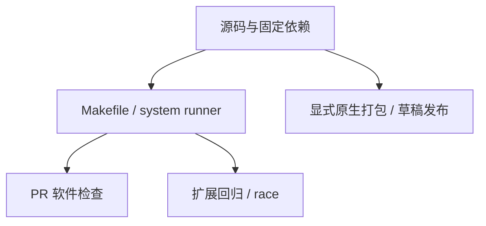
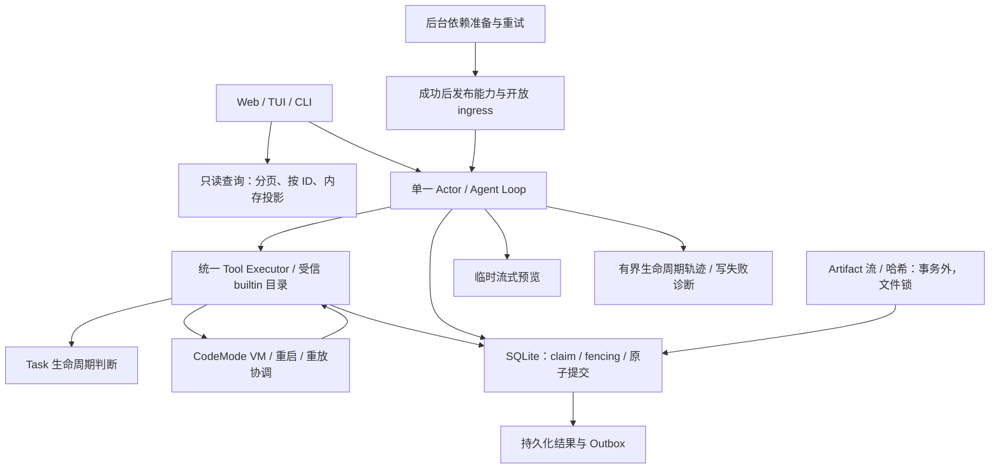
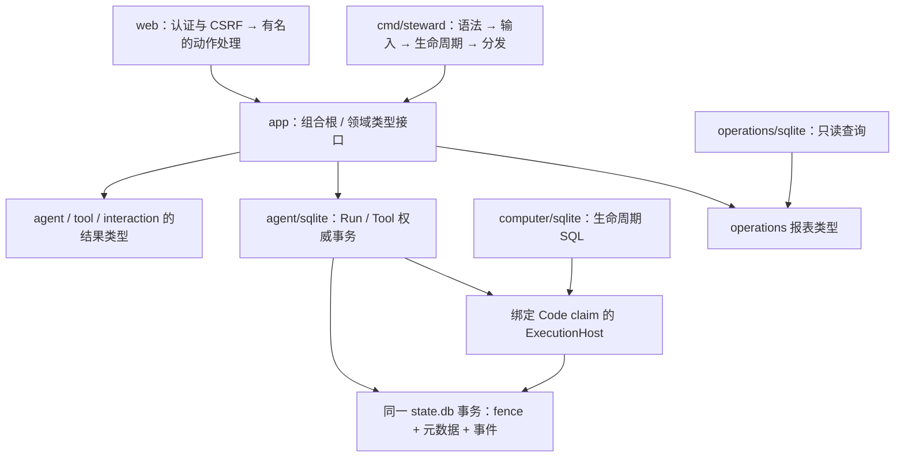

# 开发、验证与交付：技术方案

[功能说明](../features/engineering.md) · [测试方案](../test-plans/engineering.md) · [产品测试方案](../test-plans/product.md)

## 当前架构

产品逻辑与测试分属明确模块。Makefile 和现有 system runner 提供本地入口，CI 自动执行这些入口；发布流水线独立准备原生包和草稿发布。

Web 的固定资源目录归 `assets.go`，MCP 注册与调用分别维护；系统测试共用的模型 HTTP peer 归 `tests/system/provider_endpoint.py`，不再由渠道 gate 反向导入模型 gate。

调度器在单条 SQL 内物化一次活跃租约集合，供各额度维度复用，避免查询计划按 Agent 反复扫描历史 Run。该集合仅属于当前语句的数据库快照，保留既有 claim 事务、fencing、公平排序与额度配置。



### 运行时边界（F-039）



- `agent.RunFailure` 仅表示终态失败已提交，Web 可继续处理新请求；基础设施错误不能冒充该类型。CLI 可用 `errors.Is` 检查模型 cause。
- `app.WithEvents` 先交给 UI 生命周期，再在可取消的后台连接循环准备 broker/能力/恢复扫描。入口在准备成功前关闭；失败保留脱敏日志并重试。能力准备仅缓存成功，不为重试生成第二条执行管线。
- `task/transitions.go` 计算继续/停止/完成约束，适配器在同一事务读取权威事实、应用 CAS 并创建或 steering Root。`tool/codemode/execution.go` 定义其消费的持久边界并拥有 VM 重建循环；`agent/sqlite` 实现 SQL、claim 和调用接纳。
- `tool/builtins.go` 是 Host 名称、权限、内部可见性和分发家族的唯一目录。外部 provider 不能注册任意 Host 工具。冻结 ToolSpec 与角色裁减规则保持原有字节和语义。
- `agent.OperationError` 保留 operation、分类和可解包 cause；对外 Error 文本不拼接原始错误内容。召回服务不可用与状态库故障分开分类。
- `message_update` 是进程内预览，无持久序号/重放保证；完整 GenerationResult、Tool 结果、checkpoint 和业务事件仍由原有事务保存。生命周期 trace 有单次写入期限，写失败报告 `TRACE_UNAVAILABLE`。这不替代 F-031/F-034/F-035/F-036 的观测产品。
- 内部 Phase/Role/RunStatus 使用命名类型，序列化字符串不变。Provider Bridge 的图片、assistant/tool 消息转换拆成有名函数；不修改 QuickJS prelude/runtime 指纹。

迁移：不增加 schema 版本，不重写历史数据或已冻结请求。Artifact staging 文件名继续沿用生成的平面 key；文件锁需要支持 advisory flock 的本地文件系统，存储根的 OS 账户仍为信任边界。升级须先停止旧版本进程，再启动新版本；旧回收器不识别新 staging 锁，禁止混跑旧、新二进制操作同一 data root。

### Go 模块边界（F-040）

按领域职责和依赖方向组织实现，函数长度只作为检查线索，不为缩短文件拆开权威事务。

| 所属模块 | 当前职责与边界 |
| --- | --- |
| `computer/sqlite` | Computer 生命周期与 status；Run 适配器只绑定同一事务的 claim 检查与事件写入。 |
| `operations` / `operations/sqlite` | 领域报表类型与只读查询分开；额度、审批、ToolOutcome 类型归所属领域。 |
| `cmd/steward` | 单一语法表选择命令；options、command、model_input、operations、test_options、dispatch 分阶段，`run` 组装进程生命周期。 |
| Web handlers | 单一认证/CSRF 边界之后，消息、附件、模型、账户、通知由命名函数处理。 |
| Task 接纳 | executeTask 负责接纳与 replay；创建和控制使用事务内 helper，`taskChange` 保存当前行、请求及变更。 |
| App 组合根 | builtinDefinitions 建立能力，runtimeRegistry 校验，prepareRuntime 组装并在成功后一次发布；私有 runtimeRuns 不作为外部 SQLite 访问入口。 |



依赖约束：`computer/sqlite` 不导入 `agent/sqlite` 或 `app`，不接触 provider；`operations/sqlite` 不执行 Runtime 工作，只读取所需快照。Consumer interface 在 Computer 适配器定义，由 Agent 适配器实现绑定。`ExecutionHost.Write` 必须在执行 change 前、同一事务内验证 Code claim，事件必须加入该事务；不能用一个无 fence 的普通 DB callback 代替。

Computer 的 Begin 拆为已接纳计划读取、当前实例决策和原子计划写入；Task helper 不调用 BeginTx/Commit，继续与 receipt/epoch/Root 一次提交。JSON canonical encoding、冻结请求、SQL/schema 与模型可见工具定义不变，内部类型改名不改变序列化。

保留的边界：Run、Tool、Task 的多表变更仍集中在权威事务适配器，不能为了减少文件长度而独立提交。`agent/sqlite` 因此仍不是一个很小的包；这部分是事务一致性边界。Provider 协议、沙箱与系统验证脚本不因 Go 拆包而重设计。不建立通用 service/repository/ports 框架替代领域职责。

## 当前流程

用户问题 → 登记需求 → 检查代码与相关约束 → 实现与成比例验证 → 更新功能/设计/测试及状态 → 审查交付。F-038 不授予发布授权。

## 协议、实现与配置约束

本功能协议在此维护。既有编号用于追溯协议，不代表所有设计目标均已实现；完成状态以需求主索引为准。

<a id="contract-14-技术选型"></a>

### 14. 技术选型

| 层次 | 已确认选型 |
|---|---|
| 核心后端 | Go |
| 部署形态 | 一期模块化单体，未来可拆服务 |
| 模型 Provider | 独立 Go Model Provider Bridge；协议实现归 `llm/provider`，RPC 归 `llm/bridge`；Pi AI 仅作协议参考，不依赖其 SDK |
| Code Mode | 独立 Node.js JavaScript 沙箱 |
| Agent Tool | `builtin__agent_run`、Code Mode `agent.run()` 与 `tools.*`、`cua.*` 共用 ToolInvocation 管线；复用 QuickJS 和父 ToolInvocation 的内部恢复协议 |
| 本地隔离环境 | Lume macOS VM + Guest 内 Cua Driver |
| Memory/Conversation 权威存储 | 分离的 SQLite 数据库 |
| 事件队列 | NATS JetStream |
| 事件协议 | CloudEvents Structured JSON |
| 本地/云端执行抽象 | ComputerProvider |
| Artifact 传递 | `artifact_ref` |

<a id="contract-141-go-工程组织"></a>

#### 14.1 Go 工程组织

- 一期只使用 `cmd/ + internal/`，暂不创建 `pkg/`；只有未来确实需要对外 SDK 时才增加公共包。
- `cmd/steward` 是一期唯一的 Go 主进程入口。
- `internal/app` 是不包含业务逻辑的 Composition Root，负责依赖组装、启动和关闭。
- 接口由使用方所在模块定义；SQLite、NATS、飞书、macOS VM 等实现放在对应模块的具名子包中。
- 不建立通用的 `ports/`、`adapters/`、`controller/`、`service/`、`repository/` 大目录。

```text
cmd/steward/
web/                     # TypeScript 展示层；构建产物嵌入 Go Web Adapter
provider-bridge/          # Pi AI Provider/Auth Bridge；无 Tool/Computer 权限
internal/
  app/
  config/
  interaction/
  agent/
  task/
  conversation/
  memory/
  context/
  llm/
    bridge/
    provider/
    account/
    sqlite/
    secret/
  skill/
  tool/
  computer/
  artifact/
  delivery/
  event/
  observability/
runtime/
  javascript/            # QuickJS Code Mode Sidecar；无模型凭据
```

具名实现子包示例：

```text
memory/sqlite
conversation/sqlite
llm/bridge
llm/secret
event/nats
computer/macosvm
computer/environment
computer/sqlite
interaction/feishu
tool/mcp
```

<a id="contract-142-模块职责边界"></a>

#### 14.2 模块职责边界

- `interaction`：渠道接入、身份绑定，并将输入归一化为 `InboundEvent`。
- `agent`：Agent Actor、Main/Worker Agent Loop、Task 创建决策、Run 树生命周期、创建权限、深度与 Worker 调度；Code Mode 通过 AgentService 只创建 Child Run，不建立 Workflow 模块。
- `task`：持久化工作对象、状态及其关联 Run，不承载执行循环。
- `conversation`：保存权威消息历史。
- `memory`：长期记忆、召回与 Memory Curator。
- `context`：为每次 Turn 组装、裁剪、冻结和压缩上下文，不拥有来源数据。
- `llm`：管理 ModelProfile/ModelSnapshot、Provider Bridge、模型目录、能力 Probe 与固定主模型调用；一期不做动态模型路由。
- `llm/secret`：封装数据根下的私有文件 SecretStore 与显式环境变量引用；`llm/memory` 提供测试用内存实现。只返回受控 Credential，不把 Secret 暴露给领域存储或模型。
- `skill`：Skill 的发现、读取、候选、审核和生命周期。
- `tool`：工具注册、发现、ToolInvocation 与调用；包括 AgentToolExecutor、Computer Tool Executor、Code Mode 的内部 CodeExecutionState/CodeCall Ledger 和 Sidecar 桥接。
- `tool` 与 `agent/sqlite` 共同落实副作用前的授权、冻结审批与执行权检查；当前没有独立的 `security` 包。
- `computer`：管理逻辑 Computer、运行 Instance、Checkpoint、恢复和并发仲裁。
- `artifact`：管理产物生命周期及 `artifact_ref`。
- `delivery`：管理 `DeliveryRequest`、Outbox 和渠道发送。
- `event`：定义 CloudEvents 信封、发布订阅接口及 NATS JetStream 实现。
- `observability`：承接日志、指标、Trace、RunTrace 和 DLQ 告警，不参与业务决策。
- `config`：加载和校验进程配置。
- `app`：组装模块并管理进程生命周期，不承载业务逻辑。

<a id="ci-continuous-integration-and-delivery"></a>

## Continuous integration and delivery

CI is the automation that runs software checks. Unit, integration and end-to-end
are test levels; using CI does not turn a unit test into an end-to-end test.

<a id="ci-pull-requests-and-main"></a>

### Pull requests and main

[CI](../../.github/workflows/ci.yml) preserves `Ubuntu checks` as the sole required
aggregate status. A scope job selects documentation-only checks or the full code
path. Code runs in eleven isolated Ubuntu lanes, described by the private
[CI partition](../../tests/system/ci.py):

- Five software lanes retain all `make test lint` work and `make test-prompts`:
  Go, provider RPC, frontend/JavaScript, browser/infrastructure, and lint.
- Five system lanes cover the eleven core gates without duplicate scenarios. Each runner
  builds its own binary, records its hash and source state, and owns disposable
  fixtures. Channels partitions its independent Web and transport scenarios
  across two runners; the ordinary local gate still runs both groups.
- One lane retains Web Access contracts, focused Main/UI/credential races, task
  coding isolation/recovery, Code Mode discovery and Main responsiveness.

The local Make targets remain sequential and unchanged. Jobs share dependency
caches, not mutable build outputs, node_modules or application state. Native
Select behavior and 320px touch/layout assertions remain part of channels.
Production timeouts and the provider's real 30/90/180-second deadline probes
remain unchanged. Full race coverage stays in extended regression.

Each lane has a ten-minute failure boundary. The latency target is under five
minutes from workflow start to the aggregate result on a warm hosted runner;
this is measured remotely, not asserted from local runtimes. Cold tool/cache
installation and hosted queue delays may exceed that target.

Hosted Ubuntu setup uses the official HTTPS archive instead of the image's
Azure archive mirror. Package-manager phases have 90-second process boundaries;
locked npm/browser setup has 120-second stage boundaries with owned-child
cleanup. Slow or unavailable downloads fail the lane and cannot count as tested
coverage. Browser revision and installed-package verification remain unchanged.

The Go checks also exercise production tool composition, including a forged
loaded-tool checkpoint and no native fallback without a JavaScript runtime.
The model dependency test uses Go's transitive dependency graph: shared contracts
cannot depend on adapters, provider protocols cannot depend on domain state,
and account/storage cannot depend on the RPC transport.

PR checks use GitHub’s proposed merge commit, so the checked code includes the current base. Artifact names identify that checked commit.

Documentation-only PRs run the local link/index check without installing Go,
Node or Chromium. The `Ubuntu checks` job still executes and reports a status;
there is no workflow-level path filter that leaves branch protection pending.
Unknown paths, code changes, empty diffs and main pushes use the full PR path.

A lane stops on its first failure; other lanes finish and retain their evidence
(`fail-fast: false`). The aggregate uses `always()` and requires successful scope
and every selected lane. Missing, failed or cancelled work cannot pass; skipped
code lanes are accepted only for the explicit successful documentation path.
The process owner forwards cancellation, allows fixture cleanup and kills
remaining owned groups. Logs and results include checked commit, lane and run
attempt. Tests never need an online model account.

The partition deliberately avoids per-file test selection, shared executable
artifacts and a custom parallel process scheduler. Repeated runner setup is the
tradeoff for isolation and bounded critical paths. Changes to the partition must
preserve core coverage and fail-closed aggregation; the infrastructure tests
exercise both. Queue time and complete remote wall time are reported with PR
validation rather than treated as guaranteed by job timeouts.

<a id="ci-extended-regression"></a>

### Extended regression

[Extended regression](../../.github/workflows/regression.yml) runs weekly and via
manual dispatch. It executes all retained deterministic system gates, then the
complete Go race inventory. A separate macOS job checks native CLI/startup, the credential adapter and offline VM contracts; actual Guest integration remains explicit live validation. It uploads failures as well as passing results and
has a 60-minute outer limit. A failure remains a defect to investigate; it cannot
be waived into a release pass. Run it before releases and broad protocol/state
changes, or use the corresponding focused gates during development.

The tests remain deterministic software regressions. No Golden benchmark,
semantic Judge, paid model call or clause-audit inventory runs in either workflow.

<a id="ci-delivery"></a>

### Delivery

[Native packages](../../.github/workflows/release.yml) remains separate. Manual
runs or explicit version tags build native archives and checksums on supported
Linux/macOS architectures. Linux packaging installs Bubblewrap for the same mandatory
installation diagnostics used locally. Packages retain project and third-party notices;
manual and tag runs download all archives and verify checksums before draft creation,
which rechecks its own downloaded copies. Version tags create an unpublished draft release for
human inspection. An ordinary PR neither deploys nor publishes a release.

Real-account login, external-site compatibility, macOS Computer and real-model
quality require their appropriate explicit live validation. A green PR does not
claim those checks ran. Tests, model evaluation and release authorization have
separate outcomes.

<a id="contributing-repository-ownership"></a>

### Repository ownership

| Location | Purpose |
| --- | --- |
| `cmd/steward`, `internal/` | Application and Go tests beside their implementation |
| `provider-bridge`, `runtime/javascript`, `guest-browser`, `web` | Product runtimes, frontend and their local tests |
| `tests/system/` | Deterministic CLI/UI/process tests and shared fixture support |
| `tests/harness/` | Unit/component regressions for retained test and setup utilities |
| `tests/fixtures/` | Small synthetic protocol, transport and coding samples |
| `scripts/` | Installation, dependency setup, packaging and local maintenance |
| `docs/` | Current architecture, operations and development guidance |

The full Golden Case benchmark, real-model evaluation runners, scores and
historical clause-audit ledgers are maintained outside the product checkout.
They are not PR prerequisites. See [evaluation boundaries](../test-plans/product.md#testing-agent-evaluation).

## Dependency and repository maintenance

`make lint` includes SHA-pinned workflow validation with actionlint v1.7.12. The independent dependency-audit workflow uses govulncheck v1.9.0 and npm lockfile audits, and runs weekly/manually/on dependency PRs. Dependabot proposes updates without automatic merging. Go 1.26.10 is the current minimum patched toolchain; the application module import path remains compatible.

The root README covers onboarding and directory responsibilities. GOVERNANCE/CONTRIBUTING/SECURITY own collaboration and reporting policies. Current artwork sources are separate from embedded runtime assets; static brand images derive from the production atlas. Historical reconstruction briefs are removed instead of being maintained as competing design authorities.
