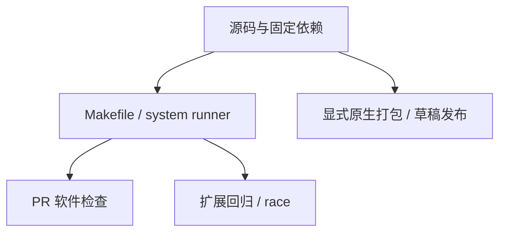
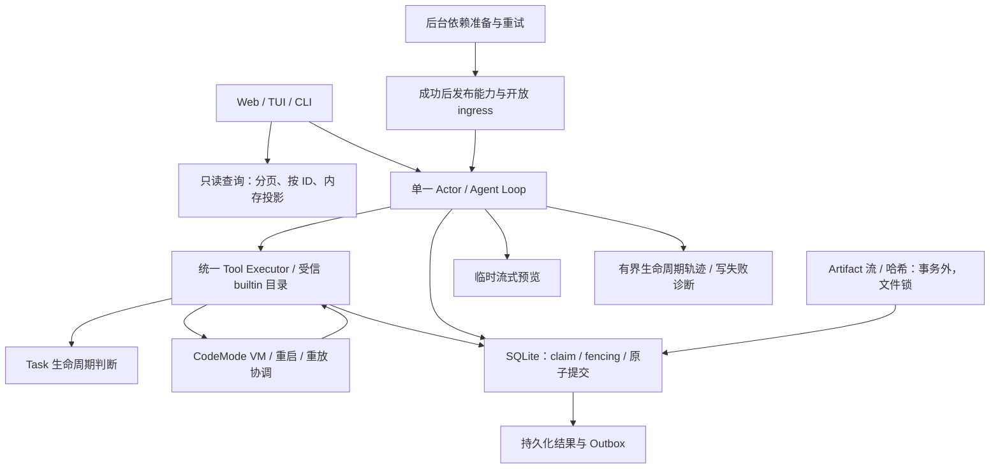
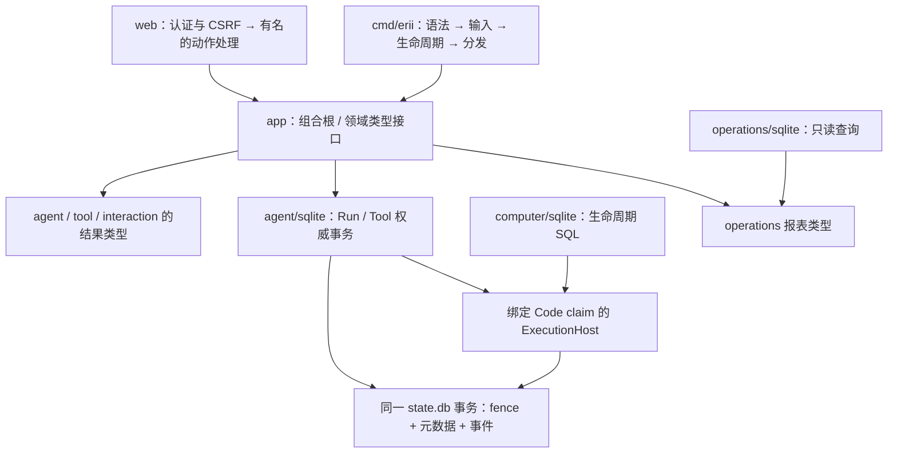

# 开发、验证与交付：技术方案

[功能说明](../features/engineering.md) · [测试方案](../test-plans/engineering.md) · [产品测试方案](../test-plans/product.md)

## 当前架构

产品逻辑与测试分属明确模块。Makefile 和现有 system runner 提供本地入口，CI 自动执行这些入口；发布流水线独立准备原生包和草稿发布。



### 运行时边界（F-039）



- `agent.RunFailure` 仅表示终态失败已提交，Web 可继续处理新请求；基础设施错误不能冒充该类型。CLI 可用 `errors.Is` 检查模型 cause。
- `app.WithEvents` 先交给 UI 生命周期，再在可取消的后台连接循环准备 broker/能力/恢复扫描。入口在准备成功前关闭；失败保留脱敏日志并重试。能力准备仅缓存成功，不为重试生成第二条执行管线。
- `task/transitions.go` 计算继续/停止/完成约束，适配器在同一事务读取权威事实、应用 CAS 并创建或 steering Root。`tool/codemode/execution.go` 定义其消费的持久边界并拥有 VM 重建循环；`agent/sqlite` 实现 SQL、claim 和调用接纳。
- `tool/builtins.go` 是 Host 名称、权限、内部可见性和分发家族的唯一目录。外部 provider 不能注册任意 Host 工具。冻结 ToolSpec 与角色裁减规则保持原有字节和语义。
- `agent.OperationError` 保留 operation、分类和可解包 cause；对外 Error 文本不拼接原始错误内容。召回服务不可用与状态库故障分开分类。
- `message_update` 是进程内预览，无持久序号/重放保证；完整 GenerationResult、Tool 结果、checkpoint 和业务事件仍由原有事务保存。生命周期 trace 有单次写入期限，写失败报告 `TRACE_UNAVAILABLE`。这不替代 F-031/F-034/F-035/F-036 的观测产品。
- 内部 Phase/Role/RunStatus 使用命名类型，序列化字符串不变。Provider Bridge 的图片、assistant/tool 消息转换拆成有名函数；不修改 QuickJS prelude/runtime 指纹。

迁移：不增加 schema 版本，不重写历史数据或已冻结请求。Artifact staging 文件名继续沿用生成的平面 key；文件锁需要支持 advisory flock 的本地文件系统，存储根的 OS 账户仍为信任边界。升级须先停止旧版本进程，再启动新版本；旧回收器不识别新 staging 锁，禁止混跑旧、新二进制操作同一 data root。

### Go 工程审查与模块边界（F-040）

以下是以合并后的 PR #95 为基线的审查结果，优先级针对工程维护成本。函数长度只作为定位线索，判断依据是职责混合、依赖方向与状态流的可理解性。

| 优先级 / 发现 | 具体问题与影响 | 本轮处理 |
| --- | --- | --- |
| P2 · 领域持久化依赖反向集中 | `agent/sqlite/computer.go` 把 Computer 生命周期 SQL 与私有 `codeBridge` 绑定，增加 Computer 变化牵动 Agent 适配器的范围。 | `computer/sqlite` 持有生命周期和 status；Run 适配器只绑定同一事务内的 claim 检查与事件写入。 |
| P2 · 只读查询与接口类型泄漏 | 运维报表与 DTO、额度 DTO、审批别名、ToolOutcome 位于 SQLite 包，App 的对外方法把实现包变成调用方的依赖。 | `operations` 定义报表、`operations/sqlite` 查询；其余 DTO 归 `agent`、`interaction`、`tool`，删除无意义的审批类型别名。 |
| P2 · CLI 入口职责混合 | `cmd/erii.run` 约 380 行，混合语法判断、模型输入、配置、离线备份、初始化、测试屏障和分发；大量并行布尔变量掩盖互斥命令。 | 用单一语法表选择命令种类；按 options、command、model_input、operations、test_options、dispatch 分阶段；`run` 只保留进程生命周期组装。 |
| P2 · Web 操作分发承载业务动作 | 约 200 行 POST 方法混合 JSON/form/multipart、模型选择与账户 goroutine 状态，审查权限/关闭行为时难以追踪。 | 单一认证/CSRF 边界保持不变，路由调用有名的消息、附件、模型、账户与通知处理函数。 |
| P2 · Task 事务闭包包含多种职责 | 约 235 行 executeTask 混合 frozen-call 验证、两层 replay receipt、创建和已有 Task 状态变化，依赖大量捕获变量。 | 接纳与 replay 留在 executeTask，具体创建/控制在命名事务内 helper；`taskChange` 明确保存当前行、请求与变更状态。 |
| P2 · 注册与实例组装混在一起 | `app.prepareRuntime` 一边发现/校验能力，一边配置 provider、Runs 与测试注入，阅读失败路径要跨越整个函数。 | builtinDefinitions、runtimeRegistry、prepareRuntime 分别建立能力、校验 registry、组装实例；成功后一次发布。 |
| P3 · 不必要的具体类型出口 | App 的公共 Runs 方法允许调用者直接依赖 SQLite 执行实现，当前项目没有这样的外部消费者。 | 改为包内 runtimeRuns；外部使用 Actor 或所属控制接口。 |



依赖约束：`computer/sqlite` 不导入 `agent/sqlite` 或 `app`，不接触 provider；`operations/sqlite` 不执行 Runtime 工作，只读取所需快照。Consumer interface 在 Computer 适配器定义，由 Agent 适配器实现绑定。`ExecutionHost.Write` 必须在执行 change 前、同一事务内验证 Code claim，事件必须加入该事务；不能用一个无 fence 的普通 DB callback 代替。

Computer 的 Begin 拆为已接纳计划读取、当前实例决策和原子计划写入；Task helper 不调用 BeginTx/Commit，继续与 receipt/epoch/Root 一次提交。JSON canonical encoding、冻结请求、SQL/schema 与模型可见工具定义不变，内部类型改名不改变序列化。

保留的边界：Run、Tool、Task 的多表变更仍集中在权威事务适配器，不能为了减少文件长度而独立提交。`agent/sqlite` 因此仍不是一个很小的包；这部分是事务一致性边界，不宣称本轮已把全部 SQL 移出。Provider 协议、沙箱与系统验证脚本不因 Go 拆包而重设计。本轮未建立通用 service/repository/ports 框架。

## 当前流程

用户问题 → 登记需求 → 检查代码与相关约束 → 实现与成比例验证 → 更新功能/设计/测试及状态 → 审查交付。F-038 不授予发布授权。

## 协议、实现与配置约束

迁入内容按职责归属在此维护。既有编号用于追溯协议，不代表所有设计目标均已实现；完成状态以需求主索引为准。

<a id="contract-14-技术选型"></a>

### 14. 技术选型

| 层次 | 已确认选型 |
|---|---|
| 核心后端 | Go |
| 部署形态 | 一期模块化单体，未来可拆服务 |
| 模型 Provider | 独立 Node.js Model Provider Bridge：复用 Pi AI 行为；支持本地 OpenAI-compatible 与 OpenAI Sign in with ChatGPT |
| Code Mode | 独立 Node.js JavaScript 沙箱 |
| Agent Tool | `builtin__agent__run`、Code Mode `agent.run()` 与 `tools.*`、`cua.*` 共用 ToolInvocation 管线；复用 QuickJS 和父 ToolInvocation 的内部恢复协议 |
| 本地隔离环境 | Lume macOS VM + Guest 内 Cua Driver |
| Memory/Conversation 权威存储 | 分离的 SQLite 数据库 |
| 事件队列 | NATS JetStream |
| 事件协议 | CloudEvents Structured JSON |
| 本地/云端执行抽象 | ComputerProvider |
| Artifact 传递 | `artifact_ref` |

<a id="contract-141-go-工程组织"></a>

#### 14.1 Go 工程组织

- 一期只使用 `cmd/ + internal/`，暂不创建 `pkg/`；只有未来确实需要对外 SDK 时才增加公共包。
- `cmd/erii` 是一期唯一的 Go 主进程入口。
- `internal/app` 是不包含业务逻辑的 Composition Root，负责依赖组装、启动和关闭。
- 接口由使用方所在模块定义；SQLite、NATS、飞书、macOS VM 等实现放在对应模块的具名子包中。
- 不建立通用的 `ports/`、`adapters/`、`controller/`、`service/`、`repository/` 大目录。

```text
cmd/erii/
web/                     # TypeScript 展示层；构建产物嵌入 Go Web Adapter
provider-bridge/          # Pi AI Provider/Auth Bridge；无 Tool/Computer 权限
internal/
  app/
  config/
  interaction/
  agent/
  task/
  conversation/
  memory/
  context/
  llm/
  secret/
  skill/
  tool/
  security/
  computer/
  artifact/
  delivery/
  event/
  observability/
runtime/
  javascript/            # QuickJS Code Mode Sidecar；无模型凭据
```

具名实现子包示例：

```text
memory/sqlite
conversation/sqlite
llm/providerbridge
secret/keyring
event/nats
computer/lume
computer/cua
interaction/feishu
tool/mcp
```

<a id="contract-142-模块职责边界"></a>

#### 14.2 模块职责边界

- `interaction`：渠道接入、身份绑定，并将输入归一化为 `InboundEvent`。
- `agent`：Agent Actor、Main/Worker Agent Loop、Task 创建决策、Run 树生命周期、创建权限、深度与 Worker 调度；Code Mode 通过 AgentService 只创建 Child Run，不建立 Workflow 模块。
- `task`：持久化工作对象、状态及其关联 Run，不承载执行循环。
- `conversation`：保存权威消息历史。
- `memory`：长期记忆、召回与 Memory Curator。
- `context`：为每次 Turn 组装、裁剪、冻结和压缩上下文，不拥有来源数据。
- `llm`：管理 ModelProfile/ModelSnapshot、Provider Bridge、模型目录、能力 Probe 与固定主模型调用；一期不做动态模型路由。
- `secret`：封装 OS Credential Store 与测试用内存实现；只返回受控 Credential，不把 Secret 暴露给领域存储或模型。
- `skill`：Skill 的发现、读取、候选、审核和生命周期。
- `tool`：工具注册、发现、ToolInvocation 与调用；包括 AgentToolExecutor、Computer Tool Executor、Code Mode 的内部 CodeExecutionState/CodeCall Ledger 和 Sidecar 桥接。
- `security`：在产生副作用前执行风险识别、授权与确认裁决。
- `computer`：管理逻辑 Computer、运行 Instance、Checkpoint、恢复和并发仲裁。
- `artifact`：管理产物生命周期及 `artifact_ref`。
- `delivery`：管理 `DeliveryRequest`、Outbox 和渠道发送。
- `event`：定义 CloudEvents 信封、发布订阅接口及 NATS JetStream 实现。
- `observability`：承接日志、指标、Trace、RunTrace 和 DLQ 告警，不参与业务决策。
- `config`：加载和校验进程配置。
- `app`：组装模块并管理进程生命周期，不承载业务逻辑。

<a id="ci-continuous-integration-and-delivery"></a>

## Continuous integration and delivery

CI is the automation that runs software checks. Unit, integration and end-to-end
are test levels; using CI does not turn a unit test into an end-to-end test.

<a id="ci-pull-requests-and-main"></a>

### Pull requests and main

[CI](../../.github/workflows/ci.yml) runs one `Ubuntu checks` job. The existing
required status name is preserved. One checkout and dependency setup serve:

1. `make test lint`: Go unit/component checks, Node runtime contracts, frontend
   freshness/types, the real Chromium contract and retained infrastructure tests.
2. `make test-e2e`: nine deterministic product flows through actual CLI/UI,
   stores, brokers and runtimes. See the [coverage map](../test-plans/product.md#testing-system-coverage).

Documentation-only PRs run the local link/index check without installing Go,
Node or Chromium. The `Ubuntu checks` job still executes and reports a status;
there is no workflow-level path filter that leaves branch protection pending.
Unknown paths, code changes, empty diffs and main pushes use the full PR path.

Failures stop the job; failed or cancelled work does not count as a pass. The
process owner forwards cancellation, allows fixture cleanup and kills remaining
owned process groups. Results and failed logs are uploaded with source/run
identity. Tests never need an online model account.

The job has a 20-minute stop boundary. It is not a latency claim. This replaces
38 job instances and their setup/build/upload/join overhead; GitHub-hosted queue
time and wall-time improvements must be measured on the new workflow. Local
results do not establish remote CI performance. There is no custom changed-file
selector, secondary required gate, benchmark comparator or cross-job build bundle.

<a id="ci-extended-regression"></a>

### Extended regression

[Extended regression](../../.github/workflows/regression.yml) runs weekly and via
manual dispatch. It executes all retained deterministic system gates, then the
complete Go race inventory. It uploads failures as well as passing results and
has a 60-minute outer limit. A failure remains a defect to investigate; it cannot
be waived into a release pass. Run it before releases and broad protocol/state
changes, or use the corresponding focused gates during development.

The tests remain deterministic software regressions. No Golden benchmark,
semantic Judge, paid model call or clause-audit inventory runs in either workflow.

<a id="ci-delivery"></a>

### Delivery

[Native packages](../../.github/workflows/release.yml) remains separate. Manual
runs or explicit version tags build native archives and checksums on supported
Linux/macOS architectures. Version tags create an unpublished draft release for
human inspection. An ordinary PR neither deploys nor publishes a release.

Real-account login, external-site compatibility, macOS Computer and real-model
quality require their appropriate explicit live validation. A green PR does not
claim those checks ran. Tests, model evaluation and release authorization have
separate outcomes.

<a id="contributing-repository-ownership"></a>

### Repository ownership

| Location | Purpose |
| --- | --- |
| `cmd/erii`, `internal/` | Application and Go tests beside their implementation |
| `provider-bridge`, `runtime/javascript`, `guest-browser`, `web` | Product runtimes, frontend and their local tests |
| `tests/system/` | Deterministic CLI/UI/process tests and shared fixture support |
| `tests/harness/` | Unit/component regressions for retained test and setup utilities |
| `tests/fixtures/` | Small synthetic protocol, transport and coding samples |
| `scripts/` | Installation, dependency setup, packaging and local maintenance |
| `docs/` | Current architecture, operations and development guidance |

The full Golden Case benchmark, real-model evaluation runners, scores and
historical clause-audit ledgers are maintained outside the product checkout.
They are not PR prerequisites. See [evaluation boundaries](../test-plans/product.md#testing-agent-evaluation).

## Changelog

| 日期 | 决策 | 理由与影响 |
| --- | --- | --- |
| 2026-10-28 | F-040：Computer 与运维查询归所属模块，App 返回领域类型并隐藏具体执行访问器。 | 选择明确领域子包而非通用 repository 层；通过绑定 claim 的 Host 保留原子事务，不改变存储协议。 |
| 2026-10-28 | F-040：CLI 使用统一语法表和分阶段处理；Web 动作、Task 变更、能力注册分职责。 | 相较仅按行数切文件，命名函数对应可审查步骤；复用原入口和回归，保持原有参数、权限、关闭与 replay 行为。 |
| 2026-10-28 | F-039：终态 Run 失败与基础设施错误分开；UI 先开放，依赖准备只缓存成功。 | 保留控制面以修复故障；不使用跳过失效能力的降级注册，避免静默更改冻结能力。 |
| 2026-10-28 | F-039：Task 规则、CodeMode 协调从 SQLite 适配器移回所属模块；统一 Host 目录与显式 Artifact 分发。 | 保持一个事务权威和一条工具管线，避免以通用 service/ports 层替代现有领域。 |
| 2026-10-28 | F-039：流式预览不逐片落库，生命周期 trace 保留有界写入与诊断。 | 避免每个 token 竞争权威 writer；完整请求/结果仍持久，丢失的临时预览不能作为执行失败或重试依据。 |
| 2026-10-28 | F-039：命名状态类型、Bridge 转换函数和分类错误。 | 保持线协议、快照与数据库兼容；只解包内部 cause，避免日志/界面泄露私人内容。 |
| 2026-10-28 | 把贡献流程、工程组织与 CI 说明归入同一功能及方案。 | 不维护额外 CONTRIBUTING/CI 正文；保留软件测试与独立模型评测边界。 |
