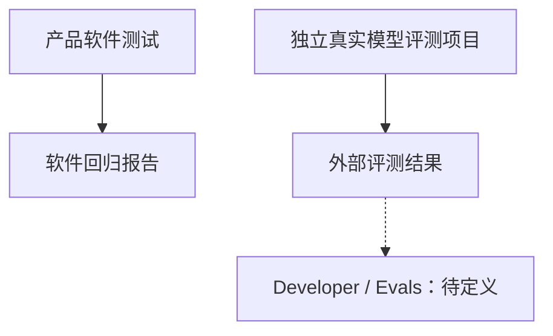

# Developer Evals 评测入口：技术方案

[功能与需求](../features/evals.md) · [测试方案](../test-plans/evals.md) · [主索引](../feature-map.md)

本文的架构与流程描述当前有效实现；明确标记的待实现方案不表示已落地。实现级协议仍服从 [跨功能协议与约束](product-overview.md#contract-0-文档效力与实现规则)。

## 当前架构

当前产品测试与独立 Agent 效果评测分工；Web 没有评测存储、导入或结果关联页面。

## 当前流程与目标差异

当前运行测试或外部评测并保留报告。未来读取明确来源的评测结果、显示质量/成本/可靠性指标，并关联 Observability；结果契约尚待设计。

- **F-032**：当前无 Evals Tab；软件测试由 tests/ 管理，真实模型评测属于独立评测项目。 先定义结果来源、导入/关联方式、指标和用户操作；产品仓库不建立独立模型评测框架或迁回历史 benchmark。

## 代码与依赖

- [tests/system/runner.py](../../tests/system/runner.py)
- [internal/interaction/web/server.go](../../internal/interaction/web/server.go)

## 验证与交付

验收场景、已有入口和剩余覆盖统一在 [测试方案](../test-plans/evals.md) 维护。实际执行结果以对应版本的 PR 或 CI 证据为准；架构说明不证明回归或 Live 验证通过。
