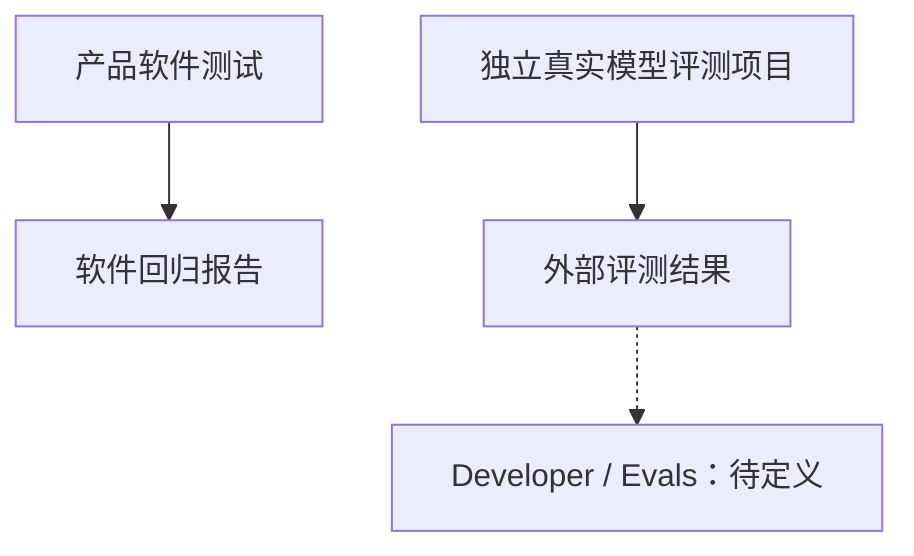

# Developer Evals 评测入口：技术方案

[功能与需求](../features/evals.md) · [测试方案](../test-plans/evals.md) · [主索引](../feature-map.md)

最近核对：2026-10-28。本文的架构与流程描述当前有效实现；明确标记的待实现方案不表示已落地。实现级协议仍服从 [跨功能协议与约束](product-overview.md#contract-0-文档效力与实现规则)。

## 当前架构

当前产品测试与独立 Agent 效果评测分工；Web 没有评测存储、导入或结果关联页面。

## 当前流程与目标差异

当前运行测试或外部评测并保留报告。未来读取明确来源的评测结果、显示质量/成本/可靠性指标，并关联 Observability；结果契约尚待设计。

- **F-032**：当前无 Evals Tab；软件测试由 tests/ 管理，真实模型评测属于独立评测项目。 先定义结果来源、导入/关联方式、指标和用户操作；本轮不新建评测框架或迁回历史 benchmark。

## 代码与依赖

- [tests/system/runner.py](../../tests/system/runner.py)
- [internal/interaction/web/server.go](../../internal/interaction/web/server.go)

## 验证与交付

验收场景、已有入口和剩余覆盖统一在 [测试方案](../test-plans/evals.md) 维护。本次建档未执行本功能的回归或 Live 验证，不以架构图替代运行证据。

## Changelog

2026-10-28：按统一文档结构迁入本功能的协议与历史决策，更新引用并移除旧文件；此为文档归属调整，不改变运行时协议。

本节追加记录每次架构/流程取舍。旧图不保留在正文；历史正式决定保留在本节。首次记录为现状建档，不推断历史决策日期。

| 日期 | 类型 | 决策与理由 | 取舍及影响 | 关联 |
| --- | --- | --- | --- | --- |
| 2026-10-28 | 现状建档 / 未来方向 | 仅登记后续 Developer 页面方向；不改变现行测试/评测边界，不在产品仓库重建平行 benchmark 平台。 | 明确当前边界与待补齐链路；本次仅建立文档，未修改运行时。 | [跨功能契约](product-overview.md#contract-0-文档效力与实现规则) |

后续记录需包含实际比较过的选项、采用理由、兼容/迁移影响和相关需求或 PR；未决建议不能写成已实施决策。
