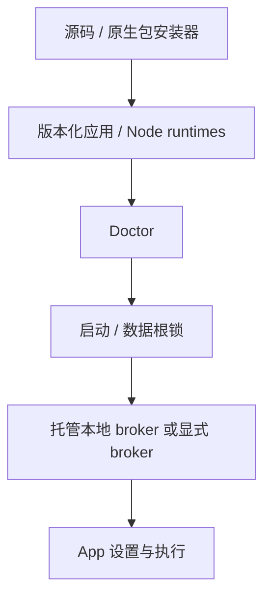

# 安装、启动与部署：技术方案

[功能说明](../features/installation.md) · [测试方案](../test-plans/installation.md) · [主索引](../feature-map.md)

## 当前架构

唯一 Go 入口是 cmd/steward；安装器管理版本化应用和启动器，用户数据独立保存。默认终端启动拥有本地 JetStream broker，显式配置保留外部 broker 路径。

## 当前流程

安装到暂存目录 → 检查固定依赖与 Doctor → 切换受管启动器 → 启动并获取锁 → 模型设置 → 前台执行 → 先排空 App 再关闭 broker。F-037 的验证见并列测试方案。

## 命名与安装边界

源码入口是 `cmd/steward`，二进制及启动器名称是 `steward`，受管版本存放于 `lib/steward/releases/`，数据独立位于 `~/.local/share/steward` 或显式 `STEWARD_DATA_ROOT`。安装到暂存目录后执行 Doctor，再原子切换受管启动器。安装器拒绝覆盖非受管目录或已有其他启动器。

打包使用 `scripts/package.sh` 生成 `steward-<platform>-<arch>.tar.gz` 与校验文件；归档包含运行时与当前说明。源码安装依赖 Go/npm，原生包保留显式 Node 前提。发布需要独立授权。

前台启动持有数据根锁，自有 broker 使用随机 loopback 端口。退出先关闭 App，再关闭 broker。显式配置和 `STEWARD_NATS_URL` 可以选择外部 broker。普通安装不部署后台服务；macOS 可通过独立、显式的 `service install/start` 启用用户 LaunchAgents，生命周期与停止意图见 [运维方案](operations.md#macos-用户级后台生命周期)。仍不引入第二 Agent loop 或默认模型。

不提供其他品牌的启动器、配置和数据发现回退，也不改写已冻结执行或主动清除应用数据。运行时审批、重放、取消和未知外部效果语义维持不变。
