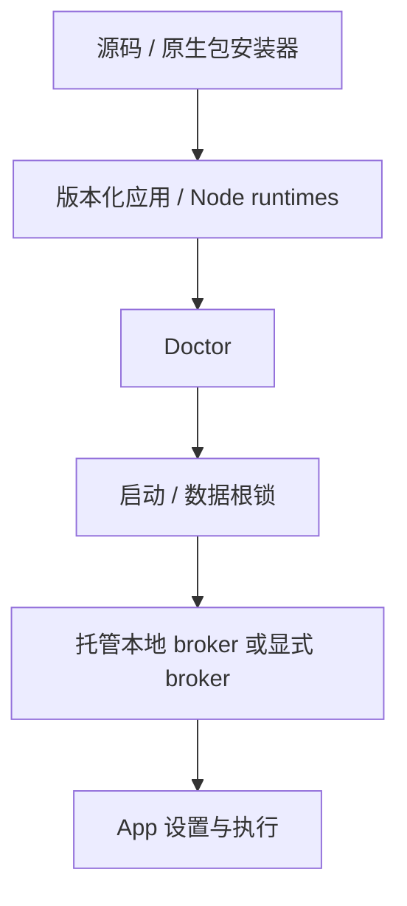

# 安装、启动与部署：技术方案

[功能说明](../features/installation.md) · [测试方案](../test-plans/installation.md) · [主索引](../feature-map.md)

## 当前架构

唯一 Go 入口是 cmd/erii；安装器管理版本化应用和启动器，用户数据独立保存。默认终端启动拥有本地 JetStream broker，显式配置保留外部 broker 路径。

## 当前流程

安装到暂存目录 → 检查固定依赖与 Doctor → 切换受管启动器 → 启动并获取锁 → 模型设置 → 前台执行 → 先排空 App 再关闭 broker。F-037 的验证见并列测试方案。

## Changelog

历史安装决策迁入下文；历史目录位置仅表示当时取舍，当前文档归属以 Feature Map 为准。

| 日期 | 决策 | 理由与影响 |
| --- | --- | --- |
| 2026-10-28 | 把安装说明、部署流程和历史布局决策归入本功能。 | 统一文档承载，保留历史正文和原验收边界；不改变安装行为。 |

### 历史决策与演进记录

以下正文保留原决定、理由、兼容影响和当时证明范围，不作为当前完成声明。原记录中旧目录布局与旧验证命令属于历史上下文；现行入口以功能说明、当前架构及产品测试方案为准。

## 004 — Erii installation and repository layout

Status: implemented by ERII-183 and merged in [PR #33](https://github.com/z-chenhao/erii/pull/33).
This record retains the installation/layout decision and its validation scope.

### Decision summary

Use `cmd/erii` as the only Go process entry point and `erii` as the executable.
Keep frontend source in `web/`, with generated assets embedded in the existing
Go HTTP adapter. Add source/native-package installation and a foreground desktop
startup that owns its local broker. This is deployment and source organization;
the Agent, Tool, model and Durable Replay protocols retain their current contracts.

### Concrete evidence and constraints

The old README described implemented Tasks as future work and required several
manual npm/configuration/broker steps. Frontend tooling lived inside the Go
adapter. The shared loop's model phase obscured its four durable lifecycle phases.
Existing real SQLite, Pi/QuickJS and CLI harnesses already verify those boundaries.
The owner explicitly requested the executable/directory rename to match Erii.

### Invariants and policy

SQLite remains authoritative; JetStream provides wakeups. Main and Worker share
one loop. First launch requires explicit profile probing and selection. Snapshots,
call keys, approvals, unknown effects, fencing and cancellation retain their
semantics. The managed loopback broker is desktop deployment policy, not an
additional queue implementation. An explicit config or `ERII_NATS_URL` keeps the
existing external-broker path.

### Openness decision

The public user surface is the installed `erii` command and feature guides.
`internal/startup` privately owns the local broker lifecycle, locks and storage.
The loop's private phase handlers expose no new extension API. Frontend source is
inspectable and independently buildable but uses the existing Host HTTP contract;
credentials and execution authority remain in Go.

### Restraint decision

Retain real persistence, event recovery and sidecars. Do not add a daemon manager,
second Agent loop, frontend service, generic CLI framework, model auto-selection,
cloud split, or compatibility executable. Native bundles retain an explicit Node
prerequisite. Source installs also require Go/npm. No release is published by this
refactor; the tag workflow only prepares a draft for inspection.

### Design and migration

The installer stages the binary and pinned runtime dependencies, runs Doctor,
and switches a managed launcher only after validation. User data is separate from
versioned application releases. Existing data roots and snapshots need no schema
migration. Update commands and CI together; the old executable path is replaced.

The default terminal launch holds a shared maintenance lock plus an exclusive
startup lock, starts file-backed JetStream on a random loopback port, and lets the
existing App own setup and execution. App shutdown finishes before broker shutdown.
The stream and DLQ retain their existing retention/approval/retry policies.

Guides move to `docs/guides/`; dated measurements move to `docs/reports/`. A local
link checker protects navigation. The original technical baseline stays at its
stable path. Locked Golden Case fixtures and historical report contents are not
rewritten to match a new command name.

### Deliberately not generalized

No public startup plugin, broker-provider interface, universal turn framework or
new Tool schema. The frontend has one real consumer. The native package workflow
uses the existing source installer; it does not create another build pipeline.

### Tradeoffs and risks

The executable rename changes developer scripts and deployment command lines;
users must update invocations. Broker storage adds a local data-root subdirectory.
The managed launch serves the terminal path; Web/custom deployments keep explicit
configuration. ChatGPT credential persistence still requires a native macOS
Keychain build. Node and native OS support require release validation separately.

### Validation

The maintained startup gate packages and installs into a path with spaces, runs
read-only Doctor from another working directory, rejects an unmanaged executable,
drives explicit local setup and a Tool-backed reply through the real PTY, kills
and restarts the app, reinstalls, reads durable state and checks cleanup. Broker
tests cover production stream/DLQ provisioning, ownership, maintenance exclusion,
cancellation and disk-backed restart. Existing state/replay suites and race checks
cover the loop refactor. Every original required CI gate stays required.

### References

- [Pi loop organization](https://github.com/earendil-works/pi/blob/main/packages/agent/src/agent-loop.ts)
- [Codex CLI install and launch](https://learn.chatgpt.com/docs/codex/cli)
- [OpenClaw startup flow](https://docs.openclaw.ai/start/getting-started)
- [GitHub native runner labels](https://docs.github.com/en/actions/reference/runners/github-hosted-runners)

These references inform readability and install/launch ergonomics. They do not
grant permission to reuse credentials or change Erii's runtime semantics.
