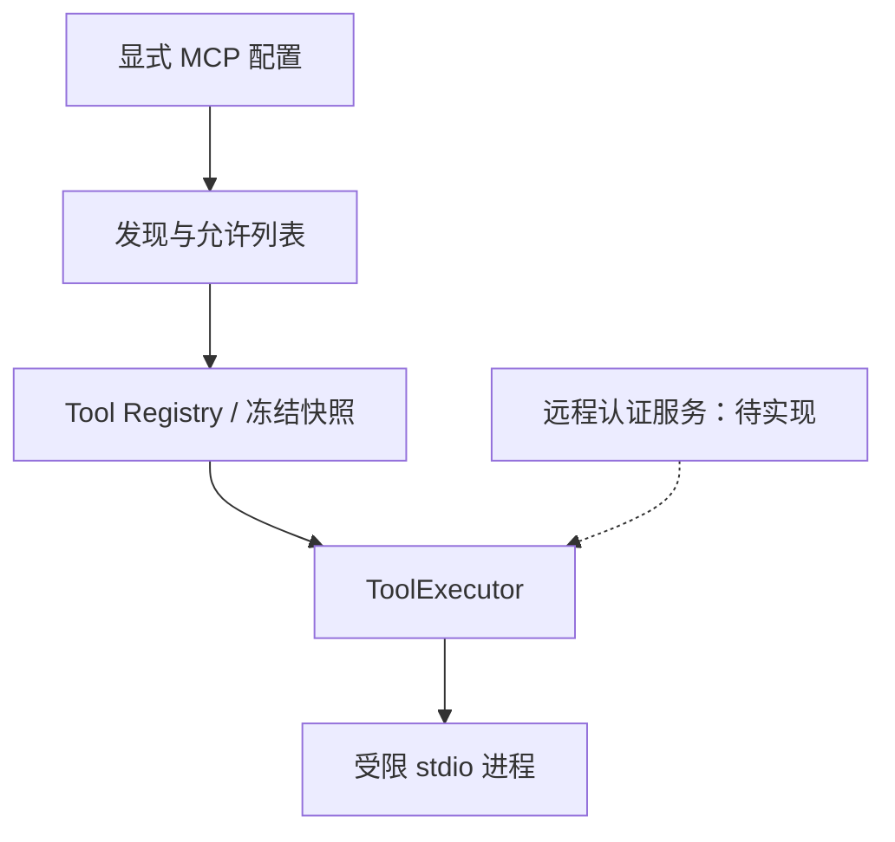

# MCP 与真实外部能力：技术方案

[功能与需求](../features/integrations.md) · [测试方案](../test-plans/integrations.md) · [主索引](../feature-map.md)

最近核对：2026-10-28。本文的架构与流程描述当前有效实现；明确标记的待实现方案不表示已落地。实现级协议仍服从 [跨功能协议与约束](product-overview.md#contract-0-文档效力与实现规则)。

## 当前架构

MCP 适配器先发现允许工具，生成冻结 ToolSpec；调用时重新核对服务端声明，经受限子进程执行。真实服务扩展仍必须进入同一 Registry/Executor。

## 当前流程与目标差异

配置 → 发现并冻结工具 → Agent 选择工具 → 审批/执行 → 结果规范化。新增远程服务需先设计认证、边界和未知结果处理，再接相同执行路径。

- **F-024**：启动服务器、tools/list、tools/call、schema 指纹与工具允许列表已实现。 当前子进程受限、无继承凭据/网络；这不是通用远程认证 MCP 客户端。
- **F-025**：已有本地 MCP 与配置型 Guest 浏览器基础；未形成统一远程认证连接及具体业务连接器体系。 按首个真实用户场景选择接入方式与服务，补连接、凭据生命周期、能力探测和可信结果核实。

## 代码与依赖

- [internal/tool/mcp/client.go](../../internal/tool/mcp/client.go)
- [internal/computer/sandbox/sandbox_linux.go](../../internal/computer/sandbox/sandbox_linux.go)
- [internal/app/runtime.go](../../internal/app/runtime.go)

## 验证与交付

验收场景、已有入口和剩余覆盖统一在 [测试方案](../test-plans/integrations.md) 维护。本次建档未执行本功能的回归或 Live 验证，不以架构图替代运行证据。

## 协议、实现与配置约束

迁入内容按职责归属在此维护。既有编号用于追溯协议，不代表所有设计目标均已实现；完成状态以需求主索引为准。

## MCP, Skills and controlled coding

These optional adapters enter the existing registry and ToolExecutor. Main and
Root receive the same configured work surface; Root still lacks Task control and
user delivery. Neither role receives Skill management. No second discovery API,
execution loop, approval pipeline or model credential channel is introduced.

Use `config.example.yaml` for configuration. Paths are operator configuration;
frozen ToolSpecs represent their scopes with hashes. A `resource_hash` binds
each new ToolSpec to its configured scope. Descriptions and hashes are part of
frozen `tools_json`; Skill resources also determine `skill_set_hash`.
Descriptions reach the Pi Bridge. Full Skill bodies enter context only on view.

### MCP transport

Configure an absolute executable, argument vector, dedicated provider directory,
server name and tool allowlist. No shell, inherited credentials, proxy settings,
user HOME or network access is available to the server. Its executable, system
runtime files and configured provider directory are the only file-read scopes;
only that directory is writable. Put interpreted server code/dependencies there
if using a system interpreter. The provider directory must not overlap domain
data, Skills, the coding checkout or another provider directory. Scope checks
resolve aliases through existing ancestors even before new data directories
exist. The command must be self-contained or use
the exposed system runtime; arbitrary host package paths are unavailable.

The adapter implements MCP `2025-03-26` newline JSON-RPC stdio initialization,
initialized notification, bounded paginated `tools/list`, and `tools/call` text
results. Each operation owns a short-lived initialized session; every call
rediscovers its advertised tool and rejects schema/description drift before
dispatch. Unknown allowlist entries, duplicate/invalid names, oversized frames,
unsupported schemas, server requests, malformed replies and unsupported content
fail closed. Notifications are bounded; they never update a running catalog.
See the [MCP transport specification](https://modelcontextprotocol.io/specification/2025-03-26/basic/transports)
and [tools specification](https://modelcontextprotocol.io/specification/2025-03-26/server/tools).

The operator must classify each exposed tool as `read_only` or `external_effect`.
Provider annotations cannot grant permissions. Reads use `safe`; effects use
`high` risk and `never` replay because standard MCP has no authoritative receipt
query/idempotency contract. Every effect requires its own frozen approval.
Transport loss or a malformed result after dispatch is `unknown`; no retry or
claimed success follows. A call result must be an object with a non-null content
array, text entries with explicit string text, and a boolean `isError` when
present. Empty content arrays and explicit empty text are valid.
Raw provider errors are discarded. Cancellation terminates and collects the
session's process group. The executor supplies timeout, audit, conflict, quota,
result ordering and Artifact spillover semantics. A server-wide conflict key
serializes calls to the same configured provider across Runs.

HTTP/SSE, authenticated external MCP connections and production website access
are not implemented. The local stdio adapter exercises real structured protocol
calls against deterministic external-system Fakes without opening host network
or credential access. Future Guest-connected adapters must retain the same
registry, frozen policy and invocation lifecycle.

## Changelog

2026-10-28：测试入口随当前 Makefile/runner 对齐。旧说明中的 make verify、Delivery/security 分片与自动五轮是历史调度；当前默认单次，重复次数通过 runner --repeat 显式指定。保留机制验收要求。

2026-10-28：按统一文档结构迁入本功能的协议与历史决策，更新引用并移除旧文件；此为文档归属调整，不改变运行时协议。

本节追加记录每次架构/流程取舍。旧图不保留在正文；历史正式决定保留在本节。首次记录为现状建档，不推断历史决策日期。

| 日期 | 类型 | 决策与理由 | 取舍及影响 | 关联 |
| --- | --- | --- | --- | --- |
| 2026-10-28 | 现状建档 | 保留统一工具表面与 Host 权限分类，不让服务端注解授予权限。当前网络隔离是既定边界；远程接入不能靠直接放开现有沙箱绕过设计。 | 明确当前边界与待补齐链路；本次仅建立文档，未修改运行时。 | [跨功能契约](product-overview.md#contract-0-文档效力与实现规则) |

后续记录需包含实际比较过的选项、采用理由、兼容/迁移影响和相关需求或 PR；未决建议不能写成已实施决策。
