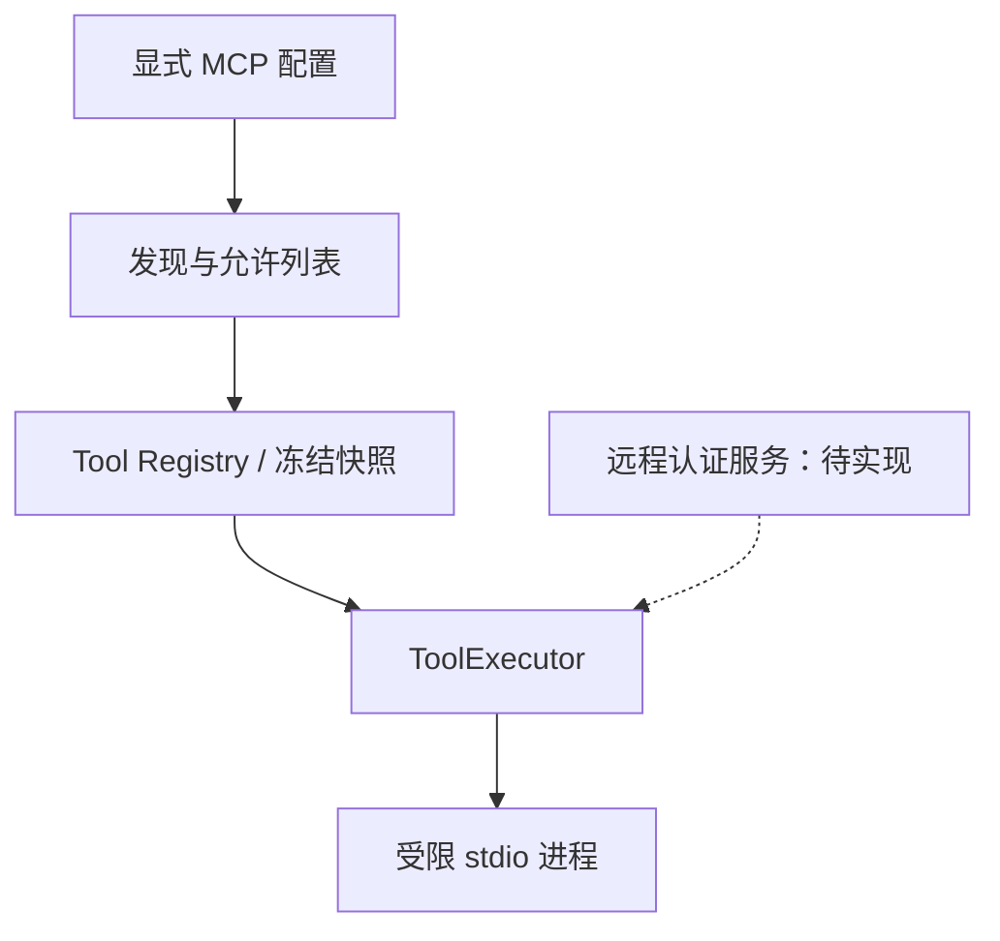
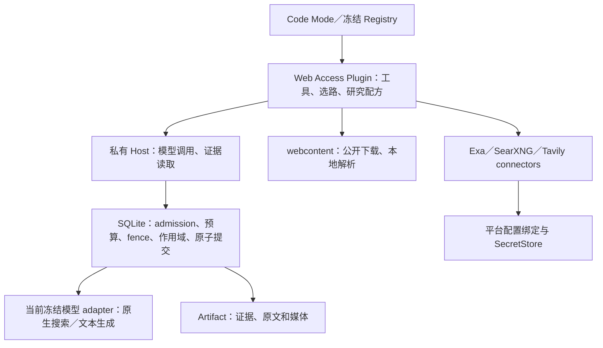
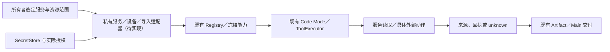

# MCP 与真实外部能力：技术方案

[功能与需求](../features/integrations.md) · [测试方案](../test-plans/integrations.md) · [主索引](../feature-map.md)

本文的架构与流程描述当前有效实现；明确标记的待实现方案不表示已落地。实现级协议仍服从 [跨功能协议与约束](product-overview.md#contract-0-文档效力与实现规则)。

## 当前架构

MCP 适配器先发现允许工具，生成冻结 ToolSpec；调用时重新核对服务端声明，经受限子进程执行。真实服务扩展仍必须进入同一 Registry/Executor。



## 当前流程与目标差异

配置 → 发现并冻结工具 → Agent 选择工具 → 审批/执行 → 结果规范化。新增远程服务需先设计认证、边界和未知结果处理，再接相同执行路径。

- **F-024**：启动服务器、tools/list、tools/call、schema 指纹与工具允许列表已实现。 当前子进程受限、无继承凭据/网络；这不是通用远程认证 MCP 客户端。
- **F-025**：GitHub 精确 PR 监听提供 SecretStore PAT 认证读取及失效诊断/替换后恢复；Agent 的远程服务工具、OAuth 和写动作生命周期仍未实现。

## 代码与依赖

- [internal/tool/mcp/client.go](../../internal/tool/mcp/client.go)
- [internal/computer/sandbox/sandbox_linux.go](../../internal/computer/sandbox/sandbox_linux.go)
- [internal/app/runtime.go](../../internal/app/runtime.go)

### F-042 · 可靠的环境事件监听

当前消费者是显式配置一个 GitHub.com PR 的本地操作员；入口为 `github` CLI 与生产 `WithEvents` 生命周期。新增 `internal/observer/github` 私有适配器，使用固定 GitHub.com GET 路径，拒绝所有 HTTP redirect，分页由本地确切端点与页码构建，不跟随外部 Link 或响应 URL。凭据由 SecretStore 每轮重新解析；错误只保存安全代码。`/user` 身份用于排除自身评论/评审；PR 响应核对仓库全名、编号及 head，并在首次成功时固定不可变 repository ID。

领域必需机制为可靠持久化、版本去重、短事务、停止/隐私 fencing 与健康；当前政策为一个确切 PR、只读 PAT、定期重扫和有限历史。两者分开，均只在仓库内部使用，不稳定通用 Source 插件协议、外部 schema 或新的 Task 生命周期。监听不会调用 `AcceptInbound/Submit`，以免把第三方文本变成用户话语或越过 F-045 的主动启用边界。

每轮流程：SQLite 注册/读取 watch 并接受版本/隐私 epoch 票据 → 在事务外读取完整的评论、review 和当前 head check-runs → 单短事务重检票据、enabled、隐私 epoch、repository ID → 插入新观察及现有 EventOutbox 唤醒 → 更新 head 与成功时间。完整扫描失败只保存故障状态，不保存部分事件或推进成功边界。同类持续故障只在安全代码变化时写健康唤醒，恢复再写一次；内部唤醒不直接创建工作或用户通知。并发 poll、stop/resume 与 Forget 会使旧票据失效。运行时 shutdown 取消并等待 watcher 退出后关闭数据库。

Migration 033 在 `state.db` 增加 `github_watch/github_observation`；不修改既有 Run、工具或冻结能力快照。watch 身份固定为仓库名/PR，repository ID 进一步防止名称复用。来源 ID、类型、来源时间、规范化字段及完整源正文摘要构成版本 hash，唯一键 `(scope,event_key)` 使重复扫描/重启不产生重复观察。review 的 submitted_at 不是编辑时间，因此完整源正文摘要仍参与私有 event_key，即使修改发生在 16 KiB 展示边界之外也产生新版本；原始长正文和该摘要字段不另行持久化或展示。历史观察保持不可变；Forget 后只查询当前 epoch，显式 resume 不会将旧版本重新发布。所有查询只读，不触发扫描或修改健康。

选择全量有界重扫而非时间高水位：评审/CI 端点的修改和乱序不能由单个时间游标完整表示，重扫能补回 GitHub 仍保留的版本；代价是 API 读取量。每页 4 MiB、每类 20 页、总事件正文 8 MiB，超限整体失败，不伪装完整接收。正文截断保留来源链接，接收不宣称 GitHub 的历史审计或外部 exactly-once。旧 head 的 CI、删除和中间变更不受保证；不扩展 webhook 服务器、OAuth、通用工作流或自动 Task 接续。

### 明确 Task 关联与 Main 接续

本机所有者可 CAS 绑定确切 watch scope、已有 Task 和当前 Task epoch；关联冻结 privacy epoch、授权 generation 及当前观察序号作为接收起点。`github_task_binding` 是此单一 GitHub 适配器的私有授权/消费位置，不是通用 Source/工作流协议。只处理绑定之后的新观察，不以话题相似、自由文本 TaskRef 或 PR 内容自行关联。

`main_inbox` 的既有 event_id 强引用 task_update，因此不将外部观察伪装成 Worker 结果。私有 `github_task_followup` 记录观察→现有 Main 的不可变因果，复用 createMain、Actor、ToolInvocation、EventOutbox 和恢复扫描；每次只接纳一个来源版本，观察与因果唯一键防止重启/乱序重复。消息使用已有 RuntimeContext 的 JSON 框、Origin=runtime，明确是第三方证据而非新用户命令/审批；不写 main_input 或用户 Conversation。

交给 Main 的原目标与来源正文各最多 4 KiB，截断明确标记为 preview；完整 Task/观察继续保存在原存储，不改写版本身份。信息不足时沿已有授权读取原 Task 或询问所有者，不凭缺失细节继续。这样单个长评审不能制造无法压缩的受保护上下文。

只有因果 Main 受此附加裁决：同一 Task 至多一个新 append，来源/hash 已接纳的重复仍按 Task 原规则复用回执；新 Task、另一 Task、Automation/Memory 控制及直接副作用被拒绝。原 Task Worker 继续原工具、审批和 unknown 裁决。成功 append 在同一事务记录 continued_epoch 并推进 binding 期望代次，使合法接续不会撤销自己，其他动作不能借此重新授权。

执行 runtime 准备必须在发现 Tool/依赖、公开可执行 Actor 或运行任何恢复前，以可信 owner 配置调用 ConfigureGitHub，包括配置为空；Store 当前 exact scope 私有且默认拒绝。OpenControl 的 status/evidence/model 等只读打开不调用持久配置协调，不改变既有 binding/generation；显式 owner bind 在 CAS/Task/watch 校验通过后与其他 scope 撤销同事务提交，read-only 操作不替代执行启动。单事务禁用其他 scope 的绑定、增加 generation 并撤销旧 Main；配置重加不恢复绑定，须显式 bind。恢复查询只接纳当前确切 scope；调度选择、可执行等待、claim 与 append 都核对当前 scope，旧进程跳过其他 scope 的 Main，普通 Worker 仍可前进。停止中的原 join 边界不变。既有 claim/模型接受/Host 工具写入继续用 DB generation、Task epoch/status 与隐私 fence 拒绝迟到结果，不增加新的 claim 授权层。只有具有该私有因果行的 Main 增加这些条件，普通 Main/Worker 仍采用原权限与运行语义。unbind、watch stop、Task pause/cancel/manual complete、配置移除/切换、明确 CREDENTIAL_REJECTED 或 REPOSITORY_IDENTITY_CHANGED 原子撤销旧因果 Main；私有终止原因仍由同一个 stop recovery 排空，Run 终态不可逆。Forget 继续使用现有屏障。新用户输入将外部 Main 标为 superseded，并用既有后继 Main 接纳输入，避免真实用户消息因旧观察授权失效而遗失。

内部 Task explicit_end_epoch 区分人工 complete 和 once Root 自然完成，未增加 Task 状态或修改模型工具 schema。自然完成的原绑定可继续；人工结束的当前代次不能自动恢复，只有显式用户 append 后的新代次才可重新绑定。新迁移保留原 Run/模型/能力快照与历史回执，不回填自动关联；此前没有任何 GitHub Task 绑定。

轮询健康与已接纳因果的授权分开：仅 healthy 且无 failure_code 的 watch 可新 promotion；已 assigned 的原始观察不因 UNAVAILABLE、INVALID_RESPONSE、CREDENTIAL_MISSING、ACCESS_DENIED_OR_RATE_LIMITED、SOURCE_UNAVAILABLE 或 SOURCE_MOVED 丢失。CREDENTIAL_MISSING 合并了 SecretStore 暂不可读等原因；403/429 同码也不能断言明确撤权；404/3xx 只证明当前来源不可读/移动，不跟随 redirect、不改变原 exact scope。选择保留先前完整接纳的证据，避免网络抖动永久吞掉已推进唯一键/序号的观察；明确凭据拒绝和仓库身份变化采取保守 hard revoke，健康恢复也不自动重新绑定。该策略不保证当前来源仍可用，也不授予新的外部动作权限。

真实消费者只有可信 App 启动与此 GitHub 适配器，当前 scope、绑定 generation、健康/授权区别和不可变因果为领域必需；通用 Source、热配置平台、通用 claim 框架与新的错误分类没有证据，不暴露或稳定化。配置撤销持久保留代次，轮询故障保留已接纳工作，两者复用现有短事务与 fence，是比新增第二调度/授权管线更窄的可逆设计。

F-020 继续负责原消息/话题路由；GitHub 因果 Main 通过已有 github_task_followup.task_id 复用 taskReplyOrigin，与原 Task Worker 一起回原绑定/消息。显式通知偏好、撤权与未知投递裁决不变；来源接收和 Task 控制不决定新通知目的地。剩余范围为其他真实服务、外部关联类型、源平台历史保留及真实模型范围判断质量。

## 验证与交付

验收场景、已有入口和剩余覆盖统一在 [测试方案](../test-plans/integrations.md) 维护。实际执行结果以对应版本的 PR 或 CI 证据为准；架构说明不证明回归或 Live 验证通过。

## 协议、实现与配置约束

本功能协议在此维护。既有编号用于追溯协议，不代表所有设计目标均已实现；完成状态以需求主索引为准。

<a id="capabilities-mcp-skills-and-controlled-coding"></a>

## MCP, Skills and controlled coding

External MCP and curated Skill content enter the existing registry and ToolExecutor.
File/command tools and empty Skill discovery are built in by default (see [execution](coding.md)).
Main retains its explicit control, memory, evidence and delivery surface, Skill
list/view, and MCP tools configured by the Host as read_only or external_effect.
Focused lookups and explicit single-step changes may run directly; multi-step,
long-running, batch and native workspace/Computer execution go to Tasks. Root derives execution
capabilities independently from the full registry and still lacks Task control and
user delivery. Neither role receives Skill management. Tool search and Code Mode
discovery share the frozen registry; no second execution loop, approval pipeline
or model credential channel is introduced.

Use `config.example.yaml` for configuration. Paths are operator configuration;
frozen ToolSpecs represent their scopes with hashes. A `resource_hash` binds
each new ToolSpec to its configured scope. Descriptions and hashes are part of
frozen `tools_json`; Skill resources also determine `skill_set_hash`.
The model invokes tools through Code Mode. Skill names and descriptions enter
context only through skill_list search; bodies enter only through skill_view.
Skill versions remain in the Host's frozen resource metadata.

<a id="capabilities-mcp-transport"></a>

### MCP 工具暴露

MCP 工具统一经 Code Mode 调用，不提供服务器或单工具暴露模式。配置示例：

```yaml
mcp:
  - name: local_catalog
    command: /absolute/path/to/server
    directory: /absolute/private/provider
    description: Find and update catalog records
    tools: {lookup: read_only, send_message: external_effect}
```

`tools` 是权限允许列表；只允许这里配置的工具进入冻结目录。旧 `exposure` / `tool_exposure` 字段应删除，严格配置校验拒绝这些字段。Main 和 Worker 都在各自的 Code Mode 中发现、描述和组合调用，不向模型声明单个 MCP Schema。执行与恢复契约见[统一工具方案](tools-approvals.md#mcp-渐进暴露与动态声明)。

单服务器允许列表和发现目录各至多 4096 个工具，保留 1 MiB 帧、16 页、单 Schema 64 KiB 及既有超时限制；500 个工具的目录可注册而不全量进入模型请求。服务器默认描述优先取配置 `description`，否则只取初始化 instructions 首行，最多 512 个字符；这些只是路由数据，不是授权或指令。

### MCP transport

Configure an absolute executable, argument vector, dedicated provider directory,
server name and tool allowlist. No shell, inherited credentials, proxy settings,
user HOME or network access is available to the server. Its executable, system
runtime files and configured provider directory are the only file-read scopes;
only that directory is writable. Put interpreted server code/dependencies there
if using a system interpreter. The provider directory must not overlap domain
data, Skills, the coding checkout or another provider directory. Scope checks
resolve aliases through existing ancestors even before new data directories
exist. The command must be self-contained or use
the exposed system runtime; arbitrary host package paths are unavailable.

The adapter implements MCP `2025-03-26` newline JSON-RPC stdio initialization,
initialized notification, bounded paginated `tools/list`, and `tools/call` text
results. Each operation owns a short-lived initialized session; every call
rediscovers its advertised tool and rejects schema/description drift before
dispatch. Unknown allowlist entries, duplicate/invalid names, oversized frames,
unsupported schemas, server requests, malformed replies and unsupported content
fail closed. Notifications are bounded; they never update a running catalog.
See the [MCP transport specification](https://modelcontextprotocol.io/specification/2025-03-26/basic/transports)
and [tools specification](https://modelcontextprotocol.io/specification/2025-03-26/server/tools).

The operator must classify each exposed tool as `read_only` or `external_effect`.
Provider annotations cannot grant permissions. Reads use `safe`; effects use
`high` risk and `never` replay because standard MCP has no authoritative receipt
query/idempotency contract. Every effect requires its own frozen approval.
Transport loss or a malformed result after dispatch is `unknown`; no retry or
claimed success follows. A call result must be an object with a non-null content
array, text entries with explicit string text, and a boolean `isError` when
present. Empty content arrays and explicit empty text are valid.
Raw provider errors are discarded. Cancellation terminates and collects the
session's process group. The executor supplies timeout, audit, conflict, quota,
result ordering and Artifact spillover semantics. A server-wide conflict key
serializes calls to the same configured provider across Runs.

HTTP/SSE, authenticated external MCP connections and production website access
are not implemented. The local stdio adapter exercises real structured protocol
calls against deterministic external-system Fakes without opening host network
or credential access. Future Guest-connected adapters must retain the same
registry, frozen policy and invocation lifecycle.

## 个人 Connector 待实现方案

F-046–F-070 的具体范围及分类见[术语与登记边界](../features/integrations.md#术语与登记边界)，接入顺序见[主索引](../feature-map.md#personal-connector-priorities)。其中 16 项面向明确外部系统／服务，F-069 是组合搜索与读取的 Web Access Plugin；F-048–F-054 是执行、导入或模型能力候选，不计为 connector，也未确认为独立开发任务。F-069 已在既有执行框架内自建多源搜索、正文／PDF／图片提取与证据续读，详见下方实现方案；其他服务仍是需求与实施约束，未新增其适配器、OAuth 或公开接口。已有受限本地 MCP、具名 GitHub PR 观察和 Guest 边界保持原契约。

### 具体要求与现有消费者

当前消费者为本机所有者：让助手完成公开资料研究、工程协作、本机／远端维护、跨助手上下文接续、视觉产物及明确的生活查询。支持证据为用户授权查看的定性聊天样本，不包含用户频次统计，也不将旧聊天里的设备状态、执行结果或账户信息作为当前事实。稳定文档只记录抽象需求，私人会话正文及附件不进入仓库或测试夹具。

个人 connector 的实施建议以 ChatGPT 日常问题为主要消费者：先补公开检索和地点／路线／天气事实，再按已确认的数据来源接邮件、生活数据及工作材料。GitHub 的工程优先级继续由既有工程闭环持有，不与日常问题榜混作一个频次排名。数据来源尚未确认的 HealthKit／云盘／日历等先验证需求和接入条件，不为满足排名提前开发设备端组件或授权系统。

下游继续使用已有 Main/Task、Code Mode、Tool Registry/Executor、Artifact、Memory、SecretStore 及交付管线。外部资料不能伪装成用户指令／审批，旧任务和旧 Run 不因新 connector 配置获得能力；服务读取、事件接收及外部动作是独立授权范围。F-047 不复制 F-026 的代码交付关系或 F-042 的监听状态，F-051/F-052/F-053 不建立第二套 Memory，F-062/F-063 不建立第二套 Task。

### 机制、政策与复杂度

| 部分 | 分类与必须保留的机制 | 当前政策／默认方案 |
| --- | --- | --- |
| 身份与凭据 | 领域必需：服务身份、实际权限、SecretStore 引用、撤权及可诊断失效 | 逐服务选认证方式，首版只接一个明确用户／账户／资源范围；不默认全账户权限 |
| 读取与来源 | 领域必需：资源身份、来源时间／版本、分页、缺失与截断、隐私作用域 | 主动查询优先；只为真实主动任务增加订阅，不要求所有服务后台同步 |
| 外部写入 | 领域必需：冻结具体参数、授权、结果核实、幂等／回执能力判断、unknown | 从只读到草稿再到具名动作；工具级约束不能冒充供应商级 scope 隔离 |
| 恢复与停止 | 领域必需：取消、重启、撤权／Forget fencing、限流和中断可见 | 本地进程生命周期，复用既有任务／工具恢复；不承诺外部 exactly-once |
| 工具发现 | 领域必需：按角色冻结、允许列表、Schema／权限核对 | 沿用渐进发现与 Code Mode，不预载全部服务工具定义 |
| 多供应商抽象、市场及工作流 | 当前属推测复杂度，没有独立实际消费者支撑稳定契约 | 不建设通用 connector SDK、平台市场、跨账户身份图谱、统一全量数据镜像或第二套调度 |

共性机制先在实际适配器中验证，出现真实重复后再提取消费者所需的窄接口。接入目录可以增长，但新增服务不能通过削弱沙箱、默认继承 HOME／网络／凭据或暴露内部领域模型来省略边界。

### 外部系统 Connector 的分项方案与未决条件

| 需求 | 首个可审查闭环 | 认证／来源及实施前必须确认的条件 |
| --- | --- | --- |
| F-046 Tavily | 搜索→读取选定正文→带来源回答 | API key 引用；查询是否向外披露资料、额度与失败格式；不把 Extract 当万能网站访问 |
| F-047 GitHub | 明确仓库读取→准备协作动作→授权执行→查回执 | PAT／App 方案按部署选择；仓库、用户与 head 身份；复用 F-042/F-026 的职责边界 |
| F-055 Google Maps | 地点链接→核实地点→路线与导航交接 | Maps Platform 凭据及计费、短链解析边界、坐标／区域／时区及结果使用限制；不是个人收藏 API |
| F-056 高德 | POI／天气／路线→来源结果→唤端链接 | Web API key 或官方 MCP；URL 中的凭据不能落日志，坐标／配额与地域支持需 Live |
| F-057 Apple Health／HealthKit | 确认数据来源→授权原生设备端组件→读取选定指标／时间窗 | 来源未确认；需要真实 HealthKit 集成和系统授权，不是 Mac 云 API；XML 导入不计 connector 接通 |
| F-058 飞书云文档 | 选定文档／知识库→读资料→草稿／授权更新 | 用户 token 与应用 token 的身份／资源范围不同；材料实际存放位置、组织授权及协作版本需核实 |
| F-059 Gmail | 查确切邮件→读取附件→本地草稿 | OAuth、受限 scopes 适用要求、refresh／revoke；如向模型发送数据需核实适用政策，不能默认本地部署即免评估 |
| F-060 Jellyfin | 指定服务器／库→查询条目和播放相关状态 | 服务 URL 与具名账户授权，API／版本和端点需验证；媒体库查询不能证明 Apple TV 实际播放 |
| F-061 AWS | 账户／区域内读取资源→解释可取得费用 | 最小权限、短期凭据与各 API 权限；费用延迟／收费、credits 和其他区域覆盖不能混同 |
| F-062 Google Calendar | 确认所用日历→读取忙闲→授权创建事件 | 用户来源未确认；OAuth scope、重复日程、邀请和提醒语义先明确，与 F-015 分工 |
| F-063 Apple EventKit | 确认所用清单→本机授权→读取／创建 | 用户来源与本机组件方案未定；Calendar 与 Reminders 独立授权，不直接读系统私有数据库 |
| F-064 Google Drive | 确认资料存储→选择文件→读取／保存 | 来源未确认；`drive.file` 不支持任意全盘搜索，原生编辑按实际文件类型另行验收 |
| F-065 X | 网页覆盖不足的确切帖子→结构化上下文→核验 | 首先复用搜索／Chrome；直连 API 账户、用量成本和媒体覆盖需核实，不接写操作 |
| F-066 YouTube | 确认视频任务→读取元数据／授权转录→时间戳引用 | 委托需求待确认；官方字幕下载要求视频编辑权限，不能承诺任意公开视频转录 |
| F-067 Exa MCP | F-069 已接固定公开服务→免密钥查询→来源结果 | 现有窄搜索适配保持实验性；免费限流、过滤能力、schema 变化和正文完整性不能假设 |
| F-068 SearXNG | 选定实例→JSON 搜索→来源结果 | 实例与上游未定，接口格式／部分结果、服务端点范围及认证重定向需验证 |

### F-069 · Web Access 的最小组合方案

**具体要求与现有消费者**：Main／Task Worker 需要批量和固定源搜索、公开文档提取、问答、摘要及可重读证据。用户要求自主实现；已有 Go 搜索／读取、模型控制面、SecretStore、Code Mode 和 Artifact 是实际依赖与下游契约。服务适配按公开协议自建；不安装外部 agent SDK、复制插件源码或建立另一套 agent 运行时。

**机制与政策**：`internal/plugin/webaccess` 是内置能力包，持有工具声明、冻结来源顺序、批处理、问答／摘要／来源核查配方及证据预览。消费方定义的私有 `Host` 仅提供辅助模型调用与作用域内证据读取，不暴露数据库、事务或模型选择器。SQLite 实现 Host，负责 accepted invocation、冻结身份比对、模型 admission／预算／请求哈希、fencing、作用域读取和原子提交；App 仅装配。

| 模块 | 必要职责 | 不持有的职责 |
| --- | --- | --- |
| `internal/connector/exa`、`searxng`、`tavily` | 各服务公开协议；具名连接参数与 SecretStore 引用；有界响应和安全错误 | 工具目录、来源顺序、摘要、状态库或插件生命周期 |
| `internal/connector/internal/searchhttp` | SearXNG／Tavily 已有共同 JSON 结果传输、凭据解析与脱敏 | 通用 connector SDK、任意服务注册 |
| `internal/webcontent` | 公开 DNS 固定／重定向复验、有界下载、本地 HTML／PDF／图片处理 | 服务账户、研究目标或模型调用 |
| `internal/plugin/webaccess` | 组合这些机制和当前研究配方；生成待持久化证据／媒体 | 连接授权、预算裁决、数据库与原子发布 |
| 当前 LLM adapter／平台连接 | 原生搜索协议、账户认证／撤权及冻结模型；配置中的服务实例绑定 | 外部搜索服务选择政策 |

`source_order` 和兼容的 `exa_fallback` 是当前插件政策；原生能力来自当前账户实际协议，不凭模型名猜测，也不切换冻结模型。SearXNG／Tavily 的内部 `Connection` 只表示已配置实例／凭据引用，并非新建账户生命周期或持久化格式。统一连接管理仍归 F-025。



**必要复杂度**：具名源顺序与允许目的地防止静默扩大查询披露；结构化 HTTP／模型错误决定是否切换；DNS 连接固定和重定向复验防止 SSRF。解析进程的独立 HOME、禁用 fetch、有限输入／输出与进程组回收来自文档安全和取消需求。辅助模型交换复用 frozen Snapshot、负 step、预算与账户 observer；每个 invocation／call key 记录请求哈希，重入不重新发送或套用不同证据。工具 namespace 显式带 description，以满足真实账户 Responses 契约；SIWC hosted search 不发送不支持的 max_tool_calls。

**证据与媒体契约**：Steward 自有版本化 `Document` 保存来源、原文、claim 和片段；分页为 UTF-8 字节坐标，case-insensitive 查找保留大小写转换后的原文字节映射。fuzzy 只提供按序词组匹配，不推断语义。片段分别记录内容哈希和来源全文哈希；有片段／来源不等于支持或反驳。媒体通过内部 AttachmentOutput 与证据和终态同事务提交，配额或终态失败回滚全部元数据。它是已有媒体消费者需要的机制，不新增公共存储协议。

### 参考行为与自主实现边界

参考工具能力与公开服务协议，connector 实现和命名均归 Steward。仅使用通用本地解析库：Readability、Defuddle、LinkeDOM、Turndown、unpdf；它们不持有账户、网络搜索或 agent 调度。搜索、来源优先级、失败分类、参数验证、证据结构、持久化、查找与摘要提示均由本项目实现；没有插件配置透传或内部模型直接公开。

**开放范围与稳定性**：这些模块、Host 和解析进程协议保持 private／experimental；可在仓库内理解与复用，未承诺公共 SDK、通用 connector 平台或永久插件兼容。本次仅移动职责，工具名／Schema／输出字段、配置序列化、资源身份算法及 Document v1 不变，无数据迁移；已完成结果继续从既有记录重放。源顺序、解析源码及依赖锁进入资源身份；升级拒绝不匹配旧 Run，旧 web_fetch 的字节续读工具仍保留。拒绝把包移动当成公共安装协议；没有为预测未来供应商设计抽象注册系统或泛型配置 DSL。

**取舍与未泛化部分**：当前只有 native／Exa／SearXNG／Tavily 四条真实变化轴，不复制无实际凭据／消费者的供应商目录。原生域名条件与本地来源筛选分开，日期只报告服务实际保证；Exa 不支持的过滤直接拒绝。独立第三方全文外送、任意宿主文件、其他助手凭据、浏览器 profile、仓库 clone 和视频均未开放。摘要只用当前模型，summary-review 保持未批准草稿；没有伪造人类审核。已实现范围与缺口见功能说明，各服务 Live 不互相替代。

### 非 Connector 能力候选

F-048–F-054 不属于业务系统 connector，尚未确认为独立开发任务；以下仅保留候选方向及原 ID。文件／SSH／浏览器执行、来源导入和图片模型接入须分别归属相应能力设计，不参与 connector 数量、顺序或完成判定。

| 能力候选 | 候选闭环 | 尚待确认的边界 |
| --- | --- | --- |
| F-048 macOS | 选择目录／服务→只读检查→维护预览 | 宿主 helper／OS 权限方式未定，范围解析与链接逃逸必须独立校验；不能继承 Guest 权限 |
| F-049 SSH | 具名主机→核对 host key→诊断→具名维护 | SecretStore 凭据引用、账户、主机指纹与动作范围；网络变更回滚及断连后的未知效果 |
| F-050 Chrome | 选择标签页→读取当前上下文→核实网页动作 | 浏览器 helper／扩展、用户绑定、页面身份与 OS 权限方式未定；不读取 profile、cookie 或任意会话 |
| F-051 ChatGPT | 选定导出／对话→预览导入范围→来源召回 | 不预设消费者聊天历史 API；格式、分支、附件、去重和撤销单位需用脱敏样本确定 |
| F-052 Codex | 选定工程会话→只读导入→区分旧报告与当前证据 | 优先用户提供资料；本地格式／状态属于实验性外部实现，不能直接耦合桌面应用私有库 |
| F-053 Pi | 选定会话及分支→导入→接续主题 | 格式版本和分支身份需核实；只读会话，不导入认证、插件或历史执行权限 |
| F-054 图片服务 | 选择模型／素材→生成或编辑→保存可重开产物 | 首个服务和模型支持以当时官方 API 为准；素材披露、用量／费用、结果未知与动画能力分别处理 |

### 目标调用与数据边界

以下为外部系统 connector 的待实现路径，不表示已存在这些 adapter 或工具；一般执行工具、导入器和模型供应商不因经过相同 Executor 就变为业务 connector：



历史资料导入先预览来源、范围与缺失项，再经现有隐私／Artifact／召回路径保存；长期记忆仍按 F-009 形成。具体持久化字段、格式版本、去重及撤销单位在相应 feature 实施前定义，不在需求登记时引入通用资源表或迁移。敏感资料的外部处理范围必须可理解、可约束，认证可用不代表模型可读取整个账户；书签和历史使用也不构成现在的授权。

如增加事件监听，应以真实主动任务为消费者，单独定义来源版本、补读范围、去重、接收健康、明确关联与停止语义；不能把 F-042 的 GitHub 有界重扫原样套用到 Gmail 或 Calendar。Gmail 推送、日历同步等按各自官方生命周期实现，不把“支持 webhook”视为可靠事件接收已完成。第三方内容只能提供证据，不授予动作、创建新 Task 或恢复用户已停止的工作。

### 开放范围、稳定性与取舍

- **私有**：凭据维护、供应商字段、设备／浏览器 helper、来源文件布局及适配错误映射留在各适配器；不直接暴露内部 Main/Task/Run 或 SQLite 模型。
- **实验性**：各新 connector 在真实账户／平台验证前保持独立可关闭；特别是 Codex/Pi 导入格式、宿主 Chrome、本机 helper 与健康数据桥接，不承诺外部格式稳定或所有平台兼容。
- **已有契约**：沿用 Registry、Code Mode、ToolInvocation、审批、Artifact、交付和隐私语义；新增模型可见工具范围在实施时逐项评审和冻结，不因列入需求清单获得稳定公共 API。

首个实际服务可选窄原生 API 或官方 MCP，不为单个高德接入先建设全功能 OAuth MCP 平台；反过来也不以“已有 MCP”省略远程认证／网络隔离。原生 API 的回执、精确权限和增量同步通常需要服务专属语义，MCP 传输不抹平这些差异。通用远程 MCP 如成为真实复用需求，仍由 F-025 独立设计。

历史导入而非账户全量抓取，牺牲自动新鲜度以减少隐藏授权与私有协议耦合；来源更新后可显式重导入。SSH／浏览器可解决低频工作，但专用服务适配器能提高结构化结果和回执可信度，二者按实际任务组合，不把广域 shell 或网页点击当作所有 connector 的统一业务契约。

当前不扩展个人微信全聊天、支付／交易、自动购票、招聘系统批量资料或对全账户的持续采集；样本中的咨询、点餐、面试写作和财务研究并不证明这些授权或稳定接口需求。地域服务、费用、数据源与调用方式不确定的项目保持候选状态；不为了凑目录数量先稳定接口。

验证要求见[分项验收计划](../test-plans/integrations.md#个人-connector-验收计划)。实施时同步本页当前架构、功能用法和主索引；需求登记不改变旧配置、数据、Run 快照或外部服务状态。

### F-070 · 独立插件生命周期（待实现）

Plugin 是能力包边界，Connection 是平台管理的账户／服务实例边界。当前以一个内置 plugin 验证内部组合，使用既有 Registry 冻结工具，没有独立安装系统。待有真实安装／启停消费者时再定义最小内部清单和操作入口；连接认证／撤销继续复用 F-025，不在 plugin 内复制账户状态机。卸载与断连不能互相隐式执行，旧 Run 的冻结权限不被新插件状态扩大。公共 SDK、市场、动态加载、研究 Skill 发布与通用工作流引擎均不在当前重构内。
