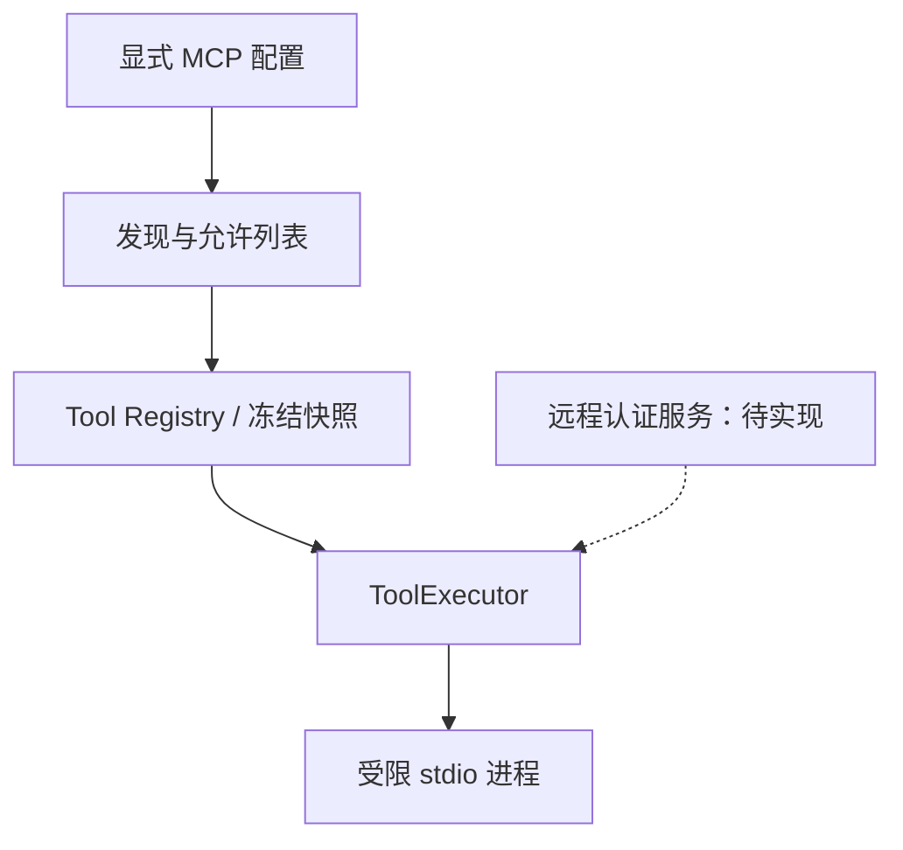

# MCP 与真实外部能力：技术方案

[功能与需求](../features/integrations.md) · [测试方案](../test-plans/integrations.md) · [主索引](../feature-map.md)

本文的架构与流程描述当前有效实现；明确标记的待实现方案不表示已落地。实现级协议仍服从 [跨功能协议与约束](product-overview.md#contract-0-文档效力与实现规则)。

## 当前架构

MCP 适配器先发现允许工具，生成冻结 ToolSpec；调用时重新核对服务端声明，经受限子进程执行。真实服务扩展仍必须进入同一 Registry/Executor。

## 当前流程与目标差异

配置 → 发现并冻结工具 → Agent 选择工具 → 审批/执行 → 结果规范化。新增远程服务需先设计认证、边界和未知结果处理，再接相同执行路径。

- **F-024**：启动服务器、tools/list、tools/call、schema 指纹与工具允许列表已实现。 当前子进程受限、无继承凭据/网络；这不是通用远程认证 MCP 客户端。
- **F-025**：GitHub 精确 PR 监听提供 SecretStore PAT 认证读取及失效诊断/替换后恢复；Agent 的远程服务工具、OAuth 和写动作生命周期仍未实现。

## 代码与依赖

- [internal/tool/mcp/client.go](../../internal/tool/mcp/client.go)
- [internal/computer/sandbox/sandbox_linux.go](../../internal/computer/sandbox/sandbox_linux.go)
- [internal/app/runtime.go](../../internal/app/runtime.go)

### F-042 · 可靠的环境事件监听

当前消费者是显式配置一个 GitHub.com PR 的本地操作员；入口为 `github` CLI 与生产 `WithEvents` 生命周期。新增 `internal/observer/github` 私有适配器，使用固定 GitHub.com GET 路径，拒绝所有 HTTP redirect，分页由本地确切端点与页码构建，不跟随外部 Link 或响应 URL。凭据由 SecretStore 每轮重新解析；错误只保存安全代码。`/user` 身份用于排除自身评论/评审；PR 响应核对仓库全名、编号及 head，并在首次成功时固定不可变 repository ID。

领域必需机制为可靠持久化、版本去重、短事务、停止/隐私 fencing 与健康；当前政策为一个确切 PR、只读 PAT、定期重扫和有限历史。两者分开，均只在仓库内部使用，不稳定通用 Source 插件协议、外部 schema 或新的 Task 生命周期。监听不会调用 `AcceptInbound/Submit`，以免把第三方文本变成用户话语或越过 F-045 的主动启用边界。

每轮流程：SQLite 注册/读取 watch 并接受版本/隐私 epoch 票据 → 在事务外读取完整的评论、review 和当前 head check-runs → 单短事务重检票据、enabled、隐私 epoch、repository ID → 插入新观察及现有 EventOutbox 唤醒 → 更新 head 与成功时间。完整扫描失败只保存故障状态，不保存部分事件或推进成功边界。同类持续故障只在安全代码变化时写健康唤醒，恢复再写一次；内部唤醒不直接创建工作或用户通知。并发 poll、stop/resume 与 Forget 会使旧票据失效。运行时 shutdown 取消并等待 watcher 退出后关闭数据库。

Migration 033 在 `state.db` 增加 `github_watch/github_observation`；不修改既有 Run、工具或冻结能力快照。watch 身份固定为仓库名/PR，repository ID 进一步防止名称复用。来源 ID、类型、更新时间及规范化内容构成版本 hash，唯一键 `(scope,event_key)` 使重复扫描/重启不产生重复观察。历史观察保持不可变；Forget 后只查询当前 epoch，显式 resume 不会将旧版本重新发布。所有查询只读，不触发扫描或修改健康。

选择全量有界重扫而非时间高水位：评审/CI 端点的修改和乱序不能由单个时间游标完整表示，重扫能补回 GitHub 仍保留的版本；代价是 API 读取量。每页 4 MiB、每类 20 页、总事件正文 8 MiB，超限整体失败，不伪装完整接收。正文截断保留来源链接，接收不宣称 GitHub 的历史审计或外部 exactly-once。旧 head 的 CI、删除和中间变更不受保证；不扩展 webhook 服务器、OAuth、通用工作流或自动 Task 接续。

待实现：F-004 基于明确 Task/PR 关联将观察作为不可信外部证据交 Main；F-020 决定回原话题的交付。来源消费上下文不能赋予新权限，停止/Forget 后不得自动恢复工作；F-025 的其他真实服务与授权动作仍需独立设计。

## 验证与交付

验收场景、已有入口和剩余覆盖统一在 [测试方案](../test-plans/integrations.md) 维护。实际执行结果以对应版本的 PR 或 CI 证据为准；架构说明不证明回归或 Live 验证通过。

## 协议、实现与配置约束

本功能协议在此维护。既有编号用于追溯协议，不代表所有设计目标均已实现；完成状态以需求主索引为准。

## MCP, Skills and controlled coding

External MCP and curated Skill content enter the existing registry and ToolExecutor.
File/command tools and empty Skill discovery are built in by default (see [execution](coding.md)). Main and
Root receive the same frozen work surface; Root still lacks Task control and
user delivery. Neither role receives Skill management. No second discovery API,
execution loop, approval pipeline or model credential channel is introduced.

Use `config.example.yaml` for configuration. Paths are operator configuration;
frozen ToolSpecs represent their scopes with hashes. A `resource_hash` binds
each new ToolSpec to its configured scope. Descriptions and hashes are part of
frozen `tools_json`; Skill resources also determine `skill_set_hash`.
Descriptions reach the Pi Bridge. Full Skill bodies enter context only on view.

### MCP transport

Configure an absolute executable, argument vector, dedicated provider directory,
server name and tool allowlist. No shell, inherited credentials, proxy settings,
user HOME or network access is available to the server. Its executable, system
runtime files and configured provider directory are the only file-read scopes;
only that directory is writable. Put interpreted server code/dependencies there
if using a system interpreter. The provider directory must not overlap domain
data, Skills, the coding checkout or another provider directory. Scope checks
resolve aliases through existing ancestors even before new data directories
exist. The command must be self-contained or use
the exposed system runtime; arbitrary host package paths are unavailable.

The adapter implements MCP `2025-03-26` newline JSON-RPC stdio initialization,
initialized notification, bounded paginated `tools/list`, and `tools/call` text
results. Each operation owns a short-lived initialized session; every call
rediscovers its advertised tool and rejects schema/description drift before
dispatch. Unknown allowlist entries, duplicate/invalid names, oversized frames,
unsupported schemas, server requests, malformed replies and unsupported content
fail closed. Notifications are bounded; they never update a running catalog.
See the [MCP transport specification](https://modelcontextprotocol.io/specification/2025-03-26/basic/transports)
and [tools specification](https://modelcontextprotocol.io/specification/2025-03-26/server/tools).

The operator must classify each exposed tool as `read_only` or `external_effect`.
Provider annotations cannot grant permissions. Reads use `safe`; effects use
`high` risk and `never` replay because standard MCP has no authoritative receipt
query/idempotency contract. Every effect requires its own frozen approval.
Transport loss or a malformed result after dispatch is `unknown`; no retry or
claimed success follows. A call result must be an object with a non-null content
array, text entries with explicit string text, and a boolean `isError` when
present. Empty content arrays and explicit empty text are valid.
Raw provider errors are discarded. Cancellation terminates and collects the
session's process group. The executor supplies timeout, audit, conflict, quota,
result ordering and Artifact spillover semantics. A server-wide conflict key
serializes calls to the same configured provider across Runs.

HTTP/SSE, authenticated external MCP connections and production website access
are not implemented. The local stdio adapter exercises real structured protocol
calls against deterministic external-system Fakes without opening host network
or credential access. Future Guest-connected adapters must retain the same
registry, frozen policy and invocation lifecycle.
