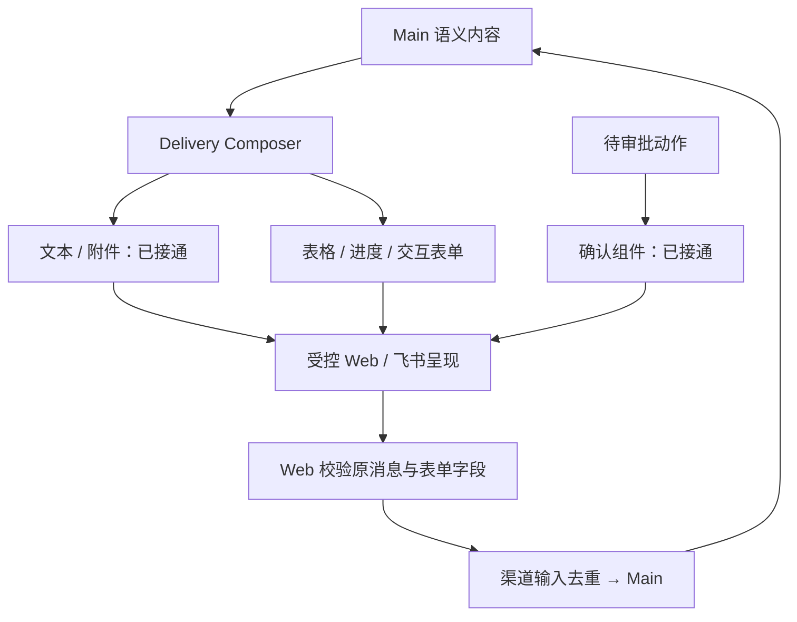

# 受控富 UI 交付：技术方案

[功能与需求](../features/intelligent-ui.md) · [测试方案](../test-plans/intelligent-ui.md) · [主索引](../feature-map.md)

本文的架构与流程描述当前有效实现；明确标记的待实现方案不表示已落地。实现级协议仍服从 [跨功能协议与约束](product-overview.md#contract-0-文档效力与实现规则)。

## 当前架构

Main 保存渠道无关的文字及可选声明式结果块；Delivery Composer 校验结构化数据并产生 UISpec，Web 和飞书仅使用固定组件渲染。表单回答复用现有渠道输入接纳和 Main 调度，不增加任务生命周期、模型路由或审批机制。

## 生成与降级

读取权威语义内容 → 生成 UISpec → 校验版本/组件 → 渲染；未知或失败退回权威文本。新增交互必须有真实提交和去重路径。

Main 的冻结角色指令说明 `steward-result` JSON 围栏格式：`schema_version: 1`、完整的 `fallback` 文字及 `components`。生成端只接受 `markdown`、`table`、`progress`、`form`；不接受 HTML、脚本、动作 URL、审批身份、Artifact 授权或 Host 表单身份。用户消息不被解释为组件。

每块最多 16 个组件，每条回复最多 4 份表单；表单最多 16 个具名、必填文本字段。表格最多 12 列、200 行，列名至多 200 字节，单元格至多 2000 字节；所有列数必须匹配。输入文字块沿用 64 KiB 上限，UISpec 继续保持至多 128 个组件。未知版本、未知字段、坏组件或越界结果整体回退到该块的文字替代；无法读取替代内容时保留原文。渲染端仍使用固定转义模板及 React 组件，不解释模型代码。

`progress` 是模型对已知事实的文字摘要，不能修改 Task 状态、自动推送通知或声明外部动作完成。审批身份只能由原审批流程产生，模型结果块中的伪造确认组件直接降级。

## 表单提交、恢复与兼容

Composer 以原消息身份、组件位置及定义生成稳定的表单标识，只在 Host 投影中附加。Web 提交只携带消息身份、表单身份和字段值；服务端从当前 Conversation 的确切 assistant 消息和权威投影读取问题与字段定义，不接受客户端提供的问题、标签、目标 Run、审批或幂等键。

提交重新验证 Web 绑定、模型就绪状态、字段名称集合、非空值、UTF-8 及长度。回答保存为有序的普通文字 ContentPart，保留字段边界并直接向用户展示问题和答案。`ui-form:` 来源命名空间由该入口保留，通用消息接口不能伪造表单已接受状态。稳定来源键经既有 `channel_source`、`channel_callback` 与 Main 输入在同一事务中接纳：相同回答返回同一回执，修改后重试返回冲突。

GET 仅从已接受的输入读取回答，复制投影后附加已提交状态与原值，不改写冻结的 Delivery 投影、Conversation 或接纳记录。页面更新保留其他表单的草稿和焦点；发送结果不明时保留填写内容，不生成新来源身份。原生 HTML 表单支持无 JavaScript 提交；失败页面显示可复制的草稿。飞书与 TUI 使用可读替代内容，不增加渠道回调动作。

没有数据库迁移、公开 Tool 或任意表单动作。UISpec v1 新字段可选；已有冻结投影保持原表示，旧只读表单不被当作交互表单。新 Main 获得结果格式指引，已接受 Run 的冻结上下文不被热替换。

## 代码与依赖

- [internal/delivery/ui/spec.go](../../internal/delivery/ui/spec.go)
- [internal/delivery/ui/compose.go](../../internal/delivery/ui/compose.go)
- [internal/delivery/ui/forms.go](../../internal/delivery/ui/forms.go)
- [internal/app/ui_forms.go](../../internal/app/ui_forms.go)
- [internal/interaction/web/ui_forms.go](../../internal/interaction/web/ui_forms.go)
- [internal/interaction/web/page.go](../../internal/interaction/web/page.go)
- [web/src/main.tsx](../../web/src/main.tsx)
- [web/src/components/data-table.tsx](../../web/src/components/data-table.tsx)
- [web/src/rich-forms.ts](../../web/src/rich-forms.ts)

## 验证与交付

验收场景、已有入口和剩余覆盖统一在 [测试方案](../test-plans/intelligent-ui.md) 维护。实际执行结果以对应版本的 PR 或 CI 证据为准；架构说明不证明回归或 Live 验证通过。

## 协议、实现与配置约束

本功能协议在此维护。既有编号用于追溯协议，不代表所有设计目标均已实现；完成状态以需求主索引为准。

#### 4.2 统一的渠道无关输出

核心输出链路统一为：

`AssistantMessage + DeliveryRequest + Outbox`

- `AssistantMessage` 保存渠道无关的语义内容。
- `DeliveryRequest` 表达投递目标、交付意图和约束，不承载某个渠道专属的最终消息结构。
- `Outbox` 保证投递的可靠性、重试和幂等。
- `Delivery Adapter` 将统一消息转换为飞书、Web、邮件等渠道格式。
- Main Agent Loop 感知 Agent 人格和当前交互场景。
- Task 的普通进度只更新 Progress Store 和用户主动打开的实时界面，不创建主动通知。
- 主动通知仅由四类语义事件触发：工作完成、工作失败、需要用户输入、需要用户审批。渠道只改变呈现方式，不扩大通知范围。
- 渠道适配层负责长度、排版、卡片、附件和 Intelligent UI 等渠道呈现。
- 工具、Worker 和业务模块不需要理解具体渠道。

Intelligent UI 采用 Delivery 层的声明式组件协议 `UISpec`：

- 一期只提供受控组件集合，例如 Markdown、表格、Artifact 卡片、任务进度、确认卡片和表单。
- Web 可完整渲染；飞书映射为消息卡片；TUI 或不支持的渠道自动降级为文本。
- `UISpec` 带 `schema_version`；未知组件或渲染失败时 fail-soft，降级为语义文本，不阻塞消息投递。
- 一期不允许模型生成或执行任意 HTML、JavaScript、React 代码。
- Main Agent Loop 输出渠道无关的语义结果；Delivery Composer 根据语义内容、结构化数据和渠道能力生成 `UISpec`，Agent 不需要感知具体渠道。
- 后续如需更自由的生成式界面，可增加 `builtin__ui_compose`，产出经过 Schema 校验和安全检查的 `UIArtifact`。

Web/飞书身份绑定、回调规范化、UISpec v1 渲染、冻结路由与不确定投递恢复的实现及操作说明见 [渠道与交付](../features/channels.md)。

Web 展示层复用 ad-agent 的固定 React 组件、OpenIntelligentUI 的原生 DataTable 和 Steward 字标与 Ghost 形象；它们只渲染现有 UISpec 与 Host 表单。组件、资源与许可证随 Go 二进制本地嵌入；不引入第二 Agent/模型路由，也不启用任意模型 HTML/JS。来源与构建验证见 `web/README.md`。
