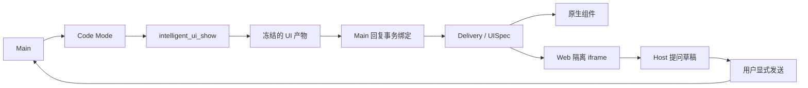

# Intelligent UI：技术方案

[功能与需求](../features/intelligent-ui.md) · [测试方案](../test-plans/intelligent-ui.md) · [主索引](../feature-map.md)

## 当前架构

Main 通过 Code Mode 发现并调用 `builtin__intelligent_ui_show`，先读取内建 `intelligent_ui` Skill。工具接受原生组件或 HTML/CSS/JavaScript 片段，并要求完整文字替代；普通最终回复没有输出 Schema 或 JSON 围栏约束。

原生 DataTable 继续复用 OpenIntelligentUI。自定义答案借鉴其隔离渲染、主题与受控消息桥接方式，适配 Steward 的工具执行和持久交付。没有接入上游 Python Agent、模型路由或 CopilotKit/AG-UI 传输。TRAE 的专用 Widget 工具与按需 Skill 分工是方法参考；第三方 Skill 镜像不是其完整官方实现。

## 工具与 Skill

`ui_present` 是受信任的 Main 专属本地呈现权限；Worker 的冻结权限不包含它。工具仍经通用接纳、参数校验、fencing、调用记录与结果提交，不能作为审批、Artifact 授权或外部写入的旁路。模型只声明 Code Mode。

参数为 `title`、`fallback`，以及二选一的 `components` 或 `html`（可附 `css`、`javascript`）。原生组件支持 markdown/table/progress/form，拒绝模型提供的审批、消息或表单身份。自定义代码不在 Code Mode 或 Go Host 执行；工具只保存展示产物。成功回执返回 `ui_ref` 与 `staged`，不表示已经送达。

内建 Skill 与参考资源随二进制嵌入、按内容版本冻结，复用 skill list/view 接口。配置目录不能覆盖 `intelligent_ui`。Skill 解释何时使用、模板选择、主题、数据依据与交互，不扩大工具权限。

## 持久化与交付

state schema 43 的 `ui_widget` 以工具 invocation 为唯一身份保存不可变输入。重放复用同一行。Main 回复准备事务把已成功、未绑定的产物关联到确切消息，并加入文字替代；失败、取消或尚未成功的调用不会发布。Delivery 冻结 UISpec，GET 只读组装或读取投影，不创建新产物。

每个 Run 待绑定产物最多 16 个；每份原生定义最多 16 个组件、4 个表单。宿主根据消息与组件位置生成表单身份。组件限制、输入字节与 Sandbox 规则由 Host 校验，不依赖模型遵循 Skill。

## Web 隔离与交互

自定义答案用 `sandbox="allow-scripts"` iframe，拒绝 same-origin、弹窗、顶层导航和表单提交权限。Widget URL 本身也带 CSP sandbox，即使直接打开仍是隔离文档。CSP 禁止外部资源、fetch/XHR/WebSocket、子框架与表单动作；摄像头、麦克风、定位与剪贴板权限关闭。父页面只允许同源 frame URL。

宿主只接受来源为该 iframe Window、opaque origin 和固定协议标识的消息。高度有界，主题由 Host 设置，异常与超时显示文字替代。渲染代码与消息代码不具有父 DOM、存储或凭据访问权。

`steward.sendPrompt({text})` 只能提出有界文字，出现在 Host 自己的可编辑草稿中；用户按 Send to Ghost 后才通过普通消息接纳入口发送。重试沿用来源键；选项与滑块默认本地运行，不能自动授权工具或传回整个沙箱状态。原生表单继续按确切消息、冻结字段和回答去重，支持无 JavaScript 提交。

## 升级与完成判定

旧 `steward-result` 文本协议不再解析，普通文字不会产生组件。不热改旧快照，不为旧多段 Prompt 提供恢复分支；升级前结束或取消旧执行，使用新 Run。保留历史数据，不重写已接受请求或不可变投影。新 schema 数据库不能由旧二进制打开。

UI 是用户交付而非 Task 完成证明。进度只是已知事实摘要；表单和 Widget 提问均不批准外部动作。非 Web 渠道和无脚本页面保留语义替代。真实模型的工具选择、审美和数据解释质量需独立评测。

## 代码与依赖

- [UI 工具和契约](../../internal/delivery/ui/widget.go)
- [持久化与消息绑定](../../internal/agent/sqlite/ui_widgets.go)
- [Web Sandbox](../../internal/interaction/web/widgets.go)
- [React Widget](../../web/src/widgets.tsx)
- [内建 Skill](../../internal/skill/builtin/intelligent_ui/SKILL.md)
- [系统回归](../../tests/system/verify_intelligent_ui.py)

#### 4.2 统一的渠道无关输出

Main 的语义文字、UI 工具的展示产物与完整文字替代通过同一 Conversation/Delivery 生命周期交付。Web 提供原生组件与隔离交互，飞书与 TUI 保留可读替代；具体外部动作继续使用原审批管线。
