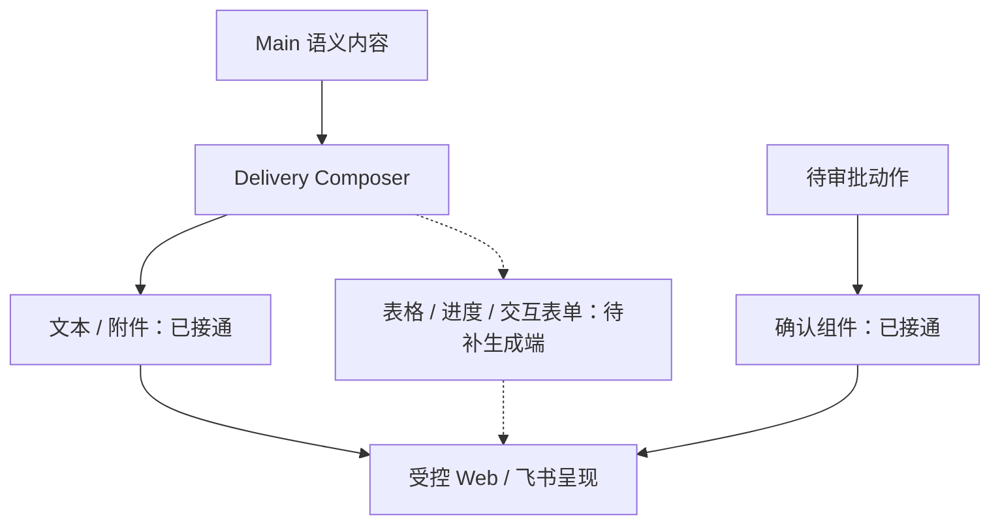

# 受控富 UI 交付：技术方案

[功能与需求](../features/intelligent-ui.md) · [测试方案](../test-plans/intelligent-ui.md) · [主索引](../feature-map.md)

最近核对：2026-10-28。本文的架构与流程描述当前有效实现；明确标记的待实现方案不表示已落地。实现级协议仍服从 [跨功能协议与约束](product-overview.md#contract-0-文档效力与实现规则)。

## 当前架构

Main 保存渠道无关内容；Delivery Composer 产生 UISpec；Web 和飞书仅使用固定组件渲染。当前缺少普通结构化结果的组件选择与映射。

## 当前流程与目标差异

读取权威语义内容 → 生成 UISpec → 校验版本/组件 → 渲染；未知或失败退回权威文本。新增交互必须有真实提交和去重路径。

- **F-021**：组件 Schema 与渲染器已实现，审批有生成路径；普通 Compose 只产生 markdown/Artifact，form 当前为只读字段展示。 补结构化结果到表格/进度/表单的生成映射；交互表单需定义提交与恢复语义。

## 代码与依赖

- [internal/delivery/ui/spec.go](../../internal/delivery/ui/spec.go)
- [internal/interaction/web/page.go](../../internal/interaction/web/page.go)
- [web/src/main.tsx](../../web/src/main.tsx)
- [web/src/components/data-table.tsx](../../web/src/components/data-table.tsx)

## 验证与交付

验收场景、已有入口和剩余覆盖统一在 [测试方案](../test-plans/intelligent-ui.md) 维护。本次建档未执行本功能的回归或 Live 验证，不以架构图替代运行证据。

## 协议、实现与配置约束

迁入内容按职责归属在此维护。既有编号用于追溯协议，不代表所有设计目标均已实现；完成状态以需求主索引为准。

#### 4.2 统一的渠道无关输出

核心输出链路统一为：

`AssistantMessage + DeliveryRequest + Outbox`

- `AssistantMessage` 保存渠道无关的语义内容。
- `DeliveryRequest` 表达投递目标、交付意图和约束，不承载某个渠道专属的最终消息结构。
- `Outbox` 保证投递的可靠性、重试和幂等。
- `Delivery Adapter` 将统一消息转换为飞书、Web、邮件等渠道格式。
- Main Agent Loop 感知 Agent 人格和当前交互场景。
- Task 的普通进度只更新 Progress Store 和用户主动打开的实时界面，不创建主动通知。
- 主动通知仅由四类语义事件触发：工作完成、工作失败、需要用户输入、需要用户审批。渠道只改变呈现方式，不扩大通知范围。
- 渠道适配层负责长度、排版、卡片、附件和 Intelligent UI 等渠道呈现。
- 工具、Worker 和业务模块不需要理解具体渠道。

Intelligent UI 采用 Delivery 层的声明式组件协议 `UISpec`：

- 一期只提供受控组件集合，例如 Markdown、表格、Artifact 卡片、任务进度、确认卡片和表单。
- Web 可完整渲染；飞书映射为消息卡片；TUI 或不支持的渠道自动降级为文本。
- `UISpec` 带 `schema_version`；未知组件或渲染失败时 fail-soft，降级为语义文本，不阻塞消息投递。
- 一期不允许模型生成或执行任意 HTML、JavaScript、React 代码。
- Main Agent Loop 输出渠道无关的语义结果；Delivery Composer 根据语义内容、结构化数据和渠道能力生成 `UISpec`，Agent 不需要感知具体渠道。
- 后续如需更自由的生成式界面，可增加 `builtin__ui_compose`，产出经过 Schema 校验和安全检查的 `UIArtifact`。

Web/飞书身份绑定、回调规范化、UISpec v1 渲染、冻结路由与不确定投递恢复的实现及操作说明见 [渠道与交付](../features/channels.md)。

Web 展示层复用 ad-agent 的固定 React 组件、OpenIntelligentUI 的原生 DataTable 和 Collie 边牧品牌资产；它们只渲染现有 UISpec 与 Host 表单。组件、资源与许可证随 Go 二进制本地嵌入；不引入第二 Agent/模型路由，也不启用任意模型 HTML/JS。来源与构建验证见 `web/README.md`。

## Changelog

2026-10-28：按统一文档结构迁入本功能的协议与历史决策，更新引用并移除旧文件；此为文档归属调整，不改变运行时协议。

本节追加记录每次架构/流程取舍。旧图不保留在正文；历史正式决定保留在本节。首次记录为现状建档，不推断历史决策日期。

| 日期 | 类型 | 决策与理由 | 取舍及影响 | 关联 |
| --- | --- | --- | --- | --- |
| 2026-10-28 | 现状建档 | 保留声明式 UISpec 和固定组件，避免任意模型 HTML/JS。渲染能力与内容生成、交互提交分别验收。 | 明确当前边界与待补齐链路；本次仅建立文档，未修改运行时。 | [跨功能契约](product-overview.md#contract-0-文档效力与实现规则) |

后续记录需包含实际比较过的选项、采用理由、兼容/迁移影响和相关需求或 PR；未决建议不能写成已实施决策。
