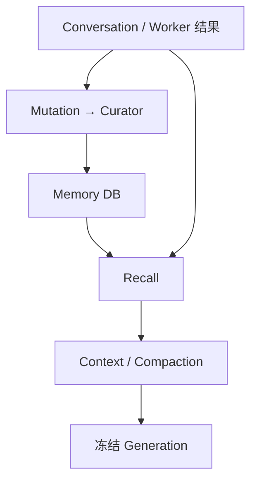

# 长期记忆、召回与上下文：技术方案

[功能与需求](../features/memory-context.md) · [测试方案](../test-plans/memory-context.md) · [主索引](../feature-map.md)

最近核对：2026-10-28。本文的架构与流程描述当前有效实现；明确标记的待实现方案不表示已落地。实现级协议仍服从 [跨功能协议与约束](product-overview.md#contract-0-文档效力与实现规则)。

## 当前架构

Conversation 与 Memory 分库。Curator 串行处理持久 Mutation；Recall 并行查询两路证据；Context builder 在模型 admission 前压缩，按轮冻结。



### 加密召回的工作索引（F-039）

每个 Memory Store 最多保留一个授权作用域的内存 SQLite 工作索引，禁用落盘 temp。每次查询按当前可访问记录增量同步；未变化文档复用向量，只对新增/变化文档生成 embedding。切换作用域、Forget、重新配置 vault 或关闭 Store 清除工作索引。索引变更串行，等待可由 context 取消；embedding 调用不持索引锁，不阻塞其他 Run 的检索。隐私修改关闭旧工作索引，使尚未完成的旧视图检索失败关闭。持久库不保存解密内容或这些向量，选定 embedding 仍须为 loopback。

召回不可用保留其独立错误分类并阻止未冻结的请求派发，不伪装为 state.db 错误。原有逐轮证据冻结、隐私 epoch 和 provider 一致性检查继续生效。

## 当前流程与目标差异

观察或显式记忆请求 → 保存事件 → Curator 提取归并 → 后续轮次召回 → 压缩 → 冻结模型请求。Forget 先建立隐私屏障，再异步维护记录。

- **F-009**：remember/forget、隐私屏障、后台维护已实现；提取与稳定性判定采用规则，归并主要按指纹。 补语义去重、冲突识别和过时信息维护；保留证据与隐私边界，不将模型推测直接升级为事实。
- **F-010**：显式 embedding 配置下，全文与向量结果融合；召回结果按轮冻结并带来源。 未配置 embedding 时不可用；不宣称大规模 ANN 性能或中文语义质量已验证。
- **F-011**：新 Run 已接通结构化模型摘要、工作状态、私有原文 Artifact 和逐轮冻结；目标与未知操作保留原文。真实模型的约束保留质量仍需离线验证；不得改写原文或旧 Run 的冻结请求。

## 代码与依赖

- [internal/memory/curator.go](../../internal/memory/curator.go)
- [internal/memory/sqlite/curator.go](../../internal/memory/sqlite/curator.go)
- [internal/agent/sqlite/memory.go](../../internal/agent/sqlite/memory.go)
- [internal/agent/sqlite/recall.go](../../internal/agent/sqlite/recall.go)
- [internal/recall/sqliteindex/index.go](../../internal/recall/sqliteindex/index.go)
- [internal/context/compact.go](../../internal/context/compact.go)
- [internal/agent/sqlite/compaction.go](../../internal/agent/sqlite/compaction.go)
- [internal/agent/context.go](../../internal/agent/context.go)
- [internal/prompt/prompts.go](../../internal/prompt/prompts.go)
- [internal/context/working.go](../../internal/context/working.go)
- [internal/agent/sqlite/context.go](../../internal/agent/sqlite/context.go)
- [internal/agent/sqlite/handoff.go](../../internal/agent/sqlite/handoff.go)

## 验证与交付

验收场景、已有入口和剩余覆盖统一在 [测试方案](../test-plans/memory-context.md) 维护。本次建档未执行本功能的回归或 Live 验证，不以架构图替代运行证据。

## 协议、实现与配置约束

迁入内容按职责归属在此维护。既有编号用于追溯协议，不代表所有设计目标均已实现；完成状态以需求主索引为准。

<a id="contract-10-conversation-上下文与-compaction"></a>

### 10. Conversation 上下文与 Compaction

<a id="contract-101-数据职责"></a>

#### 10.1 数据职责

- Conversation 是用户与 Agent 沟通的权威原始记录。
- RunTrace 保存模型推理过程需要的工具调用、工具返回、错误和运行事件。
- 用于模型的 Context 是从 Conversation、Memory、Skill 和 Run 状态动态组装的工作集，不等于完整存储。

<a id="contract-102-分级压缩"></a>

#### 10.2 分级压缩

主对话和 Worker 内部上下文都使用同一套分级压缩原则：

1. 根据比例阈值、冻结输出上限和传输预算选择工作集；当前 Task anchor、当前输入及未知外部操作保持完整。历史图片像素单独选择最新八张不同图片，原始引用仍保留。
2. 对超出预算的旧消息按完整工具交换分批生成工作摘要：目标、约束、进度、未知效果、决策、下一步、关键证据。摘要使用同一模型和同一 Agent Loop 的工具关闭轮次，并经过相同的费用、凭据、取消与重放裁决。
3. 原始 Conversation/checkpoint 不修改；被总结的原文保存为 Run 私有 Artifact，可通过已有 Artifact 工具读取。摘要和读取引用进入 runtime 工作状态；摘要流式文本不会交付用户。

Compaction 触发条件统一为：

```text
context_tokens > context_window * threshold_percentage
```

不使用固定的 `context_window - reserve_tokens` 作为唯一触发规则。

<a id="contract-103-召回与-prompt-cache"></a>

#### 10.3 召回与 Prompt Cache

- 每一轮同时执行 `Memory 召回` 与 `Conversation 召回`。
- 两路召回并行、分别排序，再在统一上下文预算下合并。
- 本轮召回结果冻结，避免 Agent Loop 中途改变上下文。
- 用户于 2026-10-18 确认：Forget 覆盖未完成 Run。可靠接受 Forget 时提交隐私 epoch，撤销旧上下文的后续 dispatch、模型结果接受及重放；旧快照仅保留作审计，不原地改写。首版保守停止同 Agent 作用域全部未完成 Run，新的自动上下文不导入撤销点之前的证据。详见 ADR 003 与 `docs/features/memory-context.md`。
- 撤销点之后接受的新输入归属新的排队 Main，保留不可变回执；旧 Main owner join 或租约失效并完成 stop settlement 后，才允许调度或 Claim 后继 Run。同内容的新显式 remember 保留独立的新来源与时间戳，不能因去重而继续指向撤销点之前的证据。
- System Prompt、人格、规则和 Core Memory 尽量保持静态。
- 动态召回内容放在 Prompt 后部，以减少对 Prompt Cache 的破坏。

<a id="contract-11-memory-与-conversation"></a>

### 11. Memory 与 Conversation

<a id="contract-111-边界"></a>

#### 11.1 边界

| 组件 | 职责 | 特性 |
|---|---|---|
| Conversation | 保存用户与 Agent 的原始沟通证据 | 权威、可审计、以追加为主 |
| Memory | 保存从历史中提炼出的长期状态 | 派生、可合并、可替代、可遗忘 |

分类原则：

| 信息 | 存储位置 |
|---|---|
| 用户偏好、事实、关系、稳定决策 | Memory |
| 可复用方法、工作流、经验 | Skill |
| 安全规则与审批要求 | SecurityPolicy |
| 持续工作的状态与进度 | Task |
| 工具步骤、错误和原始结果 | RunTrace |
| 用户与 Agent 的原始消息 | Conversation |

完整工具轨迹不写入 Memory。

<a id="contract-112-可插拔接口"></a>

#### 11.2 可插拔接口

对业务层只暴露两个 Provider：

```text
MemoryProvider
ConversationProvider
```

- Store、Index、Recall 是各 Provider 内部可替换的实现部分，不拆成六个公共接口。
- 一期每个组件只选择一个 Provider，不设计运行时热切换、双写或通用迁移层。
- 将来更换 Provider 时通过一次性迁移工具完成。

<a id="contract-113-一期存储"></a>

#### 11.3 一期存储

Memory 与 Conversation 分别存储：

```text
memory.db
conversation.db
```

- 两者均以 SQLite 保存权威数据。
- 各自维护 FTS 与向量索引。
- 召回使用 FTS5 与向量搜索并行，再通过 RRF 融合。
- Memory 与 Conversation 使用各自的领域排序逻辑。
- Provider 故障采用 fail-closed，不静默切换到未知或降级的数据源。

<a id="contract-114-memory-数据模型"></a>

#### 11.4 Memory 数据模型

Memory 支持用户级和 Agent 级作用域，以及 Core/Recall 两级：

```ts
interface MemoryRecord {
  memory_id: string;
  scope_type: "user" | "agent";
  scope_id: string;
  tier: "core" | "recall";
  content: string;
  source_refs: SourceRef[];
  supersedes_memory_id?: string;
  created_at: Timestamp;
  deleted_at?: Timestamp;
}
```

- `core` 用于稳定且高频需要的关键信息。
- `recall` 用于按需搜索的长期信息。
- 修正不覆盖原记录，而是创建新记录并通过 `supersedes_memory_id` 建立替代关系。

<a id="contract-115-memory-召回工具"></a>

#### 11.5 Memory 召回工具

Agent 只使用一个统一搜索工具：

```text
builtin__memory_search
```

该工具内部同时搜索 MemoryProvider 与 ConversationProvider，Agent 不选择数据源。工具始终可发现；未配置显式 embedding 时，描述说明配置要求，调用返回 `PROVIDER_UNAVAILABLE`，不触发自动召回或隐式 Provider。已配置的 Run 仍冻结 embedding 身份并对漂移 fail-closed。

输入：

```text
query
limit?
time_range?
```

输出：

```text
content
source_type
source_ref
occurred_at
author_role?
```

相关性分数仅供系统内部排序，不暴露给 Agent。

<a id="contract-116-memory-写入与维护"></a>

#### 11.6 Memory 写入与维护

ERII-23 实现与配置：`docs/features/memory-context.md`。可信本地 Experience Reviewer 使用 `skill manage` 完成候选、验证、晋升与退役；普通 Main/Worker 不获得 Skill 修改能力。

显式管理工具：

```text
builtin__memory_manage
```

支持：

```text
remember
forget
```

- Agent Loop 不直接写 Memory 数据库，只提交 Memory Mutation Event。
- Root 与 Child Worker 都可以在当前用户与 Agent 作用域内调用只读 `memory_search`，统一检索长期 Memory 与 Conversation 历史；检索内容按需进入各自 Run Context，不自动复制完整历史，也不在 Run 之间同步检索结果。
- Worker 不直接提交长期 Memory 写入。Conversation、Root/Child Run、Task 结果和用户反馈都进入统一 Memory 提取管线，由后台 Curator 无感完成证据判断、去重、冲突合并与持久化，避免并行 Child 重复或相互覆盖。
- 后台 Memory Curator 串行合并事件，处理去重、冲突、替代和遗忘。
- Curator 是机器审核与归并流程，不是人工审批。
- Memory 默认无感形成：后台自动观察 Conversation、Task 结果和用户反馈，异步提取、归并、降级与淘汰，不阻塞当前回复，也不为单条记忆请求用户确认。
- 用户偏好、身份事实、关系和长期承诺在证据足够时自动写入；不因为信息敏感而弹出确认。敏感 Memory 使用更严格的本地加密、作用域、召回与日志脱敏策略。
- 凭据、访问令牌、支付密钥等 Secret 不进入语义 Memory；需要保存时进入独立 Secret Store。这是存储边界，不是记忆确认流程。
- 模糊推断先进入低置信 Recall，只有稳定、重复或被后续行为验证的信息才提升为 Core，避免一次随口表达永久改变 Agent 行为。
- Main 始终能发现 `builtin__memory_manage`；未配置 `memory.encryption_key_ref` 时描述说明要求，调用返回 `PROVIDER_UNAVAILABLE`，不排队 Mutation、不声称接受、不改变隐私 epoch。Root/Child 不获得该工具。
- 显式 remember/forget 只同步到事件被可靠写入，后续由 Curator 异步重试直至合并。
- `remember/forget` 是用户主动覆盖、纠错和删除记忆的控制入口，不是普通 Memory 写入的必经路径。
- Memory 维护、晋升、淘汰及其暂时性失败默认不告知用户，只进入内部可观测性系统；用户可随时查询、更正、删除或要求“不再记住”某类信息。
- Memory 写入不属于副作用审批。Security Approval 只约束发送、购买、删除、发布等外部动作，不能复用来打断后台记忆维护。

<a id="recall-durable-context-recall-erii-22"></a>

## Durable context recall (ERII-22)

Main, Root and Child use the same read-only `builtin__memory_search` Tool and
ToolInvocation executor. The Host supplies the local user and Run's Agent identity.
Arguments cannot choose an owner, Agent, provider or database. Worker capability
reductions retain read-only recall and grant no Memory mutation capability.

<a id="recall-authority-and-indexing"></a>

### Authority and indexing

| Database | Version | Authority / derived data |
| --- | --- | --- |
| `state.db` | 20 | Run/Tool ledgers; immutable recall snapshots; queued Main successor admission fence |
| `conversation.db` | 3 | Immutable original messages, monotonic sequences, frozen ownership; derived FTS5/vectors |
| `memory.db` | 2 | Facts, evidence references, supersession links, tombstones; derived FTS5/vectors |

Files use the absolute data root, private permissions and WAL. Forward migrations
are transactional and reject future schemas. The populated Conversation v1 upgrade
indexes text without rewriting original JSON, IDs, timestamps or sequences.
Existing local Conversation IDs are Agent identities and migrate to local-user
ownership. New channels bind authenticated Conversation ownership before append;
rebinding fails.

Memory.Apply is a trusted Curator boundary. It atomically saves an immutable record,
evidence and index document. Identical duplicate IDs are harmless; changed payloads
conflict. Supersession replaces only an active record in the same user and exact
scope. Competing corrections permit one successor. Forget retains a tombstone and
excludes the whole supersession lineage from retrieval. Neither storage operation changes
Conversation evidence. Explicit local history retains originals. The public Forget
control additionally applies the privacy barrier before future automatic retrieval;
see ADR 003. Automatic extraction, remember/forget and compaction are described in
[maintenance operations](../features/memory-context.md). Explicit Forget also establishes
a privacy barrier over unfinished context; immutable audit is retained.

The chosen vector adapter stores dense vectors in SQLite
`recall_document.vector_json`, partitions by authorized scope/visibility/time using
a B-tree, and exhaustively ranks that partition by cosine in Go. It adds no native
extension or production dependency. This is exact vector search, with linear cost;
it makes no ANN or sublinear-performance claim. Measure large corpora before
increasing limits. SQLite FTS5 uses unicode61/BM25. unicode61 does not segment CJK
substrings; the configured model supplies semantic recall.

Authoritative writes atomically commit text and FTS. NULL vectors are recoverable
derived work. Media-only entries retain original Artifact references but are
excluded from text search; no empty embedding request can block other recall.
Search first embeds authorized missing records and installs each
vector atomically. A crash may leave some indexed records; it never produces
partial successful recall. Both candidate paths read one coherent database
snapshot. A concurrent, not-yet-indexed append fails that search closed; a later
caller can retry. Each database pins one embedding identity. Replacing it requires
stopping execution, backing up the three databases, clearing only derived vector
columns and `recall_configuration` in an offline transaction, and configuring new
Runs. Originals remain intact; there is no online mixing or hot migration.

A valid multipart original can exceed the embedding adapter's 64 KiB per-request
bound. Derived indexing splits it at UTF-8 boundaries into requests of at most
64 KiB and pools normalized vectors by chunk byte length into one document vector.
Every byte is embedded; full FTS text and the original source reference remain.
Exactly cancelling vectors use the first valid chunk vector as a deterministic
fallback. No vector is saved until all chunks succeed. Pending v2 documents and
v1 migration use this same path without rewriting originals or changing schemas;
already indexed short documents retain their vectors. This document-level pooling
does not provide passage ranking. Large hits still obey the existing output budget.

<a id="recall-ranking-budget-and-recovery"></a>

### Ranking, budget and recovery

Each Provider runs FTS5 and vector ranking concurrently. Owner, Agent, visibility
and inclusive time filters apply before candidate selection. Vector candidates
require cosine >= 0.25; each path supplies at most 200 candidates. RRF is
`sum(1/(60+rank))`, starting at rank one. Memory breaks equal fused scores by Core
tier, recent timestamp and stable reference. Conversation breaks ties by recent
timestamp and stable reference. The Service queries both Providers concurrently,
alternating their domain-ranked lists under one count and serialized evidence
budget. Scores remain private to each Provider.

Tool input is `query`, optional `limit` (1–50, default 10), and optional
`time_range: {start?, end?}` using RFC3339. Output contains only `content`,
`source_type`, `source_ref`, `occurred_at`, optional `author_role`. Invalid arguments
return INVALID_ARGUMENT; provider/index faults return PROVIDER_UNAVAILABLE without
partial output. The Tool is read-only, needs no approval, and reuses the existing
ToolInvocation replay/result pipeline.

For each model turn, each Run independently queries its latest explicit user/Task
input. Root and Child never copy Parent prompt state or search results. Recall
freezes in `run_recall` before model admission with claim/epoch and version checks.
Restart uses those exact hits; new turns query the current corpus. Execution
cancellation interrupts pending recall and admits no partial/frozen model turn.
Evidence is
untrusted runtime data in a dynamic suffix, preserving the static system/identity
prefix. It never becomes a user-authored Conversation message. The suffix uses at
most one quarter of the remaining conservative byte budget, capped at 16 KiB;
hierarchical compaction and the final model-window check also apply; see maintenance operations.

Automatic extraction conservatively retains bounded first-person reports from
user Conversation. Attributed Worker results use `User reported: ...`; untrusted
Worker material never counts toward Core promotion. Questions, long logs and
credential-bearing input are excluded. Exploratory and transient statements stay
Recall. Identical independent user evidence can promote a stable statement after
three sources. Explicit remember can establish Core, but exploratory language
remains Recall. Corrections create immutable successors; competing successors
conflict. This deterministic extractor preserves reports rather than inventing
diagnoses or certainty; it is not a general semantic fact normalizer.

With maintenance enabled, every derived Memory record is encrypted with AES-GCM
bound to record identity and scope; deduplication uses keyed hashes. This avoids
relying on a heuristic sensitivity classifier for storage protection. Persistent
FTS/vector tables contain no private plaintext. Authorized retrieval decrypts a
scoped working set into an in-memory SQLite index with temporary files disabled,
then uses the same FTS5/vector RRF adapter and the selected local embedding
provider. Encrypted Memory requires a literal loopback embedding endpoint; remote
embedding fails closed before any private input is sent. Existing remote-only
recall installations without maintenance keep their configured provider.

Existing Memory is sealed before enabling the configured maintenance provider;
derived FTS is rebuilt and old database/WAL pages are cleaned. A persisted cleanup
marker resumes cleanup after a crash. Original Conversation and frozen Run audit
records retain their existing private-file storage policy; this is not full disk
encryption. Back up all three databases together with the credential-store key.
The private working index is reused within one authorized scope and reconciled
incrementally. Scope switches, Forget, vault reconfiguration and Close discard
it. Unchanged records retain their vectors; no private vectors are persisted.

Forget follows [ADR 003](#decision-003-forget-revokes-unfinished-context). It
revokes unfinished context at acceptance, before asynchronous tombstones apply.
It deliberately stops every unfinished Run in the Agent scope and prevents old
automatic context from being imported into new Runs. Older Tasks are hidden from
model search and append is denied; a fresh self-contained Task can use new
independent input. Immutable audit remains.
Fresh chat input accepted while the revoked Main is stopping binds to a separate
queued Main and keeps that receipt on retries. Its execution waits for the old
owner to join or expire and settle. A fresh explicit remember of identical content
creates a successor with its own timestamp and source, so unrelated Forget does
not hide the newly supplied evidence. Old evidence remains excluded. State schema
20 migrates the Main admission index without rewriting stored input or snapshots;
all processes sharing the data root must use the current binary after migration.
An explicit Forget issued by a Main Tool can stop that Main before another model
reply; the durable receipt is visible through the control/status boundary.

Context uses a conservative three-UTF-8-byte token estimate, the configured
percentage threshold, the frozen output ceiling and a 384-KiB text/Tool envelope.
Host provenance counts toward that transport envelope, not model tokens. Recall
receives at most a quarter of the space remaining after required inputs and Tools,
capped at 16 KiB. The remaining Bridge frame space accommodates selected images.
Irreducible required input fails explicitly; a provider context-length
rejection still gets one Loop retry at a lower threshold with the same snapshot and at most four image previews on that retry.

New Run checkpoints carry context version 2. Historical version-0 Runs retain the
existing bounded-excerpt path and already frozen requests; their compaction policy
hashes are unchanged. Children inherit their Parent's context version and policy.
State schema 27 guards immutable context versions and working-state boundaries;
existing checkpoints and accepted generations are not rewritten. All processes
sharing the data root must upgrade together; older binaries reject schema 27 on
startup. New Root
Runs use the current assembly while preserving Task epochs and role reductions.

后续工具命名升级独立于 context version：state schema 28 保留旧上下文与已接受请求，但旧工具快照不被静默重命名，执行兼容要求见[工具升级说明](tools-approvals.md#decision-005-compatibility-and-upgrade)。

### 当前上下文装配与业务接续

- 内置文案放在 `internal/prompt/system/`、`internal/prompt/capability/`、`internal/prompt/summary/` 的 Markdown 文件中，通过 `go:embed` 编入二进制；`internal/prompt` 只提供文案与摘要目标字节数替换。角色选择、冻结能力判断、顺序、消息边界和动态证据继续由装配代码负责。
- Markdown 使用 UTF-8，Git 属性固定 LF；载入时仅移除单个文件末尾 LF，保留段落、空格和消息边界。修改这些资产需重新构建，只影响新生成的上下文；旧 Run 与已接受请求仍读取各自冻结记录。资源不依赖启动目录，不增加外部 prompt 配置或热加载入口。
- `internal/agent/context.go` 是唯一初始装配入口。Main 使用 safety + Main 规则；Root 使用 safety + 精简身份 + Worker 规则；Child 使用 safety + Worker 规则。之后追加执行原则、冻结能力对应的操作指导、作用域项目指令和 Skill 索引。
- Skill 索引进入 Capability Snapshot 的 Host prompt metadata；provider Tool schema 仅包含名称、描述与输入 schema。项目 AGENTS.md 通过执行环境的 builtin__read 按需读取，不读取宿主 cwd。恢复旧 Run 时保留已冻结上下文和原工具结果，不用当前文件覆盖它。项目和 Skill 指令不能扩大权限或授予审批。
- Root 的 Task 正文和显式 Artifact 引用是一个受保护的逻辑输入。Child 只接收显式子任务和引用，以及从 Parent 冻结的共享规则；不复制聊天、Task 历史或 Parent 的工作状态。
- 新 Main 从 Conversation 载入语义历史，并交接最近 Main 的工作摘要和可见顶层工具回执；私有摘要原文仅通过显式 Run grant 传递。Forget 屏障之前的执行内容不进入这条交接路径。
- Task 续跑接收旧 Root 最终业务结果、Root 可见的顶层工具输出和历史指令；最终答复已接受但 report 尚未提交时，仍保留该答复，排除内部压缩摘要。不汇总 Child 的模型响应、内部工具轨迹或 Code Mode 未输出内容。整棵 Task 树中结果未知的效果以 Host 状态保留，不披露 Child 参数。
- 生成前执行消息投影、按轮召回、工作集选择与冻结。工作摘要继续是有来源的 runtime user 消息；模型生成的摘要不写入长期 Memory，也不成为安全策略。
- 需要总结时，该轮只提供专用总结 system prompt、序列化证据和保留任务事实，不声明 Tools。结果提交后推进同一个 Run 的 step，更新 `working_state`，继续业务推理；已接受结果在故障恢复时复用。
- `summary_bytes` 是摘要目标；模型结果上限为 `max(4096, summary_bytes × 4)`，最多 64 KiB。被截断、空白、超限或要求调用工具的摘要不能成为工作状态。语义质量不由确定性测试证明。

## Changelog

2026-10-28：将内置角色、能力指导与摘要指令迁入嵌入式 Markdown 产品资产，便于独立审阅和迭代；保留 Go 中的装配与权限判断。相较运行时加载外部文件，`go:embed` 保持单二进制部署和显式升级；本次完整消息与摘要请求逐字节不变，不引入 schema、配置或冻结请求迁移。

2026-10-28：F-003/F-004/F-006/F-011/F-022 上下文治理。借鉴 Pi 的分区装配和工作摘要；保留 Erii 的 Main/Worker、Task epoch、显式交接、冻结能力、费用与重放边界。相较汇总整棵树，改用 Root 可见业务输出和 Host 未知效果；相较纯摘录，新 Run 使用同模型的工具关闭摘要轮次。state schema 27 校验 context version 和工作状态边界；旧 checkpoint 及已接受请求保持原实现与 hash，新 context version 不回填旧 Run，所有进程需统一升级。

2026-10-28：测试入口随当前 Makefile/runner 对齐。旧说明中的 make verify、Delivery/security 分片与自动五轮是历史调度；当前默认单次，重复次数通过 runner --repeat 显式指定。保留机制验收要求。

2026-10-28：按统一文档结构迁入本功能的协议与历史决策，更新引用并移除旧文件；此为文档归属调整，不改变运行时协议。

本节追加记录每次架构/流程取舍。旧图不保留在正文；历史正式决定保留在本节。首次记录为现状建档，不推断历史决策日期。

| 日期 | 类型 | 决策与理由 | 取舍及影响 | 关联 |
| --- | --- | --- | --- | --- |
| 2026-10-28 | F-039：同作用域复用仅在内存的索引，增量补充向量并在隐私边界清除。 | 相较逐次重建减少重复本地模型调用；内存中明文寿命延长到作用域切换/Forget/关闭，仍不落盘，进程内隐私互斥。 |
| 2026-10-28 | 现状建档 | 沿用分库、证据来源和冻结召回；语义能力不足需单独补齐，不把摘录当成完整语义摘要。Forget 保留原始审计，但阻止旧上下文继续执行。 | 明确当前边界与待补齐链路；本次仅建立文档，未修改运行时。 | [003-memory-forget-revokes-unfinished-context.md](#decision-003-forget-revokes-unfinished-context) |

后续记录需包含实际比较过的选项、采用理由、兼容/迁移影响和相关需求或 PR；未决建议不能写成已实施决策。

### 历史决策与演进记录

以下正文保留原决定、理由、兼容影响和当时证明范围，不作为当前完成声明。原记录中旧目录布局与旧验证命令属于历史上下文；现行入口以功能说明、当前架构及产品测试方案为准。

<a id="decision-003-forget-revokes-unfinished-context"></a>

## Forget revokes unfinished context

Accepted for ERII-23 on 2026-10-18 by the project owner: “选择 A：Forget 应覆盖未完成 Run；审计记录可以保留，但被忘记内容不得继续进入模型上下文”.

A durable Forget intent is a privacy barrier. It takes precedence over reusing
frozen recall, compacted context and completed recall calls in unfinished work.
The Host retains immutable requests/results as audit evidence. It never changes
a frozen request, snapshot, CodeCall argument hash or internal call key to remove
content in place.

The initial implementation invalidates all unfinished Runs in the same Agent
scope. Semantic dependencies can exist in copied Tool results, Child results and
summaries; checking only the latest `run_recall` row would miss them. A monotonically
increasing privacy epoch is committed with the accepted mutation. Business writes,
model-result acceptance and Code Mode callbacks must match the epoch frozen at
Run creation. Existing stop recovery joins live owners, stops descendants before
parents, and preserves uncertain effects as `unknown`. Task status remains intact.
The Host does not revive an old Run or retry an unknown effect.

Provider dispatch holds a short state transaction while writing its request
frame. Forget acceptance and request dispatch therefore have a serialized order
across local processes. A request already dispatched cannot be withdrawn from a
provider; its late result is rejected after revocation. A queued request cannot
dispatch after the barrier. This does not claim erasure from an external model.

New Runs do not automatically import Conversation or recall evidence from before
the scope's barrier. This intentionally conservative rule also excludes unrelated
older context from automatic assembly. Originals remain available in explicit
local history/audit; a user can provide fresh independent evidence or remember
again. Older Tasks are excluded from model Task search and cannot append/create a new
Root across the barrier. The user can create a fresh Task with independent current
input. This prevents old anchors/instructions from silently reintroducing revoked
material.

Input accepted after the barrier owns a new queued Main with its own frozen
snapshots and immutable receipt. It never joins the revoked Main. Both scheduler
and direct Claim wait for revoked Main owners to join or expire and settle before
executing the successor. A later Forget revokes that queued successor as usual.
State schema 20 replaces the single nonterminal Main index with one Main whose
desired state is running; stopped audit rows may coexist with its queued successor.
The migration preserves all input, claim and snapshot records. Use the current
binary for all processes after migration; older binaries do not enforce this
successor admission fence.

A newer explicit remember with an independent evidence source creates an
immutable successor even when its content and tier deduplicate. Its timestamp
and source belong only to the fresh evidence; the old record stays audit-only.
Receipt replay, repeated sources and out-of-order older evidence do not renew a
fact. Scope privacy filtering and lineage/source suppression still apply.

Memory deletion retains tombstones, invalidates the whole supersession lineage,
and suppresses re-extraction of its evidence sources. Category opt-outs persist
with CAS versions; replay uses frozen deletion targets and immutable policy
receipts so an old event cannot revoke fresh explicit evidence or undo a later choice. The background Curator is
serial and receipt-based. No maintenance delivery or Approval is created.

State schema 19 adds the event journal, privacy epoch, frozen context policy,
compaction manifests and Experience Reviewer lifecycle. Existing Runs receive a
fixed default compaction policy. Accepted schema-18 generations are explicitly
marked to retain their original pre-compaction request representation on replay;
they still obey the privacy barrier. Model/Capability Snapshots do not change.
Conversation schema 3 retains derived summaries separately from original messages.
Memory schema 2 adds evidence, idempotent receipts and suppression records.

Verification lives in `tests/system/verify_memory_maintenance.py`, repeated five times
by `make verify`, plus epoch/dispatch, migration, Curator, context and lifecycle
regressions. The harness kills the owner before model dispatch and after Memory
commit, then verifies stored state and fresh model requests. It does not establish
semantic model quality or selective dependency tracking.
