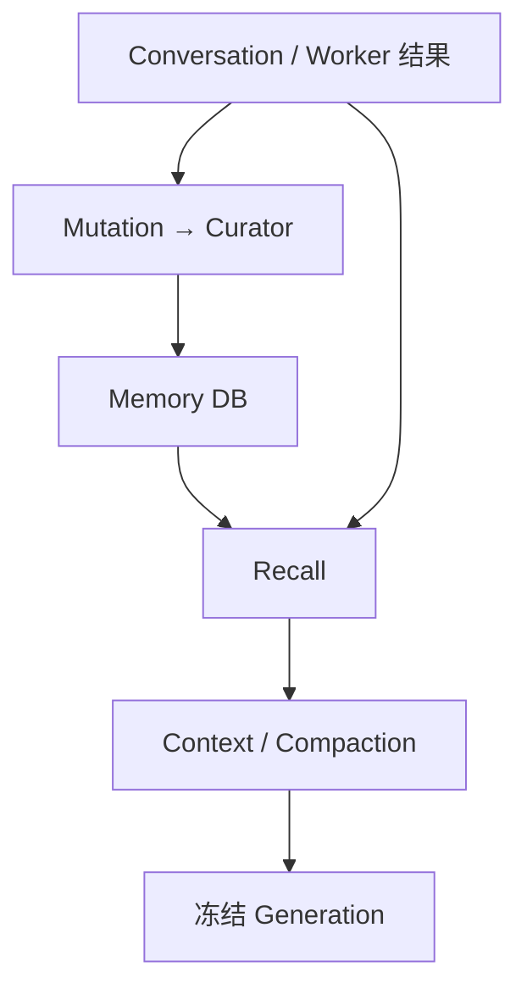

# 长期记忆、召回与上下文：技术方案

[功能与需求](../features/memory-context.md) · [测试方案](../test-plans/memory-context.md) · [主索引](../feature-map.md)

本文的架构与流程描述当前有效实现；明确标记的待实现方案不表示已落地。实现级协议仍服从 [跨功能协议与约束](product-overview.md#contract-0-文档效力与实现规则)。

## 默认本地搜索

安装版由能力设置服务准备 SecretStore 密钥，默认以 `SearchLocal` 查询 Memory 与 Conversation 的 SQLite 文本索引，不依赖外部 embedding。该路径不写向量配置，后续可添加自定义 embedding。加密记忆通过现有 scoped 内存工作索引检索；凭据不可用时不向 Main 自动装配无法解密的记忆，Conversation-only 资源身份与完整本地搜索分开冻结。显式部署仍可保持旧的未配置行为。默认资源的持久引用、开关与迁移边界见 [能力设置方案](capability-setup.md#自动默认资源)。


## 当前架构

Conversation 与 Memory 分库。Curator 串行处理持久 Mutation；Recall 并行查询两路证据；Context builder 在模型 admission 前压缩，按轮冻结。



### 加密召回的工作索引（F-039）

每个 Memory Store 最多保留一个授权作用域的内存 SQLite 工作索引，禁用落盘 temp。每次查询按当前可访问记录增量同步；未变化文档复用向量，只对新增/变化文档生成 embedding。切换作用域、Forget、重新配置 vault 或关闭 Store 清除工作索引。索引变更串行，等待可由 context 取消；embedding 调用不持索引锁，不阻塞其他 Run 的检索。隐私修改关闭旧工作索引，使尚未完成的旧视图检索失败关闭。持久库不保存解密内容或这些向量，选定 embedding 仍须为 loopback。

召回不可用保留其独立错误分类并阻止未冻结的请求派发，不伪装为 state.db 错误。原有逐轮证据冻结、隐私 epoch 和 provider 一致性检查继续生效。

## 当前流程与目标差异

观察或显式记忆请求 → 保存事件 → Curator 提取归并 → 后续轮次召回 → 压缩 → 冻结模型请求。Forget 先建立隐私屏障，再异步维护记录。

- **F-009**：独立后台模型提炼，严格结构化候选经宿主证据、作用域、类别与当前版本校验后归并；同义支持、纠正替代、撤回、晋升、降级与过期均由持久状态维护。
- **F-010**：默认本地文本相关性检索；自定义 embedding 路径保留全文/向量融合。自动召回排除当前上下文原文及其派生记忆，跨来源去重，按轮冻结并带来源。新的 Main 与本机所有者可经只读 evidence 入口逐跳读取明确关联的 Conversation、Task 与授权 Artifact，按正文/链接游标续读；它独立于 embedding，不将精确引用导航混同语义搜索。
- **F-011**：新 Run 已接通结构化模型摘要、工作状态、私有原文 Artifact 和逐轮冻结；目标与未知操作保留原文。真实模型的约束保留质量仍需离线验证；不得改写原文或旧 Run 的冻结请求。

## 代码与依赖

- [internal/memory/curator.go](../../internal/memory/curator.go)
- [internal/memory/sqlite/curator.go](../../internal/memory/sqlite/curator.go)
- [internal/agent/sqlite/memory.go](../../internal/agent/sqlite/memory.go)
- [internal/agent/sqlite/recall.go](../../internal/agent/sqlite/recall.go)
- [internal/recall/sqliteindex/index.go](../../internal/recall/sqliteindex/index.go)
- [internal/context/compact.go](../../internal/context/compact.go)
- [internal/agent/sqlite/compaction.go](../../internal/agent/sqlite/compaction.go)
- [internal/agent/context.go](../../internal/agent/context.go)
- [internal/prompt/prompts.go](../../internal/prompt/prompts.go)
- [internal/context/working.go](../../internal/context/working.go)
- [internal/agent/sqlite/context.go](../../internal/agent/sqlite/context.go)
- [internal/agent/sqlite/handoff.go](../../internal/agent/sqlite/handoff.go)

### F-010 · 关联证据导航与按需续读

当前消费者是 Main 与本机用户，入口为 `builtin__evidence_read` 与 `evidence read`。`internal/evidence` 定义内部实验性窄请求/投影；Host 从受信 Run 或本机身份取得作用域，不接受调用者的 Agent/Run/所有者字段。精确解析、权限/隐私裁决和续读是领域必需机制；4 KiB 正文、20 条关系与单跳展开是当前预算政策。避免建立图数据库、全局对象索引或通用 Source/Repository 接口。

Conversation 使用同会话的精确消息 ID 读取，尚未 Flush 的新输入可读其不可变 conversation_intent；不调用 Flush，不改写原文。Task 返回不可变原始目标；其链接组合现有 task_request、task_instruction、task_update、main_inbox/main_reply 和显式 ArtifactRefs。消息→任务、任务→原话/交付、产物→任务均基于真实持久关联；正文、文件内容、相似度和 Worker 私有轨迹不建立链接。SQL 按当前对象读取关系页，不在 Go 中自动遍历全量历史。

每次读取先捕获隐私 epoch、Forget 时间边界及受信 Main claim。消息、Task 和 Artifact 必须晚于该边界，链接在返回前逐一经过相同 scope/privacy/live 过滤。Artifact 只使用现有 Scope/Describe/Open 授权，验证哈希及文件读取在事务外，返回前重检 epoch/claim 与产物存活；不加 pin/grant，不将 task_ref 转成新的访问权限。跨库读取同样在最后重检隐私边界，拒绝 Forget 期间已读取的迟到结果。不可访问对象和未知对象不区分存在性。

证据读取与每跳校验使用本功能私有的 ReadOnly deferred state transaction，避免沿用写入池默认的 BEGIN IMMEDIATE；它们不预留 WAL writer，也不在文件或跨库读取期间保持 state snapshot。受信 ToolInvocation 的既有接纳/结果提交仍沿用原写事务，读路径不建立额外 Repository 层或新的状态管线。

原文按字节 offset 读取，UTF-8 范围向前收敛到完整字符，返回能继续前进的 next_offset；二进制不转 Base64。链接单次读取最多 21 个候选，显示至多 20 个已授权链接，用 next_links_offset 继续候选页；失效/隐藏项被省略，因此页可少于 20 项。关系是动态当前视图，跨次新增关联可能改变页位置；不承诺跨调用的图快照。具体 Tool 调用的已接受结果继续由原 ToolInvocation 管线冻结和重放，恢复不会重新执行一次已经成功的读取。

Main 的 current 只选择 checkpoint.input_sequence 之前的已消费用户输入，不越过正在处理轮次的输入边界；本机 current 为最新已接受输入。WorkerTools/ChildTools 显式移除新工具，避免 Child 借共享 TaskID 导航父任务或完整 Conversation。没有迁移，也不修改既有工具 Spec 或冻结 capability；新 Main 冻结新增工具，旧 Run 的精确 catalog 仍可正常 Select，旧调用不获得新能力。

### 本机 Memory 精读

本机所有者可用现有 `evidence read` 精读一条确切的当前 Memory 记录。CLI 解析增补 `memory:`，Main 的 ToolSpec、解析和冻结 catalog 保持原契约。Main 的结果会进入持久 ToolInvocation、checkpoint 和 trace，解密接入需要独立的原文保留政策。

宿主取得本机 UserID、当前 Agent、隐私 epoch 和 Forget 时间边界。Memory SQLite 沿用当前记录的用户/Agent scope、active 旧明文或密封记录、未删除及未替代判定，并限制记录时间晚于 Forget。SQL 行在 Vault 读取 SecretStore 前关闭。密封记录以既有 ID、用户和 scope 组成的 AAD 验证，失败时不返回记录。旧可见明文沿原表示读取。控制启动沿用数据根检查和 schema 打开方式，跳过保护迁移、Curator 与 embedding 初始化。原文只进入本机响应。

来源读取最多 21 个持久类型匹配的候选，复用 20 条链接和 4 KiB UTF-8 正文预算。Conversation 元数据校验持久用户/Agent 归属与时间，若未 Flush 可检查已接纳的本机 intent，明确归属冲突直接省略。Task 链接复用已有 scope/Forget 判定。Run、私有反馈、隐藏谱系及正文提及不会产生链接。跨库和密钥操作在短 state 只读事务外完成。返回前重查当前 Memory 及存储表示，然后重查 owner、epoch 和时间边界；任一变更丢弃整页。该入口与存储衔接为内部实验实现，无新迁移或权限。

### 本机 GitHub 接续证据

本机所有者可从现有 Task 追溯实际交给 Main 的确切 GitHub 观察版本，并从观察回到原 Task。确切 PR 来自控制启动时已验证的配置。只读查询复用 `github_task_followup`，校验观察、绑定与 Task 的持久 scope、generation、隐私 epoch 和时间边界。当前代中已接纳的较早 Task epoch 可保留，未接纳项需对应当前 Task epoch。观察模式决策、未关联的普通轮询观察、已忽略和旧代记录均不建立链接。当前绑定失效或凭据/仓库身份被明确拒绝时隐藏关联，网络中断仍可读取已保存的证据。

CLI 使用内部实验性 `github:SEQUENCE` 精确引用和现有正文/链接预算。正反向共用同一查询条件，返回前在短 state 只读快照中复核。第三方正文和状态仅作证据。接续关系与可见性是必要机制，单 PR 和仅本机 CLI 是当前范围。该读取直接组合现有持久记录，避免添加图索引、外部 API 读取或第二套授权流程。

尚未接通的范围包括 Main 的 Memory 原文、替代谱系、Main 的 GitHub 导航、其他外部来源和真实模型导航质量。私有摘要原文仍由现有 Artifact grant 管理。

## 验证与交付

验收场景、已有入口和剩余覆盖统一在 [测试方案](../test-plans/memory-context.md) 维护。实际执行结果以对应版本的 PR 或 CI 证据为准；架构说明不证明回归或 Live 验证通过。

## 协议、实现与配置约束

本功能协议在此维护。既有编号用于追溯协议，不代表所有设计目标均已实现；完成状态以需求主索引为准。

<a id="contract-10-conversation-上下文与-compaction"></a>

### 10. Conversation 上下文与 Compaction

<a id="contract-101-数据职责"></a>

#### 10.1 数据职责

- Conversation 是用户与 Agent 沟通的权威原始记录。
- RunTrace 保存模型推理过程需要的工具调用、工具返回、错误和运行事件。
- 用于模型的 Context 是从 Conversation、Memory、Skill 和 Run 状态动态组装的工作集，不等于完整存储。

<a id="contract-102-分级压缩"></a>

#### 10.2 分级压缩

主对话和 Worker 内部上下文都使用同一套分级压缩原则：

1. 根据比例阈值、冻结输出上限和传输预算选择工作集；当前 Task anchor、当前输入及未知外部操作保持完整。历史图片像素单独选择最新八张不同图片，原始引用仍保留。
2. 对超出预算的旧消息按完整工具交换分批生成工作摘要：目标、约束、进度、未知效果、决策、下一步、关键证据。摘要使用同一模型和同一 Agent Loop 的工具关闭轮次，并经过相同的费用、凭据、取消与重放裁决。
3. 原始 Conversation/checkpoint 不修改；被总结的原文保存为 Run 私有 Artifact，可通过已有 Artifact 工具读取。摘要和读取引用进入 runtime 工作状态；摘要流式文本不会交付用户。

Compaction 触发条件统一为：

```text
context_tokens > context_window * threshold_percentage
```

不使用固定的 `context_window - reserve_tokens` 作为唯一触发规则。

<a id="contract-103-召回与-prompt-cache"></a>

#### 10.3 召回与 Prompt Cache

- 每个新逻辑输入并行执行 `Memory 召回` 与 `Conversation 召回`；工具续轮、摘要、重试和重启复用首次结果。
- 两路召回并行、分别排序，再在统一上下文预算下合并。
- 本轮召回结果冻结，避免 Agent Loop 中途改变上下文。
- Forget 覆盖未完成 Run。可靠接受 Forget 时提交隐私 epoch，撤销旧上下文的后续 dispatch、模型结果接受及重放；旧快照仅保留作审计，不原地改写。首版保守停止同 Agent 作用域全部未完成 Run，新的自动上下文不导入撤销点之前的证据。详见 ADR 003 与 `docs/features/memory-context.md`。
- 撤销点之后接受的新输入归属新的排队 Main，保留不可变回执；旧 Main owner join 或租约失效并完成 stop settlement 后，才允许调度或 Claim 后继 Run。同内容的新显式 remember 保留独立的新来源与时间戳，不能因去重而继续指向撤销点之前的证据。
- System Prompt、人格、规则和 Core Memory 尽量保持静态。
- 新 Run 将带原始时间戳的召回附在当前 user message 的 `<recall_memory>` 区块中；不插入额外消息或在工具交换后追加历史证据。

<a id="contract-11-memory-与-conversation"></a>

### 11. Memory 与 Conversation

<a id="contract-111-边界"></a>

#### 11.1 边界

| 组件 | 职责 | 特性 |
|---|---|---|
| Conversation | 保存用户与 Agent 的原始沟通证据 | 权威、可审计、以追加为主 |
| Memory | 保存从历史中提炼出的长期状态 | 派生、可合并、可替代、可遗忘 |

分类原则：

| 信息 | 存储位置 |
|---|---|
| 用户偏好、事实、关系、稳定决策 | Memory |
| 可复用方法、工作流、经验 | Skill |
| 安全规则与审批要求 | SecurityPolicy |
| 持续工作的状态与进度 | Task |
| 工具步骤、错误和原始结果 | RunTrace |
| 用户与 Agent 的原始消息 | Conversation |

完整工具轨迹不写入 Memory。

<a id="contract-112-可插拔接口"></a>

#### 11.2 可插拔接口

对业务层只暴露两个 Provider：

```text
MemoryProvider
ConversationProvider
```

- Store、Index、Recall 是各 Provider 内部可替换的实现部分，不拆成六个公共接口。
- 一期每个组件只选择一个 Provider，不设计运行时热切换、双写或通用迁移层。
- 将来更换 Provider 时通过一次性迁移工具完成。

<a id="contract-113-一期存储"></a>

#### 11.3 一期存储

Memory 与 Conversation 分别存储：

```text
memory.db
conversation.db
```

- 两者均以 SQLite 保存权威数据。
- 各自维护 FTS 与向量索引。
- 召回使用 FTS5 与向量搜索并行，再通过 RRF 融合。
- Memory 与 Conversation 使用各自的领域排序逻辑。
- Provider 故障采用 fail-closed，不静默切换到未知或降级的数据源。

<a id="contract-114-memory-数据模型"></a>

#### 11.4 Memory 数据模型

Memory 支持用户级和 Agent 级作用域，以及 Core/Recall 两级：

```ts
interface MemoryRecord {
  memory_id: string;
  scope_type: "user" | "agent";
  scope_id: string;
  tier: "core" | "recall";
  content: string;
  source_refs: SourceRef[];
  supersedes_memory_id?: string;
  created_at: Timestamp;
  deleted_at?: Timestamp;
}
```

- `core` 用于稳定且高频需要的关键信息。
- `recall` 用于按需搜索的长期信息。
- 修正不覆盖原记录，而是创建新记录并通过 `supersedes_memory_id` 建立替代关系。

<a id="contract-115-memory-召回工具"></a>

#### 11.5 Memory 召回工具

Agent 只使用一个统一搜索工具：

```text
builtin__memory_search
```

该工具同时搜索 MemoryProvider 与 ConversationProvider，Agent 不选择数据源。安装版默认本地文本检索；显式部署关闭 recall 时仍保留不可用描述。新 Run 冻结所选本地/向量资源身份，旧 Run 不追溯改变；漂移 fail-closed。

输入：

```text
query
limit?
time_range?
```

输出：

```text
content
source_type
source_ref
occurred_at
author_role?
```

相关性分数仅供系统内部排序，不暴露给 Agent。

<a id="contract-116-memory-写入与维护"></a>

#### 11.6 Memory 写入与维护

实现与配置：`docs/features/memory-context.md`。可信本地 Experience Reviewer 使用 `skill manage` 完成候选、验证、晋升与退役；普通 Main/Worker 不获得 Skill 修改能力。

显式管理工具：

```text
builtin__memory_manage
```

支持：

```text
remember
forget
```

- Agent Loop 不直接写 Memory 数据库，只提交 Memory Mutation Event。
- Root 与 Child Worker 都可以在当前用户与 Agent 作用域内调用只读 `memory_search`，统一检索长期 Memory 与 Conversation 历史；检索内容按需进入各自 Run Context，不自动复制完整历史，也不在 Run 之间同步检索结果。
- Worker 不直接提交长期 Memory 写入。Conversation、Root/Child Run、Task 结果和用户反馈都进入统一 Memory 提取管线，由后台 Curator 无感完成证据判断、去重、冲突合并与持久化，避免并行 Child 重复或相互覆盖。
- 后台 Memory Curator 串行合并事件，处理去重、冲突、替代和遗忘。
- Curator 是机器审核与归并流程，不是人工审批。
- Memory 默认无感形成：后台自动观察 Conversation、Task 结果和用户反馈，异步提取、归并、降级与淘汰，不阻塞当前回复，也不为单条记忆请求用户确认。
- 用户偏好、身份事实、关系和长期承诺在证据足够时自动写入；不因为信息敏感而弹出确认。敏感 Memory 使用更严格的本地加密、作用域、召回与日志脱敏策略。
- 凭据、访问令牌、支付密钥等 Secret 不进入语义 Memory；需要保存时进入独立 Secret Store。这是存储边界，不是记忆确认流程。
- 模糊推断先进入低置信 Recall，只有稳定、重复或被后续行为验证的信息才提升为 Core，避免一次随口表达永久改变 Agent 行为。
- Main 始终能发现 `builtin__memory_manage`；未配置 `memory.encryption_key_ref` 时描述说明要求，调用返回 `PROVIDER_UNAVAILABLE`，不排队 Mutation、不声称接受、不改变隐私 epoch。Root/Child 不获得该工具。
- 显式 remember/forget 只同步到事件被可靠写入，后续由 Curator 异步重试直至合并。
- `remember/forget` 是用户主动覆盖、纠错和删除记忆的控制入口，不是普通 Memory 写入的必经路径。
- Memory 维护、晋升、淘汰及其暂时性失败默认不告知用户，只进入内部可观测性系统；用户可随时查询、更正、删除或要求“不再记住”某类信息。
- Memory 写入不属于副作用审批。Security Approval 只约束发送、购买、删除、发布等外部动作，不能复用来打断后台记忆维护。

<a id="recall-durable-context-recall-steward-22"></a>

## Durable context recall

Main, Root and Child use the same read-only `builtin__memory_search` Tool and
ToolInvocation executor. The Host supplies the local user and Run's Agent identity.
Arguments cannot choose an owner, Agent, provider or database. Worker capability
reductions retain read-only recall and grant no Memory mutation capability.

<a id="recall-authority-and-indexing"></a>

### Authority and indexing

| Database | Version | Authority / derived data |
| --- | --- | --- |
| `state.db` | 20 | Run/Tool ledgers; immutable recall snapshots; queued Main successor admission fence |
| `conversation.db` | 3 | Immutable original messages, monotonic sequences, frozen ownership; derived FTS5/vectors |
| `memory.db` | 2 | Facts, evidence references, supersession links, tombstones; derived FTS5/vectors |

Files use the absolute data root, private permissions and WAL. Forward migrations
are transactional and reject future schemas. The populated Conversation v1 upgrade
indexes text without rewriting original JSON, IDs, timestamps or sequences.
Existing local Conversation IDs are Agent identities and migrate to local-user
ownership. New channels bind authenticated Conversation ownership before append;
rebinding fails.

Memory.Apply is a trusted Curator boundary. It atomically saves an immutable record,
evidence and index document. Identical duplicate IDs are harmless; changed payloads
conflict. Supersession replaces only an active record in the same user and exact
scope. Competing corrections permit one successor. Forget retains a tombstone and
excludes the whole supersession lineage from retrieval. Neither storage operation changes
Conversation evidence. Explicit local history retains originals. The public Forget
control additionally applies the privacy barrier before future automatic retrieval;
see ADR 003. Automatic extraction, remember/forget and compaction are described in
[maintenance operations](../features/memory-context.md). Explicit Forget also establishes
a privacy barrier over unfinished context; immutable audit is retained.

The chosen vector adapter stores dense vectors in SQLite
`recall_document.vector_json`, partitions by authorized scope/visibility/time using
a B-tree, and exhaustively ranks that partition by cosine in Go. It adds no native
extension or production dependency. This is exact vector search, with linear cost;
it makes no ANN or sublinear-performance claim. Measure large corpora before
increasing limits. SQLite FTS5 uses unicode61/BM25. unicode61 does not segment CJK
substrings; the configured model supplies semantic recall.

Authoritative writes atomically commit text and FTS. NULL vectors are recoverable
derived work. Media-only entries retain original Artifact references but are
excluded from text search; no empty embedding request can block other recall.
Search first embeds authorized missing records and installs each
vector atomically. A crash may leave some indexed records; it never produces
partial successful recall. Both candidate paths read one coherent database
snapshot. A concurrent, not-yet-indexed append fails that search closed; a later
caller can retry. Each database pins one embedding identity. Replacing it requires
stopping execution, backing up the three databases, clearing only derived vector
columns and `recall_configuration` in an offline transaction, and configuring new
Runs. Originals remain intact; there is no online mixing or hot migration.

A valid multipart original can exceed the embedding adapter's 64 KiB per-request
bound. Derived indexing splits it at UTF-8 boundaries into requests of at most
64 KiB and pools normalized vectors by chunk byte length into one document vector.
Every byte is embedded; full FTS text and the original source reference remain.
Exactly cancelling vectors use the first valid chunk vector as a deterministic
fallback. No vector is saved until all chunks succeed. Pending v2 documents and
v1 migration use this same path without rewriting originals or changing schemas;
already indexed short documents retain their vectors. This document-level pooling
does not provide passage ranking. Large hits still obey the existing output budget.

<a id="recall-ranking-budget-and-recovery"></a>

### Ranking, budget and recovery

Each Provider runs FTS5 and vector ranking concurrently. Owner, Agent, visibility
and inclusive time filters apply before candidate selection. Vector candidates
require cosine >= 0.25; each path supplies at most 200 candidates. RRF is
`sum(1/(60+rank))`, starting at rank one. Memory breaks equal fused scores by Core
tier, recent timestamp and stable reference. Conversation breaks ties by recent
timestamp and stable reference. The Service queries both Providers concurrently,
merging their ranked lists under one count and serialized evidence budget. Local lexical coverage dominates rank tie-breaks; vector results retain reciprocal provider rank. Ranking and provenance fields remain private, outside the serialized Tool contract.

Tool input is `query`, optional `limit` (1–50, default 10), and optional
`time_range: {start?, end?}` using RFC3339. Output contains only `content`,
`source_type`, `source_ref`, `occurred_at`, optional `author_role`. Invalid arguments
return INVALID_ARGUMENT; provider/index faults return PROVIDER_UNAVAILABLE without
partial output. The Tool is read-only, needs no approval, and reuses the existing
ToolInvocation replay/result pipeline.

For each new explicit input, each Run independently queries its authorized context. New Main
policies combine the latest request with the immediately preceding user input and
last textual assistant answer before that request (UTF-8 excerpts, at most 4096
bytes total). Runtime UI state, tool payloads and older topics do not supply query
antecedents. Root and Child query only their own explicit Task input and never
copy Parent prompt state or search results. Recall
freezes in `run_recall` before model admission with claim/epoch and version checks.
New policies reuse that retrieval across tool rounds, summary rounds, retries and
restart until a different explicit input is accepted, including a repeated text
with a new input identity. Context preparation records `recall_input_ref` and
`recall_step` in its immutable provenance; no additional retrieval row or retriever
observation is created for reuse. Each generation still checks model/transport
budgets and freezes its actual prepared request. With unchanged input and tools,
and no compaction, the message prefix stays exact while tool exchanges append.
Only a new explicit input queries the current corpus. Execution
cancellation interrupts pending recall and admits no partial/frozen model turn.
New policies exclude working-context Conversation IDs and their derived Memory before index candidate limits, including both lexical and vector selection. Consumed originals outside the working set remain eligible; unconsumed accepted inputs remain excluded. The service and final projection also remove matching source identities or exact text and deduplicate before freezing. This is private automatic-recall policy; explicit memory search
retains its original results. Final exact-text filtering after bounded retrieval can still return fewer hits; no semantic topic classifier is introduced.
Evidence is untrusted runtime data. With the Host-frozen `input_recall` policy,
recall is attached after the current user's text inside one `<recall_memory>`
block. Hits are ordered by original timestamp and quote their original author;
XML escaping prevents stored text from closing the block. Source keys are not
included in the model-facing evidence. The original Conversation message is
unchanged. The first request is system → history → current user input containing
recall; tool continuations append exchanges to that exact prefix until a new
input or required compaction changes the working set. The final rendered block,
including escaping and framing, must fit its evidence budget.
Evidence uses at
most one quarter of the remaining conservative byte budget, capped at 16 KiB;
hierarchical compaction and the final model-window check also apply; see maintenance operations.

`contextual_recall` freezes logical-input reuse and Main query expansion. The newer Host-only `input_recall` policy freezes the inline evidence and ordinary-object-ID projection. Missing flags preserve historical query and placement bytes. New Children inherit the Parent policy. Accepted historical requests and
recall rows remain immutable. Unfrozen lookups use Host source exclusions and
current corpus visibility; a policy flag never restores forgotten or retired
Memory.

Automatic observations use a separate structured semantic generation, not
literal first-person sentence copying. Main/Worker prompts are unchanged. The
private proposal is validated and applied by Host code as specified below.

With maintenance enabled, every derived Memory record is encrypted with AES-GCM
bound to record identity and scope; deduplication uses keyed hashes. This avoids
relying on a heuristic sensitivity classifier for storage protection. Persistent
FTS/vector tables contain no private plaintext. Authorized retrieval decrypts a
scoped working set into an in-memory SQLite index with temporary files disabled,
then uses the same FTS5/vector RRF adapter and the selected local embedding
provider. Encrypted Memory requires a literal loopback embedding endpoint; remote
embedding fails closed before any private input is sent. Existing remote-only
recall installations without maintenance keep their configured provider.

Existing Memory is sealed before enabling the configured maintenance provider;
derived FTS is rebuilt and old database/WAL pages are cleaned. A persisted cleanup
marker resumes cleanup after a crash. Original Conversation and frozen Run audit
records retain their existing private-file storage policy; this is not full disk
encryption. Back up all three databases together with the credential-store key.
The private working index is reused within one authorized scope and reconciled
incrementally. Scope switches, Forget, vault reconfiguration and Close discard
it. Unchanged records retain their vectors; no private vectors are persisted.

Forget follows [ADR 003](#decision-003-forget-revokes-unfinished-context). It
revokes unfinished context at acceptance, before asynchronous tombstones apply.
It deliberately stops every unfinished Run in the Agent scope and prevents old
automatic context from being imported into new Runs. Older Tasks are hidden from
model search and append is denied; a fresh self-contained Task can use new
independent input. Immutable audit remains.
Fresh chat input accepted while the revoked Main is stopping binds to a separate
queued Main and keeps that receipt on retries. Its execution waits for the old
owner to join or expire and settle. A fresh explicit remember of identical content
creates a successor with its own timestamp and source, so unrelated Forget does
not hide the newly supplied evidence. Old evidence remains excluded. State schema
20 migrates the Main admission index without rewriting stored input or snapshots;
all processes sharing the data root must use the current binary after migration.
An explicit Forget issued by a Main Tool can stop that Main before another model
reply; the durable receipt is visible through the control/status boundary.

Context uses a conservative three-UTF-8-byte token estimate, the configured
percentage threshold, the frozen output ceiling and a 384-KiB text/Tool envelope.
Host provenance counts toward that transport envelope, not model tokens. Recall
receives at most a quarter of the space remaining after required inputs and Tools,
capped at 16 KiB. The remaining Bridge frame space accommodates selected images.
Irreducible required input fails explicitly; a provider context-length
rejection still gets one Loop retry at a lower threshold with the same snapshot and at most four image previews on that retry.

New Run checkpoints carry context version 2. Historical version-0 Runs retain the
existing bounded-excerpt path and already frozen requests; their compaction policy
hashes are unchanged. Children inherit their Parent's context version and policy.
State schema 27 guards immutable context versions and working-state boundaries;
existing checkpoints and accepted generations are not rewritten. All processes
sharing the data root must upgrade together; older binaries reject schema 27 on
startup. New Root
Runs use the current assembly while preserving Task epochs and role reductions.

后续工具命名升级独立于 context version：state schema 28 保留旧上下文与已接受请求，但旧工具快照不被静默重命名，执行兼容要求见[工具升级说明](tools-approvals.md#decision-005-compatibility-and-upgrade)。

### 当前上下文装配与业务接续

- 内置文案放在 `internal/prompt/system/`、`internal/prompt/capability/`、`internal/prompt/summary/` 的 Markdown 文件中，通过 `go:embed` 编入二进制；`internal/prompt` 只提供文案与摘要目标字节数替换。角色选择、冻结能力判断、顺序和动态证据由 Agent 装配代码负责；系统分段在该层已经拼为一条消息，Host 元数据保留有类型的分段。
- Markdown 使用 UTF-8，Git 属性固定 LF；载入时仅移除单个文件末尾 LF，保留段落、空格和消息边界。修改这些资产需重新构建，只影响新生成的上下文；旧 Run 与已接受请求仍读取各自冻结记录。资源不依赖启动目录，不增加外部 prompt 配置或热加载入口。
- `internal/agent/context.go` 是唯一初始装配入口。Main、Root、Child 统一使用 role → safety → `<execution_rules>` → `<capability_guidance>`。Main 使用面向用户的角色；Root 将精简身份与 Worker 规则合为角色段，将阶段进度约定归入执行段；Child 使用 Worker 角色。Host 分段中的 `child_text` 冻结 Child 可继承的共享文本，执行段的 `progress` 标记用于 Root 进度接纳；两者不进入 Provider 投影。Child 不继承 Root 的身份与进度约定。MCP/Skill 目录不进入初始 Prompt，分别通过 Code Mode 与 skill_list 按需搜索；项目指令通过执行环境按需读取。
- Skill 目录与版本保存在 Capability Snapshot 的 Host metadata 中，不注入 system；模型通过 skill_list 搜索名称与用途，再通过 skill_view 按名称读取。provider Tool schema 仅包含名称、接口描述与输入 schema。项目 AGENTS.md 通过执行环境的 builtin__read 按需读取，不读取宿主 cwd。恢复旧 Run 时保留已冻结上下文和原工具结果，不用当前文件覆盖它。项目和 Skill 指令不能扩大权限或授予审批。
- Root 的 Task 正文和显式 Artifact 引用是一个受保护的逻辑输入。Child 只接收显式子任务和引用，以及从 Parent 冻结的共享规则；不复制聊天、Task 历史或 Parent 的工作状态。
- 新 Main 从 Conversation 载入语义历史，并交接最近 Main 的工作摘要和可见顶层工具回执；私有摘要原文仅通过显式 Run grant 传递。Forget 屏障之前的执行内容不进入这条交接路径。
- Task 续跑接收旧 Root 最终业务结果、Root 可见的顶层工具输出和历史指令；最终答复已接受但 report 尚未提交时，仍保留该答复，排除内部压缩摘要。不汇总 Child 的模型响应、内部工具轨迹或 Code Mode 未输出内容。整棵 Task 树中结果未知的效果以 Host 状态保留，不披露 Child 参数。
- 用户图片投影由冻结 context policy 的 `user_images` 标记控制：新 Run 启用、字段缺失沿用旧引用模式。真实 user 的显式图片与 Tool 选择使用同一有界 ImageRefs 工作集；像素仅在授权 dispatch 时加载，文本模型上下文明确说明未看到图片。
- 生成前执行消息投影、按轮召回、工作集选择与冻结。工作摘要继续是有来源的 runtime user 消息；模型生成的摘要不写入长期 Memory，也不成为安全策略。
- 需要总结时，该轮只提供专用总结 system prompt、序列化证据和保留任务事实，不声明 Tools。结果提交后推进同一个 Run 的 step，更新 `working_state`，继续业务推理；已接受结果在故障恢复时复用。
- `summary_bytes` 是摘要目标；模型结果上限为 `max(4096, summary_bytes × 4)`，最多 64 KiB。被截断、空白、超限或要求调用工具的摘要不能成为工作状态。语义质量不由确定性测试证明。

## 当前设计取舍与兼容约束

内置角色、能力指导和摘要指令通过 `go:embed` 嵌入 Markdown 产品资产，保留单二进制部署和显式升级；Go 负责装配与权限判断。图片投影由 `agent/messages.go` 与冻结 policy 管理，不把 Base64 写入工作状态、归档或 Conversation，具体限制见 [文件方案](artifacts-media.md)。

新 Root 在执行原则后冻结独立的阶段进度约定，以完整工具轮的简短 assistant 文本生成只读进度，不新增工具或额外模型轮次。Child 不继承该约定，旧 Run 不重写；接纳边界见 [任务方案](tasks.md)。

工作摘要采用 Root 可见业务输出和 Host 未知效果，不汇总整棵树的私有轨迹；新 Run 使用同模型、关闭工具的摘要轮次。state schema 27 校验 context version 与工作状态边界，旧 checkpoint、已接受请求及 hash 保持原值，新 context version 不回填旧 Run；共享数据根的进程须统一升级。

召回索引在同一作用域内仅驻留内存，增量补充向量，减少重复本地模型调用。明文驻留至作用域切换、Forget 或关闭，隐私互斥边界内清除，不落盘。Forget 保留原始审计，同时阻止旧上下文继续执行。

<a id="decision-003-forget-revokes-unfinished-context"></a>

## Forget revokes unfinished context

A durable Forget intent is a privacy barrier. It takes precedence over reusing
frozen recall, compacted context and completed recall calls in unfinished work.
The Host retains immutable requests/results as audit evidence. It never changes
a frozen request, snapshot, CodeCall argument hash or internal call key to remove
content in place.

The implementation invalidates all unfinished Runs in the same Agent
scope. Semantic dependencies can exist in copied Tool results, Child results and
summaries; checking only the latest `run_recall` row would miss them. A monotonically
increasing privacy epoch is committed with the accepted mutation. Business writes,
model-result acceptance and Code Mode callbacks must match the epoch frozen at
Run creation. Existing stop recovery joins live owners, stops descendants before
parents, and preserves uncertain effects as `unknown`. Task status remains intact.
The Host does not revive an old Run or retry an unknown effect.

Provider dispatch holds a short state transaction while writing its request
frame. Forget acceptance and request dispatch therefore have a serialized order
across local processes. A request already dispatched cannot be withdrawn from a
provider; its late result is rejected after revocation. A queued request cannot
dispatch after the barrier. This does not claim erasure from an external model.

New Runs do not automatically import Conversation or recall evidence from before
the scope's barrier. This intentionally conservative rule also excludes unrelated
older context from automatic assembly. Originals remain available in explicit
local history/audit; a user can provide fresh independent evidence or remember
again. Older Tasks are excluded from model Task search and cannot append/create a new
Root across the barrier. The user can create a fresh Task with independent current
input. This prevents old anchors/instructions from silently reintroducing revoked
material.

Input accepted after the barrier owns a new queued Main with its own frozen
snapshots and immutable receipt. It never joins the revoked Main. Both scheduler
and direct Claim wait for revoked Main owners to join or expire and settle before
executing the successor. A later Forget revokes that queued successor as usual.
State schema 20 replaces the single nonterminal Main index with one Main whose
desired state is running; stopped audit rows may coexist with its queued successor.
The migration preserves all input, claim and snapshot records. Use the current
binary for all processes after migration; older binaries do not enforce this
successor admission fence.

A newer explicit remember with an independent evidence source creates an
immutable successor even when its content and tier deduplicate. Its timestamp
and source belong only to the fresh evidence; the old record stays audit-only.
Receipt replay, repeated sources and out-of-order older evidence do not renew a
fact. Scope privacy filtering and lineage/source suppression still apply.

Memory deletion retains tombstones, invalidates the whole supersession lineage,
and suppresses re-extraction of its evidence sources. Category opt-outs persist
with CAS versions; replay uses frozen deletion targets and immutable policy
receipts so an old event cannot revoke fresh explicit evidence or undo a later choice. The background Curator is
serial and receipt-based. No maintenance delivery or Approval is created.

State schema 19 adds the event journal, privacy epoch, frozen context policy,
compaction manifests and Experience Reviewer lifecycle. Existing Runs receive a
fixed default compaction policy. Accepted schema-18 generations are explicitly
marked to retain their original pre-compaction request representation on replay;
they still obey the privacy barrier. Model/Capability Snapshots do not change.
Conversation schema 3 retains derived summaries separately from original messages.
Memory schema 2 adds evidence, idempotent receipts and suppression records.

Verification lives in `tests/system/verify_memory_maintenance.py`, repeated five times
by the maintained memory system gates, plus epoch/dispatch, migration, Curator, context and lifecycle
regressions. The harness kills the owner before model dispatch and after Memory
commit, then verifies stored state and fresh model requests. It does not establish
semantic model quality or selective dependency tracking.

### 默认文件 SecretStore

当前消费者是自动 Memory、显式本地凭据、离线备份命令与现有 OAuth 文件后端。Memory 曾在默认应用组装中使用系统 SecretStore，使 macOS 重新编译后的钥匙串授权阻塞整个启动。默认应用与离线命令改为 Files；OAuth 继续使用既有 account-secrets 目录和 UUID 契约，所有生产密钥统一使用文件后端。

两个文件目录复用私有 fileStore，限制固定目录、不可穿越的引用名、0700/0600 权限、普通单链接文件、禁止跟随符号链接，以及原子写入与 fsync。跨进程串行仍由 Memory defaults 锁和账户锁负责，不新增通用存储平台或公共文件路径接口。环境引用保持显式。文件存储依赖本地账户和目录访问控制，不再依赖操作系统钥匙串访问策略。

密钥身份与已加密数据不可分离，旧引用缺文件时失败关闭，不自动回退系统服务或生成新密钥。已有加密记忆须先将原密钥保存到文件 SecretStore；空数据库可在离线核对后建立新默认密钥。凭据文件不进入现有数据备份白名单，须独立保留原密钥；不把密钥写进 owner YAML、日志或模型输入。


### 语义 Curator 与召回修复（2026-11-06）

**需求与证据。** 当前消费者是单机用户、Main/Worker 的自动召回及所有者 Memory 检视。
现场旧 12 条自动记录均为原文片段；当前任务同时以 Memory 与 Conversation 两次进入 recall。
Conversation 原文、既有 Run 的冻结输入和公开 Tool 输出结构是下游契约，均不重写。

**机制与策略。** 观察仍写入持久 mutation，串行 Curator 在独立后台任务中调用当前已验证模型；
不创建用户 Task/Run，不阻塞当轮答复，不以主 Agent 的提示词约束替代数据治理。
模型仅建议 add/support/replace/retract、语义 facet、类别、规范事实、原文 quote 和 tentative。
宿主严格解析单一 JSON，限制 8 项/32 KiB，校验精确用户证据、已提供的当前目标、类别/facet、一致时间、
作用域、隐私屏障与类别 opt-out。原文引用只能证明出处，不能数学证明模型对语义的解释；
因此模型质量仍需真实数据评测，不能凭 JSON 校验宣称推理绝对正确。

候选上下文限 128 条/64 KiB，并在派发前检查实际模型窗口；超限或模型不可用延期，不退回原话摘抄。
证据不足的可能性信息保留 tentative Recall，不能覆盖既定事实。
同义/跨语言事实通过已有 ref support；纠正创建不可变 successor；撤回退役。
独立原始用户来源满 3 个可晋升 Core；重放及 Worker 复述不增加独立来源。
facet 与内容摘要使用密钥摘要，元信息、请求与返回均 Vault 密封。
独立来源计数按当前事实生命周期维护，历史来源保留在不可变记录与密封 receipt；当前记录带去重后的最近 64 个来源。

当前私有生命周期策略：tentative Recall 14 天；普通 Recall 180 天；自动 Core 一年未确认
降为 Recall，按最后确认起 545 天到期。降级继承原始时间，不把维护时间伪装为新证据。
显式 remember 不受自动老化策略影响。过期、退役、替代、删除项在搜索、精读和检视中采用同一可见性规则；
退役项只返回审计元数据，不作为有效记忆解密。类别遗忘使用密封语义类别，旧来源的 suppression 防止复活。

**恢复与授权。** state schema 48 保存私有 memory_generation、semantic receipt 和费用预留；
memory schema 3 保存密封 facet、到期、退役与不可变归并 receipt。
复用现有模型冻结、账号授权/撤销、GenerationObserver 用量记录和费用边界。
派发与接纳验证维护租约和隐私 epoch；归并期间再次串行校验 Forget 边界。
跨库崩溃重放同一已接纳 proposal，避免再次调用模型；迟到结果不可接纳。
无效输出最多尝试 3 次后记为失败并隔离，后续观察继续；临时不可用保持待处理。
旧规则生成的自动记录仅退役保留审计，再从原始来源处理；显式 remember 与历史对话保留。

**召回。** 自动查询来自真实用户消息/Task 来源，不采用展开后的 Task anchor 指令。
排除当前上下文及当前 Main 输入（含已接受的后续输入）及其派生 Memory，过滤未来来源。
两路索引在候选限额前排除工作集来源及其派生 Memory；合并后再按内部身份、规范文本与 Memory→Conversation provenance 去重。模型只收到普通对象 ID；自动召回正文仅包含来源类型/作者、原始时间与证据文本，受最终渲染字节和数量预算约束。
默认本地搜索采用中英文分词/中文二元词、主题覆盖优先于 Core/时间；仅共同的请求词不应召回无关 UI 对话。
最多保留 400 个工作候选并收敛到最佳 200 个，扫描受请求 context 时限约束。
本地文本路径不承诺跨语言语义搜索；自定义 embedding 路径继续负责向量近义检索。
既有 run_recall、model_generation 与冻结上下文仍作为历史审计保留。

**取舍与稳定范围。** 这是 private 后台协议，未开放模型直接写库、通用 Curator 插件、
新的用户配置或公共 facet schema。作用域、原始证据、幂等、加密、租约、撤销及版本是必要机制；
次数、TTL、上下文容量与相关性阈值是可替换的当前策略。
拒绝继续把原句当事实、单靠 system prompt 去重、每条派生记忆创建用户 Task、重写旧 Run 或默认外发 embedding。

<a id="memory-and-recall-invariants"></a>

### Memory and recall invariants

These are enforced engineering contracts, not model instructions:

- Conversation preserves original messages. Automatic Memory contains derived, evidence-backed state; do not persist ordinary requests, tool plans or UI error reports as lasting facts merely because they contain first-person words.
- Only Host-owned identity and original provenance authorize writes. A Curator may suggest operations; code validates exact evidence, scope, category, current target, uncertainty and version before committing. A structured response alone does not prove semantic correctness.
- Equivalent facts share one current lineage; corrections and withdrawals preserve immutable audit. Replays and Worker repetitions of one source never count as independent evidence. Forget, opt-out, retirement, expiry and supersession apply to search, exact reads and owner inspection alike.
- Dispatch, acceptance and cross-database retry must retain privacy epochs, leases, durable result reuse and usage/cost accounting. Maintenance never manufactures user Tasks or deliveries, and never falls back to literal extraction when its model fails.
- Automatic Recall queries the original input/Task source, excludes working evidence before candidate limits while allowing compacted originals, deduplicates Memory/Conversation echoes by provenance, and applies authorization/time/byte/count limits. Local lexical matching must not treat shared request words as topic relevance.
- Empty or ordinary maintenance must not close an index used by another query. Publish updates through the store's synchronized incremental index; privacy revocation keeps its explicit invalidation/fail-closed behavior.
- Unit and system tests must assert these behaviors and their failure paths. CI must execute them on every code PR; a regression existing only in optional/nightly jobs is insufficient. Fakes verify transport and state contracts, while semantic-model quality requires separate real-model evidence.

Keep this contract here; `AGENTS.md` routes contributors to it. The UI design document remains the owner of visual/interaction constraints, rather than duplicating backend memory rules there.

### Pre-release schema adoption

Public state migration 47 adds reference cost estimates; semantic Memory is
migration 48. An already deployed local pre-release used 47 for Memory. The
v48 upgrade recognizes only the exact complete three private tables and index
and the absence of the public cost table, then atomically adds the missing cost
schema and advances to 48. Its encrypted requests/results, receipts and usage
are preserved. Public v47 runs the ordinary semantic migration. Unknown or
partial private schemas fail closed; no global IF NOT EXISTS policy or version
rewind is introduced. Backups remain necessary for rollback.
