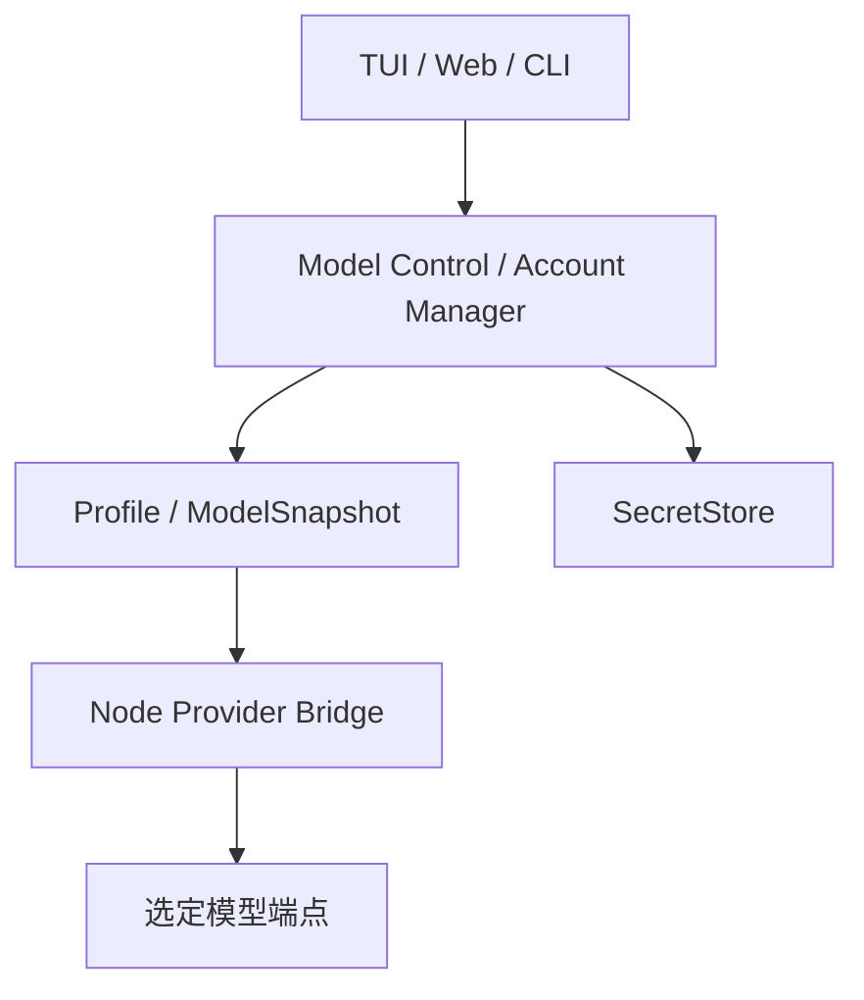

# 模型连接与账户：技术方案

[功能与需求](../features/model-connections.md) · [测试方案](../test-plans/model-connections.md) · [主索引](../feature-map.md)

最近核对：2026-10-28。本文的架构与流程描述当前有效实现；明确标记的待实现方案不表示已落地。实现级协议仍服从 [跨功能协议与约束](product-overview.md#contract-0-文档效力与实现规则)。

## 当前架构

Go Control 管理配置、Probe 和选择；账户 Manager 访问 SecretStore；Node Bridge 负责供应商协议转换。每个 Run 保存冻结的 ModelSnapshot，后续配置变化仅影响新 Run。



## 当前流程与目标差异

新增连接或登录 → 能力测试 → 显式选择 → 新建 Run 冻结快照 → Bridge 发起推理。失败回到可修复设置，不自动切换账户或模型。

- **F-001**：CLI/TUI/Web 有连接、Test、Select 入口，Run 冻结模型快照。 无活动模型时保持 setup_required；不隐式选取收费或 Fake 模型。
- **F-002**：账户生命周期和 macOS Keychain 已实现；非 macOS 原生凭据写入返回错误。 补齐支持平台的凭据后端及相应设置反馈；不能把环境变量 API Key 视为 OAuth 凭据写入实现。

## 代码与依赖

- [cmd/erii/models.go](../../cmd/erii/models.go)
- [internal/llm/control.go](../../internal/llm/control.go)
- [internal/llm/account/manager.go](../../internal/llm/account/manager.go)
- [internal/llm/secret/unsupported.go](../../internal/llm/secret/unsupported.go)
- [provider-bridge/bridge.mjs](../../provider-bridge/bridge.mjs)

## 验证与交付

验收场景、已有入口和剩余覆盖统一在 [测试方案](../test-plans/model-connections.md) 维护。本次建档未执行本功能的回归或 Live 验证，不以架构图替代运行证据。

## 协议、实现与配置约束

迁入内容按职责归属在此维护。既有编号用于追溯协议，不代表所有设计目标均已实现；完成状态以需求主索引为准。

<a id="contract-5-模型与-agent-决策"></a>

### 5. 模型与 Agent 决策

- 一个 Agent 在任一时刻只有一个活动主模型配置；Main、Root Worker 与 Child 默认使用同一配置，不做按任务动态模型路由。
- 首次启动必须由用户完成模型连接、认证、模型选择和能力验证；在产生有效的 Active Model Profile 前，不启动 Agent Actor，也不接受 Conversation/Task。
- 用户可以在设置/TUI 中显式新增连接、重新登录、测试和切换活动模型，但这属于用户控制面，不暴露为模型可调用 Tool。
- 模型切换只影响之后创建的 Run。每个 Run 在创建时冻结 `ModelSnapshot`；Root 的所有 Child 继承同一个 Snapshot，进行中的 Run 不热切换模型。
- 是否使用工具、创建 Task、启动 Worker、召回历史或继续当前 Run，由 Agent 自行决策。
- 模型输出不直接产生外部副作用，所有副作用必须经过 Tooling 与 Security 层。

<a id="contract-51-首次启动设置流程"></a>

#### 5.1 首次启动设置流程

TUI/Web 首次启动展示阻塞式 Setup Wizard，只提供两条等价的模型连接路径：

```text
Choose model connection
  1. Local / OpenAI-compatible endpoint
  2. OpenAI — Sign in with ChatGPT
```

统一步骤为：

1. 选择连接类型并完成 URL 配置或账号登录。
2. 获取模型目录；目录不可发现时允许手动填写模型 ID。
3. 选择一个模型，并只展示该模型确认支持的 reasoning effort、输入模态和上下文设置。
4. 执行 Connection Test 与 Agent Capability Probe。
5. 测试通过后原子保存 ModelProfile、AuthConnection 引用和 Agent Active Model，并进入正常 TUI。

Setup Wizard 可以安全取消；取消后应用的 `AppReadiness` 保持 `setup_required`，只允许重新进入设置、查看诊断或退出。`AppReadiness` 与运行期仅有 `idle/busy` 的 `AgentStatus` 分离。不得为了“先进入界面”偷偷启用 Fake、无凭据 Provider 或默认收费模型。

`AppReadiness = setup_required | ready | degraded`：`ready` 才开放 Agent Ingress；Active Profile 后续失效时进入 `degraded`，允许查看历史、修复连接和切换 Profile，但不接受新的 Agent 工作。

初次设置完成后，`model list/add/login/logout/select/test` 可以作为 TUI 命令或 Settings API 存在，但不是 `builtin__model_*` Agent Tool。模型不能自行切换到更贵、不同隐私边界或不同账号的 Provider。

<a id="contract-52-统一-modelprofile"></a>

#### 5.2 统一 ModelProfile

```typescript
type ProviderKind = "openai_compatible" | "openai_account";
type AuthKind = "api_key" | "chatgpt_oauth";
type ModelProfileStatus =
  | "unverified"
  | "ready"
  | "unavailable"
  | "reauth_required"
  | "invalid";

interface ModelProfile {
  profileId: string;
  name: string;
  providerKind: ProviderKind;
  endpoint?: string;
  wireApi: "openai_completions" | "openai_responses";
  modelId: string;
  authConnectionId?: string;
  reasoningEffort?: string;
  contextWindow: number;
  maxOutputTokens: number;
  generationDefaults?: {
    temperature?: number;
    topP?: number;
  };
  compatibility: ModelCompatibility;
  capabilities: ModelCapabilities;
  status: ModelProfileStatus;
  verifiedAt?: string;
  version: number;
}

interface ModelCompatibility {
  developerRole: boolean;
  reasoningEffort: boolean;
  parallelToolCalls: boolean;
  streamUsage: boolean;
  toolResultFormat: "openai" | "provider_specific";
}

interface ModelCapabilities {
  textInput: true;
  imageInput: boolean;
  audioInput: boolean;
  toolCalls: boolean;
  streaming: boolean;
  reasoningEfforts: readonly string[];
}

interface AuthConnection {
  connectionId: string;
  provider: string;
  authKind: AuthKind;
  status: "connected" | "refreshing" | "reauth_required" | "logged_out";
  accountLabel?: string;
  workspaceLabel?: string;
  expiresAt?: string;
  version: number;
}
```

- `ModelProfile` 保存连接和模型元数据，不保存 access token、refresh token 或 API Key。
- `ModelSnapshot` 是 Run 创建时对 Profile 版本、模型 ID、Wire API、兼容性、能力、生成参数和 endpoint hash 的不可变拷贝；只保存稳定的 `auth_connection_id`，不复制 CredentialRef 或 Secret。AuthConnection 可以在不改变 Snapshot 的前提下刷新同一账号凭据。
- Context Builder、Tool Schema 和 Provider request 必须使用同一个 Snapshot，避免运行中配置变化导致 Prompt/Tool/重放不一致。
- Profile 变更创建新版本；选择另一个 Profile 只更新 Agent 的 `active_model_profile_id`。旧 Snapshot 和历史用量继续可审计。
- Provider 返回的价格、上下文、最大输出、Reasoning 等目录元数据只作为候选；激活前必须规范化并冻结。用户手填值不能突破宿主安全上限。

<a id="contract-53-本地-qwen--openai-compatible-端点"></a>

#### 5.3 本地 Qwen / OpenAI-compatible 端点

本地路径借鉴 Pi 的 `models.json` 语义，但落入本产品的 ModelProfile，不要求用户手写 JSON。最小输入为：

```yaml
provider_kind: openai_compatible
endpoint: http://127.0.0.1:8000/v1
wire_api: openai_completions
model_id: Qwen3.8-27B-Splash
auth_connection_id: null
```

- `endpoint` 支持用户明确配置的 `http/https` URL，默认建议 `http://127.0.0.1:8000/v1`；`localhost` 从 Erii Go 主进程所在网络命名空间解析，不指向 Computer macOS Guest。
- API Key 可为空；需要认证时创建 `AuthConnection{auth_kind: api_key}` 并只把值保存到 SecretStore。不得为了满足 SDK 校验向网络发送伪造 Key；若上游要求任意 Bearer 值，可由用户显式配置。
- 模型目录通过 `GET /models` 最佳努力发现；端点不支持目录时允许手动输入 `model_id`，但仍必须通过实际推理 Probe。
- Compatibility 不能仅因服务声称“OpenAI compatible”就推断。至少显式记录 `developer_role`、`reasoning_effort`、`parallel_tool_calls`、`stream_usage` 和 Tool Result 格式；未知项通过 Probe 或保守默认确定。
- MVP 必须支持常见 Qwen/vLLM/SGLang/LM Studio 风格 Chat Completions；Responses API 只有在实际端点通过契约测试后才启用。
- 可选 `temperature/top_p` 只在模型声明支持时发送；未设置时使用 Provider 默认值。Reasoning 模型拒绝的采样参数不得强行注入。
- Connection Test 检查 URL、TLS/连接、鉴权、模型存在性和一次最小流式生成；Agent Capability Probe 还必须验证 Tool Call、Tool Result continuation、取消和长输出裁剪。不能完成 Tool Call 的 Profile 可以保存用于诊断，但状态不是 `ready`，不能设为 Erii 主模型。
- 声明 `image_input:true` 时，Host 通过现有图像 resolver 与 Provider envelope 发送合成蓝色方块并验证颜色响应，成功后才保留并冻结图像输入能力。旧 Probe 中缺失图像证明不授予该能力；文本 Profile 的验证与引用回退不变。失败的图像重测同样撤销 readiness。
- URL、Header、响应 Body 和模型输出都按不可信外部输入处理；禁止跨 Origin 自动携带 Authorization，禁止把凭据或完整 Provider 响应写入日志。

<a id="contract-54-openai--sign-in-with-chatgpt"></a>

#### 5.4 OpenAI — Sign in with ChatGPT

第二条路径采用 Pi 当前 OpenAI Provider 的 “Sign in with ChatGPT” 语义，而不是 legacy `openai-codex` Provider：

- Setup Wizard 启动带 PKCE S256、state 和 OIDC nonce 的浏览器登录；Loopback Callback 只监听 `127.0.0.1` 的随机端口，state 单次使用并带短时过期，回调内容不得进入 access log。以 OpenAI JWKS 验证 ID Token 签名、issuer、issued-client audience、期限和 nonce；重新登录必须匹配所选账号身份。Device Authorization 保留为明确的后续需求，待当前官方 Provider 的受支持协议确认后实现；不作为当前 M1/ERII-8 里程碑阻塞条件，不得记为已交付或已测试（2026-10-16 用户批准方案 A，见 [ADR 001](#decision-001-adr-001-current-openai-account-authentication-and-deferred-device-flow)）。
- 登录完成后创建 `AuthConnection{provider: openai, auth_kind: chatgpt_oauth}`，刷新凭据进入 SecretStore；`state.db` 只保存 credential ref、账号/Workspace 的脱敏显示信息、过期状态和版本。
- `AuthConnection.status = connected | refreshing | reauth_required | logged_out`。状态迁移由 Auth 层持久化；模型和 Run 只引用 Connection ID，不能读取 CredentialRef。
- Access token 到期前由 Provider Auth 层自动刷新；同一 Credential 使用单飞锁，避免多个并发 Run 同时刷新。刷新失败或服务返回确定的授权失效时，连接进入 `reauth_required`，停止接收新 Run 并提示用户重新登录。
- 安装级稳定 `device_id` 保存为非 Secret 配置，用于 Provider 登录连续性；不写入普通日志、Bug Report 或模型上下文。
- 登录后从 OpenAI Provider 获取该账号当前可用的模型目录，只允许选择实际返回且适用于当前客户端的模型。模型上线、下线和账号权益由目录决定，不在代码中硬编码具体 Codex 型号。
- ChatGPT 登录表示使用账号订阅权益；它与 OpenAI Platform API Key 是不同的认证和计费路径。MVP 的该入口不接受 API Key，也不把二者静默互相回退。
- Logout 删除 SecretStore 中的 refresh/access token、清理 Provider Session/Prompt Cache，并将关联 Profile 置为 `reauth_required`；不删除历史 Run、Conversation 或用量记录。
- Host 在请求解析时捕获账号 epoch，最终接受结果时在 usage 写事务内重验该 epoch 与账号状态；该事务与其他 Host 的鉴权状态写入串行化。若 auth loss/logout 已先提交，旧结果记录 `AUTH_REQUIRED`，不得返回成功文本或发布 completed 事件；同一身份的成功刷新不改变 epoch。该 fence 不进入 ModelSnapshot、模型上下文或 Bridge RPC。
- Generate/Continue 的注册保留到 Host 最终接受完成。Cancel/Dispose 的确认与 usage 提交使用同一注册级接受锁；确认先完成时，未接受的结果记录 `GENERATION_CANCELLED`，不返回成功或发布 completed。usage 提交先完成时，后来的取消不改变已接受的结果；鉴权事务拒绝仍返回 `AUTH_REQUIRED`。接受锁只保护实际 usage 写入/提交，不包围 observer 等待、RPC 或 sink 回调；SQLite writer admission 在获取接受锁之前完成。接受控制仅存在于 Go Host 内存，不改变 RPC、ModelSnapshot 或存储格式。
- 不读取或修改用户现有 `~/.codex/auth.json`，不调用 `codex login` 后复制凭据，也不让多个产品争用同一凭据文件。Erii 拥有独立的 AuthConnection 生命周期。

<a id="contract-55-provider-bridge-与安全边界"></a>

#### 5.5 Provider Bridge 与安全边界

MVP 使用独立的 Model Provider Bridge 复用 Pi AI 的 Provider、OAuth、模型目录、流式 Responses/Completions 与 token refresh 行为；它和 Code Mode Sidecar 是两个权限隔离的进程：

| 进程 | 可以访问 | 明确不能访问 |
|---|---|---|
| Go Host | 领域状态、SecretStore、Run/Context、Provider Bridge RPC | 不直接实现 Provider 私有 OAuth/Wire 细节 |
| Model Provider Bridge | 当前请求、Tool Schema、运行时 access token、Provider 网络 | ToolExecutor、Computer、ArtifactStore 直接读取、业务数据库 |
| Code Mode Sidecar | 当前 JavaScript、受控 Host Call | 模型凭据、LLM Provider、数据库和任意网络 |

- Provider Bridge 使用固定版本依赖和版本化本地 RPC，至少提供 `auth.start/auth.continue/auth.logout/auth.status`、`models.list`、`model.probe`、`generation.start/cancel` 与流式事件。
- RPC 与 Code Mode Sidecar 一样采用 JSON-RPC 2.0，MVP 使用长生命周期 Stdio 子进程；每个 generation 携带 `generation_id/run_id/model_snapshot_id`，流式事件在单 generation 内带单调 `sequence` 并可去重，最终完成事件只能提交一次。
- OAuth UI 回调是 UI-neutral 事件：打开 URL、显示 device code、报告进度、选择 Workspace 或要求用户输入，均由 Interaction 层呈现。
- Bridge 通过受控 Secret RPC 读取当前 Credential、写回刷新后的 Credential；不自行维护第二份 `auth.json`。refresh token 仅在内存和 SecretStore 出现。
- 每个 Agent Run 使用独立、稳定的 Provider `session_id = run_id`，允许 Provider 复用 Prompt Cache 或 WebSocket；Child 不复用 Parent session。Run 终态时显式清理 session 资源，缓存命中不进入正确性语义。
- Pi 依赖升级必须通过 Provider 契约测试、登录测试与流式事件 golden test；未来可以替换为原生 Go Adapter，但不得改变 ModelProfile、ModelSnapshot 或 LLMProvider 语义。
- Provider Bridge 崩溃不等于 Run 失败。Host 重启 Bridge，并根据 generation 是否已得到可持久化完成结果决定重试同一模型请求或返回明确错误；不得把部分 Assistant 输出当成已完成消息。

<a id="contract-56-切换故障与隐私语义"></a>

#### 5.6 切换、故障与隐私语义

- 系统不在本地 Qwen 与 OpenAI 账号模型之间自动 fallback。切换 Provider 会改变费用、隐私和能力边界，必须由用户控制面显式选择。
- Erii 不负责启动、下载或升级本地 Qwen/vLLM 进程；它只保存连接并报告可操作的健康诊断。端点恢复后可以重新 Test 并恢复同一 Profile。
- Active Profile 暂时不可用时，新 Run 进入可恢复等待或返回设置级错误；后台已有 Task 不自动换模型。用户选择新 Profile 后，由 Main 决定对受影响工作创建新 Run。
- Root 的后代树始终继承 Root ModelSnapshot；同一 Durable Replay 不允许换 model ID、endpoint、Wire API、兼容性或 Tool Schema。需要换模型时创建新业务 Run。
- 本地模型请求只发送到配置的 endpoint；OpenAI Account 请求只发送到 Provider 固定的受信端点。模型连接的隐私说明在激活前展示一次，并可在设置中查看。
- Token、延迟、错误和费用按 ModelSnapshot 记账；本地模型只有显式配置四类零费率后才可记为零货币成本；缺少定价保持 unpriced，仍记录 tokens、时延、失败和主机资源指标。
- Provider 错误统一归一为 `AUTH_REQUIRED | MODEL_NOT_FOUND | MODEL_INCOMPATIBLE | RATE_LIMITED | CONTEXT_LENGTH_EXCEEDED | PROVIDER_UNAVAILABLE | GENERATION_CANCELLED | INVALID_PROVIDER_RESPONSE`。限流、断连和服务暂时不可用可以在同一 generation 内有限重试；鉴权失效、模型不兼容和无效响应不得通过切换 Provider 掩盖。`CONTEXT_LENGTH_EXCEEDED` 只允许 Context Builder 在同一 ModelSnapshot 下压缩后重试。

实现参考：

- Pi 模型配置：<https://github.com/earendil-works/pi/blob/main/packages/coding-agent/docs/models.md>
- Pi Provider/OAuth：<https://github.com/earendil-works/pi/blob/main/packages/ai/README.md>
- Pi 自定义 Provider：<https://github.com/earendil-works/pi/blob/main/packages/coding-agent/docs/custom-provider.md>
- OpenAI Codex Authentication：<https://developers.openai.com/codex/auth>

<a id="provider-bridge-provider-bridge-and-local-model-control"></a>

## Provider Bridge and local model control

The Go Host runs a separate Node stdio Bridge using exact dependency
`@earendil-works/pi-ai@1.3.0` (MIT), with a checked-in transitive lockfile.
Pi's Chat Completions and Responses adapters are imported. Installation downloads the Pi
SDK dependency tree; it adds no hosted service or account cost. Its SDK still
brings other provider packages transitively, although Erii does not enable them.
Current OpenAI account OAuth is also implemented; see the account lifecycle below.
The [Main CLI](../features/conversation.md) uses the same Bridge for frozen Run requests,
Direct Tool continuation and Conversation recovery. Main and Worker use the
same Agent Loop and frozen snapshots; [delegation](delegation.md) and
[Code Mode](codemode.md) document the current recovery boundaries. Bridge conformance alone does not establish M1, real provider
compatibility or release acceptance.

<a id="provider-bridge-private-protocol-v1"></a>

### Private protocol v1

`internal/llm` owns consumer interfaces for the model control plane and the shared
Agent Loop. They are repository-internal and may evolve with conformance tests;
they are not a public plugin API. `internal/llm/bridge` implements the stdio client.
`internal/llm/fake` implements deterministic provider fixtures behind it.

One long-lived child exchanges newline-delimited JSON-RPC 2.0. The Host first
sends `bridge.initialize` with `protocol_version: 1` and rejects any different
response version. Numeric request IDs are Host-created and correlated per client.
The child gets only PATH, an isolated working-directory choice (OS temp directory),
and its explicit arguments, without application config or inherited credentials.
Child stderr and arbitrary error bodies are discarded. This is a logical process
boundary, **not an OS sandbox**; the fixtures themselves perform no filesystem,
Tool, Computer, domain database or network operations.

| RPC | Semantics |
| --- | --- |
| `bridge.initialize`, `bridge.shutdown` | Protocol handshake; orderly shutdown followed by bounded forced cleanup and process reap |
| `auth.start`, `auth.continue`, `auth.refresh`, `auth.logout`, `auth.status` | Fake auth lifecycle; real account start/poll/refresh/logout use a private Secret RPC envelope and UI-neutral browser/progress events |
| `models.list`, `models.refresh` | Candidate catalog, never proof of capability; real calls carry a transient Host connection envelope |
| `model.probe` | Provider-side connection check; the Host also runs behavioral generation checks |
| `generation.start`, `generation.continue` | Real calls additionally carry a transient connection envelope; accepted request with immutable ModelSnapshot, Host-created generation/run IDs, and `session_id = run_id` |
| `generation.event` | Notification with generation ID, monotonic sequence and text/tool/completion/error kind |
| `generation.cancel` | Cancellation acknowledgement; Host discards partial accumulated result |
| `session.dispose` | Terminal session cleanup; Host fences new admission and settles matching Generate/Continue calls with GENERATION_CANCELLED after acknowledgement |

The Host accepts a matching duplicate sequence once, rejects changed content under
one sequence and rejects gaps/out-of-order new events. A completion is delivered
once per generation call. Complete frames already received before process EOF
are drained before reporting a crash; incomplete generation returns an explicit
error with no partial result. Only the next independent operation restarts and
re-handshakes the same Bridge. The Bridge process itself does not own durable
results: the Host persists frozen requests and accepted results in its
`model_generation` ledger. [Main recovery](../features/conversation.md) checkpoints model and
Conversation completion; [Code Mode](codemode.md) retains its fixed-source replay
ledger through the same Host pipeline.

Frames are bounded to 1 MiB; generation output to the smaller of 64 KiB and four
bytes per requested output token, on a UTF-8 boundary. This is a byte safety bound,
not tokenization or a context-limit estimate. There are at most 4096 distinct
sequence events and 32 Tool Calls (64 KiB of arguments per call). The reader
validates and deduplicates events independently of sink speed,
clips text before retaining it, and queues only each kind's normalized payload.
Each generation mailbox holds the full 4096-event budget plus one rejection;
matching duplicates consume no slots. Slow sinks cannot block the shared reader's
RPC replies. Queued text shares the output byte bound, Tool Calls retain the
existing count/frame/argument bounds, and sequence history stores only digests.
Sink callbacks run synchronously; cancellation is observed between callbacks.
Host RPC calls have a five-second bound per wire exchange, including writer
admission and pipe I/O; behavioral Probe has a ten-second bound. Writer admission observes cancellation, and pipe
deadlines interrupt a blocked write without leaking a writer goroutine. A partial
frame terminates and reaps that Bridge instead of reusing a corrupted stream.
Cancellation and cleanup have independent one-second contexts. Close can abandon
its graceful shutdown attempt and terminate a peer that is not reading.
Cancellation after complete dispatch sends `generation.cancel` even before the
start acknowledgement. A late acknowledgement cannot revive that generation.
Explicit Cancel acknowledgement also settles the matching local Generate or
Continue call with `GENERATION_CANCELLED`, without requiring a second terminal
notification. It interrupts a pending start acknowledgement and fences queued
and late events. Cancellation and final result publication share the process
registry lock; an old acknowledgement cannot settle a different registration.
Cancel for a registered generation waits for its start/continuation write to
finish or fail before sending the cancellation RPC. Registration alone never
permits cancellation to overtake dispatch. This wait observes the caller's
deadline and the five-second Cancel bound, holds no process lock, and does not
wait for the start acknowledgement. Close can still retire the peer independently.
Waiting for a shared restart/handshake observes each caller's context. The
lifecycle state lock never covers process I/O or reap; Close can terminate an
initializing child immediately and waits for its initializer to finish cleanup.
If an internal acknowledgement deadline expires while the caller remains live,
the dispatched start/continuation is cancelled with an independent cleanup
context. Failed cleanup forces termination. The caller receives
`PROVIDER_UNAVAILABLE`, and the generation is never replayed automatically.
Failed cancellation cleanup terminates the Bridge and returns the cancellation
cause together with the sanitized cleanup error; it cannot certify a successful
Probe. Oversized/malformed frames,
unknown event kinds and sequence drift fail closed. Transport failure is
`PROVIDER_UNAVAILABLE`; invalid wire data is `INVALID_PROVIDER_RESPONSE`.
Host validation rejection of accepted work sends bounded independent cancellation
before returning; failed cleanup retires the peer and preserves the original
sanitized rejection together with the cleanup error. An unusable reader forces
retirement. Provider terminal errors are distinct and require no extra cancel.
These paths never replay a generation automatically.

Provider errors normalize only to the baseline's eight stable error codes. No
raw response body, token, endpoint or child stderr enters error messages. The
process does not get a domain store, ToolExecutor, Computer or ArtifactStore.
No model-visible Tool was added, and model code cannot select profiles.

<a id="provider-bridge-probe-and-activation"></a>

### Probe and activation

The Host tests one streamed reply, an actual `probe_echo` Tool Call with valid
arguments, a Tool Result continuation, acknowledged cancellation, and clipping
of long output. This test Tool has no executor or external effect. Failure of any
mandatory behavior prevents selection. The catalog and user claims cannot mark
a profile ready. Probe, selection and readiness enforce context/output limits
of 1,048,576/65,536 tokens. These are execution limits, not the persisted metadata
format: valid v3 candidates above these limits still migrate, list and read back
unchanged, alongside all other candidates. They cannot be probed or selected
until replaced or edited within limits. No profile is silently clamped.
When `image_input:true` is declared, Probe additionally sends a Host-owned blue
square through the same image resolver/Pi envelope used by user uploads and
explicitly selected screenshot output, and requires the correct color response. Rejection or an incorrect reply prevents
activation; a failed retest revokes existing readiness. Declare `image_input:false`
for a text-only profile. Activation retains observed text/tool/streaming capabilities,
declared and verified image input, and conservative compatibility. Old Probe
records without image proof remain valid for text profiles and cannot admit images.
Unprobed audio/reasoning/parallel/usage claims and optional
sampling defaults are cleared. Explicit reasoning effort is rejected until a
Probe supports it. Frozen snapshots remain unchanged by all control-plane edits.

the system runner owns launch, doctor, CLI drive, independent SQLite readback,
SIGKILL/restart and cleanup mechanics. Related Bridge/storage/security contracts have their own regression entry points. `make test-race` covers concurrent
RPC/cancellation and independent SQLite activation contenders. See
[testing guide](../test-plans/product.md) for exact entries and `evidence/verification.json` for the
CLI evidence. No account, installed broker, persistent test process or human
observation relay is required.

Session disposal waits for admitted writes before sending its RPC, without waiting
for generation start acknowledgements. Its acknowledgement fences queued/late
completion and settles only captured matching registrations. A result published
before disposal remains complete. Failed disposal retires the peer instead of
leaving suppressed work unobservable. Terminal session admission fences remain
for the lifetime of the Host client, including Bridge restarts; new Runs use new
session IDs. the system runner covers ack-only/pre-ack/late/completion races, matching
Generate/Continue calls against actual Node/HTTP, dispatch ordering, failed cleanup,
and the full 30-second trickling-body deadline (not a shortened test-only timer).

## Changelog

2026-10-28：F-013 在 Web 本地/账户模型候选中增加显式图片输入声明，并展示已验证/未验证/纯文本状态；沿用既有行为 Probe 和冻结 ModelSnapshot，不基于勾选或 catalog 直接启用视觉。

2026-10-28：测试入口随当前 Makefile/runner 对齐。旧说明中的 make verify、Delivery/security 分片与自动五轮是历史调度；当前默认单次，重复次数通过 runner --repeat 显式指定。保留机制验收要求。

2026-10-28：按统一文档结构迁入本功能的协议与历史决策，更新引用并移除旧文件；此为文档归属调整，不改变运行时协议。

本节追加记录每次架构/流程取舍。旧图不保留在正文；历史正式决定保留在本节。首次记录为现状建档，不推断历史决策日期。

| 日期 | 类型 | 决策与理由 | 取舍及影响 | 关联 |
| --- | --- | --- | --- | --- |
| 2026-10-28 | 现状建档 | 沿用单一活动模型与冻结快照；账户凭据由 SecretStore 持有。保留现有账户认证 ADR；跨平台后端缺口不通过把 Token 写进配置或数据库绕过。 | 明确当前边界与待补齐链路；本次仅建立文档，未修改运行时。 | [001-current-openai-account-auth.md](#decision-001-adr-001-current-openai-account-authentication-and-deferred-device-flow) |

后续记录需包含实际比较过的选项、采用理由、兼容/迁移影响和相关需求或 PR；未决建议不能写成已实施决策。

### 历史决策与演进记录

以下正文保留原决定、理由、兼容影响和当时证明范围，不作为当前完成声明。原记录中旧目录布局与旧验证命令属于历史上下文；现行入口以功能说明、当前架构及产品测试方案为准。

<a id="decision-001-adr-001-current-openai-account-authentication-and-deferred-device-flow"></a>

## ADR 001: Current OpenAI account authentication and deferred device flow

Status: accepted by 朱晨浩 on 2026-10-16 in ERII-8, comment
`01a1431f-37d1-7369-9c29-fba77578c4a5` (方案 A). Implementation remains subject
to independent review and human merge.

<a id="decision-001-decision-and-evidence"></a>

### Decision and evidence

Use the current OpenAI public-client subscription protocol in the Provider
Bridge. Retain Pi AI 1.3.0 for Responses generation. Its bundled login hardcodes
port 1455, checks ID-token presence rather than verified identity, and its OpenAI
catalog is static. Calling it unchanged cannot satisfy §5.4. Implement the
documented current OAuth protocol inside the existing Bridge, with random-port
loopback, expiring one-use state, PKCE S256, verified ID-token identity and a
dynamic account-specific catalog. Go does not implement provider-private wire
details. No additional production dependency is required.

Device Authorization is deferred until a supported **current-provider** grant
is established. It remains an explicit future requirement and is excluded from
this slice's completion gate. It must not be reported as tested or delivered.
Do not substitute the legacy `openai-codex` provider or Platform API keys.

Authoritative protocol references, inspected 2026-10-16:

- [Registration and sign-in](https://developers.openai.com/siwc/token-sharing-open-source/sign-in)
- [Accounts and sessions](https://developers.openai.com/siwc/token-sharing-open-source/profiles-and-sessions)
- [Models and inference](https://developers.openai.com/siwc/token-sharing-open-source/models-and-inference)
- [ID-token verification](https://developers.openai.com/siwc/website#6-verify-the-id-token)
- [Preview wire restrictions](https://developers.openai.com/siwc/token-sharing-open-source/preview-limitations)

<a id="decision-001-boundary-and-invariants"></a>

### Boundary and invariants

The only consumers are the existing CLI/settings control plane and trusted
generation resolver. `account.Manager` owns lifecycle and uses a narrow private
Store/Provider boundary. This is not a model Tool, public API, general OAuth
framework or second generation pipeline. Credentials cross only the existing
trusted Host/Bridge RPC and SecretStore boundaries; no credential file is used.
UI events never contain tokens. Private authorization URLs are shown only for
the active interaction and must not be captured as logs or reports.

Each AuthConnection owns one immutable account/client registration. SQLite keeps
the issued public client ID and a hash of verified issuer/subject; labels are
masked. Access, refresh and retained ID tokens stay in OS SecretStore. The
installation device UUID is non-secret private configuration, excluded from
diagnostics, events, traces, reports and prompts.

Cross-process kernel locks serialize refresh, credential replacement, recovery
and logout for one connection. A persisted `refreshing` row observed after
obtaining the lock means its prior owner was interrupted: fail closed to
`reauth_required`, delete credentials and revoke proof. Never replay a rotating
refresh whose outcome may be unknown. Successful refresh preserves capability
proof for the same identity and updates its auth provenance atomically. Auth
loss/logout invalidates related profile proof and closes ingress atomically
with metadata/events. Remote revocation failure does not prevent local logout;
report whether revocation was confirmed.

<a id="decision-001-migration-tradeoffs-and-intentionally-private-choices"></a>

### Migration, tradeoffs and intentionally private choices

Schema v6 adds private installation identity, immutable account registrations
and legal auth transitions. Empty and v5 migration are transactional. Existing
profiles, snapshots, usage and events are preserved. Pre-v6 OAuth metadata was
never backed by a real login; it has no validated registration and cannot become
ready by being imported. Create a new verified account connection for such a
record; do not attach a new identity to a historical snapshot.

The existing Keychain/SQLite boundary cannot perform one distributed commit.
Persist `refreshing` before rotation; persist the new SecretStore value before
committing connected metadata. A crash between those writes requires re-login,
even if rotation succeeded. Failed initial registration cleans the newly owned
secret; a process death before metadata insertion can still leave an orphaned
Keychain item, as with existing API-key registration. No automatic credential
enumeration or cross-account deletion is introduced.

Provider network destinations are fixed. Only the local fixture substitutes
network I/O; production RPC cannot choose OAuth endpoints or an account base
URL. Catalog visibility and actual returned model IDs gate account inference.
Optional reasoning/modalities remain conservative until independently verified.
No change to Main/Worker ownership, immutable snapshots or ToolInvocation.

The MVP is a single local installation, on macOS/Linux filesystems supporting
advisory locks. Account streams use HTTP with provider cache retention disabled;
logout aborts matching Bridge work and reaps its process. Another Host's final
result is rejected after auth loss: the usage write transaction rechecks the
Host-captured account epoch and status, serializing acceptance with auth mutation.
Only a committed acceptance can publish completion. Logout/reauthorization between
the observer Guard and persistence rejects the old text with `AUTH_REQUIRED`;
successful same-identity refresh preserves acceptance. Remote history/cache
deletion is not promised. Account-provider 401/403 closes readiness without switching model.

Generation registrations remain cancellable while the observer or SQLite writer
admission is pending. A private Host-only `Finalize` callback joins the existing
usage transaction to the registration's acceptance lock. Cancel/Dispose ack first
means `GENERATION_CANCELLED`, empty final output and no completion; commit first
preserves the accepted result. Auth loss is still checked in that same SQLite
transaction and rejects with `AUTH_REQUIRED`. The lock excludes observer waits,
RPC and sink callbacks; the shared RPC reader is not locked during persistence.
Waiting Cancel/Dispose calls retain their own deadlines; failed local disposal
cleanup retires the peer. An already admitted commit is allowed to settle.
No new wire field, stored schema, migration or alternate generation path is
needed. Peers and immutable snapshots retain protocol v1 compatibility.

<a id="decision-001-verification-and-remaining-requirements"></a>

### Verification and remaining requirements

`make test`, `make test-race`, `make lint` and `make verify` include deterministic
OAuth/ID-token fixtures, actual Pi Responses, CLI/storage readback, single-flight
refresh, failure injection, secret scans and kill/restart. The account harness
owns launch, doctor, drive, evidence and cleanup. Required auth cases repeat five
times in `make verify`. No online account is needed in CI.

Unexecuted real login/Keychain/provider Live Shadow is **inconclusive**. Device
Authorization is **deferred**, not passed. Main/Conversation Golden Cases belong
to ERII-9/10; this slice does not establish full M1 or release completion.
