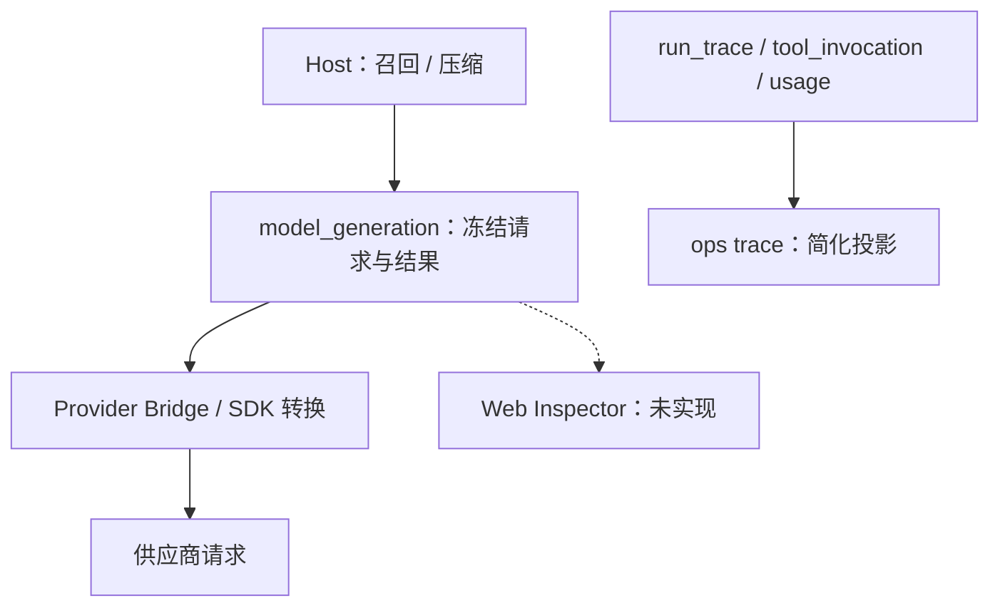
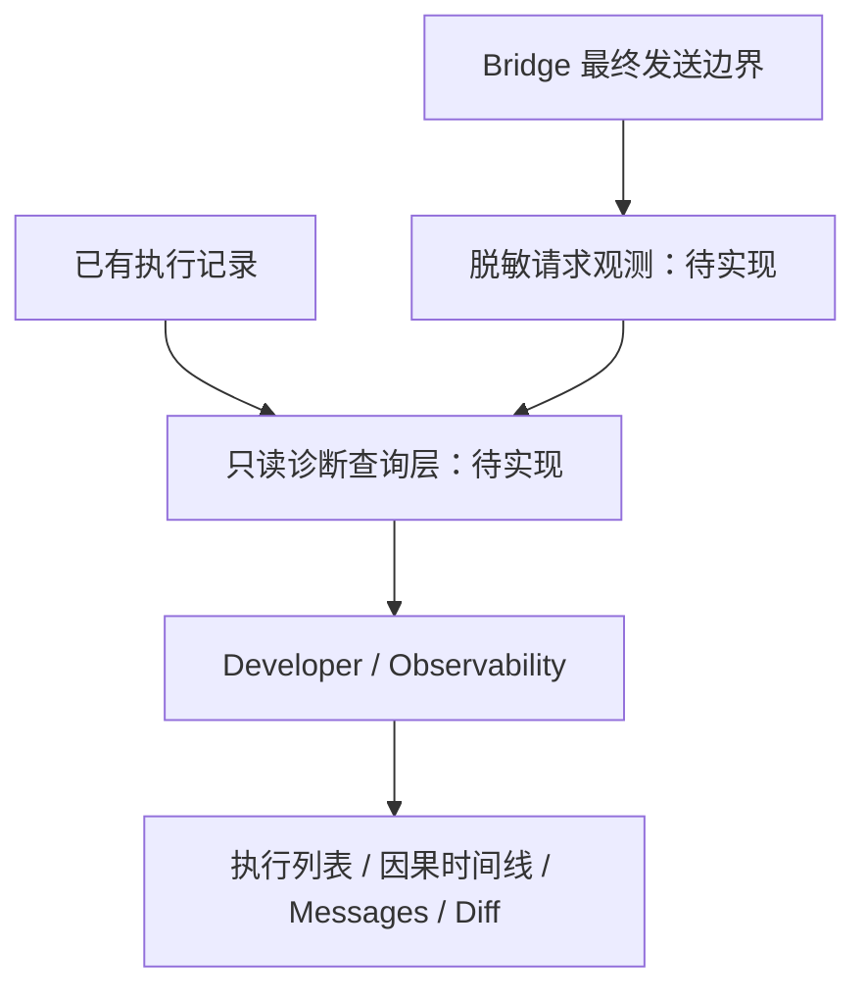

# Developer Observability 执行检查器：技术方案

[功能与需求](../features/observability.md) · [测试方案](../test-plans/observability.md) · [主索引](../feature-map.md)

最近核对：2026-10-28。本文的架构与流程描述当前有效实现；明确标记的待实现方案不表示已落地。实现级协议仍服从 [跨功能协议与约束](product-overview.md#contract-0-文档效力与实现规则)。

## 当前架构

当前 Host 已保存冻结模型交换、工具与恢复数据；Bridge 继续转换 system、工具命名空间和图片。只有简化 CLI trace 和本地日志，没有执行检查器，也没有完整最终请求观测记录。

## 当前流程与目标差异

当前：每轮组装上下文 → 保存冻结请求 → Bridge 转换 → 发送 → 保存结果/usage。最新目标：只读聚合这些记录 → 关联执行与尝试 → 在 Web 检查；发送边界补记录脱敏后的最终请求。

- **F-031**：Web 无此 Tab；已有领域记录与简化 ops trace。 实现列表、筛选、Main 创建 Task 的关联和 Root/Child 树，保留返回对话或任务的导航。
- **F-034**：model_generation 已保存冻结请求与结果；召回、压缩有独立记录，缺聚合查询与页面。 实现完整有序消息查看、来源关联、压缩省略说明、相邻轮次新增/删除/变化展示。
- **F-035**：Bridge 会合并 system、转换工具并加入图片；当前缺完整发送边界观测记录。 在最终发送边界保存受控脱敏记录，标识发送尝试与转换版本；凭据和图片 Base64 不进入普通轨迹。
- **F-036**：调用、trace、generation 与 usage 数据已有，CLI 只提供有限投影。 聚合模型/工具时间线、状态、已有 Token/耗时；区分 Generation、dispatch attempt 和结果复用。

## 最新待实现方案

以下是已确认方向的设计分解，尚未存在对应接口或页面。

Main 创建 Task 是因果关联，不把 Root 伪装成 Main 的 Child Run。Generation 与实际 dispatch attempt 分开；已保存结果的复用、未发送等待、取消和恢复都要标明。

Host 请求、Bridge/SDK 转换结果和脱敏供应商请求必须分层展示；图片用授权引用、尺寸和哈希描述，不把 Base64 或凭据写入普通轨迹。请求正文的隐私访问、保留与导出策略在实现前明确，观测故障不能破坏权威执行。

首版范围：执行列表与筛选、关系/时间线、逐轮消息和 Tool Schema、响应、来源与相邻轮次 Diff、现有用量展示。实时订阅、搜索索引、外部导出和具体接口/表结构仍待实施设计，不预设不存在的 API。

## 代码与依赖

- [internal/agent/sqlite/operations.go](../../internal/agent/sqlite/operations.go)
- [internal/agent/sqlite/generation.go](../../internal/agent/sqlite/generation.go)
- [internal/agent/sqlite/schema.sql](../../internal/agent/sqlite/schema.sql)
- [internal/llm/sqlite/local.go](../../internal/llm/sqlite/local.go)
- [provider-bridge/bridge.mjs](../../provider-bridge/bridge.mjs)
- [internal/interaction/web/server.go](../../internal/interaction/web/server.go)

## 验证与交付

验收场景、已有入口和剩余覆盖统一在 [测试方案](../test-plans/observability.md) 维护。本次建档未执行本功能的回归或 Live 验证，不以架构图替代运行证据。

## 协议、实现与配置约束

迁入内容按职责归属在此维护。既有编号用于追溯协议，不代表所有设计目标均已实现；完成状态以需求主索引为准。

#### 6.5 Agent Event Sink 与可靠性边界

- Agent Loop 只依赖一个 `EventSink`，由外部 Composite Sink 将事件路由到实时流、持久化、事件队列和可观测性实现。
- `message_update`、`tool_execution_update` 等增量更新是 best-effort 实时事件，不进入 EventQueue。
- Conversation 最终消息、Run 状态、Checkpoint 和 Outbox 初始记录属于 durable 写入；日志、指标、流式 Token 和临时进度属于 best-effort。
- durable 写入先于 best-effort 通知；durable 写入失败时进行有限指数退避，并在稳定边界停止，由恢复机制继续。
- `state.db` 与 `conversation.db` 不做分布式事务，使用确定性 ID 和幂等写入；只有所有必要 durable 写入成功后才推进 Checkpoint。
- ToolExecutor 与 EventSink 是独立边界：工具执行日志、结果持久化和副作用幂等由 ToolExecutor 负责，结果持久化成功后才发出 `tool_execution_end`。

### 13. 可观测性与用户进度

#### 13.1 Observability

- Observability 与业务 Operations 分离。
- 内部保存结构化日志、指标、分布式追踪、RunTrace、工具轨迹和 DLQ 状态。
- 原始工具调用轨迹只对研发调试开放。
- 内部异常先由 Main Agent Loop 解释和处理，不向用户直接暴露底层错误。

## Changelog

2026-10-28：按统一文档结构迁入本功能的协议与历史决策，更新引用并移除旧文件；此为文档归属调整，不改变运行时协议。

本节追加记录每次架构/流程取舍。旧图不保留在正文；历史正式决定保留在本节。首次记录为现状建档，不推断历史决策日期。

| 日期 | 类型 | 决策与理由 | 取舍及影响 | 关联 |
| --- | --- | --- | --- | --- |
| 2026-10-28 | 现状建档 / 未来方向 | 2026-10-28 已确认集成现有 Web，采用 Developer → Observability；首先利用已有权威记录。独立第三方平台不是首版依赖，观测不参与调度或重放。 | 明确当前边界与待补齐链路；本次仅建立文档，未修改运行时。 | [跨功能契约](product-overview.md#contract-0-文档效力与实现规则) |

后续记录需包含实际比较过的选项、采用理由、兼容/迁移影响和相关需求或 PR；未决建议不能写成已实施决策。
