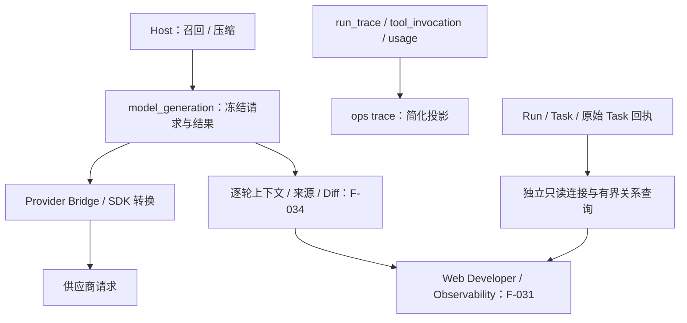
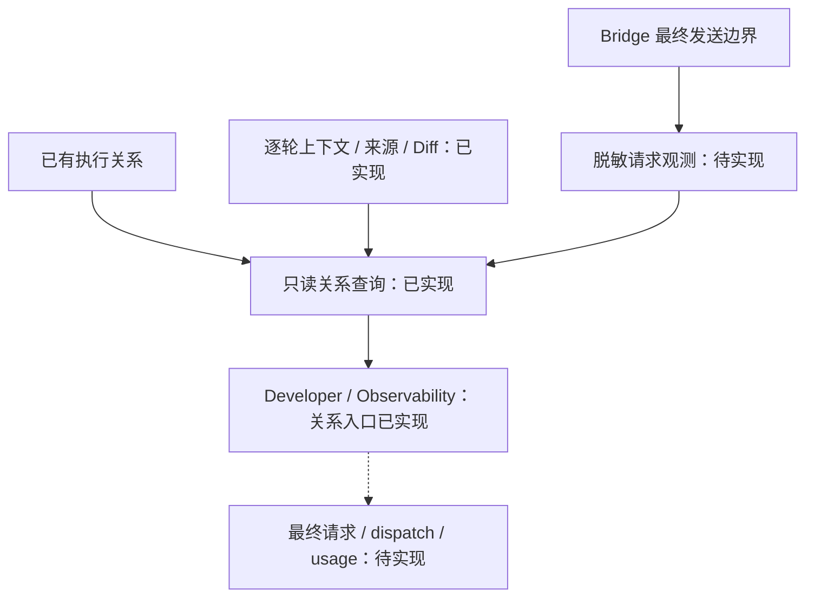

# Developer Observability 执行检查器：技术方案

[功能与需求](../features/observability.md) · [测试方案](../test-plans/observability.md) · [主索引](../feature-map.md)

最近核对：2026-10-29。本文的架构与流程描述当前有效实现；明确标记的待实现方案不表示已落地。实现级协议仍服从 [跨功能协议与约束](product-overview.md#contract-0-文档效力与实现规则)。

## 当前架构

Host 保存冻结模型交换、工具与恢复数据；Bridge 继续转换 system、工具命名空间和图片。F-031 已通过独立只读查询接通 Web 执行列表和因果关系检查；CLI trace 和本地日志保留。F-034 接通冻结 context、来源与 Diff；最终请求观测和调用/用量时间线仍待实现。

## 当前流程与目标差异

当前：每轮组装上下文 → 保存冻结请求 → Bridge 转换 → 发送 → 保存结果/usage。最新目标：只读聚合这些记录 → 关联执行与尝试 → 在 Web 检查；发送边界补记录脱敏后的最终请求。

- **F-031**：已实现列表、角色/状态/UTC 时间筛选、稳定 keyset 分页、原始 Main→Task 回执关联和真实 Root/Child 树；保留返回对话/任务的导航。仅提供关系元数据，不将后续 context/dispatch 功能列为已完成。
- **F-034**：已从 model_generation、context_compaction、run_recall 提供逐轮只读检查、完整有序消息、工具/响应、已记录来源与省略记录，以及相邻输入 Diff。
- **F-035**：Bridge 会合并 system、转换工具并加入图片；当前缺完整发送边界观测记录。 在最终发送边界保存受控脱敏记录，标识发送尝试与转换版本；凭据和图片 Base64 不进入普通轨迹。
- **F-036**：调用、trace、generation 与 usage 数据已有，CLI 只提供有限投影。 聚合模型/工具时间线、状态、已有 Token/耗时；区分 Generation、dispatch attempt 和结果复用。

## F-031 当前实现与模块边界

- `observability/inspection.go` 定义执行、Task 节点、回执关系和查询边界。`observability/sqlite` 持有 SELECT 和 keyset 游标；Web 消费自己的 `ExecutionReader` 小接口，不扩充 Conversation/action Core，也不取得领域数据库句柄。App 只绑定依赖。
- 状态库仍使用原有单写连接。Store 另持有检查器的惰性只读池（最多 2 个连接），查询同一 state.db，DSN 使用 `mode=ro` 与 `query_only(1)`；开启检查页时才建立物理连接。关系查询使用短只读快照，API/Page 总期限 3 秒。观察读取失败只使该页面返回不可用，不调度 Agent、不修改状态、不占用 Runtime 的写连接。Store.Close 同时关闭检查器。
- 执行列表按 `(created_at, run_id)` 倒序，支持 Main/Root/Child、状态和创建时间 `[since, until)`；Task 树与 Main 的回执按创建/接纳时间正序。每页默认 40、最多 100，读取多一行决定是否还有后续页，不执行全表 COUNT 或一次加载整个任务树。游标绑定列表/指定 Main/指定 Task，分页排序字段不可变；每页看到当前提交状态，不承诺跨页一致性快照。
- Main→Task 关联读取 `task_request` 的原始提交回执，再关联来源 ToolInvocation 和 Task。`task_invocation` 中复用的回执不作为新的创建关系。Task 的创建者只取原始 create 回执；缺失时保持未知。接纳时间与实际 dispatch/完成时间分开，不推测 F-036 数据。
- Root/Child 与深度、Root ID、Task epoch 直接读取 Run 记录，Root 的 Parent 为空；页面不把 Main 当作 Root 的父 Run。同一页按真实 Parent 分支排列，避免并行兄弟与晚创建孙节点的时间顺序造成错误缩进。分页中缺席的 Parent 明确标记为页外并保留直接链接，选中 Worker 自身的 Parent/Root 不随当前树页裁掉。Task 标题最多 240 字符，裁切有标记；不读取/返回 checkpoint、prompt、工具正文、模型配置或凭据。绑定当前 Agent，未知和其他 Agent 的选择均返回 404。
- Web 复用现有 token/session、loopback、binding、CSP 和 no-store 边界；新 GET API 为 `/api/developer/executions`（role/status/since/until/cursor/limit）及 `/api/developer/relationships`（run 或 task、relations_after、limit）。非法过滤器/游标返回 400，缺失资源 404，读故障 503，不泄露底层错误。POST 没有观察动作入口。公开绑定的标题和 ID 使用普通模板转义。
- 公共布局和 Conversation、Settings、Progress、Observability 分别放入 Web 的嵌入 HTML 模板，保持现有 React islands、草稿和实时更新边界。F-031 使用完整服务端 HTML，无 JavaScript 也可用；不增加轮询/前端状态管理或通用插件框架。

迁移：state schema 30 只新增执行列表/状态/Task 排序与回执关联索引，不重写记录、模型/能力快照、请求、审批或恢复键。原有已接纳执行继续使用原冻结内容。升级前停止旧进程，统一使用支持 schema 30 的二进制。

## F-034 当前实现与模块边界

- `observability/context.go` 持有轮次、内容分段、Diff 及校验类型。`observability/sqlite/context.go` 在原只读池中聚合已接纳的 generation、对应压缩与召回，不导入 Agent、当前 checkpoint 或运行配置。Web 消费独立 `ContextReader`，使用自己的 `context.go` 与 `templates/context.html`；App 只绑定同一检查器。既有关系查询和 Conversation Core 不扩充内容访问职责。
- 轮次按不可变 step_index 正序 keyset 分页，每页 40；选择轮次后，在短只读快照中查询元数据和当前 section。消息/工具/召回按原数组索引分页，响应与 provenance 作为各自单项；缺失或失败响应明确未知。未到模型接纳的准备阶段不伪造 generation。无 schema 或冻结格式变化，schema 继续为 30，老请求/审批/恢复键原样保留。
- SQL 只投影 messages、tools、已完成 result_json、provenance_json 与 hits_json，不将整个 request_json 或 model_snapshot 返回 Web。每次最多返回 40 项元数据和 8192 字节正文。使用 BLOB 字节切片保留嵌入 NUL，再收齐 UTF-8 边界；续读游标单调前进，JSON 与可读 text 各自有完整入口。切换轮次/section/item 时清除依赖的内容偏移，避免新选择沿用旧裁切位置。UI 不需要 JavaScript。
- 相邻轮次是同一 Run 中严格更早的最大 step；step 可不连续。只比较冻结 messages/tools。消息以非空 source.ref、其次 tool_call_id、最后原位置为键，工具以名称为键；重复键加出现序号。SQL 对已有项做精确比较，返回 added/removed/changed/moved、前后索引，分页 40 项；完整内容通过原轮次读取，不复制大段前后正文。不根据自然语言猜测身份或相似性。
- 来源按冻结 ContextSource、原工具调用 ID、召回 hit 与 compaction provenance 展示；压缩摘要、history_artifact、source_refs、omitted_images 保留原字段。已有引用可定位历史记录，缺失的细粒度归因保持未知。检查器不解析不可信正文来推导权威关系，不解密/检索当前 Memory，不读取或授予 Run-only Artifact 字节。原始输入可继续在历史轮次核对。
- 入口 `/developer/context?run=...` 从执行详情导航；GET API 为 `/api/developer/rounds`、`/api/developer/context`、`/api/developer/context-diff`。按当前 Agent 绑定 Run；不存在、其他 Agent 或不存在的 step/item 返回 404，非法查询 400，读取失败 503 且不泄露底层错误。每个页面/API 总期限 3 秒，保持最多 2 个独立只读连接，不阻塞单写连接或参与调度。
- 隐私/保留：这是同一工作区所有者授权下的敏感正文检查，复用 loopback、binding、token/session、CSP 与 no-store。消息普通转义，不执行 HTML，不读取凭据引用、所有权 token 或媒体 Base64。直接读取既有权威记录，不新增副本、缓存、导出或保留机制；已有数据保留、删除与备份语义不变。未来外部导出或多用户访问需另行设计。

## 后续待实现方案

下图区分已实现的关系/context 检查与尚待实现的发送边界、dispatch/usage；当前不把 generation 状态解释为外部发送次数。

Main 创建 Task 是因果关联，不把 Root 伪装成 Main 的 Child Run。Generation 与实际 dispatch attempt 分开；已保存结果的复用、未发送等待、取消和恢复都要标明。

Host 请求、Bridge/SDK 转换结果和脱敏供应商请求必须分层展示；图片用授权引用、尺寸和哈希描述，不把 Base64 或凭据写入普通轨迹。请求正文的隐私访问、保留与导出策略在实现前明确，观测故障不能破坏权威执行。

F-031 交付列表和执行关系，F-034 交付逐轮消息、Tool Schema/响应与来源/Diff；后续按 F-035/F-036 交付最终发送请求、发送尝试与已有用量。实时订阅、内容搜索、外部导出仍未实施，不预设 API。

## 代码与依赖

- [internal/agent/sqlite/operations.go](../../internal/agent/sqlite/operations.go)
- [internal/agent/sqlite/generation.go](../../internal/agent/sqlite/generation.go)
- [internal/agent/sqlite/schema.sql](../../internal/agent/sqlite/schema.sql)
- [internal/llm/sqlite/local.go](../../internal/llm/sqlite/local.go)
- [provider-bridge/bridge.mjs](../../provider-bridge/bridge.mjs)
- [internal/interaction/web/server.go](../../internal/interaction/web/server.go)
- [internal/observability/inspection.go](../../internal/observability/inspection.go)
- [internal/observability/sqlite/inspection.go](../../internal/observability/sqlite/inspection.go)
- [internal/interaction/web/inspection.go](../../internal/interaction/web/inspection.go)
- [internal/interaction/web/templates/observability.html](../../internal/interaction/web/templates/observability.html)

## 验证与交付

验收场景、已有入口和剩余覆盖统一在 [测试方案](../test-plans/observability.md) 维护。F-031/F-034 的软件证据覆盖真实执行、冻结输入/结果、压缩与浏览器只读链路，不代表最终 wire 观测或真实模型质量。

## 协议、实现与配置约束

迁入内容按职责归属在此维护。既有编号用于追溯协议，不代表所有设计目标均已实现；完成状态以需求主索引为准。

#### 6.5 Agent Event Sink 与可靠性边界

- Agent Loop 只依赖一个 `EventSink`，由外部 Composite Sink 将事件路由到实时流、持久化、事件队列和可观测性实现。
- `message_update`、`tool_execution_update` 等增量更新是 best-effort 实时事件，不进入 EventQueue。
- Conversation 最终消息、Run 状态、Checkpoint 和 Outbox 初始记录属于 durable 写入；日志、指标、流式 Token 和临时进度属于 best-effort。
- durable 写入先于 best-effort 通知；durable 写入失败时进行有限指数退避，并在稳定边界停止，由恢复机制继续。
- `state.db` 与 `conversation.db` 不做分布式事务，使用确定性 ID 和幂等写入；只有所有必要 durable 写入成功后才推进 Checkpoint。
- ToolExecutor 与 EventSink 是独立边界：工具执行日志、结果持久化和副作用幂等由 ToolExecutor 负责，结果持久化成功后才发出 `tool_execution_end`。

### 13. 可观测性与用户进度

#### 13.1 Observability

- Observability 与业务 Operations 分离。
- 内部保存结构化日志、指标、分布式追踪、RunTrace、工具轨迹和 DLQ 状态。
- 原始工具调用轨迹只对研发调试开放。
- 内部异常先由 Main Agent Loop 解释和处理，不向用户直接暴露底层错误。

## Changelog

2026-10-28：按统一文档结构迁入本功能的协议与历史决策，更新引用并移除旧文件；此为文档归属调整，不改变运行时协议。

本节追加记录每次架构/流程取舍。旧图不保留在正文；历史正式决定保留在本节。首次记录为现状建档，不推断历史决策日期。

| 日期 | 类型 | 决策与理由 | 取舍及影响 | 关联 |
| --- | --- | --- | --- | --- |
| 2026-10-29 | F-034：冻结上下文、来源与 Diff | 沿用权威冻结记录与独立只读池，新增聚合查询和 feature 自有页面；选择存储投影而非从当前 checkpoint 重建，避免历史与重放漂移。 | 无 schema/协议迁移；40 项分页与 8192 字节连续 UTF-8 切片保留长文本，来源缺失如实说明。Diff 比较已存输入、重复键按出现顺序；同一所有者敏感内容访问，不增加导出/副本/归档授权。F-035/036 保持未实现。 | F-034 |
| 2026-10-28 | F-031：执行关系检查 | 用已有权威 Run/Task/原始回执建立有界只读投影，接通现有 Web 的 Developer 导航。与共享写连接方案比较，选择独立惰性只读池，避免观察阻塞 Runtime；按 feature 拆开内嵌页面模板。 | schema 30 仅加索引，冻结数据不改；Root/Child 与 Main→Task 因果边区分。无观察调度引擎、内容导出或新 CI/eval 平台，F-034/035/036 保持未实现。 | F-031 |
| 2026-10-28 | 现状建档 / 未来方向 | 2026-10-28 已确认集成现有 Web，采用 Developer → Observability；首先利用已有权威记录。独立第三方平台不是首版依赖，观测不参与调度或重放。 | 明确当前边界与待补齐链路；本次仅建立文档，未修改运行时。 | [跨功能契约](product-overview.md#contract-0-文档效力与实现规则) |

后续记录需包含实际比较过的选项、采用理由、兼容/迁移影响和相关需求或 PR；未决建议不能写成已实施决策。
