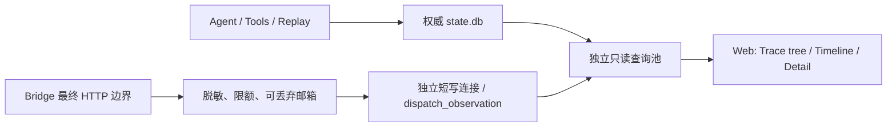

# Developer Observability：技术方案

[功能与需求](../features/observability.md) · [测试方案](../test-plans/observability.md) · [主索引](../feature-map.md)

当前实现对齐 Langfuse 的观测概念与浏览体验；视觉沿用 Steward 的共享主题、控件和间距，只有状态使用语义颜色。运行状态、冻结请求和重放仍由 Steward 持有。参考 [Core concepts](https://langfuse.com/docs/observability/data-model)、[Observation types](https://langfuse.com/docs/observability/features/observation-types) 与 [Good traces](https://langfuse.com/docs/observability/best-practices)。跨功能语义服从 [运行时契约](runtime-contracts.md)。

## 当前架构

- **Session**：Conversation ID，关联多次 Main 执行与后台 Task epoch。
- **Trace**：一次 Main Run 或一个 Root epoch 的执行树。Child 仍属于其 Root trace；Main 创建 Task 的原始回执建立跨 trace 因果关联，不把 Root 显示成 Main 的 Child。
- **Observation**：Agent、Generation、Tool、Retriever、上下文准备、审批等待、工具执行片段、HTTP attempt 和事件。投影读取实际 parent / invocation ID，不从自然语言或时间顺序猜测关系。

状态数据库是业务权威。除新增独立的可丢失 dispatch 证据外，页面直接投影已有记录，不建设第二个调度/重放引擎。

## 查询与模块边界

- `observability/trace.go` 定义查询与投影；`observability/sqlite/traces.go` 负责 Trace/Session、指标与有界 observation 页，`observation_sources.go` 明确各权威表的统一字段，`trace_detail.go` 只读取所选节点的允许正文。
- 复用原独立只读池：`mode=ro`、`query_only(1)`、最多 2 个连接；按当前 Agent 限定 trace 和每次详情读取。Main/Root 列表默认 40、最多 100，按不可变创建时间和 ID keyset 分页；observation 每页最多 100，游标绑定 Root trace。缺席的 parent 显示为页外片段，所选节点可独立读取。
- 详情不返回完整 model_snapshot、配置、所有权 token 或 connection。`content.go` 是冻结 context、Tool 和 Wire 正文共用的 UTF-8 字节分段实现；每段最多 8192 字节，支持 NUL、中文和 emoji，完整内容通过续读读取，拒绝非法偏移。
- Web 依赖自己的 `TraceReader`、`ContextReader`、`ExecutionReader` 小接口；App 只绑定同一检查器。查询状态、服务端视图计算、正文模板、渐进导航和样式各自归属功能文件，不扩充 Conversation Core。旧重复关系页被新详情页替换；既有 `/api/developer/executions` 与 `/relationships` 元数据接口语义保留。
- 新 GET API：`/api/developer/traces`、`/api/developer/observations`、`/api/developer/observation-body`。页面与 API 总期限 3 秒；非法查询 400，缺失/越界节点 404，读故障 503 且不泄露底层错误。沿用 loopback、binding、token/session、CSP、no-store；正文普通转义，SVG 使用数值属性，不注入动态内联脚本/样式。
- 同页读取之间可看到不同的已提交状态；不承诺整次浏览或跨页数据库快照。刷新获取最新状态。原生链接无 JS 可用；渐进导航仅替换 workbench，保存树/时间线滚动位置与 URL/history，不轮询、不调度工作。

### 页面职责与节点导航

`/developer/observability` 只读取 Trace 列表，`/developer/observability/{runID}` 只读取该执行树与关系，详情不依赖全局列表查询成功。浏览器列表点击名称时以共享原生 dialog 抽屉呈现同一个服务端 workbench，非模态列表浏览、共享 Escape/焦点恢复与 URL/history 管理选择，关闭恢复原列表；完整详情页与无脚本路线保持独立。左侧紧凑执行树与右侧内容分开，执行时长位于名称下方；移除重复的底部执行表，Task epoch 通过详情选择器切换。因果/内部标识折叠保留，Main→Task 仍是跨 Trace 链接，Root 不冒充 Main Child。

节点类型决定 Tab：Generation Preview/Context/Requests（Preview 继续使用原 overview URL 值），仅有前一存储轮次时增加 Compare；HTTP Preview/Requests；其他节点 Preview。技术 metadata 为折叠区。完整 contextReader 合并到 Generation Context 内，保留全部 messages/tools/response/provenance/recall、分页、原始 JSON、UTF-8 偏移及前后 Diff 内容；不再维护并列的冻结上下文页面。旧 context/run-query URL 经过原参数校验后仅跳转，API 不变。

### 列表查询与呈现

当前消费者为安装所有者的 Developer 列表及已有 Trace API。新增可选 `search`（最多 200 UTF-8 字节）在当前 Agent、Session、角色、状态、时间范围内，对 Run ID、Task 标题（Main 使用 Main conversation）和模型做字面子串匹配；ASCII 大小写不敏感，不把 `%` 或 `_` 解释为通配符。查询在 keyset 分页前应用，不只过滤当前页，不扫描 observation 正文。API 输出与既有查询保持兼容，不更改持久化 schema、授权或冻结数据。

服务端继续拥有查询机制、指标口径与时间边界；最近 24 小时／7 天／30 天是当前 Web 的时间快照链接，Refresh 不隐式滚动其起点。Developer 导航 176px/168px、筛选栏 176px（手机默认收起）、单行分列、默认显示 Input/Output 与默认隐藏 ID 是 Web 呈现策略；列显隐只存当前浏览器。共享 `disclosure.tsx` 使用 Base UI Popover 管理定位/焦点/关闭，顶栏时间字段通过 form 属性关联原列表 form，脚本失效保留 details 表单。详情抽屉复用同一 GET 页面解析的 workbench，不增加第二个详情 API 或查询引擎。

`Traces` 额外返回完整筛选范围的 `total` 与最多 48 个时间桶 `activity`。同一个只读事务在 keyset 条件前计算 count/min/max 和分桶；行数据与指标继续分页读取，直方图不从当前 40 条摘要假造全量。无匹配记录返回零计数。未指定边界时使用匹配记录的最早/最晚创建时间，指定时间边界时按该边界分桶；时间戳与排序均为 UTC。新增投影字段不修改数据库 schema 或执行状态。

这些组件和查询投影是仓库内实现，不提升为外部插件协议或通用查询语言。当前不实现 Langfuse 的 field:value DSL、facet 计数、保存视图、批量操作或公开分享；只借鉴布局与诊断密度。选择有界元数据子串查询而不增加 FTS 索引，避免将这次列表改造扩大为全文检索基础设施；大规模搜索优化需以真实数据量再验证。

### 详情呈现与可逆交互

树的 HasChildren 与连接线依据已读取 observation parent 关系生成，不按时间猜测祖先。折叠状态只留在本次页面，选择、搜索和节点加载仍读取同一个只读 workbench。搜索保留命中的祖先并临时展开；关闭搜索恢复分支状态。节点类型与状态使用不同语义颜色，未知结果不会因配色被解释为成功。

`resize-handle.ts` 共享 Pointer Capture、取消、键盘、边界与 ARIA 行为；`split-view.ts` 与 `sheet.ts` 分别负责内部/外部尺寸。只持久化有限宽度比例，不保存诊断正文；移动端停用竖向分栏。`read-only-json.ts` 只创建转义后的 DOM text，保留原 pre 与服务端续读链接。树形视图有 2000 节点预算，片段、无效 JSON、不能无损往返的数字回退到原 pre；服务端 prettyBody 使用 json.Number，避免只读展示先把归档数字转为 float64。Formatted/JSON 和折叠不更改权威记录、冻结字节或查询授权。Copy 仅由用户点击复制当前已加载片段。无脚本保持原生文本、链接和 details 阅读。

## 时间、用量与恢复

| 节点/指标 | 语义 |
| --- | --- |
| Agent / Tool lifecycle | 接纳到终态的 wall time，可能包含排队和等待 |
| Generation | 冻结接纳到保存结果；不是一次 HTTP dispatch |
| Provider HTTP | 发送尝试到收到响应头；不冒充完整推理/stream 耗时 |
| Provider operation | 既有 usage ledger 的 latency_ms，包含 provider 准备和流式读取 |
| Approval / spend wait | 实际授权创建到决定；未决定时结束未知 |
| Execute tool | 新事件中的 invocation ID 关联的 start/end 片段；缺事件不推断 |
| Retriever / context | 已保存时间点；历史记录没有开始时间时不给虚构耗时 |
| Result reuse | 从已接纳结果继续的事件；不新增 generation、usage 或外部调用 |

Agent Loop 在实际复用结果和成功提交等待后发出 best-effort 事件；Tool 事件保留真实 invocation ID。旧记录没有该字段时不以跨 generation 可重复的 provider call ID 配对。事件缺失只保留未知，不改变权威执行。

指标仅汇总唯一 model_generation 关联的 provider_usage 与 spend_reservation；HTTP 重试和 reuse 不倍增。部分 usage 标明已知记录数，费用直接读取已结算账本、按币种分开；不使用当前价格推算历史，不将缺失 usage、价格或 duration 补零。

## F-034 冻结上下文

逐轮内容继续由 `model_generation`、`context_compaction` 和 `run_recall` 提供，读取 Host 冻结输入、原始 Schema 与接受结果，不从当前 checkpoint/Memory 重建。Generation 详情默认按角色展示有界预览；完整消息、来源、Schema、压缩记录和旧/新内容由同一 Generation 的 Context 阅读器与 Compare 入口读取。

同一逻辑输入复用首次召回时，`context_compaction.provenance_json.recall_step` 指向该 Run 内确切的 `run_recall` 记录，后续 Generation 的召回区按此引用读取；Retrieve context 仅由真实召回记录产生，Prepare context 仍记录每次请求准备。旧 provenance 缺此字段时只读本 step 的记录，缺失保持未知，不以最近时间点猜测复用。

相邻输入比较同一 Run 的前一个已存 step，step 不要求连续。消息按 source.ref / tool_call_id / 旧位置，工具按名称，重复键按出现序号对齐，精确区分 added/removed/changed/moved，不做语义猜测。原始归档只显示引用，不因观测授予 Run-only Artifact 访问。

## F-035 最终 HTTP 证据

- `provider-bridge/observability.mjs` 独立拥有脱敏与限额；`bridge.mjs` 在最终 SDK fetch 前和 headers/error 后通知。Account 路径也在 namespace 转换之后采集。每次重试独立 attempt ID，携带 generation ID、UTC 微秒时间、capture/SDK 格式版本、脱敏正文 hash 和状态。
- `generation.observation` 是私有 RPC 的可选、独立诊断通知。只有 Host 在冻结请求外设置 observe 时才发送；不占用 generation.event 序号，不进入请求哈希或 Capability/ModelSnapshot。旧 peer 不产生证据时明确未知；probe 不持久化为业务 observation。
- 不采集请求头/connection；Node 和 Host 都移除已知凭据。图片替换为已知 Artifact 引用、预览 JPEG hash 与原图/预览尺寸；不是原图像素 hash。正文最多 256 KiB，超限保留 hash/原因，不能当逐字原包或用于重放。模型输出仍来自既有已接受结果，不复制原始 SSE 流。
- Host `bridge/observations.go` 校验 registration、字段与上限，诊断错误/回调 panic 不拒绝 generation。`observability/sqlite/recorder.go` 使用 32 条非阻塞邮箱与独立单写连接，busy_timeout 25ms、单条总写期限 100ms；只在该预算内重试本地幂等 INSERT 的 SQLITE_BUSY/LOCKED，其他失败或超时/拥塞可丢弃。Provider 无数据库访问；Web 不取得写连接。App 关闭 provider 后再排空 recorder，强制退出允许留空；已终结的 generation/Run 缺少 HTTP 结束证据时显示 unknown，不冒充仍在请求或补造结束时间。
- capture 的 started 仅证明 fetch 尝试，headers 仅证明响应头被收到；取消、网络错误、丢失事件与终态不确定性各自保留。generation.attempt_count 不能被解释为 HTTP 次数，工具 Host execution starts 也不等于实际网络次数。

Generation Overview 按 UTC 时间显示各 HTTP 尝试及流时间点。首段数据来自传输层，首段可见文本或首个工具调用来自已解析的模型事件。终止标记记录 Responses 的完成或失败等事件，兼容接口使用 finish reason 或 SDK 完成事件。标记仅包含阶段、时间及关联键。整轮超时也可在发出生成 HTTP 请求之前记录。HTTP 节点的持续时间仍表示等待响应头。

## 存储、兼容与隐私

state schema **31** 引入 `dispatch_observation` 与 Root 查询索引。schema **42** 扩展阶段枚举并复制原 HTTP 尝试记录。旧请求缺失的流时间点保留为未知。诊断表独立于权威记录、冻结请求、审批和恢复键。升级前停止旧进程，统一使用支持 schema 42 的二进制。

敏感冻结输入和脱敏最终请求由同一安装所有者授权查看，保留在本地 state.db 并沿用其保留/加密备份边界。capture 不是业务权威或 exactly-once 证明；未知观测不阻塞业务恢复。没有第三方传输、公开分享、外部导出或观测驱动的执行操作。

未实施：Langfuse 服务/OTel exporter、远程 Prompt Management、Dataset/Evals、聚合 Agent Graph、全文搜索和自动轮询。Prompt 继续由文件/Git 管理，模型质量评测继续离线维护。

## 验证与代码

- [统一数据模型](../../internal/observability/trace.go)
- [只读投影](../../internal/observability/sqlite/traces.go)
- [可丢失采集器](../../internal/observability/sqlite/recorder.go)
- [最终请求脱敏](../../provider-bridge/observability.mjs)
- [Web 读取边界](../../internal/interaction/web/traces.go)
- [Trace 模板](../../internal/interaction/web/templates/traces.html)
- [正文读取](../../internal/observability/sqlite/content.go)

需求级证据与限制统一见 [测试方案](../test-plans/observability.md)，运行命令沿用现有 make/runner，不新建 CI gate 或模型评测框架。

## 协议、实现与配置约束

本功能协议在此维护。既有编号用于追溯协议，不代表所有设计目标均已实现；完成状态以需求主索引为准。

#### 6.5 Agent Event Sink 与可靠性边界

- Agent Loop 只依赖一个 `EventSink`，由外部 Composite Sink 将事件路由到实时流、持久化、事件队列和可观测性实现。
- `message_update`、`tool_execution_update` 等增量更新是 best-effort 实时事件，不进入 EventQueue。
- Conversation 最终消息、Run 状态、Checkpoint 和 Outbox 初始记录属于 durable 写入；日志、指标、流式 Token 和临时进度属于 best-effort。
- durable 写入先于 best-effort 通知；durable 写入失败时进行有限指数退避，并在稳定边界停止，由恢复机制继续。
- `state.db` 与 `conversation.db` 不做分布式事务，使用确定性 ID 和幂等写入；只有所有必要 durable 写入成功后才推进 Checkpoint。
- ToolExecutor 与 EventSink 是独立边界：工具执行日志、结果持久化和副作用幂等由 ToolExecutor 负责，结果持久化成功后才发出 `tool_execution_end`。

### 13. 可观测性与用户进度

#### 13.1 Observability

- Observability 与业务 Operations 分离。
- 内部保存结构化日志、指标、分布式追踪、RunTrace、工具轨迹和 DLQ 状态。
- 原始工具调用轨迹只对研发调试开放。
- 内部异常先由 Main Agent Loop 解释和处理，不向用户直接暴露底层错误。

## 当前设计取舍与兼容约束

观测集成现有 Web 的 Developer 区域，使用本地权威记录与独立惰性只读池，不参与调度或重放，也不依赖第三方平台。Main→Task 因果关联与 Root/Child 树分别表达。

完整 Context 阅读器归入 Generation；树、时间线和节点输入输出共享导航，旧深链接继续有效。上下文从已存冻结记录投影，不从当前 checkpoint 重建；40 项分页与 8192 字节连续 UTF-8 切片保留长文本，来源缺失如实显示，Diff 对重复键按出现顺序比较。

最终 SDK fetch 独立捕捉脱敏 HTTP attempts，恢复复用事件与用量账本分开。schema 30 的索引和 schema 31 的诊断表不改变冻结协议；独立可丢失邮箱与短写隔离诊断故障。请求体与原冻结 context 受相同所有者和本地备份边界保护，不增加第三方导出授权。
