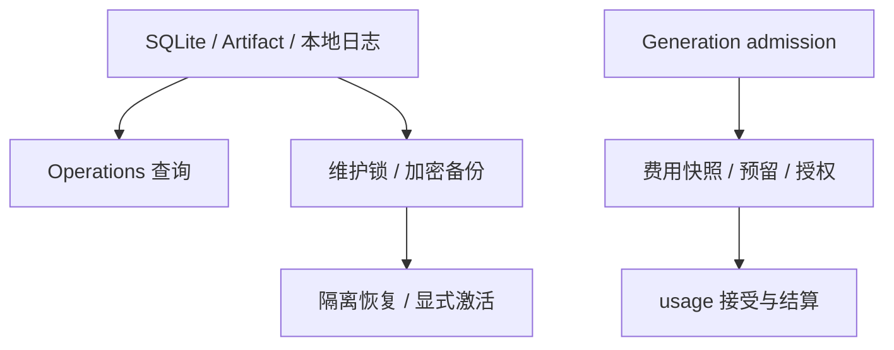

# 诊断、备份恢复与费用：技术方案

[功能与需求](../features/operations.md) · [测试方案](../test-plans/operations.md) · [主索引](../feature-map.md)

最近核对：2026-10-28。本文的架构与流程描述当前有效实现；明确标记的待实现方案不表示已落地。实现级协议仍服从 [跨功能协议与约束](product-overview.md#contract-0-文档效力与实现规则)。

## 当前架构

本地诊断读取持久状态与日志；维护锁序列化备份/恢复。模型请求在 admission 事务中处理费用预留，最终 usage 与结果一起接受。

### Go 实现职责（F-040）

报表类型由 `internal/operations` 持有，`internal/operations/sqlite` 提供只读查询；App 与 CLI 不依赖 agent/sqlite 中的报表实现类型。

## 当前流程与目标差异

诊断读取 → 定位问题；备份关闭/锁定工作集 → 加密归档 → 隔离验证恢复 → 显式切换。费用先预留再 dispatch，结果接受时结算。

- **F-028**：doctor/status/ops、日志轮转、加密备份、恢复验证与显式切换已实现。 备份不包含凭据、Guest 镜像等外部资源；不能同时运行同身份的两个恢复副本。
- **F-029**：provider_usage、费用快照、预留和授权已接入模型 admission。 无价格时不能声称零费用；不是供应商账单或按任务动态模型路由。

## 代码与依赖

- [internal/observability/observability.go](../../internal/observability/observability.go)
- [internal/maintenance/backup.go](../../internal/maintenance/backup.go)
- [internal/agent/sqlite/operations.go](../../internal/agent/sqlite/operations.go)
- [internal/agent/sqlite/spend.go](../../internal/agent/sqlite/spend.go)
- [internal/llm/sqlite/local.go](../../internal/llm/sqlite/local.go)

## 验证与交付

验收场景、已有入口和剩余覆盖统一在 [测试方案](../test-plans/operations.md) 维护。本次建档未执行本功能的回归或 Live 验证，不以架构图替代运行证据。

## Changelog

2026-10-28：测试入口随当前 Makefile/runner 对齐。旧说明中的 make verify、Delivery/security 分片与自动五轮是历史调度；当前默认单次，重复次数通过 runner --repeat 显式指定。移除已退役的独立容量采样命令，保留机制验收要求。

2026-10-28：按统一文档结构迁入本功能的协议与历史决策，更新引用并移除旧文件；此为文档归属调整，不改变运行时协议。

本节追加记录每次架构/流程取舍。旧图不保留在正文；历史正式决定保留在本节。首次记录为现状建档，不推断历史决策日期。

| 日期 | 类型 | 决策与理由 | 取舍及影响 | 关联 |
| --- | --- | --- | --- | --- |
| 2026-10-28 | F-040：按职责拆分 Go 实现。 | 保持原协议、路由、schema 与原子事务边界；详见工程方案。 |
| 2026-10-28 | 现状建档 | 保持运维诊断与用户对话分离；凭据独立备份管理。费用授权与 Tool 审批分别处理。 | 明确当前边界与待补齐链路；本次仅建立文档，未修改运行时。 | [002-account-monetary-authorization.md](#decision-002-account-monetary-authorization) |

后续记录需包含实际比较过的选项、采用理由、兼容/迁移影响和相关需求或 PR；未决建议不能写成已实施决策。

### 历史决策与演进记录

以下正文保留原决定、理由、兼容影响和当时证明范围，不作为当前完成声明。原记录中旧目录布局与旧验证命令属于历史上下文；现行入口以功能说明、当前架构及产品测试方案为准。

## Account monetary authorization

Accepted for ERII-18 on 2026-10-17 by the project owner. Baseline §6.6.6 is
normative. This resolves the previously unspecified price/limit policy.

Use an explicitly configured account monetary boundary and provider/model price
version. Token counts remain accounting and safety observations. They never
authorize spending. No model-visible budget or capability query is added.

The Host freezes pricing and policy in an immutable companion to each new
ModelSnapshot. Children share that snapshot. The generation admission transaction
reserves a conservative monetary projection from frozen context/output bounds;
usage acceptance settles it atomically with the provider observation and model
result. Missing usage retains its reservation as unknown actual cost. Existing
snapshots migrate as unpriced/unconfigured, without retrospective valuation.
Explicit setup Probes have usage-only snapshots and remain visible unpriced
control-plane observations; they are not silently valued as business Runs.

When committed account spend plus the next reservation reaches the boundary,
the Host holds dispatch and creates one durable approval owned by the Root.
All descendants join it. Its frozen action explicitly grants the remaining
bounded Run batch model spending beyond the account boundary, without another
monetary ceiling. It grants no Child Tool effect. A separate synchronous Main
Run uses its own approval; a Worker grant never authorizes Main work.

The grant is scoped to the exact Run identity, account, currency, frozen price
snapshot and Task epoch. New Roots require their own grant if the account
boundary is reached. Approval requires local ownership and the displayed frozen
hash. Denial fails held model calls with `SPEND_AUTHORIZATION_DENIED` and finalizes
their undispatched model ledger entries atomically with the Run. Pause or
cancel invalidates pending grants; old epochs cannot decide or accept usage.
Pending monetary approvals do not expire on process exit or release/reacquire.

Policy absence, missing prices and missing usage are visible states. They never
become guessed rates or zero-cost observations. Zero prices require every rate
to be written explicitly. No automatic currency conversion is supported. A
configured account cannot switch currency, and a pricing version cannot be
reused with different rates. Configuration changes affect new Runs only.

This is private Host/control-plane infrastructure. It reuses the existing
generation, Task stop, security notification, CLI/TUI approval decision and
ToolInvocation boundaries. Monetary consent is a different frozen action from
tool-effect consent, so it has a typed ledger rather than a fabricated Tool call.
It does not introduce another Agent Loop, effect execution path, model tool,
pricing service, token allowance or billing integration.

Tradeoff: projections deliberately reserve the full frozen model context/output
bound, rather than predicting tokens from text. This can prompt earlier than
actual usage requires. It prevents concurrent calls from independently consuming
the same authorization headroom. Historical unpriced usage remains unknown;
the local spend view and approval action disclose those call counts. Reported
usage exceeding a reservation is recorded as observed and creates the same Root
approval immediately, even on the final or failed model response. The shared
Loop holds its saved outcome and resumes it without another model call. Monetary
denial drains already accepted Tool calls through their independent policies
before failing the next model/reply boundary; it never orphans Child invocations.
A provider that ignores its model bounds cannot be given a guaranteed
real-world billing ceiling by this local mechanism.

Migration 015, `TestSpend*`, `TestSpendRequiresExplicitIntegerPrices`, and
`tests/system/verify_spend.py` prove conversion, frozen metadata, migration rollback,
cross-process coalescing, restart, denial, cancellation, usage rollback and
independent effect approval. The synthetic fixture is not market pricing or
model-quality evidence. M5 JavaScript/Durable Replay remains a separate gate.
