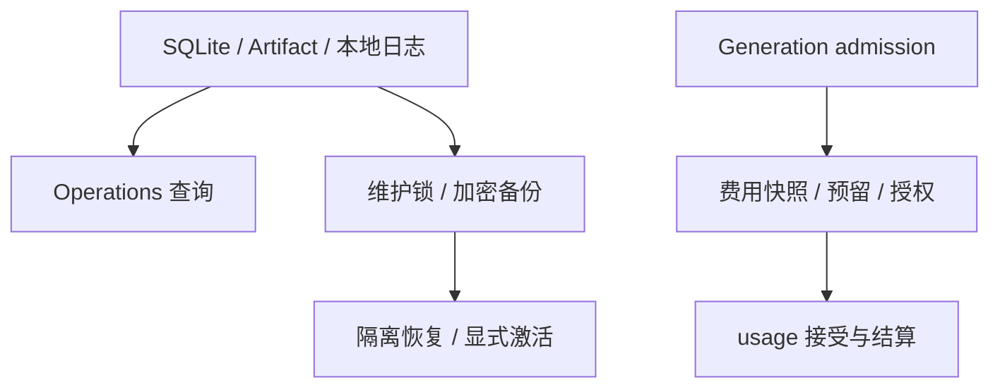

# 诊断、备份恢复与费用：技术方案

[功能与需求](../features/operations.md) · [测试方案](../test-plans/operations.md) · [主索引](../feature-map.md)

本文的架构与流程描述当前有效实现；明确标记的待实现方案不表示已落地。实现级协议仍服从 [跨功能协议与约束](product-overview.md#contract-0-文档效力与实现规则)。

## 当前架构

### macOS 用户级后台生命周期

`internal/operations/service` 管理每个规范化 data root 的两个私有 LaunchAgents：主进程运行既有 Web/Actor/Delivery 生命周期，独立巡检通过 `StartInterval=60` 运行；主进程没有无条件 `KeepAlive`。安装只是显式部署机制，启用和恢复策略由持久 `enabled` 意图决定。设计依据是 [Apple 的用户 Agent 与定时任务协议](https://developer.apple.com/library/archive/documentation/MacOSX/Conceptual/BPSystemStartup/Chapters/CreatingLaunchdJobs.html)。

控制操作使用独立短期 flock；主进程从接纳到关闭始终持有另一 OS 生存期锁，因此不使用 PID 存活推断，也不受 PID 复用影响。设置和固定码心跳分别原子替换、fsync；停止先提交 `enabled=false` 再 bootout，已排队的启动和巡检重新检查该意图。启动在控制锁之外等待接纳，运行中的服务每五秒检查停止意图并生成 readiness 心跳。重启/登录仅恢复仍启用的服务；缺少/不兼容设置 fail closed。

巡检不打开 domain 数据库、不接管 claim，也不驱动 Actor。存活进程的未配置、凭据/供应商和基础设施失效只显示健康码，继续由现有可恢复初始化处理；失去心跳时显示 stale，不杀死仍持锁进程。仅退出进程可触发 launchctl kickstart，不使用 `-k`；每分钟至多一次，三次连续恢复且未观测到 ready 后停止重启，显式 start 才重置。恢复次数在外部调用前提交，以限制巡检崩溃或调用结果不确定时的重复调度。配置/启动失败不自动重启。原始配置、供应商错误、prompt、credential 不写入心跳或通知；本地 notice 按固定状态码去重，保存最新提示与单调序号，不建立新的渠道投递协议。

机制复杂度中，持久人工意图、互斥锁、原子落盘、独立巡检与有限恢复属于进程生命周期要求；60 秒间隔、三次上限和 loopback 默认端口是当前可逆政策。实现和版本化服务元数据保持私有，不稳定通用 Service/Watchdog 插件接口，不建立第二 Agent Loop，不泛化为云部署或语义自治恢复。安装保存显式配置路径和 PATH，不拷贝 shell 凭据；Keychain 继续由 SecretStore 在运行时解析。普通安装仍不自动部署服务，升级服务需先停止并重新安装，以免把新版本发布当作启用授权。

现有 SQLite schema、审批哈希、冻结快照和 durable replay 不变。后台入口复用 `OpenRuntime`、`WithEvents`、`ServeWeb` 与既有恢复扫描；关闭浏览器不拥有服务 ctx，SIGTERM 排空仍沿既有边界，unknown 副作用继续 query-only。LaunchAgent 文件使用 XML 转义后的 argv 数组，不经过 shell；服务元数据和 jobs 使用 0600。真实 macOS 登录/Keychain/升级行为仍需隔离账户验收，协议替身只证明可控外部边界。

本地诊断读取持久状态与日志；维护锁序列化备份/恢复。模型请求在 admission 事务中处理费用预留，最终 usage 与结果一起接受。

### Go 实现职责（F-040）

报表类型由 `internal/operations` 持有，`internal/operations/sqlite` 提供只读查询；App 与 CLI 不依赖 agent/sqlite 中的报表实现类型。

## 当前流程与目标差异

诊断读取 → 定位问题；备份关闭/锁定工作集 → 加密归档 → 隔离验证恢复 → 显式切换。费用先预留再 dispatch，结果接受时结算。

- **F-028**：doctor/status/ops、日志轮转、加密备份、恢复验证与显式切换已实现。 备份不包含凭据、Guest 镜像等外部资源；不能同时运行同身份的两个恢复副本。
- **F-029**：provider_usage、费用快照、预留和授权已接入模型 admission。 无价格时不能声称零费用；不是供应商账单或按任务动态模型路由。

## 代码与依赖

- [internal/observability/observability.go](../../internal/observability/observability.go)
- [internal/maintenance/backup.go](../../internal/maintenance/backup.go)
- [internal/agent/sqlite/operations.go](../../internal/agent/sqlite/operations.go)
- [internal/agent/sqlite/spend.go](../../internal/agent/sqlite/spend.go)
- [internal/llm/sqlite/local.go](../../internal/llm/sqlite/local.go)

## 待实现方案

以下方案尚未实现。接口、持久化结构、迁移与精确时序须在实现前确定；当前执行仍遵循已有运行时契约。验收范围见功能说明及并列测试方案。

### F-028 · 本地持续运行与独立健康巡检

后台服务与交互界面分离生命周期，独立巡检不能依赖主执行循环存活；复用数据根锁、Claim/fencing 和既有恢复顺序。故障分类与停机意图是机制，重启次数、退避和通知是政策。平台 supervisor、安装/卸载与升级协议待设计，并同步 installation；只稳定实际支持的平台行为，不建立通用云部署层或模型自治修复平台。

## 验证与交付

验收场景、已有入口和剩余覆盖统一在 [测试方案](../test-plans/operations.md) 维护。实际执行结果以对应版本的 PR 或 CI 证据为准；架构说明不证明回归或 Live 验证通过。

## Account monetary authorization

Use an explicitly configured account monetary boundary and provider/model price
version. Token counts remain accounting and safety observations. They never
authorize spending. No model-visible budget or capability query is added.

The Host freezes pricing and policy in an immutable companion to each new
ModelSnapshot. Children share that snapshot. The generation admission transaction
reserves a conservative monetary projection from frozen context/output bounds;
usage acceptance settles it atomically with the provider observation and model
result. Missing usage retains its reservation as unknown actual cost. Existing
snapshots migrate as unpriced/unconfigured, without retrospective valuation.
Explicit setup Probes have usage-only snapshots and remain visible unpriced
control-plane observations; they are not silently valued as business Runs.

When committed account spend plus the next reservation reaches the boundary,
the Host holds dispatch and creates one durable approval owned by the Root.
All descendants join it. Its frozen action explicitly grants the remaining
bounded Run batch model spending beyond the account boundary, without another
monetary ceiling. It grants no Child Tool effect. A separate synchronous Main
Run uses its own approval; a Worker grant never authorizes Main work.

The grant is scoped to the exact Run identity, account, currency, frozen price
snapshot and Task epoch. New Roots require their own grant if the account
boundary is reached. Approval requires local ownership and the displayed frozen
hash. Denial fails held model calls with `SPEND_AUTHORIZATION_DENIED` and finalizes
their undispatched model ledger entries atomically with the Run. Pause or
cancel invalidates pending grants; old epochs cannot decide or accept usage.
Pending monetary approvals do not expire on process exit or release/reacquire.

Policy absence, missing prices and missing usage are visible states. They never
become guessed rates or zero-cost observations. Zero prices require every rate
to be written explicitly. No automatic currency conversion is supported. A
configured account cannot switch currency, and a pricing version cannot be
reused with different rates. Configuration changes affect new Runs only.

This is private Host/control-plane infrastructure. It reuses the existing
generation, Task stop, security notification, CLI/TUI approval decision and
ToolInvocation boundaries. Monetary consent is a different frozen action from
tool-effect consent, so it has a typed ledger rather than a fabricated Tool call.
It does not introduce another Agent Loop, effect execution path, model tool,
pricing service, token allowance or billing integration.

Tradeoff: projections deliberately reserve the full frozen model context/output
bound, rather than predicting tokens from text. This can prompt earlier than
actual usage requires. It prevents concurrent calls from independently consuming
the same authorization headroom. Historical unpriced usage remains unknown;
the local spend view and approval action disclose those call counts. Reported
usage exceeding a reservation is recorded as observed and creates the same Root
approval immediately, even on the final or failed model response. The shared
Loop holds its saved outcome and resumes it without another model call. Monetary
denial drains already accepted Tool calls through their independent policies
before failing the next model/reply boundary; it never orphans Child invocations.
A provider that ignores its model bounds cannot be given a guaranteed
real-world billing ceiling by this local mechanism.

Migration 015, `TestSpend*`, `TestSpendRequiresExplicitIntegerPrices`, and
`tests/system/verify_spend.py` prove conversion, frozen metadata, migration rollback,
cross-process coalescing, restart, denial, cancellation, usage rollback and
independent effect approval. The synthetic fixture is not market pricing or
model-quality evidence. M5 JavaScript/Durable Replay remains a separate gate.
