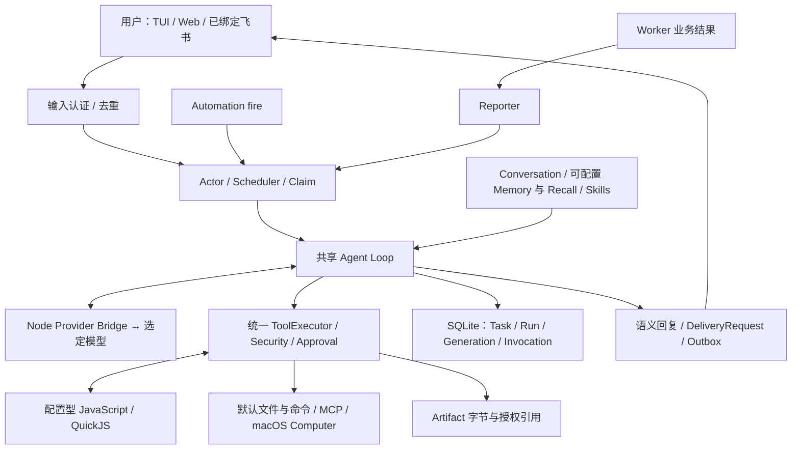
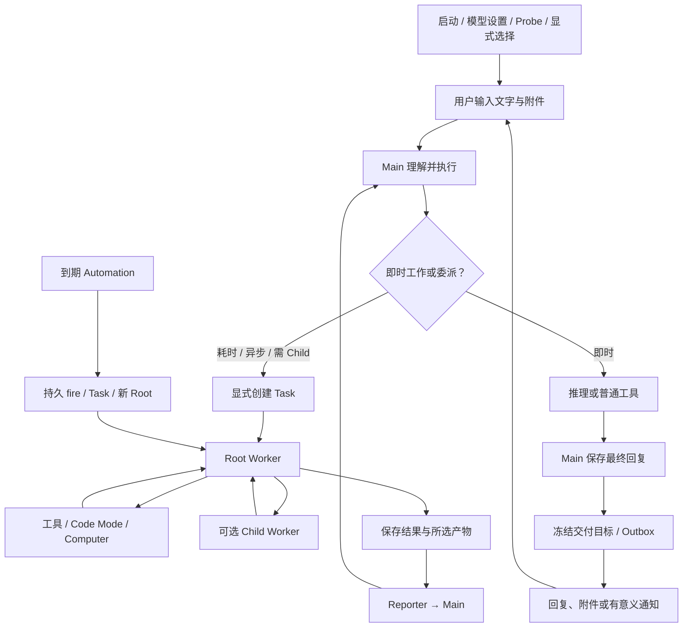
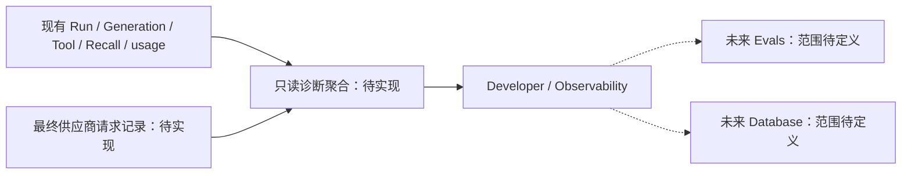
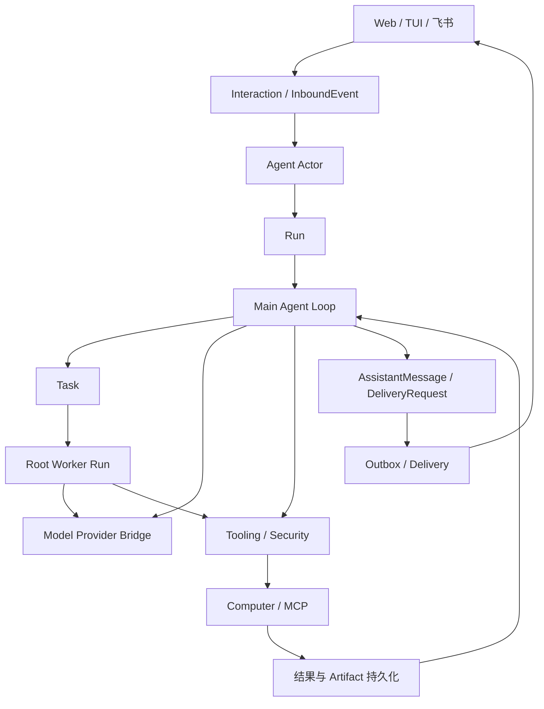

# Erii 产品架构与流程总览

[Feature Map：需求与完成状态](../feature-map.md) · [跨功能协议与约束](#contract-0-文档效力与实现规则) · [测试边界](../test-plans/product.md)

最近核对：2026-10-28。本页维护最新跨功能关系；每个功能的需求、用法、局部架构、测试方案和剩余缺口从 Feature Map 进入。

## 协议主题分布

跨功能数据、事件和配置约束见 [运行时契约](runtime-contracts.md)，工程与发布组织见 [工程设计](engineering.md)。局部工具、模型、Task、Child、Computer、Memory 协议在各功能设计中维护；统一验收矩阵见 [产品测试方案](../test-plans/product.md)。

## 当前架构

Erii 是本地 Go 模块化单体，使用独立 Node 模型 Bridge 和 QuickJS 运行时。Main 与 Worker 共用一套 Agent Loop；Root/Child 表示 Worker 在执行树中的位置。SQLite 保存权威领域状态，JetStream 提供事件唤醒。Web 资源嵌入应用，不需要独立前端服务。

权限、配置、数据、审批和恢复均由现有 Host 管理。可选能力是否注册取决于显式配置；有模块不代表当前安装已经就绪。

## 当前产品流程

Main 创建 Task 是因果关联，不是 Main 直接创建 Child。Child 结果只返回直接 Parent；Root 的业务结果经 Reporter 回到 Main。普通进度是只读投影，不触发推理或通知。

## 最新待实现方向

保留上述架构，补齐用户流程中的断点：阶段进度生产、附件理解、富 UI 生成、自动经验、语义记忆和真实服务接入。逐项状态以 Feature Map 为准，不能由本页图推断完成。

已确认在现有 Web 增加 Developer 区域，先实现 [Observability](observability.md)。其只读查询现有执行记录并补充供应商发送边界观测，不接管执行。后续 [Evals](evals.md) 与 [Database](database.md) 先登记待定义范围。

Evals 未来页面不改变独立评测项目的职责。Database 首版只读是建议，具体访问范围待设计；不开放修改执行或审批状态的后门。

## 验证

各功能说明链接并列测试方案；统一命令和证据边界见 Testing。确定性协议/恢复测试不代表真实模型语义质量，macOS/在线账号需相应平台证据。

## 协议、实现与配置约束

迁入内容按职责归属在此维护。既有编号用于追溯协议，不代表所有设计目标均已实现；完成状态以需求主索引为准。

### 跨功能协议的维护范围

下列协议原编号保留以便追溯，正文由所属功能技术方案共同维护；不存在另一份独立基线。原版本与日期记录在本页 Changelog。

### 0. 文档效力与实现规则

各功能技术方案与跨功能契约共同约束实现。Coding Agent 开工时遵循以下优先级：

1. 所属技术方案中的状态机、权限边界、持久化时序、模型可见 Tool Schema 与验收场景属于规范性要求。
2. TypeScript、Go 和表结构片段用于定义协议与最小字段，不要求逐字采用命名，但实现必须保持同等语义，并用测试证明兼容。
3. “一期不做”与“后置决策事项”不得被擅自扩展为首期功能；内部可以预留接口，但不得为假设中的未来需求建立第二套领域模型。
4. 若实现细节存在歧义，优先选择能够保持数据可恢复、权限不扩大、外部副作用不重复的最小方案，并在所属设计 Changelog 记录取舍；不得以猜测修改模型可见协议。
5. 任何协议变更先更新所属技术方案及契约测试，再修改实现。数据库内部字段可以向后兼容地增加，模型可见 Tool Schema、事件版本和 Artifact 引用格式必须显式版本化。
6. 功能设计约束产品协议与软件安全边界。Golden Case 与真实模型效果评测由独立评测项目管理；产品仓库的测试分层、CI 与发布检查见 [产品测试方案](../test-plans/product.md)。

MVP 的启动门禁与首条纵向链路是：

`首次启动 → 模型连接/登录 → Model Probe → 激活 ModelProfile → TUI 输入 → Main Run → task_manage(create) → Root Worker Run → agent.run() → Child Run → Root 汇总 → Main 回复 → TUI 展示`

Code Mode、Durable Replay、Approval、Artifact 与 Outbox 必须沿这条链路逐步接入；Web、飞书、多 Agent、云端拆分不得阻塞首条链路。

### 2. 总体架构

主链路定义为：

`ChannelMessage → Interaction → InboundEvent → AgentActor → Run → MainAgentLoop → Tooling → Security → Computer/MCP → ResultPersistence → MainAgentLoop → AssistantMessage → DeliveryRequest → Outbox → Delivery → Channel`

创建异步任务时，从 Main Agent Loop 分支为：

`MainAgentLoop → Task → WorkerRun → WorkerAgentLoop → ResultEvent → MainAgentLoop`

#### 2.1 Agent Actor 与 Main Agent Loop

- `Agent Actor` 是每个 Agent 的运行协调器，负责接收事件、创建 Run、处理并发、顺序和生命周期。
- `Main Agent Loop` 是面向用户的主推理循环，负责理解对话、做决策、调用工具、解释结果和生成回复。
- 两者不能合并：Actor 管运行秩序，Main Agent Loop 管智能行为。
- 用户可见消息只能由 Main Agent Loop 产生。

#### 2.2 主循环与 Worker 循环

- 当前对话由 Main Agent Loop 负责。
- 实现层只有一套可复用 Agent Loop 内核。`Main` 与 `Worker` 是两种运行角色；`Root Worker` 与 `Child Worker` 又是 Worker Run 在 Run 树中的两种位置，不实现第三套 Child Agent Loop。
- 只要工作是异步、耗时，或计划中包含并行 Child Run，Main Agent Loop 就在执行前显式创建一个 Task，并启动一个 Root Worker Run；`agent.run()` 和 Runtime 都不会把正在执行的工作自动“升级”为 Task。
- Main Run 默认不能创建 Child Run，也不暴露 `agent.run()`。短时、同步且不需要独立 Agent Loop 的工作可以留在 Main Run 中直接推理或调用普通 Tool；一旦需要另一个 Agent Loop，即由 Main 创建 Task 并委派给 Root Worker Run。
- 这一限制是当前产品的默认 Capability Policy，不写死为 Agent Loop 内核限制；未来若需要允许 Main 直接创建 Child，只调整工具暴露与 Parent 校验，不重构 Run、ToolInvocation 或 Worker Loop。
- 同一 Task 同时最多只有一个活动 Root Worker Run；任务内部的并发统一由该 Run 的 Child Run 表达。不同 Task 的 Root Worker Run 可以并行。
- Root Worker Run 拥有独立上下文，可以与 Main Agent Loop 及其他 Task 的 Worker 并行运行。
- Worker 不直接向用户发消息。
- Worker 的完成、失败和异常都以事件返回 Main Agent Loop，由 Main Agent Loop 结合当前对话、人格和渠道决定如何告知用户。
- 即时 Run 通过当前对话自然呈现，不额外作为用户界面中的任务项目展示。

### 15. 明确不做的过度设计

- 一期不实现多模型动态路由。
- 一期不实现 Memory/Conversation Provider 热切换与双写。
- 不把 Run、Task、Instance 等内部状态完整暴露给用户。
- 不做全局事件顺序。
- 不让 Worker 直接给用户发消息。
- 不让模型直接写数据库或绕过安全层产生副作用。
- 不把完整工具轨迹写入 Memory。
- 不因为参考 Coding Agent 而引入 Tree/Lane 等当前产品不需要的概念。
- `agent.*` 作为统一 Code Mode Host 能力按 Capability Policy 暴露；Main 默认不注入，允许委派的 Worker 只获得 `agent.run()`。Host 必须继续强制执行创建权限、深度、并发、安全上限和工具范围；不向模型暴露 Capability Snapshot 或预算监控接口。
- 一期不建立 Workflow 领域模型；Child Run 允许递归委派但必须受宿主深度、后代总数、调用次数、并发和高安全配额限制，也不提供任意文件系统、网络、动态 import 或不可重放的时间/随机能力。
- 不为 EventQueue 自研复杂基础设施。

### 19. 后置决策事项

以下选择不阻塞 Coding Agent 按 M0–M5 开工；实现必须放在接口后，不得把某个临时选择泄漏到领域协议：

1. Embedding 与 SQLite 向量实现已在 ERII-22 选择：显式配置 OpenAI-compatible embedding endpoint/model/dimensions，SecretStore 引用凭据；SQLite 保存 dense vectors，私有 adapter 在用户/Agent/时间分区内执行 exact cosine，并与 FTS5/BM25 并行后 RRF。无新增 native extension，不声称 ANN 或次线性性能。未配置 embedding 时不提供召回能力，不将 FTS-only 视作完整向量交付。实现与离线重建限制见 `docs/designs/memory-context.md`；模型质量留给 release-time Live Shadow。
2. Web 框架、TUI 框架、飞书 SDK 与视觉实现；TUI 只需支持首次模型设置、首条纵向链路和审批。
3. Context Compaction 的最终阈值与 Token 分配；算法和配置点先实现，数值通过用户选择的模型压测冻结。
4. 各具体 Tool 的风险映射、范围授权文案与审批 UI；未知副作用 Tool 默认要求审批且 `replay_policy=never`。
5. Artifact 的最终保留周期、配额与清理批次；MVP 必须先有可配置默认值、引用计数/作用域检查和 dry-run 清理。
6. 公平调度权重、NATS Stream/Consumer/DLQ、租约时长、退避与 watchdog 的生产参数；先使用保守可配置默认值并记录指标。
   ERII-29 将首版运维参数落在 `docs/features/operations.md`：事件 Stream 默认 7 天/1 GiB/100 万条/单条 1 MiB，DLQ 仅保留无正文的诊断 receipt，5 次毒消息阈值，32 个未确认消费窗口。远程 NATS 必须 TLS + SecretStore token 引用，既有无界 Stream 通过显式、无立即丢弃的运维命令升级。三个数据库和 Artifact 使用独占冷备、认证加密清单及新目录原子还原；凭据独立保管，还原先禁用，确认源实例退役及外部结果后显式启用。正常关闭不改变 Task 状态；备份不承诺外部副作用 exactly-once。
7. 高安全上限的最终容量校准、成本估算与可复用脚本管理界面；模型仍不获得预算查询工具。
8. 金融交易与其他受监管能力的合规设计；未单独评审前不得启用真实交易 Tool。
9. 云端服务拆分、租户隔离、多 Agent 创建体验和迁移；一期保持模块化单体与单 Agent 产品面。

若后置选择影响模型可见协议、数据兼容性、安全边界或 Durable Replay，必须重新评审、更新所属设计和兼容方案并在 Changelog 记录；仅替换 Adapter 或调参不需要改变领域模型。

## Changelog

2026-10-28：按统一文档结构迁入本功能的协议与历史决策，更新引用并移除旧文件；此为文档归属调整，不改变运行时协议。

| 日期 | 决策 | 比较与取舍 | 影响 |
| --- | --- | --- | --- |
| 2026-10-28 | 按用户认可的架构盘点当前实现，保留共享 Loop、统一工具管线、Main 交付和权威数据库。 | 不因局部缺口重建执行引擎；将需求与实现差距登记到 Feature Map。此条是现状建档，不是历史实现日期。 | 建立功能、技术、测试分层引用，未改变运行时。 |
| 2026-10-28 | 已确认 Observability 集成现有 Web 的 Developer 区域。 | 比较单独部署观测平台与内嵌页面，先采用内嵌只读检查器以复用本地执行记录；外部导出后置。 | 新增 F-031/F-034/F-035/F-036 待实现需求，不影响原有 Conversation 或执行协议。 |
| 2026-10-28 | 将测试方案与技术方案并列。 | 需求定义验收目标，技术文档解释实现取舍，测试文档解释证明方式；结果仍进入既有报告流程。 | 后续迭代同步需求、最新架构/流程、测试覆盖和主索引状态。 |

### 历史决策与演进记录

以下正文保留原决定、理由、兼容影响和当时证明范围，不作为当前完成声明。原记录中旧目录布局与旧验证命令属于历史上下文；现行入口以功能说明、当前架构及产品测试方案为准。

原跨功能契约标记为 Baseline v1.0，日期 2026-10-15，状态为 MVP 实现基线；其记录原则是保留已确认语义、默认值与验收边界，待定选项单列。2026-10-28 将这些内容按功能归属迁入现有 designs，并保留以下历史里程碑计划，不再把旧计划当作当前完成声明。

### 17. 实现里程碑与交付顺序

Coding Agent 按纵向可运行切片实现。每个里程碑必须包含 migration、Fake、单元测试、集成测试和可从命令行复现的演示；前一里程碑未通过不得并行建立替代架构。

#### M0：工程骨架与持久化

- 建立 `cmd/erii`、`internal/*`、配置、日志、Trace、SQLite migration 和 NATS 薄适配层。
- 实现 ID/时间/版本约定、Outbox/Inbox、ModelProfile/ModelSnapshot/AuthConnection、SecretStore Fake、Fake LLM 与测试夹具。
- 建立版本化 Model Provider Bridge RPC 骨架和 Fake Bridge；此阶段不要求真实账号登录。
- 提供 `make test` 或等价单命令，不依赖真实外部服务运行单元测试。

完成条件：空库可启动并迁移；没有模型时稳定进入 `setup_required`；重复启动不改变数据；Outbox 重发与 Inbox 去重测试通过。

#### M1：Main Run 与 Conversation

- 实现 Agent Actor、单活动 Main Run、基础 Agent Loop、Context Builder、ConversationMessage 与 TUI。
- 实现首次启动 Setup Wizard、ModelProfile 控制面与两条 Provider 路径：本地 OpenAI-compatible URL，以及 OpenAI Sign in with ChatGPT。
- Model Provider Bridge 固定复用 Pi AI 行为；Provider 未配置或真实登录不可用时仍可用 Fake 完成自动化测试。
- 先支持无副作用 Direct Tool，验证 ToolInvocation、RunTrace 与稳定结果投递顺序。

完成条件：`http://127.0.0.1:8000/v1` 的测试端点可完成模型发现/手填、Tool Call Probe 和对话；ChatGPT Browser OAuth + PKCE 登录可列出账号可用模型并完成对话；切换 Profile 只影响新 Run；进程在模型调用前后崩溃均不会重复消息。Device Authorization 按 §5.4/ADR 001 明确延后，不计为当前 M1 阻塞条件或已通过的验收项。

#### M2：Task 与 Root Worker

- 实现 `task_search/task_manage`、Task Anchor/Instruction、Root Worker、Main Follow-up、pause/append/cancel 与 `task_epoch`。
- 实现多 Task 并行、同 Task 单 Root、不打扰式进度聚合。

完成条件：Main 可把耗时工作委派给 Root；对话仍可继续；Root 完成后只触发一次 Main 汇总。

#### M3：统一 Tooling、Approval 与 Artifact

M3 的 MCP 与 Coding 验证使用真实 stdio 协议和受控磁盘 fixture：进程由 macOS Seatbelt / Linux bubblewrap 隔离，网络与 Host 用户目录不可达；生产 Lume/Guest ComputerProvider 仍在 M6。它们共享现有 ToolExecutor/Security/Artifact 管线，不另建 Computer Agent Loop。新增 ToolSpec 的可选 description/resource_hash 随 tools_json 冻结，旧快照不自动扩权；不需要新增 schema 或领域状态。该中间验证边界的限制和证据见 `docs/guides/capabilities.md`。

- 完成 Tool Registry/Executor、Capability Snapshot、Security Policy、可恢复 Approval、ArtifactStore 和 Delivery Outbox。
- 为每个 ToolSpec 强制声明风险、`replay_policy`、超时、输出限制与冲突键生成器。

完成条件：审批跨重启恢复；拒绝不执行工具；`query_before_retry/never` 故障测试不会重复副作用。

#### M4：Child Run 与 `agent.run()`

- 实现 `builtin__agent_run`、AgentToolExecutor、Parent/Child Run 树、高安全上限与公平队列。
- 先验证 Direct Tool 形式，再接入 Code Mode Facade；二者必须复用同一个 ToolSpec 和 Executor。

完成条件：100 项任务产生 1 Task、1 Root、100 Child；最大实际并发不超过配置；Child 可继续委派且不能扩权。

#### M5：Code Mode 与 Durable Replay

- 实现 Node/QuickJS Sidecar、JSON-RPC、可信 Prelude、发现函数、CodeExecution/CodeCall/Store、Claim/Wake/fencing 与固定源码重放。
- 接入 `tools.*`、`agent.*`，再接入 `cua.*`；未 `await` 调用、挂起释放与输出裁剪遵循本文语义。

完成条件：在第 37/100 项后杀死 Sidecar 与 Go 进程，重启后复用 37 项结果，只执行剩余工作；故意改变相同 `call_key` 请求时 fail-closed。

#### M6：Memory、Context 与 Computer

- 实现 Conversation/Memory 分库、FTS5、Compaction、Memory Curator 与只读统一召回。
- 实现 Lume ComputerProvider、Checkpoint、Guest CUA Driver、DesktopLease、Artifact 导入导出与一期 Playwright Capability。

完成条件：Root/Child 可以独立召回持久化上下文但看不到 Parent 运行上下文；VM 重启后逻辑 Computer 与 Artifact 引用保持稳定。

#### M7：Automation、渠道与生产加固

- 实现 Automation/RunScheduler、Web/飞书适配、UISpec 降级、DLQ、容量指标、备份恢复和升级演练。
- 基于压测校准默认并发与高安全硬上限，不改变模型协议。

完成条件：定时任务、TUI/Web/飞书使用相同核心链路；重复渠道回调和 Broker 重投不会重复执行或重复通知。

M0–M5 构成可验证的 Core MVP；M6–M7 完成本文定义的一期产品能力。若需要更早试用，可在 M2/M4 提供内部版本，但不得把未实现的 Durable/Security 语义宣称为已完成。
