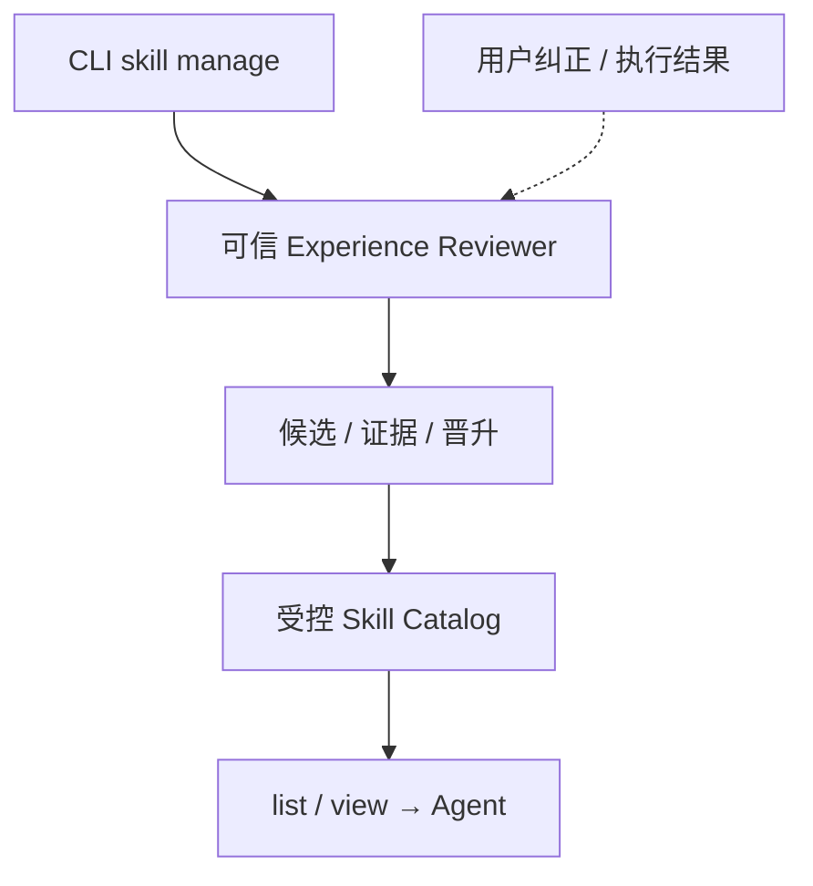

# Skills 与经验沉淀：技术方案

[功能与需求](../features/skills-experience.md) · [测试方案](../test-plans/skills-experience.md) · [主索引](../feature-map.md)

最近核对：2026-10-28。本文的架构与流程描述当前有效实现；明确标记的待实现方案不表示已落地。实现级协议仍服从 [跨功能协议与约束](product-overview.md#contract-0-文档效力与实现规则)。

## 当前架构

Catalog 提供冻结版本的读取工具；可信 Reviewer 维护 skill_candidate 与验证回执，并将已晋升方法发布进目录。自动事件到 Reviewer 的路径尚未连接。



## 当前流程与目标差异

读取已有 Skill 按需执行；当前经验流程由 CLI propose → verify → promote → 新 Run 读取新版本。目标是由可信事件驱动候选处理，保留审核边界。

- **F-022**：受控目录 list/view 与全目录指纹冻结已实现。 普通 Main/Worker 不管理目录；变化不热替换旧 Run 的冻结 Skill。
- **F-023**：可信 Reviewer 有 propose/verify/promote/reject/retire；目前由 CLI 显式驱动，缺自动触发与编排。 接入纠正/结果事件与可信 Reviewer；当前验证证据限于经审批的 bash 精确测试命令，需明确其他方法的证据标准。

## 代码与依赖

- [internal/skill/catalog.go](../../internal/skill/catalog.go)
- [internal/skill/experience.go](../../internal/skill/experience.go)
- [internal/agent/sqlite/experience.go](../../internal/agent/sqlite/experience.go)
- [cmd/collie/resources.go](../../cmd/collie/resources.go)

## 验证与交付

验收场景、已有入口和剩余覆盖统一在 [测试方案](../test-plans/skills-experience.md) 维护。本次建档未执行本功能的回归或 Live 验证，不以架构图替代运行证据。

## 协议、实现与配置约束

迁入内容按职责归属在此维护。既有编号用于追溯协议，不代表所有设计目标均已实现；完成状态以需求主索引为准。

<a id="contract-7-skill-系统"></a>

### 7. Skill 系统

<a id="contract-71-skill-结构与加载"></a>

#### 7.1 Skill 结构与加载

M3 实现说明：本地 Agent 从显式配置的受控目录读取摘要；list/view 对 Main 与 Root 开放，manage 不对普通循环开放。完整目录（含 references/scripts/assets）的内容版本和 scope 进入冻结 ToolSpec `resource_hash` 及 Capability Snapshot `skill_set_hash`。仅摘要进入 Tool description，全文按需读取。旧 Run 不热更新 Skill；内容或配置漂移时 fail closed。配置、权限和兼容规则见 `docs/designs/integrations.md`。

- 使用成熟的 Agent Skills 目录约定。
- 每个 Skill 以 `SKILL.md` 为入口，可选包含 `scripts/`、`references/` 和 `assets/`。
- 启动时只加载 Skill 摘要，需要使用时再读取完整内容，以减少上下文占用。
- Skill 保存可复用的方法、工作流和经验，不保存原始执行日志。

<a id="contract-72-skill-工具"></a>

#### 7.2 Skill 工具

```text
builtin__skill_list
builtin__skill_view
builtin__skill_manage
```

- Main Agent Loop 和 Worker Agent Loop 可以列出和读取 Skill。
- Skill 修改主要由 Experience Reviewer 执行，普通 Agent Loop 不直接随意修改 Skill。
- 用户明确纠正，或一次失败后得到验证成功的解决方案，可以快速形成候选经验。
- 普通成功执行先保留为候选，重复验证后再提升为稳定 Skill。

<a id="capabilities-skills"></a>

### Skills

The configured catalog belongs to this data root's local Agent. `agent` and
`workspace` identify the curated scope; neither grants cross-Agent access. Each
directory contains frontmatter `name`/`description` in `SKILL.md` and optional
references/scripts/assets. Names match their directories. Symlinks, malformed
metadata and oversized catalogs are rejected. Hashes include every catalog file,
not only the summary. No full body is embedded in the startup description.

`builtin__skill_list({})` returns name, description, scope and content version.
`builtin__skill_view({name, version, path?})` defaults to `SKILL.md`; relative
references must already exist in the catalog. A wrong version or changed file
returns `NON_DETERMINISTIC_REPLAY`; paths cannot escape the configured root.
Non-UTF-8 assets use the common binary-result Artifact path, preserving bytes
without placing invalid text in model history.
Changing a reference or scope changes the frozen set hash. A restarted old Run
fails compatibility selection if its catalog no longer matches. Restore the old
catalog to continue it; do not silently switch versions. Ordinary Main/Worker
tools cannot manage Skills. The trusted [Experience Reviewer](../features/memory-context.md)
owns the separate propose/verify/promote/retire lifecycle.

Skill frontmatter opens and closes with an unindented `---` delimiter line.
The same punctuation inside a name or description is metadata, and body text
after the closing delimiter remains intact. Publication validates generated bytes
with the catalog's parser and size limit before writing or publishing a candidate;
unreadable metadata cannot advance it to promoted. The writer format and resource
hashes are unchanged, so no data migration is needed. The lifecycle harness covers
punctuation-bearing metadata through promotion, new-process startup, catalog
list/view, retirement and another startup.

Each configured catalog admits at most 128 active Skills. Pending publication
and retained retirement directories do not consume active slots or enter model
summaries. The loader enumerates directory entries in batches of 128, retains at
most 128 active entries, and keeps the existing per-file/per-Skill size limits.
Publication validates the full active catalog, then admits a new Skill under an
exclusive OS lock on the catalog directory. Readers share that lock; retirement
uses the same writer boundary. There is no persistent lock file, and process
exit releases ownership. A contended writer fails closed and can be retried.

At capacity, `skill manage promote` returns `RESOURCE_LIMIT`; the candidate stays
verified at its current version. Retirement preserves its audit copy and frees
one slot, after which that same candidate/version can be promoted. An identical
already-published Skill succeeds even at capacity, recovering a crash between
directory rename and candidate status commit. A partial pending `SKILL.md` can
be rewritten on retry; unexpected staged resources or links are rejected. No
audit copies are removed to make room. These changes need no migration and do
not change valid Skill bytes or frozen resource hashes. The lifecycle harness
proves last-slot publication, full rejection with unchanged candidate state,
retirement, retry and fresh-process readback with more than 128 retained entries.
That cardinality action selects an explicit 131,072-token local Fake profile so
the 128 summaries and list results fit; earlier small-profile compaction and
context-budget assertions run unchanged before that selection.

## Prompt 资源

新 Run 的 Capability Snapshot 保存 Skill 索引与版本元数据，并在 system 的 `skill_index` 分区说明匹配任务后使用 skill view 读取正文。正文仍按需作为 Tool 结果提供，不预载全部 Skill；Skill 无法扩大角色权限。已有 skill list/view 模型接口保持不变，恢复 Run 不用新索引覆盖冻结索引。

## Changelog

2026-10-28：F-022 Skill 索引接入统一初始上下文，使用冻结的 Host prompt metadata，补匹配、版本与相对资源读取规则。保留按需读取和经验审核生命周期，不增加普通 Agent 的 Skill 管理权限。

2026-10-28：按统一文档结构迁入本功能的协议与历史决策，更新引用并移除旧文件；此为文档归属调整，不改变运行时协议。

本节追加记录每次架构/流程取舍。旧图不保留在正文；历史正式决定保留在本节。首次记录为现状建档，不推断历史决策日期。

| 日期 | 类型 | 决策与理由 | 取舍及影响 | 关联 |
| --- | --- | --- | --- | --- |
| 2026-10-28 | 现状建档 | Skill 是方法库，Memory 是用户事实，两者分开。自动经验处理不意味着把 Skill 写权限授予普通 Main/Worker。 | 明确当前边界与待补齐链路；本次仅建立文档，未修改运行时。 | [跨功能契约](product-overview.md#contract-0-文档效力与实现规则) |

后续记录需包含实际比较过的选项、采用理由、兼容/迁移影响和相关需求或 PR；未决建议不能写成已实施决策。
