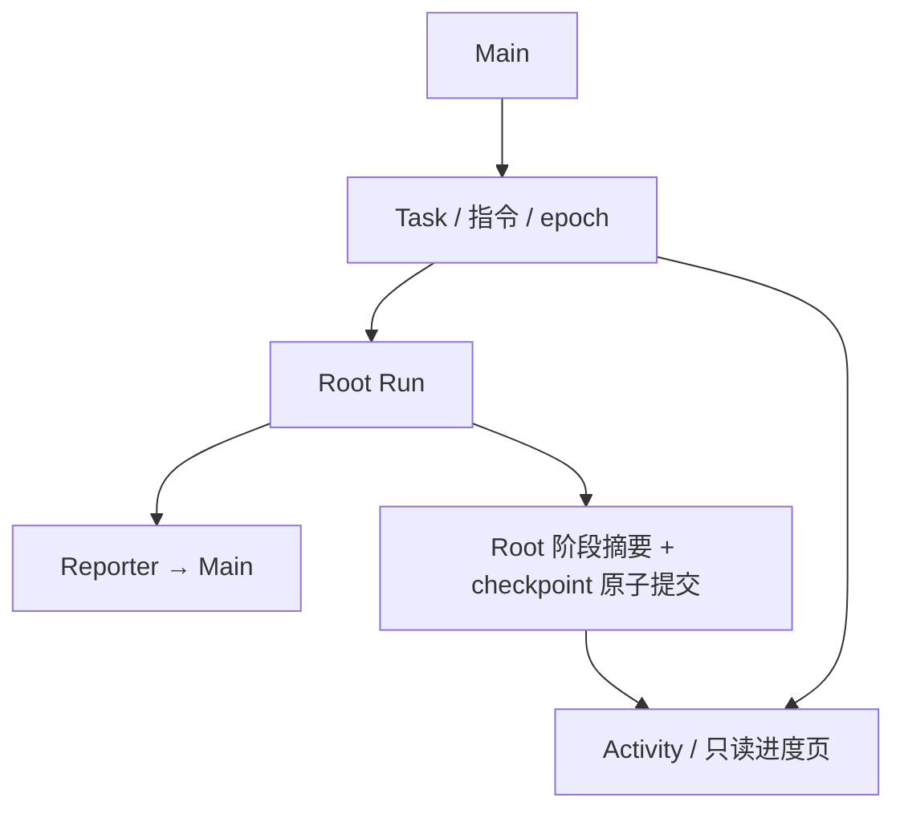
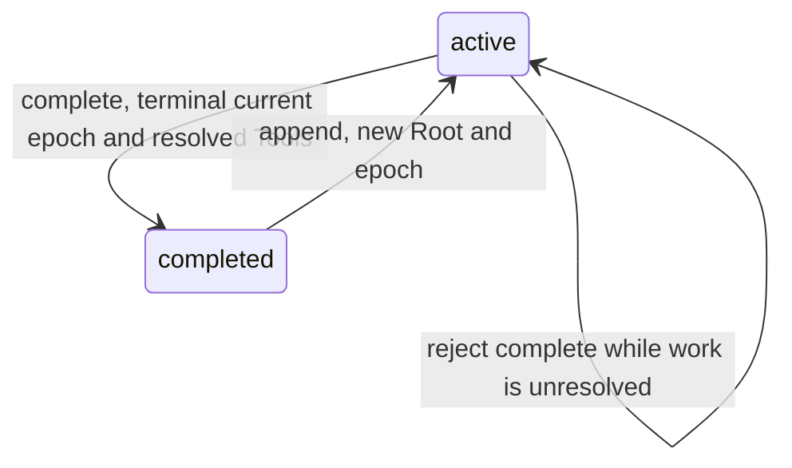

# 后台任务与用户进度：技术方案

[功能与需求](../features/tasks.md) · [测试方案](../test-plans/tasks.md) · [主索引](../feature-map.md)

最近核对：2026-10-29。本文的架构与流程描述当前有效实现；明确标记的待实现方案不表示已落地。实现级协议仍服从 [跨功能协议与约束](product-overview.md#contract-0-文档效力与实现规则)。

## 当前架构

Task 保存目标和指令；Root Run 表示一轮执行。Task epoch 与 claim 拒绝旧结果，Reporter 将业务结果交给 Main。进度是单独投影，不承担通知或调度。



### 阶段进度接入（F-005）

- 新 Root 的独立 `progress_guidance` system 片段约定：阶段变化时，在带工具调用的 assistant 文本中写一句不超过 512 UTF-8 字节的进度，描述已确认进展与下一阶段，不写推理、原始调用或私有数据。普通 Worker 规则不改，Child 不继承该片段。
- 共享 Agent Loop 不新增分支、接口或工具。`Runs.Checkpoint` 在现有事务中先 fence 与 CAS 保存 checkpoint，再由 `progress.go` 接纳 Root 阶段文本并写 `task.progress_summary`；两者一起提交或回滚。重启复用已接受的 generation，摘要失败不会留下已推进的 checkpoint 或提前执行工具。
- 接纳仅限 `tools` phase、完整且未截断的工具调用响应，并要求 Root 冻结的 system 上下文包含进度约定。空白、过长、含控制字符或非法 UTF-8 文本不替换上一条；归一化段落空白后保存。重复摘要不递增 Task version、不改变其更新时间。最终结果、压缩和 Child 文本不进入此路径。
- `task/sqlite.Reader` 使用同一次只读查询聚合当前 Task epoch 的 Root 状态、等待原因和 Child 数量，并保留 `Last update`。等待审批包含 Child 审批及 Root 的费用授权；未知外部结果显示未确认，失败 Run 保持 Task 开放，ongoing 一轮结束与 Task 完成分开。界面不暴露 Run ID、Child 任务正文或工具参数。
- 摘要是非授权的模型展示文本，沿现有 HTML 转义展示。它不创建 TaskUpdate、Inbox、Outbox、通知或额外推理；正常 checkpoint 仍保留原有运行时事件。`task_search` 继续返回已保存摘要，不能把展示文本当作已完成或副作用成功的证据。
- 无数据迁移、工具 schema 或 Bridge 格式变化。新 Root 使用新提示；旧 Run 的冻结请求和提示不重写，无进度约定时不把其历史 assistant 文本改作可见进度。继续工作保留旧摘要作为已标明来源的 Task context，新状态单独计算。

### 任务工作台只读边界（F-005/F-018）

`internal/task/view.go` 拥有用户工作台查询、进度/注意状态和详情 DTO；`internal/task/sqlite` 实现独立惰性只读池（mode=ro/query_only，最多两个连接，busy_timeout 500ms），由现有 Store 同生命周期关闭。`agent/sqlite.Activity` 委派它，TUI 与原 `/api/progress` 保持最多 20 条及原有摘要格式；新 Web 列表默认 25 条、上限 50，以不可变 created_at/task_ref 降序稳定分页，游标绑定筛选/搜索。Web 查询总期限 3 秒，不占用运行时写连接、不推进事件。

所有读取按 agent_config 当前 Agent 归属；同一 CTE 只聚合 Task 当前 epoch。Open/Needs me/Finished/All 是查询视图，Task 仍只有 active/paused/completed/cancelled。阶段与 attention 由当前 Root/Child/等待/unknown 事实推导；摘要只保留已提交值。

详情读取完整 anchor goal 和可访问 ArtifactRef，指令/里程碑每页 20 项。用户交付只由 task_update → main_inbox → main_reply → conversation_intent 精确关联，最多最近 10 条；原始 Root/Child result 不进入页面，完整用户历史仍在 Conversation。原始请求按 task_request 回执的 taskRef/source_message_id 定位。审批只按该任务 Run 归属收集 ID，再由现有授权投影/决定校验精确 frozen action。

没有新持久化模型、迁移、Task 状态、模型工具或控制入口。页面继续沟通通过普通 Main 用户输入，不直接改变 Task。

### Go 实现职责（F-040）

Task 的 frozen-call / receipt 接纳保留在 executeTask，创建与已有 Task 操作移到 task_changes.go；这些 helper 加入同一个事务，不独立提交。

## 当前流程与目标差异

创建 Task → Root 执行 → 追加可在稳定边界 Steering；暂停/取消关闭旧 epoch → 继续建立新 Root → 结果交给 Main。once 成功结束 Task；ongoing 本轮完成后仍可保持 active。

- **F-004**：Task create/append/pause/cancel/complete、once/ongoing 和 Root 恢复已接通。 Run 失败不新增 failed Task 状态；继续通常建立新 Root，不复活旧 Run。
- **F-005**：Root 的非最终 assistant 文本在完整响应提交后的工具阶段边界写入进度；Activity 将最近摘要与当前执行事实、Child 数量组合，Web 和 TUI 复用同一投影。普通进度独立于主动通知与 Main 调度。

## 代码与依赖

- [internal/task/task.go](../../internal/task/task.go)
- [internal/agent/sqlite/tasks.go](../../internal/agent/sqlite/tasks.go)
- [internal/agent/sqlite/task_control.go](../../internal/agent/sqlite/task_control.go)
- [internal/agent/sqlite/progress.go](../../internal/agent/sqlite/progress.go)：阶段摘要接纳与事务内持久化
- [internal/task/sqlite/reader.go](../../internal/task/sqlite/reader.go)：任务列表、当前执行/Child 聚合与旧 Activity 投影
- [internal/prompt/system/progress.md](../../internal/prompt/system/progress.md)：仅 Root 的阶段进度约定
- [internal/agent/sqlite/reporter.go](../../internal/agent/sqlite/reporter.go)

## 验证与交付

验收场景、已有入口和剩余覆盖统一在 [测试方案](../test-plans/tasks.md) 维护。确定性组件与系统检查分别证明生产写入、只读展示和恢复边界；它们不证明真实模型生成摘要的质量。

## 协议、实现与配置约束

迁入内容按职责归属在此维护。既有编号用于追溯协议，不代表所有设计目标均已实现；完成状态以需求主索引为准。

<a id="contract-3-taskrun-与并发模型"></a>

### 3. Task、Run 与并发模型

<a id="contract-31-核心定义"></a>

#### 3.1 核心定义

- `Task` 是可跨多个 Run 持久化的工作对象。
- 不额外区分“长期 Task”和“短期 Task”。
- `Run` 是一次有明确开始和结束的执行实例。
- `Root Worker Run` 是直接推进某个 Task 的执行实例，必须关联该 Task。
- `Child Run` 是由 `agent.run()` 创建的子执行实例，只通过 `parent_run_id` 形成 Run 树；每次 `agent.run()` 永远只创建一个 Child Run，不创建 Task。
- Root Worker 与 Child Run 都执行同一套 Worker Agent Loop：前者是 Task 的根执行者，后者是某个 Worker Run 委派出的通用 Worker。两者共享工作面能力，但在 Prompt、归属、输入来源、结果去向和生命周期上不同。
- Root Worker 额外获得精简的 Agent Identity/人格片段与完整 Task Context，对 Task 结果负责；Child 不自动继承 Agent 人格、Conversation、Memory 内容或 Parent 模型上下文，只接收通用 Worker 规则、显式 `task` 和可访问的 ArtifactRef。Root 与 Child 均可在当前用户与 Agent 数据作用域内，按需调用只读 Memory/Conversation 检索工具补充持久化上下文。
- Main Agent Loop 和 Worker Agent Loop 都会产生 Run，但通过所属 Agent、Task、Conversation 和 Run ID 隔离，不发生语义冲突。

“分析 100 条数据”的典型结构是 `1 Task + 1 Root Worker Run + 100 Child Run`，而不是 100 个 Task。

<a id="contract-32-用户视角"></a>

#### 3.2 用户视角

- Task 是后台为了异步、并行和持续执行而设计的内部抽象，用户不需要理解 Task 概念。
- 用户看到的是“持续进行中的工作”，而不是技术性的 Task/Run 列表。
- “完成”只表示本轮工作暂时结束，不代表用户目标永久结束。
- 健身计划、客户关系维护等工作可以在完成后再次恢复和继续。

<a id="contract-33-并发规则"></a>

#### 3.3 并发规则

- 不同 Task 的 Root Worker Run 可以并行；同一 Task 只允许一个活动 Root Worker Run。
- 同一 Root Worker Run 可以通过 `agent.run()` 创建多个并行 Child Run；Child Run 也可以继续创建后代 Child Run。
- RunScheduler 对实际并发、Run 树深度、后代总数和安全配额实施宿主限制，JavaScript 创建的 Promise 数量不等于实际并发数。除并发额度外，其余系统硬上限保持较高，只用于防止递归爆炸、无限循环和资源失控；不以较小的 Root 级 Token、费用或总运行时长预算截断正常复杂任务。
- Main Agent Loop 在 Worker 执行时仍可继续接收用户消息。
- 新消息若与现有工作相关，在下一个稳定边界注入该 Task 的活动 Root Worker Run；若当前没有活动 Root Worker，则为原 Task 创建新的 Root Worker Run。无关工作按创建条件决定是否创建新 Task。
- macOS 操作也应尽可能并行，例如桌面应用操作和浏览器操作在不冲突时可同时进行。
- 是否允许具体 Computer 操作并行，由 Computer/VM 层根据资源占用和锁冲突判断。
- 系统只保证同一聚合对象内部的必要顺序，不使用全局串行执行。

<a id="contract-34-conversationmain-run-与-worker-run-的关系"></a>

#### 3.4 Conversation、Main Run 与 Worker Run 的关系

- 一个 Agent 只有一条跨 Web、TUI 和飞书共享的主 Conversation。
- Worker 只维护独立执行上下文，不创建用户可见 Conversation。
- 每个 Agent 同时最多只有一个活动 Main Run，但可并行存在多个 Task 的 Root Worker Run，以及受配额限制的 Child Run。
- Main Run 忙碌时的新消息作为事件注入当前 Main Run，而不启动第二个 Main Run。
- 活动 Main Run 在下一个稳定边界优先接收用户 Steering，不等待整个 Run 结束。
- Root Worker 只在完成、失败、需要用户信息或外部副作用状态无法确认时生成 Main Follow-up；Child Run 的结果只返回直接 Parent，由 Root Worker 汇总后决定是否形成 Main Follow-up。Main Run 活动则排队到当前 Run 结束后，Main Run 空闲则触发新的 Main Run。
- 多条用户 Steering 可以批量注入，多条 Worker Follow-up 也可以批量注入，但用户消息与 Worker 消息不进入同一批次；用户 Steering 优先于 Worker Follow-up。Worker Follow-up 默认一次 Drain 当前可用的全部更新，避免多个 Task 同时结束导致 Main 连续启动多轮。
- 同一批次保留为多条独立消息，不拼接原始文本；Steering 的处理优先级高于 Follow-up。
- `AgentStatus` 不单独持久化，而是根据活动 Main Run、Worker Run 和 Task 动态推导为 `idle` 或 `busy`。

<a id="contract-35-run-状态机"></a>

#### 3.5 Run 状态机

```text
queued → running ↔ waiting → completed / failed / cancelled
```

`waiting` 通过独立的 `wait_reason` 说明原因：

```text
user_input
approval
external_event
resource
```

- Main Run、Root Worker Run 与 Child Run 共用同一个 Run 模型和存储；`kind: main | worker` 区分主循环与工作循环，`task_id` 和 `parent_run_id` 表达归属关系。
- Root Worker Run 必须关联 `task_id` 且没有 `parent_run_id`；Child Run 必须关联一个 Worker `parent_run_id`，并继承同一 `task_id`。当前默认策略下不存在由 Main Run 直接创建、没有 `task_id` 的 Child Run。
- 取消 Parent Run 或承载它的 ToolInvocation 时，取消意图沿 `parent_run_id` 形成的 Run 树递归传播；无法确认的外部副作用进入 `unknown`。
- Run 的终态不可逆；同一工作再次执行时创建新 Run。

<a id="contract-36-task-状态机"></a>

#### 3.6 Task 状态机

```text
active / paused / completed / cancelled
```

- Task 不设 `failed`；执行失败属于 Run，不代表用户的持续工作失败。
- `paused` 表示预计继续。
- Task 在创建时固定 `completion_policy=once|ongoing`；Main 可在 `task_manage(create)` 显式提供 `completionPolicy`，省略保持 `once`。
- 一次性 Task 在 Root Worker 成功且其 Run 树没有未结束后代时自动进入 `completed`。
- 持续、定时或等待外部事件的 Task 在一轮 Root Worker 结束后保持 `active`，没有可执行工作时可以进入 `paused`。
- Root Worker 失败不自动把 Task 结束为失败；失败属于 Run，由 Main Agent、后续 Root Worker 或用户决定是否继续。
- `cancelled` 表示明确终止当前调度、取消活动 Run，并拒绝迟到的 Worker 结果。
- `completed` 和 `cancelled` 都不是永久不可恢复状态；用户要求继续时，Main 对原 Task 调用 `task_manage(append)`，由 Host 将 Task 重新激活并创建新 Run，旧 Run 保持原终态。

<a id="contract-37-run-与-agent-loop"></a>

#### 3.7 Run 与 Agent Loop

- Run 是持久化执行实例，记录身份、状态、归属、时间和恢复信息。
- Agent Loop 是推动 Run 执行的算法，一次 Loop 调用可包含多个 Turn。
- Turn 沿用 Pi 的运行时定义：一次 Assistant 响应及其工具调用与结果。
- 一期不建立独立 Turn 实体或数据表，RunTrace 使用 `step_index` 记录 Loop 内部步骤。
- 一个 Run 可以因等待、审批或恢复而包含多次 Loop 调用；一次 Loop 调用只服务一个 Run。

<a id="contract-39-task-tool"></a>

#### 3.9 Task Tool

Main 对 Task 的模型可见能力只保留两个 Canonical Tool：

```text
builtin__task_search
builtin__task_manage
```

- `task_search` 是统一的只读发现工具：省略 `query` 时按 `scope/status` 列出当前或最近 Task；提供 `query` 时对历史 Task 做关键词与语义混合检索。不另设 `task_list` 或 `task_query`。
- `task_manage` 是统一的状态变更工具，使用判别联合支持 `create/append/pause/cancel/complete`，不拆成多个工具；不向模型暴露独立的 `resume` 操作。
- 两者复用统一的 `ToolSpec → ToolInvocation → ToolExecutor` 管线；Task Tool 是 Main 的控制面能力，Root/Child Worker 默认不可见。
- `task_search` 返回内部 `TaskRef`、标题、目标摘要、状态、最近进度和更新时间，不返回 Root Run ID、Run 树或内部轨迹。唯一高置信匹配可继续；多个合理候选必须由 Main 向用户澄清。
- `task_manage(create)` 原子创建 Task、保存 Task Anchor、创建首个 Root Worker Run 并发布 `run_ready`；它只返回接收凭证，不等待任务完成。
- `task_manage(create).completionPolicy` 只允许 `once|ongoing`，省略等同 `once`；仅 create 接受此字段。普通 Root 成功不结束 ongoing Task，也不自动调度下一轮；后续 append 沿用同一策略并按既有规则创建新 Root。策略创建后不可改写。retired task #225 的批准、升级边界与显式完成合同见 `docs/designs/tasks.md`。
- `task_manage(complete)` 仅接受 `active` Task，且当前 epoch 没有非终态 Root/Child Run，也没有 queued/running/waiting/unknown ToolInvocation。存在未完成工作或未确认副作用、或 Task 为 paused/completed/cancelled 时返回不可重试的 `INVALID_ARGUMENT`，不取消、不排空、不等待。Host 在同一事务内校验 Main owner、Task version/epoch，保存 `completed`、`completed_at` 和普通幂等 receipt；不递增 epoch、不修改 completion policy、不生成 Worker TaskUpdate 或 Main Follow-up。重复来源/调用复用原 receipt；新的 complete 来源不能再次完成 completed Task。后续 append 沿既有规则重新激活并创建新 Root。
- `task_manage(append)` 追加持久化 `TaskInstruction`，不覆盖原 Task Anchor。Task 为 `active` 且存在活动 Root 时，在稳定边界向该 Root 注入指令；Task 不是 `active`，或没有活动 Root 时，Host 将其置为 `active`、递增 `task_epoch` 并创建新的 Root Worker Run。
- `append` 同时承担“追加要求”和“重新激活”语义。用户只说“继续”“接着做”或“恢复这个工作”时，Main 也可以把该自然语言原样保存为 `TaskInstruction`；这条明确的用户指令就是重新激活的授权，不需要再构造 `resume` 操作。
- 领域层可以保留内部 `TaskService.Reactivate(...)` 动作供 `append` 实现状态迁移，但它不是模型可见 Tool，也不能被模型单独调用。
- Task Tool 的调用键、请求幂等和来源消息引用由 Runtime/ToolInvocation 自动绑定，模型不生成。
- Task 的产品状态仍只有 `active/paused/completed/cancelled`。`queued/running/waiting/failed` 属于 Run/ToolInvocation，不进入 Task 状态机；失败的 Root Run 也不会自动把 Task 改成 `failed`。
- Skill 继续使用有限目录语义的 `skill_list/skill_view`；Memory 与 Conversation 继续通过 `memory_search` 统一召回。Task 采用 `task_search`，因为它既需要无 query 的当前任务浏览，也需要有 query 的历史语义检索。

模型侧的创建与追加参数保持最小：

```typescript
type ArtifactRef = string;
type TaskRef = string;
type TaskStatus = "active" | "paused" | "completed" | "cancelled";

interface TaskSearchRequest {
  query?: string;
  scope?: "active" | "recent" | "all";
  status?: readonly TaskStatus[];
  limit?: number;
}

interface TaskSummary {
  taskRef: TaskRef;
  title: string;
  goalSummary: string;
  status: TaskStatus;
  progressSummary?: string;
  updatedAt: string;
}

type TaskManageOperation = "create" | "append" | "pause" | "cancel" | "complete";

interface TaskCreateRequest {
  operation: "create";
  task: string;
  completionPolicy?: "once" | "ongoing";
  artifactRefs?: readonly ArtifactRef[];
}

interface TaskAppendRequest {
  operation: "append";
  taskRef: TaskRef;
  instruction: string;
  artifactRefs?: readonly ArtifactRef[];
}

interface TaskPauseRequest {
  operation: "pause";
  taskRef: TaskRef;
}

interface TaskCancelRequest {
  operation: "cancel";
  taskRef: TaskRef;
}

interface TaskCompleteRequest {
  operation: "complete";
  taskRef: TaskRef;
}

type TaskManageRequest =
  | TaskCreateRequest
  | TaskAppendRequest
  | TaskPauseRequest
  | TaskCancelRequest
  | TaskCompleteRequest;

interface TaskManageReceipt {
  taskRef: TaskRef;
  status: TaskStatus;
  accepted: true;
}
```

`task_search` 返回 `TaskSummary[]`；`task_manage` 返回 `TaskManageReceipt`。两者都不返回 Run ID、ToolInvocation ID、配额或内部错误轨迹；失败使用统一 Host Tool Error。

- `task_search` 无 `query` 时默认 `scope="active"`；有 `query` 时默认 `scope="all"`。`limit` 默认 `20`、最大 `50`，结果按状态相关性、文本/语义相关性和最近更新时间稳定排序。
- `scope="recent"` 查询最近变更的 Task，保留期与数量由 Host 配置；`status` 是附加过滤，不改变 scope。
- `task_manage` 成功只表示变更已可靠接受，不表示 Root Worker 已完成；重复来源消息或重复 ToolInvocation 返回同一 receipt，不创建第二个 Task/Instruction/Run。

- `task` 必须是自包含的自然语言委派简报，在同一个字符串中说明目标、必要背景、约束、完成标准和预期产物；不另设 `goal/context/constraints/successCriteria/deliverables`。
- 背景信息在语义上仍然必要，但不作为独立 `context` 字段暴露；Main 负责把 Root 必须知道的内容写入 `task`。
- 模型不生成 `ContentPart[]`、MIME、Artifact 元数据、来源消息引用、调用键或基础设施 ID；只传递已有的简单 `ArtifactRef` 字符串。
- Host 从 `task` 自动生成用于 Activity 与检索的标题，并把模型参数规范化为内部 Task Anchor：

```typescript
interface TaskAnchor {
  title: string;
  task: string;
  artifactRefs: readonly ArtifactRef[];
}
```

- Host 自动绑定 Agent、Conversation、来源消息、创建 Run、ToolInvocation、时间和安全/预算策略。内部可以继续使用统一 `ContentPart` 表达多模态内容，但该结构不进入模型侧 Task Tool Schema。

<a id="contract-310-暂停与恢复"></a>

#### 3.10 暂停与恢复

- Run 只在模型响应结束、工具执行前或工具执行后的稳定边界进入 `waiting`。
- 普通 Steering 沿用 Pi 的稳定边界语义：按持久化顺序注入，不抢占正在执行的单次 Tool Call；同一批中的消息保持独立，不拼接原始文本。
- `task_manage(pause)` 是受控终止而不是粗暴杀进程：Host 先把 Task 标记为 `paused` 并阻止 Root 启动新工作，再等待当前步骤到达可持久化边界；可安全取消的 Tool 和 Child 传播取消，无法立即中止的外部副作用按恢复策略收敛到确定终态或 `unknown`。
- 暂停完成后，旧 Root Worker Run 进入不可逆的 `cancelled` 终态，并记录 `reason: task_paused`；已经提交的消息、Artifact、TaskInstruction、进度和工具结果继续保留。
- 用户随后要求“继续”时，由 Main 调用 `task_manage(append)`：创建新的 Root Worker Run，继承旧 Root 已提交的 Task Context，并从新增指令继续。这里创建新 Run，不复活旧 Run。
- Sidecar、执行器或宿主进程故障后的恢复属于运行时恢复：继续 Claim 并推进同一个未终结 Run，不创建新的业务 Run，也不需要模型调用 `resume`。
- Task 的每次暂停或重新激活都更新 `task_epoch`；Worker 事件与结果携带其启动时的 epoch，Host 拒绝旧 epoch 的迟到写入和用户通知。
- Continuation/Checkpoint 由程序自动生成，模型不感知。
- 等待审批时，系统保存待处理 ToolInvocation 的 `invocation_id`、名称和冻结参数；模型直接调用时同时保存 Provider `call_id`，Code Mode 嵌套调用则保存 Runtime `nested_call_key`，不把等待伪装成工具错误。
- 获批后执行原工具调用、追加 ToolResult，再调用 `ContinueAgentLoop`。
- 暂停是逻辑暂停，不挂住 Goroutine，也不占用 Pod。
- 分布式恢复遵循 `Persist → Release → Claim → Resume`：持久化状态后释放执行者，任意实例均可认领恢复，但同一时刻只能有一个成功执行。

<a id="contract-132-用户可见进度"></a>

#### 13.2 用户可见进度

- 默认只展示 Task 的总体状态、完成数量/总数量、当前阶段和简短阶段摘要。
- 用户进度来自 Agent 在执行中主动生成的有意义状态更新。
- 不把底层工具步骤机械地映射成用户进度。
- Worker 的普通运行进度写入 Progress Store，并在用户主动查看时更新实时 UI；它不创建主动通知，也不作为 `CustomMessage` 注入 Main Loop。“展示进度”“通知用户”和“触发 Agent 思考”是三个独立机制。
- 包含 Child Agent Tool 的 Task 只聚合展示 `queued/running/succeeded/failed/waiting` 数量；默认不向用户展示 Child Run 列表、单项 label、原始 Prompt、Token、Run ID 或内部 Tool Trace。
- 只有完成、失败、需要用户输入或需要用户审批时主动通知；大量 Child Run 的逐项完成不得形成通知风暴。
- 进度展示是只读能力，不发展为要求用户操作的任务管理后台。
- 渠道适配器可以根据 Web、飞书等载体选择合适的简洁程度和呈现形式。

<a id="task-control-model-task-stop-and-admission-model"></a>

## Task stop and admission model

This private engineering model maps the existing SQLite protocol. It adds no
runtime state, schema, Tool surface or extension API. Run it offline:

```sh
python3 tests/system/model_task_control.py --evidence evidence/task-model.json
python3 tests/system/model_task_control.py --unsafe --evidence evidence/task-model-unsafe.json
python3 -m unittest discover -s scripts -p 'test_model_task_control.py'
go test ./internal/agent/sqlite -run '^TestTaskControlModel' -count=1
```

The normal command exits 0 only after exhausting the finite reachable graph.
`--unsafe` removes Task/owner fencing from business result and Child admission;
it must exit 1 with a shortest counterexample. It does not mutate Go source.
`make test` includes the model regressions. Required race, process recovery,
five-run gates and complete CI remain separate requirements.

<a id="task-control-model-states-and-atomic-boundaries"></a>

### States and atomic boundaries

```mermaid
stateDiagram-v2
    [*] --> Active
    Active --> Stopping: pause/cancel transaction; epoch +1
    Stopping --> Stopping: append rolls back with ErrBusy
    Stopping --> Settled: owners join OR leases expire; leaf-first scan
    Settled --> Active: append transaction; instruction + epoch + new Root
    Active --> Active: append to live Root; instruction + frozen receipt
    Active --> Completed: Root succeeded; no live descendants or unknown effects
    Active --> Active: Root failed; Task stays active
    Completed --> Active: append creates new Root
```

`Stopping` and `Settled` both have Task status `paused` or `cancelled`.
They distinguish whether the old tree still has nonterminal Runs. Each Run has
an independent claim epoch and lease; Task epoch fences business writes as soon
as stop commits. An unchanged Task status on repeated stop does not increment
its epoch. The model bounds pause and cancel to one accepted change each;
receipt dedup is modeled separately for append.

| Model step | Implementation / SQL atomic unit | Important rejection or retained state |
| --- | --- | --- |
| Initial Root | [`createRoot`](../../internal/agent/sqlite/tasks.go), accepted Task creation transaction | Task, Root, snapshots, claims, tree and Outbox commit together; model starts after commit |
| Dispatch | [`tools.ExecuteBuiltin`](../../internal/agent/sqlite/builtins.go) reads persisted invocation name | Automation, Code Mode, Computer, Child, Memory manage/search keep their existing executors; Task and Artifact use the existing transactional fallback |
| Append / duplicate | `executeTaskAdmission` / `executeBuiltin` in `tasks.go`; `task_invocation`, `task_request`, Task CAS, instruction, Root and Outbox in one `Runs.write` | Same frozen action reuses receipt; fresh append checks all nonterminal tree members; ErrBusy rolls back before waiting outside the transaction; Artifact fallback never returns this admission ErrBusy |
| Pause / cancel | [`stopTask`](../../internal/agent/sqlite/task_control.go): automation disable, Task CAS/epoch increment, Run/Tool desired state, `recoverStopsTx`; caller stores receipt/Outbox in the same transaction | No signal-before-commit gap; old Run keeps its old Task epoch; no business result salvaged |
| Claim / expire | [`Claim`, `Renew`, `fence`](../../internal/agent/sqlite/runs.go): claim token, epoch increment, expiry and Run status transaction | Claim rejects stop intent, expired/stale ownership and inactive/mismatched Task; renewal uses ownership only, so a stopping owner can join safely |
| Late result / Child | `fence`, [`AcceptGeneration`](../../internal/agent/sqlite/generation.go), [`tools.Accept`](../../internal/agent/sqlite/tools.go), [`StartChildRun`](../../internal/agent/sqlite/children.go) | Old owner/Task epoch rejects writes and admission; usage/result and Tool/Child insertion roll back atomically |
| Join / recovery scan | Actor joins current executor before `SettleStop`; ownership validation, claim release and `recoverStopsTx` transaction | Live owners cannot be scanned away; expired/unowned leaves settle first; parents wait for descendants; repeated scan is idempotent |
| Unsafe effect | `recoverStopsTx` updates pending Tool status using `attempt_count` and `replay_policy`; existing [`ToolExecutor`](../../internal/tool/executor.go) | Dispatched unsafe effect becomes `unknown`; no replay; prior successful receipts stay successful; unexecuted/safe work cancels |
| Completed / failed Run | `Runs.terminal`, [`finishTask`](../../internal/agent/sqlite/reporter.go) | Read the Root outcome on each terminal transition; Root success completes a one-shot Task after all descendants end, including failed Children; unknown effects keep it active; Root failure leaves Task active; terminal Runs never revive |
| Crash / restart | Existing claim persistence plus recovery scan | Crash changes Host availability only; leases do not disappear with the process; recovery must still wait for expiry |

The abstraction serializes whole committed transactions, as `Runs.write` does.
Queued/waiting Runs share one unowned runnable category. Resources are available
at claim/admission; no profile, approval, memory-privacy, capacity or automation
state is explored. Owner identity is its per-Run epoch; token uniqueness is
assumed. Old-result and old-Child attempts use owner 1, including after owner 2
replaces it. Child belongs only to the first Root. The unsafe-effect slot belongs
to that Root and covers stop recovery only, with no successful terminal Run
while its effect is still dispatched. Main, model execution and I/O are
abstracted to persisted boundary events. This is a protocol model, not a second
execution implementation or a proof of these excluded subsystems.

The model fixes the creation policy to `once` and excludes Main's explicit
`complete` operation. Ongoing creation and explicit completion retain separate
Go contract, race and CLI recovery coverage in [ADR 006](#decision-006-006--explicit-task-completion-policy).

<a id="task-control-model-bounds-safety-and-progress"></a>

### Bounds, safety and progress

Bounds are one Task, at most two Root identities, one Child, two owner epochs
per Run, one crash/restart pair, one frozen append, one pause, one cancel and one
unsafe effect dispatch. Task epoch starts at 1 and advances at accepted control
or fresh append boundaries. Rejected operations and duplicate receipts are
self-loops. BFS memoizes states and has no depth cutoff; `max_depth` is the
greatest shortest-path depth, not an arbitrary execution-length limit. Reports
give actual state/edge counts, attained epochs and per-action coverage. Changing
the abstraction can change those counts; the executable report is authoritative.

After correcting Root-outcome completion, the normal model exhausts 26,595
states and 121,610 transitions, with greatest shortest-path depth 21 and 2,637
recovery suffixes. Observed Task epoch reaches 4 and owner epoch reaches 2.
The unsafe variant still returns the three-step fencing counterexample below.

Safety checks one nonterminal Root, stale business/Child rejection, bounded
ownership, four legal Task states and at most one unsafe dispatch. Leaf-first
settlement and atomic append/receipt reuse are modeled transitions; the Go and
CLI tests must independently validate that mapping. The model does not prove
SQLite isolation, implementation completeness or an external exactly-once claim.

Progress is checked separately for **every reached state with a committed stop
and pending append**. Its recovery suffix restarts the Host, expires remaining
leases, scans leaves to a fixed point, then retries append. It requires new
controls to cease, leases eventually to expire (no endless renewal), resources
eventually to be available, and recovery scans/append retries to run fairly.
Every such suffix must admit append with a new Root. This finite suffix check
does not prove liveness under arbitrary infinite scheduling or outside the
stated bounds. Crash before/after transaction commit is represented by the two
adjacent committed states; real kill/restart gates validate that abstraction.

<a id="tasks-ownership-and-acceptance"></a>

### Ownership and acceptance

Task + immutable anchor + first Root + frozen model/capability snapshots +
`run_ready` Outbox commit together. The same transaction stores a receipt keyed
by the accepted invocation, and by consumed source message plus normalized
action. Runtime derives both keys; models supply neither. Two identical calls
from one source return the same receipt. Distinct actions from that source can
create independent Tasks. Replaying the accepted Tool after an uncertain commit
reuses the saved receipt instead of creating another Task or instruction.

`append` retains the anchor and stores an ordered TaskInstruction. An active
Root consumes it at a model/tool/reply boundary. An already accepted model
exchange keeps its frozen request until its saved result is recovered. A late
instruction suppresses that provisional final result and causes another model
step. With no active Root, append reactivates the Task, increments `task_epoch`
and creates a new Root with current model/config snapshots. Earlier Roots stay
terminal. Previous Task instructions and authoritative prior business results remain available to the new Root; results retain runtime provenance.

Each Root receives safety, compact identity and Worker rules plus the Task
anchor/instructions. It receives no Conversation, Main checkpoint or mutable
peer context. The role-derived Tool snapshot removes both Task controls and
user delivery. Main has no `agent.run()`. Host lease admission bounds execution
to four Roots and reserves a separate Main slot, including across CLI processes.
The database still enforces one active Main per Agent and one Root per Task.

<a id="tasks-results-reporter-and-priority"></a>

### Results, Reporter and priority

The Root's natural-language result is stored privately. Its terminal Run,
one-shot Task completion, semantic TaskUpdate and Outbox commit atomically.
Failed Roots leave their Task active; failures are not a Task state. Root
business failures do not stop unrelated Tasks. Every claim-bound Worker write
checks the current Task epoch and active state as well as the Run lease.

The durable Reporter scans authoritative updates; queue delivery is only a wake.
A stable event ID derives the Main request ID. Reporter consumer dedup and the
Main Inbox entry commit in one transaction. Repeated scans or wakes cannot
create another update, Main entry or delivery. Old epochs are consumed without
injection. Current available updates are assigned together to one new Main only
after its predecessor ends. If user input overtakes a queued follow-up before
its first generation, the runtime defers that batch and handles the user first.
The final idle scan also rechecks durable updates and pending Inbox entries,
so a Root/Main commit between scans cannot strand a completion.
Once a generation has been accepted, its context stays frozen; later user input
uses the shared Loop's normal stable Steering boundary.

A typed runtime `custom/task_update` retains message ID, time, origin and named
`TaskUpdateDetails`. Its provider conversion retains `origin:runtime` and a
JSON-framed untrusted-data boundary. It never becomes a System message or user
Conversation entry. Unknown custom types and malformed runtime provenance fail
closed. Main alone writes the eventual semantic answer and DeliveryRequest.
The TUI observes committed Main replies while Roots continue; it does not stream
Worker messages directly to the user.

Progress is a separate fenced projection. `Runs.Progress` accepts a meaningful
Host update, never infers one from low-level Tool activity. It creates no
TaskUpdate, Inbox, queue wake or delivery. `/status` reads recent titles, status
and progress without invoking a model. Search also returns the saved projection.

<a id="tasks-search-policy"></a>

### Search policy

Without a query, scope defaults to `active`; with a nonempty query, to `all`.
Default limit is 20; the maximum is 50. Status filtering is additional to scope.
`recent` uses `tasks.recent_days` (default 30) and `tasks.recent_limit` (default
200), configured at startup. These restrict discovery, not database retention.
Sorting is stable by status relevance, combined text/semantic relevance,
updated time and opaque reference. Multiple plausible candidates remain visible
for Main to clarify; the Host does not silently append to the first match.

The local ranker combines lexical evidence with TF-IDF-weighted co-occurrence
similarity from the Agent's own Task anchors/instructions. Related terms learned
from the same corpus can retrieve documents without exact query overlap. It
requires no model, network or embedding dependency. Sparse/new corpora offer
limited semantic recall; multilingual semantic quality is unverified. Search
uses only the calling Agent/Conversation scope. Returned summaries are bounded
independently of the retained anchors, so all 50 rows fit the Tool result limit.

## Changelog

2026-10-29：F-005/F-018 新增任务列表/详情，比较扩展原 20 条 Activity 与独立用户查询模块后，选择 task/sqlite 只读池并让 Activity 复用事实/阶段。稳定分页避免实时活动更新时间造成跨页遗漏；详情只关联 Main 用户交付，避免暴露 Worker 结果或新控制管线。schema、Task 生命周期与冻结执行不变。


2026-10-28：测试入口随当前 Makefile/runner 对齐。旧说明中的 make verify、Delivery/security 分片与自动五轮是历史调度；当前默认单次，重复次数通过 runner --repeat 显式指定。保留机制验收要求。

2026-10-28：按统一文档结构迁入本功能的协议与历史决策，更新引用并移除旧文件；此为文档归属调整，不改变运行时协议。

本节追加记录每次架构/流程取舍。旧图不保留在正文；历史正式决定保留在本节。首次记录为现状建档，不推断历史决策日期。

| 日期 | 类型 | 决策与理由 | 取舍及影响 | 关联 |
| --- | --- | --- | --- | --- |
| 2026-10-28 | F-005：阶段摘要生产与职责拆分 | 复用 Root 工具轮的显式 assistant 进度句，与 checkpoint 原子持久化；进度写入和只读 Activity 分文件。 | 比较新增 progress 工具、额外总结模型调用和工具日志拼接后，采用无新工具/无额外推理的语义更新；保护旧冻结 Run、Child 隔离和通知边界，无 schema 迁移。 | F-005 |
| 2026-10-28 | F-040：按职责拆分 Go 实现。 | 保持原协议、路由、schema 与原子事务边界；详见工程方案。 |
| 2026-10-28 | 现状建档 | 沿用 once/ongoing 的显式完成策略及独立进度投影。补进度时不能用低层工具日志机械生成摘要，也不能恢复已结束的旧 Run。 | 明确当前边界与待补齐链路；本次仅建立文档，未修改运行时。 | [006-explicit-task-completion-policy.md](#decision-006-006--explicit-task-completion-policy) |

后续记录需包含实际比较过的选项、采用理由、兼容/迁移影响和相关需求或 PR；未决建议不能写成已实施决策。

### 历史决策与演进记录

以下正文保留原决定、理由、兼容影响和当时证明范围，不作为当前完成声明。原记录中旧目录布局与旧验证命令属于历史上下文；现行入口以功能说明、当前架构及产品测试方案为准。

<a id="decision-006-006--explicit-task-completion-policy"></a>

## 006 — Explicit Task completion policy

Status: create policy accepted by the authenticated owner in retired task #225, comment
`01a16954-32dd-7a14-a571-cd8ba4d33ed3`. retired task #226 implements this finite contract.
Explicit completion accepted by the same owner on retired task #226, comment
`01a16b9e-d2ab-7398-b474-cd47164d4022`; it resolves the interface conflict.

<a id="decision-006-decision-and-boundary"></a>

### Decision and boundary

Expose optional `completionPolicy: "once" | "ongoing"` only on the existing
Main-only `builtin__task_manage` create arm. Omission keeps `once`. Ordinary
Root success completes a once Task after its final descendant, while ongoing
stays active. Both report the Root result once. Failure and unknown effects
leave either policy active. An ongoing Task without executable work starts no
new Root until append or an existing Automation supplies work.

Persist the choice atomically with Task, immutable anchor, Root, frozen
snapshots, receipt and Outbox. The existing policy trigger prevents later edits.
Append, pause, cancel, owner leases, old-epoch rejection and the single Loop/Tool
pipeline remain the mechanisms. Automation already uses the same ongoing
policy. No new Task state, scheduler, Agent Team or Workflow domain is needed.

The consumer is Main's current Task tool. The schema is a model-visible contract;
storage IDs, policy persistence and Run ownership remain private. No policy
setter or general scheduling configuration is exposed.

<a id="decision-006-compatibility"></a>

### Compatibility

No migration or backfill: schema v9 already added this column, with `once` for
prior Tasks. Empty and historical migrations retain their existing gates.
Explicit once normalizes to omission before request hashing, retaining legacy
invocation/source dedup identity. Ongoing is a different action even when the
brief matches. Invalid, null, duplicate or cross-arm policy fields fail closed.

The registry's v1 Spec format stays v1; the extended schema and description are
frozen into new capability snapshots. Exact Spec selection rejects an older
Main capability as `MODEL_INCOMPATIBLE`; upgrading never replaces a Run's schema.
Drain existing Main Runs with their original binary before upgrading. Stored
results, Task policy, anchors and terminal Runs are not rewritten. New Runs
receive the current schema; existing Worker snapshots have no Task tool.


<a id="decision-006-explicit-completion"></a>

### Explicit completion

Extend the same Main-only manage union with `complete` and `taskRef`. Accept
only active Tasks with no nonterminal Root/Child and no queued/running/waiting/
unknown ToolInvocation in the current epoch. This includes unresolved invocations
on already terminal Runs. Reject with non-retryable `INVALID_ARGUMENT`; do not
cancel, drain or wait for work. Paused/completed/cancelled Tasks reject a new
complete action. Paused work must first append and reach an idle active boundary.

Atomically store active → completed, `completed_at`, version +1, the ordinary
source/invocation-deduplicated receipt and control Outbox event. Check Main owner
and Task version/epoch; leave epoch and completion policy unchanged. Late writes
still fail the existing ownership/status/epoch fences. No synthetic Worker
TaskUpdate or Main follow-up is emitted. Once and ongoing use the same operation;
an idle ongoing Task needs it to finish. A later append reactivates completed
work, clears the completion timestamp and creates a new Root/epoch.



`task.ParseManage` owns the strict union. `tools.executeBuiltin` owns validation,
state CAS, receipt and Outbox in one transaction. `fence` rejects stale owners
and Worker writes; append owns reactivation. These are existing mechanisms, with
no new Tool, Task state, scheduler or execution loop.

<a id="decision-006-verification"></a>

### Verification

Contract and real SQLite tests cover default/explicit-once dedup, separate ongoing
identity, frozen prior schema rejection, child-tree completion, append, controls,
late writes and immutable policy. `tests/system/verify_tasks.py` drives the actual CLI,
reads stored state, kills before/after Task and Root-result commit, restarts and
checks completed-call reuse. Explicit-completion regressions cover both policies,
all rejected state classes, complete/append races, owner fencing, invocation replay
and SIGKILL before/after the completion transaction, without synthetic follow-ups.
These deterministic contracts remain covered by package tests and the Task
system gate. Model-quality evaluation is maintained outside this repository.

### 历史用例报告范围

以下为迁移前的场景片段说明，仅保留历史范围；当前产品系统入口与独立效果评测边界以测试方案为准。

`evidence/task-cases.json`
contains 24 locked `m2-v2` GC-02/04/08/18 Task fragments across wording, noise and
key order variants, including GC-04 pause/continuation and GC-08 cancel/continuation.
SC-01/04/05/10/12 receive applicable contracts.
